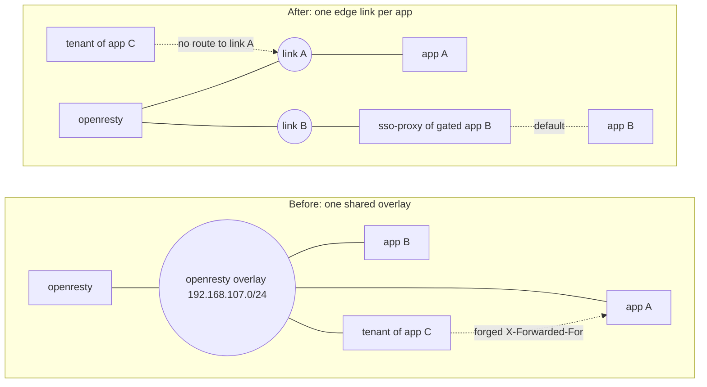

# 071 - Swarm: Per-Application Proxy-Facing Edge Overlay

## User Story

As an operator running Infinito.Nexus in swarm mode, I want every application that trusts the reverse proxy's `X-Forwarded-For` to reach the proxy over its own private edge overlay, so that a tenant on another application's overlay cannot forge a client address that the application, its brute-force throttle, its audit log or its IP allowlist then believes.

This is step 2 of the proxy-trust fix. Step 1 (a separate fix PR) moves the roles that trust all private ranges or `*` onto `proxy_hops`. This requirement makes `proxy_hops` tight under swarm too, so that step 1 is worth something there, and closes the in-stack hops that step 1 had to leave on the old trust.

## Problem

Under swarm, `proxy_hops()` in `utils/networks/proxy.py` returns the full subnet of every overlay the application shares with `svc-prx-openresty`. The proxy joins exactly one overlay, `openresty` `192.168.107.0/24` (`roles/svc-prx-openresty/meta/networks.yml`). Its consumer kind is `web_facing`, and `utils/networks/attachments.py` matches that kind against every role id starting with `web-app-` or `web-svc-`, so about 95 roles share that one overlay.

An application that trusts `192.168.107.0/24` as its proxy therefore trusts every other tenant on that overlay. The proxy appends with `proxy_set_header X-Forwarded-For $proxy_add_x_forwarded_for` (`roles/sys-svc-proxy/templates/headers/forwarded.conf.j2`), so a request that a tenant sends straight to the application with a forged `X-Forwarded-For: 203.0.113.9` reaches the application as `203.0.113.9, 192.168.107.x`, and the application, seeing the last hop inside its trusted subnet, takes the forged value. Impact: brute-force throttles, audit logs and IP allowlists key on an attacker-chosen address.

Some trusted hops also run inside the application's own stack and have no fixed subnet today:

- The oauth2 `sso-proxy` sidecar of a gated application (`roles/web-app-keycloak/templates/sso_proxy/container.yml.j2`). Under compose it has no `networks:` key and lands on `<entity>_default`. Under swarm it joins every network the application joins, DB and tenant overlays included.
- `zammad-nginx` in front of the zammad rails server. Both share several networks, so Docker's embedded DNS may answer with the rails service's address on a tenant or DB network instead of on `default`.
- For an application that provides its own `shared_net` (for example `web-app-zammad`, `web-app-snipe-it`), `utils/networks/render.py` renders `default` without a subnet, so no trust setting can name it. Step 1 therefore leaves `web-app-zammad` and the gated `web-app-snipe-it` trusting all private ranges, marked `# nocheck: forwarded-trust`.

## Rejected Alternatives

- Pin the proxy's IP and trust one address: `docker stack deploy` drops `ipv4_address` (docker/cli `cli/compose/convert/service.go` copies only `Target`, `Aliases` and `DriverOpts` into the network attachment), and an IPAM `ip-range` applies to every container on the overlay, not to one service.
- VIP or endpoint-mode tricks: the proxy's requests carry its task IP, not a virtual IP, so no VIP identifies the proxy.

## Decisions

1. Each trusting application gets one edge link: an overlay joined only by `svc-prx-openresty` and the application-side member, with its own subnet from the network SPOT (`meta/networks.yml` of the application, the same source as every other `networks.local.subnet`). The application-side member is the service the proxy's upstream targets: the application's frontend service, or, for an application gated by the oauth2 sidecar (`sso is_proxy_gated`), its `sso-proxy` sidecar.
2. `resolve_upstream` targets an alias that is unique to the link and owned by the application-side member. The rendered `proxy_pass` target therefore resolves to that member's address on the link, and the proxy's request leaves from the proxy's own task address on the link. This holds for named sidecar routes too: the `<entity>_sso-proxy` route of a gated application resolves through the link, never through the shared overlay.
3. `proxy_hops` under swarm returns the link subnet, plus the stack's `default` subnet when decision 9 applies, and nothing else. Under compose `proxy_hops` returns the same gateway list as before, plus the `default` subnet when decision 9 applies.
4. The shared `openresty` overlay stays for the proxy's own non-trusting consumers until they migrate. An application that has an edge link MUST leave the shared overlay: neither its frontend nor its sidecar keeps an endpoint there, so a tenant can reach it only through the link, which it cannot join.
5. The proxy stack declares every link as an external-or-owned network of its own. Adding a link changes the proxy service's network set, which Swarm applies as a stop-first restart of the proxy. The design MUST batch link additions into the deploy that already restarts the proxy, and MUST NOT restart the proxy once per application.
6. Links MUST exist before either stack deploys. The proxy role creates them in a pre-step ahead of the application stacks, the same ordering as the existing shared overlays.
7. Each link costs one subnet from the subnet SPOT. The allocator MUST reject an exhausted range at lint time, not at deploy time.
8. The effect on swarm CI time is measured, not assumed: the requirement records the wall-clock of the swarm deploy job before and after, and the budget is no more than the cost of one proxy restart per deploy.
9. In-stack hops (the `sso-proxy` sidecar in front of the frontend, or an in-stack web server such as `zammad-nginx` in front of its rails server) run over the stack's `default` network only. The upstream is pinned to `default` by the `<service>.<project>_default` DNS name, or by `default` being the only network both ends share. An application that provides its own `shared_net` gets a second SPOT allocation for `default` (for example `local.default_subnet` in `meta/networks.yml`). Every subnet consumer learns it: `utils/networks/render.py`, `utils/meta/scan.py`, `utils/update_check/network.py`, the network uniqueness test and the address suggest CLI. `proxy_hops` trusts exactly that subnet for the in-stack hop.

## Topology

## Open Questions

- `svc-dns-unbound` sets `ipv4_address: {{ UNBOUND_RESOLVER_IP }}` in `templates/compose.yml.j2`. By the same `docker stack deploy` behaviour that rules out the proxy pin, that address may be dropped under swarm, so the swarm `dns:` of `web-app-mailu` (`192.168.208.53`, from `roles/svc-dns-unbound/meta/networks.yml`) may not hold. This is unverified; a live swarm probe has to confirm or refute it, and it is out of scope here beyond that probe.
- Whether non-trusting `web_facing` roles stay on the shared overlay or all move to links in one wave.
- Whether the swarm `sso-proxy` sidecar still needs the shared redis overlay (`redis_connection_url` points at the shared redis when `svc-db-redis` is deployed) or the tor overlay once it is narrowed to the link and `default`.

## Acceptance Criteria

- [ ] Under swarm, `proxy_hops` of a trusting application without an in-stack hop returns exactly its edge link subnet.
- [ ] Under swarm, `proxy_hops` of a trusting application with an in-stack hop returns exactly its edge link subnet and its `default` subnet.
- [ ] Under swarm, `proxy_hops` never returns the shared `openresty` overlay subnet for an application that has an edge link.
- [ ] Under compose, `proxy_hops` of an application without an in-stack hop returns the same gateway list as before this change.
- [ ] Under compose, `proxy_hops` of an application with an in-stack hop returns the previous gateway list plus its `default` subnet, and nothing else.
- [ ] Each edge link's members are exactly `svc-prx-openresty` and the application-side member of decision 1.
- [ ] Each edge link's subnet comes from the network SPOT.
- [ ] No edge link subnet overlaps any other subnet.
- [ ] Under swarm, `resolve_upstream` renders an alias that is unique to the link.
- [ ] The rendered `proxy_pass` target resolves to the application-side member's address on the link.
- [ ] The rendered `proxy_pass` target resolves to no address on the shared overlay.
- [ ] For a gated application, the `<entity>_sso-proxy` route resolves to the sidecar's address on the link.
- [ ] The frontend of an application with an edge link has no endpoint on the shared overlay.
- [ ] The `sso-proxy` sidecar of a gated application with an edge link has no endpoint on the shared overlay.
- [ ] The proxy stack declares every link.
- [ ] Every link exists before the proxy stack deploys.
- [ ] Every link exists before its application stack deploys.
- [ ] One deploy performs at most one stop-first restart of the proxy, however many links it adds.
- [ ] A live swarm probe container on a foreign overlay fails to connect to the application-side member's address on the link.
- [ ] The same probe container fails to connect to every other address of the frontend, including its former shared-overlay address and any published port reachable from the probe's network.
- [ ] The same probe container fails to connect to every address of a gated application's `sso-proxy` sidecar.
- [ ] A request through the proxy with a forged `X-Forwarded-For` shows the real client address in the application's view.
- [ ] Every application that provides its own `shared_net` has a `default` subnet from the SPOT that overlaps no other subnet.
- [ ] `web-app-zammad` logs the real client address for a request through `zammad-nginx`, under compose and under swarm.
- [ ] The gated `web-app-snipe-it` logs the real client address for a request through its `sso-proxy` sidecar, under compose and under swarm.
- [ ] Neither `web-app-zammad` nor `web-app-snipe-it` trusts a whole private range, and neither carries `# nocheck: forwarded-trust`.
- [ ] The subnet allocator fails at lint time when the link and `default` subnets exhaust the SPOT range.
- [ ] The swarm CI deploy wall-clock before and after is recorded in the PR.
- [ ] The swarm CI deploy wall-clock after the change stays within the budget of decision 8.
- [ ] The open question on `svc-dns-unbound` is answered by a live swarm probe, and the result is recorded here as a follow-up requirement or a closed question.

## Tests

- [ ] Unit test in `tests/unit/python/utils/networks/test_proxy.py`: under swarm `proxy_hops` returns only the link subnet when the application also shares the `openresty` overlay, and raises `ValueError` when the application has no link.
- [ ] Unit test in the same file: `proxy_hops` adds the `default` subnet for a gated application and for `web-app-zammad`, in both modes, and adds nothing for an application without an in-stack hop.
- [ ] Unit test for the subnet allocation of links and `default` subnets: unique, inside the SPOT range, deterministic.
- [ ] Render test of `sso_proxy/container.yml.j2` under swarm: the sidecar joins exactly the link and `default`.
- [ ] Swarm end-to-end probe (act swarm run): the forged-header case and every foreign-overlay connection case of the acceptance criteria, run against at least one trusting application and one gated application.
