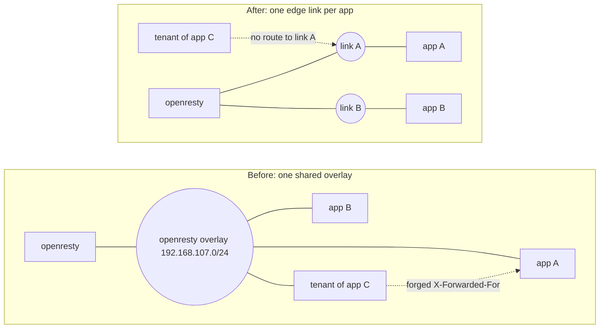

# 071 - Swarm: Per-Application Proxy-Facing Edge Overlay

## User Story

As an operator running Infinito.Nexus in swarm mode, I want every application that trusts the reverse proxy's `X-Forwarded-For` to reach the proxy over its own private edge overlay, so that a tenant on another application's overlay cannot forge a client address that the application, its brute-force throttle, its audit log or its IP allowlist then believes.

This is step 2 of the proxy-trust fix. Step 1 (a separate fix PR) moves the roles that trust all private ranges or `*` onto `proxy_hops`. This requirement makes `proxy_hops` tight under swarm too, so that step 1 is worth something there.

## Problem

Under swarm, `proxy_hops()` in `utils/networks/proxy.py` returns the full subnet of every overlay the application shares with `svc-prx-openresty`. The proxy joins exactly one overlay, `openresty` `192.168.107.0/24` (`roles/svc-prx-openresty/meta/networks.yml`). Its consumer kind is `web_facing`, and `utils/networks/attachments.py` matches that kind against every role id starting with `web-app-` or `web-svc-`, so about 95 roles share that one overlay.

An application that trusts `192.168.107.0/24` as its proxy therefore trusts every other tenant on that overlay. The proxy appends with `proxy_set_header X-Forwarded-For $proxy_add_x_forwarded_for` (`roles/sys-svc-proxy/templates/headers/forwarded.conf.j2`), so a request that a tenant sends straight to the application with a forged `X-Forwarded-For: 203.0.113.9` reaches the application as `203.0.113.9, 192.168.107.x`, and the application, seeing the last hop inside its trusted subnet, takes the forged value. Impact: brute-force throttles, audit logs and IP allowlists key on an attacker-chosen address.

## Rejected Alternatives

- Pin the proxy's IP and trust one address: `docker stack deploy` drops `ipv4_address` (docker/cli `cli/compose/convert/service.go` copies only `Target`, `Aliases` and `DriverOpts` into the network attachment), and an IPAM `ip-range` applies to every container on the overlay, not to one service.
- VIP or endpoint-mode tricks: the proxy's requests carry its task IP, not a virtual IP, so no VIP identifies the proxy.

## Decisions

1. Each trusting application gets one edge link: an overlay joined only by `svc-prx-openresty` and that application's frontend service, with its own subnet from the network SPOT (`meta/networks.yml` of the application, the same source as every other `networks.local.subnet`).
2. `resolve_upstream` targets an alias that is unique to the link (the proxy reaches `<application>` through the link, never through the shared `openresty` overlay), so the proxy's request leaves from its task address on the link.
3. `proxy_hops` under swarm returns the link subnet and nothing else. Compose behaviour is unchanged.
4. The shared `openresty` overlay stays for the proxy's own non-trusting consumers until they migrate; an application that has an edge link MUST NOT also be reached through the shared overlay.
5. The proxy stack declares every link as an external-or-owned network of its own. Adding a link changes the proxy service's network set, which Swarm applies as a stop-first restart of the proxy. The design MUST batch link additions into the deploy that already restarts the proxy, and MUST NOT restart the proxy once per application.
6. Links MUST exist before either stack deploys. The proxy role creates them in a pre-step ahead of the application stacks, the same ordering as the existing shared overlays.
7. Each link costs one subnet from the subnet SPOT. The allocator MUST reject an exhausted range at lint time, not at deploy time.
8. The effect on swarm CI time is measured, not assumed: the requirement records the wall-clock of the swarm deploy job before and after, and the budget is no more than the cost of one proxy restart per deploy.

## Topology

## Open Questions

- `svc-dns-unbound` sets `ipv4_address: {{ UNBOUND_RESOLVER_IP }}` in `templates/compose.yml.j2`. By the same `docker stack deploy` behaviour that rules out the proxy pin, that address may be dropped under swarm, so the swarm `dns:` of `web-app-mailu` (`192.168.208.53`, from `roles/svc-dns-unbound/meta/networks.yml`) may not hold. This is unverified; a live swarm probe has to confirm or refute it, and it is out of scope here beyond that probe.
- Whether non-trusting `web_facing` roles stay on the shared overlay or all move to links in one wave.

## Acceptance Criteria

- [ ] Under swarm, `proxy_hops(application_id, "swarm", ...)` returns exactly the subnet of the application's edge link, and never the `openresty` overlay subnet.
- [ ] Under compose, `proxy_hops` returns the same gateway list as before this change.
- [ ] Each trusting application has its own overlay whose only members are the proxy's frontend service and that application's frontend service, with a subnet from the network SPOT that overlaps no other subnet.
- [ ] `resolve_upstream` under swarm renders a link-unique alias, and the rendered `proxy_pass` target resolves to the proxy's link address and to no address on the shared overlay.
- [ ] The proxy stack declares every link, all links exist before either stack deploys, and one deploy performs at most one stop-first restart of the proxy however many links it adds.
- [ ] A request from a container on another application's overlay, sent straight to the application with a forged `X-Forwarded-For`, does not reach the application at all, and a forged header sent through the proxy is not honoured as the client address.
- [ ] A live swarm probe proves the previous item: a probe container on a foreign overlay fails to connect to the application's link address, and a request through the proxy with a forged `X-Forwarded-For` shows the real client address in the application's view.
- [ ] The subnet allocator fails at lint time when the link subnets exhaust the SPOT range.
- [ ] The swarm CI deploy wall-clock before and after is recorded in the PR and stays within the budget of decision 8.
- [ ] The open question on `svc-dns-unbound` is answered by a live swarm probe and the result is recorded here, either as a follow-up requirement or as a closed question.

## Tests

- [ ] Unit test in `tests/unit/python/utils/networks/test_proxy.py`: under swarm `proxy_hops` returns only the link subnet when the application also shares the `openresty` overlay, and raises `ValueError` when the application has no link.
- [ ] Unit test for the subnet allocation of links: unique, inside the SPOT range, deterministic.
- [ ] Swarm end-to-end probe (act swarm run): the forged-header and foreign-overlay cases of the acceptance criteria, run against at least one trusting application.
