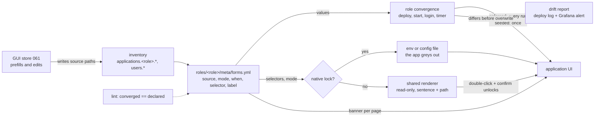

# 072 - Managed Fields: Sync, Lock or Seed

## User Story

As an administrator or user of an application, I want every field that the deployment, the SSO login or a timer writes into that application's own UI to either reach its source, or be visibly locked with that source named, or be set once and then left to me, so that no change I make silently disappears at the next deploy, login or timer run.

## Decisions for managed fields (2026-11-04)

1. Every field an application role converges from the inventory, at deploy, at container start, at login or by a timer, is a managed field. The SSO profile fields below are one group of them; the application settings in [Settings field inventory](#settings-field-inventory-2026-11-04) are the other.
2. Each role declares its managed fields in `roles/<role>/meta/forms.yml`, the single point of truth for both the value and the UI mapping. Per form it holds the admin page `path` and its `fields`; per field the `source`, the `mode`, an optional `when` and the input `selector`, and optionally `label`, `type`, `enum`, `validation` and `description`.
3. `source` is resolved relative to `applications.<role>`; only `users.<key>.<attr>` points to the global users. The role reads every managed value from the `source` its `meta/forms.yml` names, so the lock and the convergence cannot name different fields. `WORDPRESS_OPTIONS_CONTRIBUTED` and `services.sso.profile.locked` move into `meta/forms.yml`.
4. Every field declares its `mode`; there is no default. `mode: enforced` writes the field on every run and locks it in the application; `mode: seeded` writes it once, at install or while it is empty, and leaves it editable without any marker.
5. A secret, a default, the order, the group and the translation key are derived, not declared. A field is secret unless it proves otherwise, fail-closed: it is non-secret only when it declares a `type` other than `password`, its `source` lies outside `users` and `secrets.credentials` and has no segment that looks like a secret or names a credential of the role's `meta/secrets.yml`, its unrendered value is a plain scalar with no template, and neither its old nor its new value holds URL userinfo or contains a credential of the role or a user's password. Its default is the resolved `source`, its order is the YAML order, its group is the form key, and its translation key is `form:<app>:<form>:<field>:label`.
6. An inventory overrides single fields under `applications.<role>.forms`.
7. A locked field uses the application's own lock where one exists (a value set through env or a config file that the application itself renders read-only); otherwise the shared renderer (`roles/sys-front-inj-javascript/templates/profile_lock.js.j2`, generalized from profile fields to every managed field) renders it read-only.
8. A locked field shows a translated sentence that it is managed by the deployment, together with its inventory path. The settings page additionally shows one banner listing every managed field of that page.
9. A double-click on a locked field opens a confirmation dialog; after confirming, the field is editable. The next run still writes the inventory value and reports the drift.
10. A secret field is locked with its value hidden, and nothing (page, log, drift report) shows the value.
11. Before it overwrites an `enforced` field whose value in the application differs from its source, the run reports the field in the deploy log, with the old and the new value only for a field decision 5 finds non-secret and otherwise only that it differs, and raises an event that Grafana (requirement 060) alerts on.
12. A lint keeps `meta/forms.yml` and the role's convergence in step: every field the role converges is declared, and every declared field is converged.
13. The Infinito.Nexus GUI store reads the same `meta/forms.yml` to prefill and edit these fields before the deploy; its requirement 061 in the GUI repository follows this standard.

## Approach

## Decisions for profile fields (2026-11-01)

1. Every application with SSO is inventoried for profile fields the user can edit in the application, that the next SSO login overwrites, and that the application does not write back to Keycloak or LDAP.
2. Where the application can write such a field back on its own, write-back is switched on; otherwise the field is rendered read-only and shows a warning when the pointer rests on it.
3. Joomla keeps overwriting groups from Keycloak and locks its profile fields.
4. A field overwritten by a timer or a deploy counts as overwritten, the same as one overwritten at login.

## Profile field inventory (2026-11-01)

| Role | Field | Editable in app | Overwritten (login, timer or deploy) | Written back | Existing lock | Treatment | Evidence |
|---|---|---|---|---|---|---|---|
| web-app-akaunting | (no SSO-managed profile: one seeded Laravel admin behind the gate) | n/a | no | no | n/a | none needed | read: roles/web-app-akaunting/templates/playwright.env.j2:44 |
| web-app-baserow | first name | yes | yes (login, `X-Forwarded-Name`) | no | none | lock | read: roles/web-app-baserow/files/sso/infinito_sso.py:97-104,243-245 |
| web-app-baserow | language | yes | yes (login, `locale` claim) | no | none | lock | read: roles/web-app-baserow/files/sso/infinito_sso.py:107-119,181-183 |
| web-app-baserow | email | unverified | no (set only when empty) | no | none | none needed | read: roles/web-app-baserow/files/sso/infinito_sso.py:240-242 |
| web-app-baserow | staff/superuser | admin-only | yes (login; bootstrap admin exempt) | no | none | lock | read: roles/web-app-baserow/files/sso/infinito_sso.py:137-148,246-250 |
| web-app-bigbluebutton | name | no for SSO accounts | yes (ResyncOnLogin default true) | no | upstream (UI + API) | keep lock | read: roles/web-app-bigbluebutton/templates/env.j2:119-123; upstream: <https://github.com/bigbluebutton/greenlight/blob/release-3.9.0.1/app/controllers/api/v1/users_controller.rb#L204-L214> |
| web-app-bigbluebutton | email | no | yes | no | upstream | keep lock | upstream: <https://github.com/bigbluebutton/greenlight/blob/release-3.8.0/app/javascript/components/users/user/forms/UpdateUserForm.jsx#L75-L76> |
| web-app-bigbluebutton | language, avatar | yes | no (language first login only; no picture claim) | no | none | none needed | upstream: <https://github.com/bigbluebutton/greenlight/blob/release-3.9.0.1/app/controllers/external_controller.rb#L69> |
| web-app-bigbluebutton | role | admin-only | yes (timer, reconcile_roles.rb) | no | none | lock | read: roles/web-app-bigbluebutton/README.md:20 |
| web-app-bluesky | display name | yes | yes (login broker writes `name` claim) | no | none | lock | read: roles/web-app-bluesky/files/login-broker/server.js:371-402 |
| web-app-bluesky | avatar, banner, description, handle, email | yes | no | no | none | none needed | read: roles/web-app-bluesky/files/login-broker/server.js:349-357,385-391 |
| web-app-bookwyrm | display name, language, time zone | yes | yes (every new session, headers) | no | none | lock | read: roles/web-app-bookwyrm/files/sso/header_auth.py:129-130,153-165 |
| web-app-bookwyrm | groups, is_staff | admin-only (unverified) | yes (login) | no | none | lock | read: roles/web-app-bookwyrm/files/sso/header_auth.py:142-152 |
| web-app-bookwyrm | email, avatar, summary | yes | no (email at provisioning only) | no | none | none needed | read: roles/web-app-bookwyrm/files/sso/header_auth.py:241-251 |
| web-app-checkmk | full name, email, pager | no once LDAP-synced | yes (LDAP sync) | no | upstream (LDAP connector locks synced attributes) | keep lock | read: roles/web-app-checkmk/files/shell/configure-sso.sh:38-41; upstream (commit list only, own-profile page unverified) |
| web-app-checkmk | roles | no when synced | yes (LDAP sync) | no | upstream | keep lock | read: roles/web-app-checkmk/files/shell/configure-sso.sh:42-46 |
| web-app-checkmk | language, personal settings | yes | no | no | none | none needed | read: roles/web-app-checkmk/files/shell/configure-sso.sh:8-13 |
| web-app-dashboard | (no own accounts, browser `oidc.js` only) | n/a | n/a | n/a | n/a | none needed | read: roles/web-app-dashboard/README.md:29 |
| web-app-decidim | name, nickname, email, locale, avatar, URL, about | yes | no | no | none | none needed | upstream: <https://github.com/decidim/decidim/blob/develop/decidim-core/app/commands/decidim/create_omniauth_registration.rb> |
| web-app-decidim | admin flag, user_manager | admin-only | yes (login) | no | none | lock | read: roles/web-app-decidim/files/ruby/initializers/infinito_rbac.rb:25-26,32 |
| web-app-discourse | name | no | yes | no | yes (`auth_overrides_name`, server Guardian) | keep lock | read: roles/web-app-discourse/files/ruby/apply_settings.rb:31 |
| web-app-discourse | email | no | yes | no | yes (`email_editable=false`, `auth_overrides_email`) | keep lock | read: roles/web-app-discourse/files/ruby/apply_settings.rb:29-30; roles/web-app-discourse/files/ruby/verify_settings.rb:27 |
| web-app-discourse | username | staff only | no (`auth_overrides_username=false`) | no | n/a | none needed | read: roles/web-app-discourse/files/ruby/apply_settings.rb:18,32 |
| web-app-discourse | avatar, bio, location, website, locale | yes | no (filled only when blank) | no | none | none needed | upstream: <https://github.com/discourse/discourse/blob/main/lib/auth/managed_authenticator.rb> |
| web-app-discourse | admin/moderator flags | staff only | yes (login + timer) | no | none | lock | read: roles/web-app-discourse/files/ruby/plugins/infinito-rbac-login/plugin.rb:28-38,44 |
| web-app-discourse | associated groups | yes (public groups) / admin | yes (login, interaction with manual joins unverified) | no | none | unverified | read: roles/web-app-discourse/README.md:19 |
| web-app-erpnext | first name, last name | yes | yes (OIDC role app; LDAP `update_user_fields`) | no | none | lock | read: roles/web-app-erpnext/files/python/infinito_rbac/infinito_rbac/login.py:60-79,120-121; roles/web-app-erpnext/files/python/apply/ldap_source.py:52-53 |
| web-app-erpnext | phone, mobile | yes | yes (LDAP login) | no | none | lock (LDAP variant) | read: roles/web-app-erpnext/files/python/apply/ldap_source.py:54-55 |
| web-app-erpnext | email | account key (editability unverified) | no, but a changed email makes the next sign-in create a second account | no | none | lock (identity key) | read: roles/web-app-erpnext/TODO.md:3 |
| web-app-erpnext | language, time zone, avatar | yes | no | no | none | none needed | read: roles/web-app-erpnext/files/python/infinito_rbac/infinito_rbac/login.py:108-109 |
| web-app-erpnext | roles | System Manager | yes (OIDC + LDAP `sync_roles`) | no | none | lock | read: roles/web-app-erpnext/files/python/infinito_rbac/infinito_rbac/login.py:123-131 |
| web-app-espocrm | first/middle/last name, email, phone, gender | yes (upstream, unverified) | yes (OIDC, `ESPOCRM_CONFIG_OIDC_SYNC=true`); LDAP no | no | none | lock | read: roles/web-app-espocrm/templates/env.j2:70; upstream: <https://github.com/espocrm/espocrm/blob/master/application/Espo/Core/Authentication/Oidc/UserProvider/Sync.php> |
| web-app-espocrm | teams, user type | admin-only | yes (OIDC + LDAP hook) | no | none | lock | read: roles/web-app-espocrm/files/php/rbac/group_user_provider.php:51-53,73-86; roles/web-app-espocrm/files/php/rbac/ldap_role_groups.php:81-94 |
| web-app-espocrm | avatar, language, time zone | yes | no | no | none | none needed | upstream: <https://github.com/espocrm/espocrm/blob/master/application/Espo/Core/Authentication/Oidc/UserProvider/DefaultUserInfoPopulator.php> |
| web-app-fider | name, avatar, email | yes | no | no | none | none needed | read: roles/web-app-fider/README.md:24 |
| web-app-fider | role | admin-only | yes (timer) | no | none | lock | read: roles/web-app-fider/README.md:25 |
| web-app-flowise | (single instance account behind gate, no in-app OIDC) | n/a | no | no | n/a | none needed | read: roles/web-app-flowise/README.md:67 |
| web-app-friendica | name, nickname, email, avatar, location, language, time zone | yes | no (ldapauth reads LDAP only at account creation) | no | none | none needed (side effect: admin list rendered from Keycloak emails at deploy) | read: roles/web-app-friendica/TODO.md:58; roles/web-app-friendica/templates/ldapauth.config.php.j2:18-22 |
| web-app-funkwhale | email | yes | yes (LDAP sign-in, `AUTH_LDAP_ALWAYS_UPDATE_USER`) | no | none | lock | read: roles/web-app-funkwhale/templates/settings.py.j2:4; roles/web-app-funkwhale/templates/env.j2:55 |
| web-app-funkwhale | first/last name, username | unverified | yes (LDAP map) | no | none | lock if editable (unverified) | read: roles/web-app-funkwhale/templates/env.j2:55 |
| web-app-funkwhale | permission flags | admin-only | yes (LDAP sign-in) | no | none | lock | read: roles/web-app-funkwhale/templates/settings.py.j2:5; roles/web-app-funkwhale/vars/main.yml:17-22 |
| web-app-funkwhale | avatar, summary, privacy | yes | no | no | none | none needed | read: roles/web-app-funkwhale/templates/env.j2:55 |
| web-app-fusiondirectory | all LDAP attributes (name, mail, uid, phone, address, groups) | yes (ACL holders) | no (edits LDAP live) | yes (native, LDAP) | n/a | write-back (native) | read: roles/web-app-fusiondirectory/README.md:18,22,24 |
| web-app-gitea | full name | no for external users | yes (daily LDAP sync; OAuth2 login no) | no | yes (`EXTERNAL_USER_DISABLE_FEATURES change_full_name`) | keep lock | read: roles/web-app-gitea/templates/env.j2:98 |
| web-app-gitea | email | no for external users | yes (LDAP sync) | no | yes (`manage_credentials`) | keep lock | read: roles/web-app-gitea/templates/env.j2:98 |
| web-app-gitea | username | no for external users | set at registration | no | yes (`change_username`) | keep lock | read: roles/web-app-gitea/templates/env.j2:85,98 |
| web-app-gitea | avatar | yes | yes (LDAP sync when the photo attribute is set; OAuth2 no) | no | none | lock (LDAP users) | read: roles/web-app-gitea/vars/main.yml:21 |
| web-app-gitea | admin/restricted flag | admin-only | yes (OAuth2 group claim + LDAP filters) | no | none | lock | read: roles/web-app-gitea/vars/main.yml:14-15,31-33 |
| web-app-gitea | description, website, location, language | yes | no | no | none | none needed | read: roles/web-app-gitea/vars/main.yml:5-33 |
| web-app-gitlab | name, email | no | yes | no | yes (`sync_profile_attributes`) | keep lock | read: roles/web-app-gitlab/templates/config/gitlab.yml.j2:70-71; roles/web-app-gitlab/files/playwright/playwright.spec.js:117-120 |
| web-app-gitlab | username, avatar, locale, time zone, bio, website | yes | no | no | none | none needed | read: roles/web-app-gitlab/templates/config/gitlab.yml.j2:71 |
| web-app-gitlab | admin/external flags | admin-only | yes (timer) | no | none | lock | read: roles/web-app-gitlab/README.md:18 |
| web-app-grafana | name, email, login | UI disabled; `PUT /api/user` and `PUT /api/users/:id` answer 403 "Cannot update external User" for OAuth accounts (13.3.0) | yes (every login) | no | upstream (UI + API) | keep lock; add warning | read: roles/web-app-grafana/templates/env.j2:29-31; upstream: <https://github.com/grafana/grafana/blob/main/pkg/api/user.go> (user.go:243-247, utils.go:30-53) |
| web-app-grafana | org role | admin-only | yes (`role_attribute_path`, strict) | no | upstream server refusal | keep lock | read: roles/web-app-grafana/templates/env.j2:32-34 |
| web-app-grafana | preferences (theme, time zone, language) | yes | no | no | none | none needed | read: roles/web-app-grafana/templates/env.j2:21-39 |
| web-app-hermes | (one shared dashboard account) | n/a | n/a | n/a | n/a | none needed | read: roles/web-app-hermes/README.md:58 |
| web-app-homeassistant (LDAP only) | display name | admin-only | first login only | no | none | none needed | read: roles/web-app-homeassistant/files/python/ldap_login.py:158-159 |
| web-app-homeassistant | group, active flag | admin-only | yes (timer, align_ldap_users.py) | no | none | lock | read: roles/web-app-homeassistant/files/python/align_ldap_users.py:63-68 |
| web-app-homeassistant | language, time zone, theme | yes | no | no | none | none needed | read: roles/web-app-homeassistant/templates/configuration.yaml.j2:35-44 |
| web-app-jellyfin | avatar | yes | yes, LDAP variant only (photo_sync.py on deploy and timer) | no | none | lock (LDAP variant) | read: roles/web-app-jellyfin/TODO.md:3; roles/web-app-jellyfin/files/shell/configure-auth.sh:178-179 |
| web-app-jellyfin | administrator flag | admin-only | yes (SSO + LDAP login) | no | none | lock | read: roles/web-app-jellyfin/files/shell/configure-auth.sh:171,200,204,211 |
| web-app-jellyfin | preferences, language | yes | no | no | none | none needed | read: roles/web-app-jellyfin/files/shell/configure-auth.sh:195-215 |
| web-app-jenkins | full name | yes | yes (OIDC + LDAP) | no | none | lock | read: roles/web-app-jenkins/templates/casc.yaml.j2:21,35 |
| web-app-jenkins | email | yes | yes (OIDC + LDAP) | no | none | lock | read: roles/web-app-jenkins/templates/casc.yaml.j2:22,36 |
| web-app-jenkins | description, time zone | yes | no | no | none | none needed | read: roles/web-app-jenkins/templates/casc.yaml.j2:20-23 |
| web-app-jitsi | display name, email (meeting profile) | yes (per browser) | yes with keycloak_adapter (token on next join, unverified) | no | none (upstream `readOnlyName`/`disableProfile` unused) | lock | read: roles/web-app-jitsi/templates/keycloak_adapter/context.ts.j2:8-23; upstream: <https://github.com/jitsi/jitsi-meet/blob/master/config.js> |
| web-app-joomla | name, email | no for SSO accounts | yes | no | yes (readonly + server restore, `keycloak_managed`) | keep lock | read: roles/web-app-joomla/files/joomla-oidc-plugin/plg_system_keycloak/src/Extension/Keycloak.php:51-57,120-145,151-159,439 |
| web-app-joomla | language, time zone | no for SSO accounts | yes | no | yes | keep lock | read: roles/web-app-joomla/files/joomla-oidc-plugin/plg_system_keycloak/src/Extension/Keycloak.php:55-56,417-418,437-438 |
| web-app-joomla | profile phone, address, website | no for SSO accounts | yes | no | yes (`managedFields()` from env) | keep lock | read: roles/web-app-joomla/files/joomla-oidc-plugin/plg_system_keycloak/src/Extension/Keycloak.php:165-172,198 |
| web-app-joomla | username | yes | no, but lookup by username: a rename orphans the account | no | none | lock (identity key; 072 Joomla criterion) | read: roles/web-app-joomla/files/joomla-oidc-plugin/plg_system_keycloak/src/Extension/Keycloak.php:52-57,428-430 |
| web-app-joomla | groups | admin-only | yes | no | none | none (Decision 3 keeps overwrite) | read: roles/web-app-joomla/files/joomla-oidc-plugin/plg_system_keycloak/src/Extension/Keycloak.php:413,435 |
| web-app-joomla (LDAP variant) | name, email | yes | no (creation only, upstream unverified) | no | none | none needed | read: roles/web-app-joomla/README.md:37 |
| web-app-keycloak (IdP) | name, email, contact attributes, locale, zoneinfo | yes (account console) | n/a (source) | yes (LDAP WRITABLE) | n/a | none needed (write-back target) | read: roles/web-app-keycloak/vars/main.yml:198-217 |
| web-app-keycloak | username; organization attributes | no (`editUsernameAllowed: false`); admin-only | n/a | yes | realm / user-profile `edit: ["admin"]` | none needed | read: roles/web-app-keycloak/templates/import/realm.json.j2:38 |
| web-app-kix | contact name, email, login, title, phones, address, comment | yes (role rights unverified) | yes (LDAP contact sync on every LDAP sign-in) | no | none | lock | read: roles/web-app-kix/vars/main.yml:50-63,78-84 |
| web-app-kix | roles | admin-only | yes (sign-in) | no | none | lock | read: roles/web-app-kix/vars/main.yml:64-70 |
| web-app-kix | language, preferences | yes | no | no | none | none needed | read: roles/web-app-kix/vars/main.yml:50-63 |
| web-app-lam | all LDAP attributes | yes (admins) | no (LDAP editor) | yes (native, LDAP) | n/a | write-back (native) | read: roles/web-app-lam/README.md:17-18 |
| web-app-listmonk | name | yes | no | no | none | none needed | upstream: <https://github.com/knadh/listmonk/blob/master/cmd/auth.go#L296-L320> |
| web-app-listmonk | email, avatar | no for SSO accounts | n/a (matched by email; picture only from claim) | no | upstream side effect | none needed | read: roles/web-app-listmonk/files/sql/rbac_reconcile.sql:64-65 |
| web-app-listmonk | role, status | admin-only | yes (timer) | no | none | lock | read: roles/web-app-listmonk/files/sql/rbac_reconcile.sql:54-61,73-79 |
| web-app-litellm | email | admin-only | yes (`upsert_sso_user`) | no | none | lock | read: roles/svc-ai-litellm/templates/env.j2:20-24; upstream: <https://raw.githubusercontent.com/BerriAI/litellm/main/litellm/proxy/management_endpoints/ui_sso.py> |
| web-app-litellm | display name (user_alias) | admin-only | first login only | no | none | none needed | upstream: (ui_sso.py above) |
| web-app-litellm | role | admin-only | yes (timer) | no | none | lock | read: roles/web-app-litellm/files/python/rbac_reconcile.py:63 |
| web-app-magento | admin account settings | yes | no | no | none | none needed | read: roles/web-app-magento/README.md:26,37 |
| web-app-magento | admin active state | admin-only | yes (timer) | no | none | lock | read: roles/web-app-magento/files/php/rbac/reconcile_admin_users.php:61-80 |
| web-app-mailu | display name | yes | unverified | no | none | none (Mailu EOL, no fixes) | read: roles/web-app-mailu/templates/env.j2:50-63 |
| web-app-map-animator | (no editable profile) | n/a | n/a | n/a | n/a | none needed | read: roles/web-app-map-animator/README.md:11,17 |
| web-app-mastodon | display name, bio, avatar, email, language, time zone | yes | no (set at creation) | no | none | none needed | upstream: <https://raw.githubusercontent.com/mastodon/mastodon/main/app/models/concerns/user/omniauthable.rb> |
| web-app-mastodon | role | admin-only | yes (login) | no | none | lock | read: roles/web-app-mastodon/files/ruby/zz_oidc_role_sync.rb:5,25-33 |
| web-app-matomo | email, language | yes | no | no | none | none needed | read: roles/web-app-matomo/vars/main.yml:51-67 |
| web-app-matomo | superuser, site access | admin-only | yes (login, existing accounts only; accounts from reconcile) | no | none | lock | read: roles/web-app-matomo/files/php/infinito_rbac_login.php:21,38,132-164; roles/web-app-matomo/TODO.md:4 |
| web-app-matrix | display name | yes | yes (`update_profile_information: true`) | no | none | lock (Synapse `enable_set_displayname: false`) | read: roles/web-app-matrix/templates/flavor/compose/synapse/homeserver.yaml.j2:96; upstream: <https://element-hq.github.io/synapse/latest/usage/configuration/config_documentation.html> |
| web-app-matrix | email (3PID), avatar | yes | no | no | none | none needed | read: roles/web-app-matrix/README.md:24 |
| web-app-matrix | server admin | API only | yes (timer) | no | none | none needed (no in-app form) | read: roles/web-app-matrix/README.md:32 |
| web-app-mattermost | first/last name, username | no for OAuth | yes | no | upstream | keep lock | read: roles/web-app-mattermost/templates/env.j2:58-63; upstream: <https://docs.mattermost.com/administration-guide/onboard/sso-gitlab.html> |
| web-app-mattermost | email | unverified | yes | no | upstream, unverified | lock if editable | upstream: <https://raw.githubusercontent.com/mattermost/mattermost/master/server/channels/app/user.go> |
| web-app-mattermost | nickname, position, avatar, language, time zone | yes | no | no | none | none needed | upstream: (user.go above) |
| web-app-mattermost | system_admin | admin-only | yes (timer) | no | none | lock | read: roles/web-app-mattermost/README.md:16 |
| web-app-mediawiki | real name, email | no (PluggableAuth default) | yes | no | upstream | keep lock | read: roles/web-app-mediawiki/templates/oidc.php.j2:23-49; upstream: <https://www.mediawiki.org/wiki/Extension:PluggableAuth> |
| web-app-mediawiki | language, time zone | no | yes (UserLoggedIn hook) | no | yes (GetPreferences `disabled`) | keep lock | read: roles/web-app-mediawiki/templates/oidc.php.j2:51-86 |
| web-app-mediawiki | groups | admin-only | yes (groupsyncs) | no | none | lock | read: roles/web-app-mediawiki/templates/oidc.php.j2:35-44 |
| web-app-minio | (no user profile) | n/a | n/a | n/a | n/a | none needed | read: roles/web-app-minio/vars/main.yml:18-28 |
| web-app-mobilizon | email | no for provider users | first login | no | upstream | keep lock | upstream: <https://framagit.org/framasoft/mobilizon/-/raw/main/src/views/Settings/AccountSettings.vue> |
| web-app-mobilizon | display name, username, avatar, language, time zone | yes | no (unverified) | no | none | none needed | read: roles/web-app-mobilizon/templates/config.exs.j2:264 |
| web-app-mobilizon | role | admin-only | yes (timer, rbac.exs) | no | none | lock | read: roles/web-app-mobilizon/TODO.md:3 |
| web-app-moodle | name parts, email, phones, address, city, country, institution, department, description, ID number, URL, language, time zone, phonetic names | no | yes (OIDC + LDAP login) | no (`field_updateremote_*` only in the LDAP-only variant) | yes (`field_lock_*: locked`) | keep lock | read: roles/web-app-moodle/tasks/04_oidc.yml:41-97; roles/web-app-moodle/tasks/06_ldap_sync.yml:35-91 |
| web-app-moodle | avatar | yes | no | no | none | none needed | read: roles/web-app-moodle/tasks/04_oidc.yml:41-97 |
| web-app-moodle | Manager, course creator, site admin | admin-only | yes (LDAP login + timer) | no | none | lock | read: roles/web-app-moodle/tasks/06_ldap_sync.yml:93-102 |
| web-app-n8n | first/last name | yes (unverified) | yes (every new session, hook) | no | none | lock | read: roles/web-app-n8n/files/javascript/hooks.js:86-102,141-153 |
| web-app-n8n | email | yes (unverified) | no, but lookup by email header: a change creates a second account | no | none | lock (identity key) | read: roles/web-app-n8n/files/javascript/hooks.js:121-140 |
| web-app-n8n | global role | admin-only | no | no | none | none needed | read: roles/web-app-n8n/files/javascript/hooks.js:129-133 |
| web-app-nextcloud (sociallogin) | display name | yes | yes (`update_profile_on_login`) | no | none (lock rendered for oidc_login only) | lock | read: roles/web-app-nextcloud/meta/addons/sociallogin.yml:80-81; roles/web-app-nextcloud/templates/config/oidc.config.php.j2:5,11 |
| web-app-nextcloud (sociallogin) | email | yes | yes | no | none | lock | read: roles/web-app-nextcloud/meta/addons/sociallogin.yml:80-81 |
| web-app-nextcloud (sociallogin) | address, phone, website | yes | yes if claim present (scope `openid groups`, unverified) | no | none | lock (or none needed if claims absent) | read: roles/web-app-nextcloud/meta/addons/sociallogin.yml:44 |
| web-app-nextcloud (sociallogin) | admin group | admin-only | yes | no | none | lock | read: roles/web-app-nextcloud/meta/addons/sociallogin.yml:45-47,62-63 |
| web-app-nextcloud (LDAP) | display name, email | no | yes (from LDAP) | no | yes (config + read-only LDAP backend) | keep lock | read: roles/web-app-nextcloud/templates/config/oidc.config.php.j2:11; roles/web-app-nextcloud/meta/addons/user_ldap.yml:78,84 |
| web-app-nextcloud (LDAP) | phone, website, organisation, role, biography, quota, avatar | no (user_ldap-mapped) | yes (LDAP login + ldap_refresh.py) | no | upstream read-only | keep lock | read: roles/web-app-nextcloud/meta/addons/user_ldap.yml:59-75; roles/web-app-nextcloud/files/playwright/test-ldap-profile.js:30 |
| web-app-nextcloud (LDAP) | address | yes (set by ldap_refresh.py, not user_ldap) | yes (timer/deploy, ldap_refresh.py) | no | none | lock | read: roles/web-app-nextcloud/TODO.md:4; roles/web-app-nextcloud/files/python/ldap_refresh.py:101-111 |
| web-app-nextcloud | language, locale, headline | yes | no | no | none | none needed | read: roles/web-app-nextcloud/files/playwright/test-ldap-profile.js:28 |
| web-app-odoo | name, email, phone, language, time zone | yes (unverified) | yes (Keycloak + LDAP sign-in) | no | none | lock | read: roles/web-app-odoo/files/addons/auth_oauth_https/models/res_users.py:41-52; roles/web-app-odoo/files/addons/auth_ldap_profile/models/res/company_ldap.py:42-44,69 |
| web-app-odoo | avatar, signature | yes | no | no | none | none needed | read: roles/web-app-odoo/README.md:57 |
| web-app-odoo | managed access groups | admin-only | yes | no | none | lock | read: roles/web-app-odoo/files/addons/infinito_rbac/models/rbac.py:110-131 |
| web-app-openbao | (no self-service profile; alias metadata and groups from claims) | no | yes | no | n/a | none needed | read: roles/web-app-openbao/tasks/utils/oidc.yml:39-41 |
| web-app-openclaw | (identity per request from header) | n/a | n/a | n/a | n/a | none needed | read: roles/web-app-openclaw/README.md:15-16 |
| web-app-opencloud | name, email | no (LDAP read-only; edit link goes to Keycloak) | n/a (read live) | n/a | yes | keep lock | read: roles/web-app-opencloud/templates/env.j2:41,62 |
| web-app-opencloud | language | yes | no | no | none | none needed | read: roles/web-app-opencloud/templates/env.j2:10,30-42 |
| web-app-opencloud | role | admin-only | yes (oidc role driver) | no | none (upstream block unverified) | lock | read: roles/web-app-opencloud/vars/main.yml:21-34 |
| web-app-openproject | first/last name, email, login | yes (unverified for LDAP users) | yes (LDAP sync job, every 24 h) | no | none | lock | read: roles/web-app-openproject/vars/ldap.yml:9-14; upstream: <https://www.openproject.org/docs/system-admin-guide/authentication/ldap-connections/> |
| web-app-openproject | admin flag | admin-only | yes (timer) | no | none | lock | read: roles/web-app-openproject/tasks/06_rbac.yml:2-21 |
| web-app-opentalk | display name, names, email, avatar, groups | unverified | unverified | no | none | unverified | read: roles/web-app-opentalk/templates/controller.toml.j2:15-30; upstream: <https://docs.opentalk.eu/admin/controller/core/oidc/> |
| web-app-openwebui | name | yes | yes (`OAUTH_UPDATE_NAME_ON_LOGIN=true`) | no | none | lock | read: roles/web-app-openwebui/templates/env.j2:121 |
| web-app-openwebui | email | admin-only | yes (`OAUTH_UPDATE_EMAIL_ON_LOGIN=true`) | no | none | lock | read: roles/web-app-openwebui/templates/env.j2:122 |
| web-app-openwebui | role, groups | admin-only | yes (OAuth role and group management) | no | none | lock | read: roles/web-app-openwebui/templates/env.j2:124-131 |
| web-app-openwebui | avatar | yes | no | no | none | none needed | upstream: <https://docs.openwebui.com/features/authentication-access/auth/sso.md> |
| web-app-pixelfed | name, email, username, bio, website, avatar, locale | yes | no | no | none | none needed | upstream: <https://raw.githubusercontent.com/pixelfed/pixelfed/dev/app/Http/Controllers/RemoteOidcController.php> |
| web-app-pixelfed | is_admin | admin-only (unverified) | yes (login) | no | none | lock | read: roles/web-app-pixelfed/files/php/rbac/oidc_login.php:37-58 |
| web-app-penpot | full name | yes | yes (timer/deploy, reconcile.sql) | no | none | lock | read: roles/web-app-penpot/files/sql/rbac/reconcile.sql:10-20; roles/web-app-penpot/TODO.md:4 |
| web-app-penpot | email | yes | no, but it is the profile key: a change detaches the account | no | none | lock (identity key) | read: roles/web-app-penpot/TODO.md:4; roles/web-app-penpot/vars/main.yml:73,85 |
| web-app-penpot | avatar, language, theme | yes | no (no LDAP photo support) | no | none | none needed | read: roles/web-app-penpot/TODO.md:3 |
| web-app-peertube | display name, language | yes | no (creation only, no `userUpdater`) | no | none | none needed | read: roles/web-app-peertube/TODO.md:7; roles/web-app-peertube/vars/oidc-settings.yml:8-9 |
| web-app-peertube | email, avatar, description | yes (email unverified) | no | no | none | none needed | upstream: <https://cdn.jsdelivr.net/npm/peertube-plugin-auth-openid-connect/main.js> |
| web-app-peertube | role | admin-only | yes (timer, reconcile-roles.sql) | no | none | lock | read: roles/web-app-peertube/TODO.md:7; roles/web-app-peertube/tasks/05_rbac.yml:2-20 |
| web-app-pgadmin | email | admin-only | no | no | none | none needed | upstream: <https://raw.githubusercontent.com/pgadmin-org/pgadmin4/master/web/pgadmin/authenticate/oauth2.py> |
| web-app-pgadmin | role | admin-only | yes (timer) | no | none | lock | read: roles/web-app-pgadmin/README.md:30 |
| web-app-phpldapadmin | all LDAP attributes | yes (admins) | no (LDAP editor) | yes (native) | n/a | write-back (native; role EOL) | read: roles/web-app-phpldapadmin/README.md:3,27 |
| web-app-phpmyadmin / pihole / postmarks / prometheus / seaweedfs / workspace / yourls / web-svc-libretranslate | (oauth2-proxy gate only, no own user profile) | n/a | n/a | n/a | n/a | none needed | read: roles/web-app-phpmyadmin/README.md:25; roles/web-app-pihole/README.md:15-16; roles/web-app-postmarks/README.md:20-29; roles/web-app-prometheus/README.md:9; roles/web-app-seaweedfs/README.md:6; roles/web-app-workspace/README.md:5; roles/web-app-yourls/files/sso/infinito_sso.php:103-118; roles/web-svc-libretranslate/README.md:41-44 |
| web-app-pretix | full name | yes | unverified (pinned pretix-oidc 2.3.1 unread) | no | none | lock if set-always confirmed | read: roles/web-app-pretix/vars/main.yml:33-34 |
| web-app-pretix | email | no (upstream form) | unverified | no | upstream | keep lock | upstream: <https://raw.githubusercontent.com/pretix/pretix/master/src/pretix/base/forms/user.py> |
| web-app-pretix | locale, time zone | yes | no | no | none | none needed | upstream: (user.py above) |
| web-app-pretix | SSO team membership, staff flag | admin-only | yes (login) | no | none | lock | read: roles/web-app-pretix/README.md:19 |
| web-app-semaphore | name, email | yes (unverified) | yes (timer, reconcile.sql; login unverified) | no | none | lock | read: roles/web-app-semaphore/files/sql/rbac/reconcile.sql:108-113 |
| web-app-semaphore | username | yes (unverified) | no | no | none | none needed (lock if a rename breaks the match, unverified) | read: roles/web-app-semaphore/files/sql/rbac/reconcile.sql:21-22 |
| web-app-semaphore | admin flag, project role | admin-only | yes (timer) | no | none | lock | read: roles/web-app-semaphore/files/sql/rbac/reconcile.sql:71-77,172-173 |
| web-app-shopware | first/last name, email, locale, time zone, avatar | yes | yes (`keepUserUpdated: true`) | no | none | lock | read: roles/web-app-shopware/files/php/oidc/client.php:143; upstream: <https://raw.githubusercontent.com/HEPTACOM/HeptacomShopwarePlatformAdminOpenAuth/main/src/Service/UserResolver.php> |
| web-app-shopware | username | yes | no | no | none | none needed | upstream: (UserResolver.php above) |
| web-app-shopware | admin flag, ACL roles | admin-only | yes (login + timer) | no | none | lock | read: roles/web-app-shopware/files/php/oidc/client.php:184,190 |
| web-app-snipe-it | first/last name, phone | yes | yes (timer/deploy, `snipeit:ldap-sync`) | no | none | lock | read: roles/web-app-snipe-it/files/php/apply/ldap_config.php:42-61; roles/web-app-snipe-it/vars/main.yml:66-78 |
| web-app-snipe-it | email, job title, department, address, mobile, employee number | admin-only | yes (timer) | no | none | lock | read: roles/web-app-snipe-it/vars/main.yml:67-78 |
| web-app-snipe-it | website, locale, avatar | yes | no | no | none | none needed | upstream: <https://github.com/grokability/snipe-it/blob/master/app/Console/Commands/LdapSync.php> |
| web-app-snipe-it | admin permission, permission group | admin-only | yes (login, SyncRolesOnLogin + timer) | no | none | lock | read: roles/web-app-snipe-it/files/php/login_rbac/src/sync_roles_on_login.php:35,126-149 |
| web-app-stalwart | display name | admin-only | yes (`claimName`) | no | none | lock | read: roles/web-app-stalwart/templates/jmap/directory/create_oidc.json.j2:9 |
| web-app-stalwart | group membership | admin-only | yes (`claimGroups`) | no | none | lock | read: roles/web-app-stalwart/templates/jmap/directory/set_claim_groups.json.j2:3 |
| web-app-stalwart | Roundcube identity, language | yes | no | no | none | none needed | read: roles/web-app-stalwart/templates/roundcube-oauth.inc.php.j2:36 |
| web-app-suitecrm | first/last name | yes | yes (SAML + LDAP sign-in) | no | none | lock | read: roles/web-app-suitecrm/files/php/iam/saml_directory_sync.php:95-109,137-159; roles/web-app-suitecrm/files/php/iam/profile_ldap_user_provider.php:70-107 |
| web-app-suitecrm | phone, mobile, title, department, address | yes | yes (SAML + LDAP sign-in) | no | none | lock | read: roles/web-app-suitecrm/vars/main.yml:60-71 |
| web-app-suitecrm | email, username | yes / no | first login only | no | none | none needed | read: roles/web-app-suitecrm/templates/env.j2:44 |
| web-app-suitecrm | language, time zone | yes | no | no | none | none needed | read: roles/web-app-suitecrm/vars/main.yml:60-76 |
| web-app-suitecrm | is_admin | admin-only | yes (SAML sign-in + timer) | no | none | lock | read: roles/web-app-suitecrm/files/php/iam/saml_directory_sync.php:106-108,124-135 |
| web-app-taiga | full name | yes | yes (OIDC `update_user` + LDAP) | no | none | lock | read: roles/web-app-taiga/templates/settings/config.append.py.j2:49,74 |
| web-app-taiga | email | yes | OIDC no; LDAP yes | no | none | lock (LDAP path) | read: roles/web-app-taiga/templates/settings/config.append.py.j2:73 |
| web-app-taiga | username | yes | no at pinned ref; LDAP lookup by username | no | none | lock (identity key) | read: roles/web-app-taiga/README.md:49; roles/web-app-taiga/TODO.md:6 |
| web-app-taiga | language, time zone | yes (time zone UI unverified) | not at pinned ref; yes after ref bump | no | none | lock (with the ref bump) | read: roles/web-app-taiga/templates/settings/config.append.py.j2:50-51; roles/web-app-taiga/TODO.md:6 |
| web-app-taiga | bio, photo, theme | yes | no | no | none | none needed | read: roles/web-app-taiga/templates/settings/config.append.py.j2:30-75 |
| web-app-taiga | superuser/staff | admin-only | yes (timer) | no | none | lock | read: roles/web-app-taiga/README.md:47-48 |
| web-app-wazuh | (no stored profile, built per request) | n/a | n/a | n/a | n/a | none needed | read: roles/web-app-wazuh/templates/config.yml.j2:22-48 |
| web-app-weblate | full name, email, username, language, avatar | yes | no (name only when empty; email protected) | no | none | none needed | upstream: <https://raw.githubusercontent.com/WeblateOrg/weblate/main/weblate/accounts/pipeline.py> |
| web-app-weblate | superuser, team membership | admin-only | yes (timer) | no | none | lock | read: roles/web-app-weblate/tasks/utils/rbac.yml:2-23 |
| web-app-wordpress | first/last name, email, website, display name, locale | yes, but locked for SSO users | yes (every login) | no | yes (JS readOnly/disabled + `$_POST` restore) | keep lock; add warning | read: roles/web-app-wordpress/files/mu-plugins/infinito-oidc-rbac-mapper.php:24-38,266-297,310-338 |
| web-app-wordpress | same fields, admin editing another user + REST `/wp/v2/users` | yes | yes | no | missing (only `show_user_profile`/`personal_options_update` hooked) | extend lock | read: roles/web-app-wordpress/files/mu-plugins/infinito-oidc-rbac-mapper.php:31-32 |
| web-app-wordpress | nickname, bio, avatar | yes | no (nickname at creation, unverified at pin) | no | none | none needed | read: roles/web-app-wordpress/meta/addons/daggerhart-openid-connect-generic.yml:31 |
| web-app-wordpress | role, blog membership, super admin | admin-only | yes (login) | no | none | lock | read: roles/web-app-wordpress/files/mu-plugins/infinito-oidc-rbac-mapper.php:17-23,121-214 |
| web-app-xwiki | first/last name, email, phone, address, website, language, time zone | yes | yes (every OIDC login) | no | none | lock | read: roles/web-app-xwiki/README.md:21; roles/web-app-xwiki/vars/main.yml:71-77; upstream: <https://raw.githubusercontent.com/xwiki-contrib/oidc/master/oidc-authenticator/src/main/java/org/xwiki/contrib/oidc/auth/internal/OIDCUserManager.java> |
| web-app-xwiki | company | yes | LDAP mode only | no | none | lock (LDAP mode) | read: roles/web-app-xwiki/vars/main.yml:57-58 |
| web-app-xwiki | administrator first/last name, email, active (deploy-provisioned) | yes | not stored at deploy (malformed object XML) | no | none | none needed for 072 (provisioning bug tracked) | read: roles/web-app-xwiki/TODO.md:6 |
| web-app-xwiki | about, avatar | yes | no | no | none | none needed | read: roles/web-app-xwiki/vars/main.yml:72-77 |
| web-app-xwiki | XWikiAdminGroup | admin-only | yes (OIDC groups mapping; LDAP group_mapping) | no | none | lock | read: roles/web-app-xwiki/templates/xwiki.properties.j2:20 |
| web-app-zammad | first/last name, email, phone | admin and agents only | yes (OIDC sign-in + LDAP import) | no | none | lock | read: roles/web-app-zammad/templates/zz/oidc/group_role_mapping.rb.j2:44-66,118-128 |
| web-app-zammad | address | API only (inactive attributes) | yes | no | hidden by default | lock (API) | read: roles/web-app-zammad/vars/main.yml:90-94 |
| web-app-zammad | mobile, department, note, login | admin and agents | yes (LDAP import schedule) | no | none | lock (LDAP mode) | read: roles/web-app-zammad/vars/main.yml:102-111 |
| web-app-zammad | roles | admin-only | yes (login + LDAP import) | no | none | lock | read: roles/web-app-zammad/templates/zz/oidc/group_role_mapping.rb.j2:68-95 |
| web-app-zammad | language, avatar | yes | no | no | none | none needed | read: roles/web-app-zammad/vars/main.yml:85-94 |
| web-svc-xmpp | vCard fields | no (read-only from LDAP) | read live | no | yes (upstream ejabberd) | none needed | read: roles/web-svc-xmpp/templates/configuration.yml.j2:79-81 |
| web-svc-xmpp | avatar (PEP) | yes | no | no | none | none needed | unverified |
| svc-ai-agent-broker / svc-ai-agent-provisioner | (API services, no profile UI) | n/a | n/a | n/a | n/a | none needed | read: roles/svc-ai-agent-broker/README.md:9,14; roles/svc-ai-agent-provisioner/README.md:5,9 |

Existing locks to reuse:

- Joomla managed-user switch and field list: roles/web-app-joomla/files/joomla-oidc-plugin/plg_system_keycloak/src/Extension/Keycloak.php:51-57,165-172,439
- Joomla readonly form fields: roles/web-app-joomla/files/joomla-oidc-plugin/plg_system_keycloak/src/Extension/Keycloak.php:120-129
- Joomla server-side restore of submitted values: roles/web-app-joomla/files/joomla-oidc-plugin/plg_system_keycloak/src/Extension/Keycloak.php:131-145,151-159
- WordPress field selectors and managed-user check: roles/web-app-wordpress/files/mu-plugins/infinito-oidc-rbac-mapper.php:37-38,303-305
- WordPress client lock and `$_POST` restore: roles/web-app-wordpress/files/mu-plugins/infinito-oidc-rbac-mapper.php:310-338
- Moodle `field_lock_*: locked`: roles/web-app-moodle/tasks/04_oidc.yml:41-97 and roles/web-app-moodle/tasks/06_ldap_sync.yml:35-91
- MediaWiki GetPreferences `disabled`: roles/web-app-mediawiki/templates/oidc.php.j2:80-86
- GitLab `sync_profile_attributes`: roles/web-app-gitlab/templates/config/gitlab.yml.j2:70-71
- Discourse `auth_overrides_*` and `email_editable`: roles/web-app-discourse/files/ruby/apply_settings.rb:29-32
- Gitea `EXTERNAL_USER_DISABLE_FEATURES`: roles/web-app-gitea/templates/env.j2:98
- Nextcloud `allow_user_to_change_display_name`, oidc_login flavour only: roles/web-app-nextcloud/templates/config/oidc.config.php.j2:11
- Nextcloud LDAP-mapped read-only fields: roles/web-app-nextcloud/meta/addons/user_ldap.yml:59-84
- OpenCloud read-only LDAP and account-edit link to Keycloak: roles/web-app-opencloud/templates/env.j2:41,62
- Keycloak `editUsernameAllowed: false`: roles/web-app-keycloak/templates/import/realm.json.j2:38
- ejabberd vCards from LDAP: roles/web-svc-xmpp/templates/configuration.yml.j2:79-81
- Client-side injection carrier (page only, needs a server guard per app): roles/web-app-suitecrm/templates/javascript.js.j2:2

Open classification:

- web-app-opentalk: no profile-sync code in the role; the docs do not say whether later logins refresh names, email, avatar or groups.
- web-app-pretix: the pinned pretix-oidc 2.3.1 source could not be fetched, so the full-name overwrite is unknown.
- web-app-mailu: later-login behaviour of the heviat OIDC fork is unverified (Mailu EOL).
- web-app-discourse: how the login refresh of associated groups interacts with manual membership is unverified.
- web-app-mattermost: the email lock for GitLab-slot users is not confirmed upstream.
- web-app-nextcloud: whether phone, address and picture claims arrive in the sociallogin flavour with scope `openid groups` is unproven.
- web-app-openwebui: whether the LDAP login overwrites name or email is unverified.
- web-app-semaphore: whether the login itself overwrites name and email, and whether external users can edit their own profile, are unverified.
- web-app-taiga: the pinned ref differs from the README claim, and the LDAP plugin 0.5.0 source is unconfirmed.
- web-app-funkwhale: whether first name, last name and username are editable is unverified.
- web-app-xwiki: only the master source of the OIDC authenticator was read, not the pinned version.
- web-app-espocrm: own-profile editability is not confirmed upstream.
- web-app-odoo: own-profile editability is not confirmed upstream.
- web-app-openproject: own-profile editability for LDAP users is not confirmed upstream.
- web-app-kix: which roles may edit their own contact record is not confirmed upstream.
- web-app-baserow: email editability is unverified.
- web-app-n8n: whether an email change needs the password the user never saw is unverified.
- web-app-jitsi: whether a new token join replaces a name changed in the browser is unverified.
- web-app-checkmk: whether the user's own profile page respects the LDAP lock is unverified.
- web-app-gitea: the per-login re-sync of the admin flag comes from helper functions; the function that applies it was not read.
- web-app-wordpress: nickname set only at creation is unverified at the pinned plugin version.

## Settings field inventory (2026-11-04)

Application settings that a role converges, apart from the profile fields above. Evidence paths are relative to `roles/<role>/` unless they name another role; `pr` is read at the cited line, `der` is derived.

When:

- **E**: written on every deploy, or on drift at every deploy; an admin edit is reverted.
- **B**: written at every container start or request, through env or a config file that outranks the UI.
- **O**: written only while the field is unset, at the upstream default, or still holds the role's last value; an admin edit survives.
- **S**: seeded at install, at create, while empty, or at first boot.
- **Dflt**: env or file default only; once an admin saves in the UI, the database wins over the inventory for good.
- **+T**: a timer writes it as well.

| Role | Field group @ admin page | Source | When + evidence | Secret | Native lock | Role-side lock or hint today | pr/der |
| --- | --- | --- | --- | --- | --- | --- | --- |
| web-app-nextcloud | Theming name, slogan, colour, logos, favicon @ /settings/admin/theming | design.label, service_provider.platform.subtitel, web-svc-design palette, design logo | E while design is on; tasks/02_manager_ops/08_design.yml:28-46 | no | none known | none | pr |
| web-app-nextcloud | Email server SMTP host, port, security, user, password, from @ /settings/admin | lookup('email') | B, the image's smtp.config.php reads env on every request; templates/env.j2:12-22 | yes | none; the role pins `config_is_read_only => false` (templates/config/read_only.config.php.j2:3) | none | pr; UI der |
| web-app-nextcloud | LDAP settings incl. bind password @ /settings/admin/ldap | LDAP.*, LDAP.BIND_CREDENTIAL | E on drift; meta/addons/user_ldap.yml:15-165, tasks/02_manager_ops/06_plugin/04_configure.yml:11-36, tasks/addons/user_ldap.yml:47-59 | yes | none | none | pr |
| web-app-nextcloud | Social Login OIDC provider and switches @ /settings/admin/sociallogin | OIDC.CLIENT.*, RBAC.GROUP.CLAIM | E; meta/addons/sociallogin.yml:17-80 | yes | none | none | pr |
| web-app-nextcloud | Talk HPB, STUN, TURN, recording; Collabora, ONLYOFFICE, BBB, Whiteboard endpoints and JWT @ /settings/admin/talk, /richdocuments, /onlyoffice | NEXTCLOUD_HPB_*, partner lookup('tls'), partner secrets | E; meta/addons/spreed.yml:15-55, richdocuments.yml:14-22, onlyoffice.yml:19-36, bbb.yml:14-20, whiteboard.yml:11-16 | yes | none | none | pr |
| web-app-nextcloud | Connected accounts (OpenProject, GitLab, Zammad, SuiteCRM, OpenAI) | partner lookup('tls'), lookup('api'), partner OAuth apps | E on drift; GitLab and Zammad credentials S while empty (tasks/addons/integration_gitlab.yml:23-29, integration_zammad.yml:29-36) | yes | none | none | pr |
| web-app-nextcloud | App enabled state @ /settings/apps | addons.<app>.enabled | E; tasks/02_manager_ops/06_plugin.yml:8-13,82-90 | no | none | none | pr |
| web-app-wordpress | WordPress Address, Site Address @ /wp-admin/options-general.php | lookup('tls','url.base') | E on drift, then a DB-wide search-replace; tasks/08_update_domain.yml:21-49 | no | WP_HOME and WP_SITEURL constants exist, not defined | none | pr |
| web-app-wordpress | Permalink structure; anyone can register, network registration | literal; login.method.registration.enabled | E; tasks/07_manager_ops.yml:47-85 | no | none | none | pr |
| web-app-wordpress | Site Title (blogname), Site Icon, Logo, global styles | design.label, design logo and palette | S at install (tasks/02_install.yml:24-35), then O (files/php/design.php:46-57,103-121) | no | none | ownership marker option | pr |
| web-app-wordpress | Administration Email Address | users.platform_administrator.email | S at install; tasks/02_install.yml:31 | no | none | none | pr |
| web-app-wordpress (branch feature/web-app-wordpress/options-simplify) | admin_email, blogname, FreedomTranslate options, services.wordpress.options | users.platform_administrator.email, design.title while design is on | E on drift; WORDPRESS_OPTIONS_CONTRIBUTED in vars/main.yml on that branch | no | pre_option filter possible | none | pr |
| web-app-wordpress | OpenID Connect Client settings | OIDC.* via env WORDPRESS_OIDC_SETTINGS | B per request through a pre_option filter, the stored copy deleted every deploy; files/mu-plugins/infinito-oidc-client.php:28-66 | yes | pre_option filter (used) | submenu removed, page answers 403, pre_update_option keeps the value | pr |
| web-app-wordpress | AI Engine environment; FreedomTranslate API; WP Discourse connect URL and API key | addons.*.config | E, whole option arrays; tasks/addons/ai-engine-stack-host.yml:6-27, freedomtranslate-wp-stack-host.yml:7-16, wp-discourse.yml:23-58 | yes | none | none | pr |
| web-app-joomla | Site Name @ Global Configuration | design.label | S at install (tasks/03_install.yml:69), then E while design is on (tasks/09_design.yml:79-100) | no | none | none | pr |
| web-app-joomla | User registration; auth, WebAuthn and MFA plugin states; LDAP auth plugin params; User Profile plugin fields | login.method.*, LDAP.*, addons.plg_system_keycloak.config.profile | E; tasks/11_login_methods.yml:2-15, files/php/ldap_plugin.php:49-73, tasks/08_oidc_plugin.yml:95-107 | yes (LDAP) | none | none | pr |
| web-app-joomla | Atum and Cassiopeia template styles, TinyMCE skin | design palette and logo | E; tasks/09_design.yml:50-78 | no | none | none | pr |
| web-app-joomla | Mail From email | platform administrator email | S at install; tasks/03_install.yml:67 | no | none | none | der |
| web-app-moodle | Debugging; enabled auth plugins and self-registration; MFA factors; web services | lookup('debug'), login.method.*, MCP | E; tasks/01_manager_ops.yml:77-86, 05_login_methods.yml:2-34, files/php/provision/mcp.php:14-19 | no | config.php forcing available, unused | none | pr |
| web-app-moodle | auth_oidc and auth_ldap settings | OIDC.*, LDAP.* | E on drift; tasks/04_oidc.yml:25-110, 06_ldap_sync.yml:14-111 | yes | forced_plugin_settings available, unused | plugin_config.php refuses to write forced keys | pr |
| web-app-moodle | Object storage (tool_objectfs) S3 | lookup('objstore') via env | B through $CFG->forced_plugin_settings; files/build/config.php:61-80 | yes | yes, "defined in config.php" (used) | native | pr; UI der |
| web-app-moodle | AI provider and placements | MOODLE_LITELLM_*, LITELLM_CHAT_MODEL | E; tasks/utils/ai_gateway.yml:4-30 | yes | none | none | pr |
| web-app-moodle | Site full and short name; Boost colour, SCSS, logos, favicon | design.label, palette, logo | S at install (tasks/01_manager_ops.yml:30-39), then O (files/php/provision/design.php:21-103) | no | none | marker | pr |
| web-app-xwiki | Colour theme, logo, wiki title, main wiki domain and secure flag, guest register right | palette, design.label, lookup('domain'), login.method.registration | E on drift; tasks/06_design/apply.yml:63-92, 07_wiki_descriptor.yml:46-77, 08_registration.yml:55-82 | no | none | none | pr |
| web-app-friendica | Site name, frio colours, icon @ /admin/site | design title, logo, palette | Dflt, the file loses to an admin save; templates/design.config.php.j2:1-24 | no | n/a | none | pr |
| web-app-friendica | Debugging and log level @ /admin/logs; addon state | lookup('debug') via env; addons.* | B, env beats the admin value (templates/env.j2:7-9); addons E (tasks/03_addons.yml:63-80) | no | none (not greyed out) | none | pr; UI der |
| web-app-matomo | Global excluded IPs and user agents; trusted hostnames | services.matomo.excluded_ips, literal; lookup('domain') | E, whole list replaced; tasks/07_config.yml:2-34, 06_patch_trusted_hosts.yml:2-18 | no | none | none | pr |
| web-app-matomo | RebelOIDC and InfinitoRbacLogin settings | OIDC.*, RBAC.GROUP.CLAIM | E, whole config.ini.php section; tasks/addons/rebeloidc.yml:13-29 | yes | yes, a config.ini.php value makes the SystemSetting non-writable (core/Settings/Plugin/SystemSetting.php) (used) | native | pr |
| web-app-matomo | Active theme; first site name, URL, time zone | services.design.enabled; design.label, url, HOST_TIMEZONE_LABEL | theme E (tasks/09_design.yml:27-38); site S (tasks/02_manager_ops.yml:2-18) | no | none | none | pr/der |
| web-app-discourse | force_https, local and email logins, new registrations, email_editable, auth_overrides_*, site_settings @ /admin/site_settings | lookup('tls').enabled, login.method.*, services.discourse.site_settings | E; files/ruby/apply_settings.rb:6-34 | no | none (not shadowed_by_global) | none | pr |
| web-app-discourse | LDAP and OIDC plugin settings | LDAP.*, OIDC.CLIENT.* | E; meta/addons/discourse-ldap-auth.yml:12-25, files/ruby/apply_settings.rb:16-29 | yes | none | none | pr |
| web-app-discourse | allowed_internal_hosts | OIDC, LiteLLM and translate hosts | E, add-only; files/ruby/apply_settings.rb:36-42 | no | none | none | pr |
| web-app-discourse | AI LLM (URL, model, key), translator, Mermaid component | LITELLM_*, litellm_api_key, addons.* | E; templates/ai_gateway/register.rb.j2:1-17, translator/register.rb.j2:4-7, mermaid/install.rb.j2:3-7 | yes | none | none | pr |
| web-app-discourse | Site title, logos, favicon; theme assignment, colour palettes, SCSS component | design.title, logos; colors.base | O (files/ruby/design.rb:40-112); E (design.rb:22-33,86-100) | no | none | none | pr |
| web-app-gitlab | Password auth for web; sign-up enabled @ /admin/application_settings/general | login.method.native, registration | E; files/ruby/apply_login_methods.rb:10-25 | no | none known | none | pr |
| web-app-gitlab | Appearance title, PWA name, logos @ /admin/application_settings/appearance | design.label, logos | O, ownership per record; files/ruby/appearance.rb:17-41 | no | none | none | pr |
| web-app-mastodon | Site title; favicon, app icon, thumbnail; custom CSS block @ /admin/settings/branding | design.title, MASTODON_DESIGN_UPLOADS | E, no ownership check; files/ruby/design.rb:18-68 | no | none | none | pr |
| web-app-mastodon | Registrations mode | login.method.registration.enabled | E; files/ruby/ensure/registrations_mode.rb:8-11 | no | none | none | pr |
| web-app-decidim | Organization host, registration mode, OIDC enabled @ /system/organizations/:id/edit | lookup('domain'), login.method.* | E; files/ruby/set_organization_host.rb:3-5, ensure/registration_mode.rb:7-12, configure_oidc.rb:6-11 | no | none known | none | pr |
| web-app-decidim | Organization name, colours, logo, favicon | design.label, title, palette | S at create (files/ruby/ensure/organization.rb:5-20), then O (ensure/design.rb:15-68) | no | none | none | pr |
| web-app-bigbluebutton | Greenlight RegistrationMethod; colours and branding image | login.method.*; palette and design logo | E (files/ruby/greenlight/registration_method.rb:7-14); O (files/ruby/site_design.rb:24-35) | no | none | none | pr |
| web-app-mobilizon | Instance colours, logo, favicon; instance name, registrations open | palette, design; env (design label, registration) | O (files/elixir/design.exs:12-79); Dflt (templates/env.j2:3,9) | no | n/a | none | pr |
| web-app-peertube | Signup, instance name, admin email, custom CSS, theme colours, live, transcoding, single-auth redirect @ /admin/config/edit-custom | login.method.*, design.title and logo, lookup('email').from, services.peertube.live.enabled | B, custom-environment-variables outrank local-production.json; templates/env.j2:4-76 | no | none known (the UI accepts saves) | none | pr; runtime der |
| web-app-peertube | Instance logos; auth-openid-connect plugin settings | design logos; OIDC.* | O (tasks/design/apply.yml:39-63); E via SQL (files/sql/upsert-oidc-plugin.sql:5-14) | yes (plugin) | none | none | pr |
| web-app-pixelfed | Site name (app.name); custom CSS block and toggle @ /admin/settings | design.title | E; files/php/design.php:35-54 | no | none | none | pr |
| web-app-pixelfed | Registration, limits, stories, OIDC enabled | env | Dflt, the DB row wins once saved; templates/env.j2:6-42,145 | no | none | none | der |
| web-app-funkwhale | Instance name, theme colours, CSS, logo, banner @ /manage/settings | design.label, palette | E while ui__custom_css carries the role marker; files/python/design_preferences.py:18-46 | no | none | marker in CSS | pr |
| web-app-bookwyrm | Instance name, logos, favicon, theme row @ /settings/site-settings | design.label, images | E, admin uploads replaced; files/python/site_design.py:83-130 (default theme S) | no | none | none | pr |
| web-app-socialhome | Household name, primary colour | design.title, palette | O via marker file; tasks/02_design/converge.yml:24-70 | no | unknown | none | pr; UI der |
| web-app-mattermost | Site URL, Site Name, SMTP, sign-in, sign-up, MFA, GitLab-slot OIDC, personal access tokens, plugin uploads, S3, log level, metrics @ System Console | lookup('tls'), design.title, lookup('email'), login.method.*, OIDC.CLIENT.*, lookup('objstore'), lookup('debug') | B via env; templates/env.j2:3-70 | yes | yes, "set through an environment variable" (docs.mattermost.com/administration-guide/configure/environment-variables.html) (used) | none | pr |
| web-app-mattermost | Jenkins plugin URL; Agents plugin service, bot, key, model; Agents MCP switch @ Plugins | lookup('tls','web-app-jenkins'), LITELLM_*, litellm_api_key | E via mmctl or SQL, stored in the DB and editable; tasks/utils/addon/runnable.yml:7-24, utils/ai_gateway.yml:23-60, utils/mcp/server.yml:22-33 | yes | none | none | pr |
| web-app-mattermost | Team display name; allow open invite | ORGANIZATION; constant | S (tasks/01_setup.yml:54-64); E (01_setup.yml:66-71) | no | none | none | pr |
| web-app-gitea | APP_NAME, ROOT_URL, DOMAIN, SSH, mailer, registration, password, passkey, OpenID, OAuth2 switches, themes @ Site Administration > Configuration | design, lookup('tls'), lookup('domain'), lookup('email'), login.method.* | B, env rendered into app.ini; templates/env.j2:3-102 | yes (mailer) | app.ini values shown read-only (der) | none | pr; lock der |
| web-app-gitea | LDAP source; OAuth2 source "SSO Login" @ Authentication Sources | LDAP.*, OIDC.CLIENT.*, RBAC.GROUP.CLAIM | E; tasks/setup/ldap.yml:30-41, setup/oidc.yml:21-31 | yes | none (CLI-created sources are editable) | none | pr |
| web-app-grafana | Root URL, domain, cookie, signout; sign-up, org create, login form, anonymous, basic auth @ Administration > Settings | lookup('tls'), login.method.* | B via env; templates/compose.yml.j2:12-16, env.j2:7-13 | no | read-only settings view (der) | none | pr/der |
| web-app-grafana | Generic OAuth @ Administration > Authentication | OIDC.*, RBAC.GROUP.CLAIM | Dflt, env seeds and a UI save goes to the DB and wins; templates/env.j2:19-40 | yes | removing generic_oauth from `[auth] sso_settings_configurable_providers` (der, unused) | none | pr |
| web-app-grafana | Data sources, dashboard folder, contact point, policy, alert rule; Loki ruler rule | GRAFANA_LOKI_*, GRAFANA_PROMETHEUS_URL, GRAFANA_LOG_ALERT_*, services.loki.alerting.* | B via provisioning; templates/provisioning/*.yml.j2, web-svc-loki/templates/rules.yaml.j2:4-14 | no | yes, editable:false, allowUiUpdates:false, "Provisioned"; the Loki local ruler is read-only (used) | none | pr/der |
| web-app-jenkins | System message, executors, URL; security realm (OIDC, LDAP, local); role-based authorization | SOFTWARE_NAME, lookup('tls'), OIDC.*, LDAP.*, JENKINS_AUTHORIZATION_ROLES | B via JCasC at boot; templates/casc.yaml.j2:7-73 | yes | none | system message "Managed by" | pr |
| web-app-keycloak | Realm email and SMTP (app and master); loginWithEmail, duplicateEmails, adminEvents, adminPermissions | lookup('email') | E deep-merge, the masked password rewritten every run; vars/main.yml:259-272, files/python/realm/settings.py, tasks/03_manager_ops/update_routines.yml:6 | yes | none | none | pr |
| web-app-keycloak | registrationAllowed, resetPassword, rememberMe, verifyEmail, brute force, password policy, i18n, lifespans | constants, KEYCLOAK_EMAIL_VERIFY | S at realm import (tasks/04_realm_import.yml:9-16); verifyEmail also on an email-policy switch (update_routines.yml:80-89) | no | none | none | pr |
| web-app-keycloak | Display name, HTML display name; login, account, admin theme | design.title, services.keycloak.design.theme | O; files/shell/sync_realm_design.sh:47-78 | no | none | none | pr |
| web-app-keycloak | Clients (redirect URIs, web origins, logout URIs, secrets, scopes), mappers | lookup('redirect_uris'), OIDC.CLIENT.SECRET | E, lists replaced wholesale; files/python/realm/settings.py converge_client, converge_scope_lists | yes | none | none | pr |
| web-app-keycloak | LDAP user federation | LDAP.*, services.ldap.sync.period.* | E; tasks/update/03_ldap/main.yml:2-18,213-235 | yes | none | none | pr |
| web-app-keycloak | User profile config, UPDATE_EMAIL action, reCAPTCHA, realm-management role mappings, fine-grained admin permissions | KEYCLOAK_PROFILE_ATTRIBUTES, reCAPTCHA secrets, meta/rbac.yml | E; tasks/update/05_userprofile.yml:12-18, 12_required_actions.yml:28-37, 04_recaptcha.yml:38-48, 09_console_rbac.yml:15-24, 15_admin_permissions.yml:2-13 | yes (reCAPTCHA) | none | FGAP name prefix and description hash (files/python/rbac/admin_permissions.py:10-11,173) | pr |
| web-app-openproject | App title, host name, protocol, default theme @ Administration > General, Design | design.label, lookup('domain'), lookup('tls') | B via env; templates/env.j2:3-16 | no | yes, non-writable settings render disabled (app/helpers/settings_helper.rb) (der) | none | pr/der |
| web-app-openproject | SMTP; LDAP connection; GitLab webhook secret | lookup('email'), OPENPROJECT_LDAP.*, gitlab_webhook_secret | E on drift; files/sql/select/admin-state.sql:38-48, tasks/04_admin.yml:19-24, 03_ldap.yml:16-38 | yes | none (DB) | none | pr |
| web-app-n8n | LiteLLM credential; MCP bearer credential and workflow | LiteLLM URL and key, N8N_MCP_* | E via PATCH; files/python/provision/ai.py:81-104, mcp.py:256-400 | yes | none | none | pr |
| web-app-openwebui | Connections, images, RAG, audio, code execution, web search, sign-up, default role, admin email, LDAP, tool servers @ Admin Panel > Settings | LITELLM_*, OPENWEBUI_*, login.method.*, users.platform_administrator.email, LDAP.* | B via env with ENABLE_PERSISTENT_CONFIG=false; templates/env.j2:5-155 | yes | none, UI saves are lost on restart (docs.openwebui.com/reference/env-configuration) | none | pr |
| web-app-openwebui | MCP grants, agent model access | OPENWEBUI_MCP_* | E via API; files/python/provision_mcp_grants.py:160-232, agent_model_grants.py:87-130 | no | none | none | pr |
| web-app-litellm, svc-ai-litellm | Model list, UI logo, admin UI SSO, restricted_sso_group; virtual keys | svc-ai-litellm/templates/config.yaml.j2:11-54, env.j2:6-26; consumer keys | B; E while missing (files/python/ensure_keys.py:11-31) | yes | config-file models probably not editable (der) | README "file-based model list" | der/pr |
| web-app-flowise | Custom MCP servers "infinito:<provider>", managed Agentflow | MCP providers, bearer tokens | E on the matching entry; files/python/reconcile/mcp_servers.py:1-30 | yes | none | name prefix scope | pr |
| web-app-hermes | Whole config.yaml (theme, proxies, MCP servers) | HERMES_* | B, the seed is copied over at every start; files/shell/config-seed.sh:6-14 | no | none | none | pr; UI der |
| web-app-openclaw | openclaw.json (auth mode, origins, model, provider key, MCP) | OPENCLAW_*, LiteLLM | E via bind-mounted render; templates/openclaw.json.j2 | yes | none known | none | pr; UI der |
| web-app-semaphore | App-control project key store, inventory, repository, environment, templates | SEMAPHORE_* | E; files/python/project.py via tasks/utils/project/converge.yml:60-138 | yes | none | none | pr |
| web-app-openbao | ACL policies; OIDC and LDAP auth config; external groups; PKI URLs and role | policies/*.hcl.j2, OIDC.*, LDAP.*, RBAC | E; tasks/03_policies.yml:10-29, utils/oidc.yml:10-48, addons/auth-ldap.yml:21-38, 04_auth_methods.yml:38-85, 05_pki.yml:28-55 | yes | none | none | pr |
| web-app-erpnext | System Settings login methods and 2FA; Website Settings Disable Signup | login.method.* | E; files/python/apply/login/methods.py:14-26 | no | none | none | pr |
| web-app-erpnext | Language, time zone, country, currency; Company and Global Defaults | service_provider.company.*, services.erpnext.company.abbr | S while empty or at create; api_bot.py:78-90, company.py:128-227 | no | none | README:32 | pr |
| web-app-erpnext | Website Settings app name, title prefix, logo, splash, favicon, head_html; navbar logo | design.title, design urls | E when it differs; design_settings.py:37-67 | no | none | none | pr |
| web-app-erpnext | LDAP Settings; Social Login Key; outbound Email Account | LDAP.*, OIDC.*, lookup('email') | E while the service is on; ldap_source.py:41-72, oidc_settings.py:62-77, email_account.py:24-41 | yes | none | none | pr |
| web-app-odoo | OAuth provider and switch, customer account, password reset, LDAP server, web.base.url (and freeze), fs.storage S3, platform language | OIDC.*, login.method.*, LDAP.*, lookup('tls'), lookup('objstore'), HOST_LL_CC | E; tasks/05_oidc.yml:14-156, 08_login_methods.yml:8-32, 06_ldap.yml:19, 07_objstore.yml:14, files/python/apply/language.py:24-27 | yes | none (ir.config_parameter is editable) | README:58 | pr |
| web-app-odoo | web_app_name, website name, logo, favicon | design | O; design_settings.py:89-117 | no | none | none | pr |
| web-app-espocrm | authenticationMethod, 2FA, oidcFallback, maintenance, cron, cache, reCAPTCHA, Site URL, OIDC team sync, aclStrictMode | login.method.*, services.espocrm.*, lookup('tls'), RBAC.GROUP.CLAIM | E via ESPOCRM_SEED_* (files/php/seed/config.php:114-126, templates/env.j2:41-92, files/php/set_siteurl.php:16-17); RBAC +T (seed/rbac.php:231-249) | yes | none known | README:34-36 | pr |
| web-app-espocrm | Language, date, time zone, currency, SMTP, LDAP, OIDC client | HOST_*, lookup('email'), LDAP.*, OIDC.* | S once per image version (ESPOCRM_CONFIG_*); templates/env.j2:17-71, files/shell/docker-entrypoint-custom.sh:102,174 | yes | none known | none | pr |
| web-app-espocrm | Group Email Account "(system)"; theme, application name | the app's own SMTP config; design.title | E (files/php/seed/group_email_account.php:90-123); O (files/shell/design_sync.sh:53-70) | yes | none | none | pr |
| web-app-suitecrm | System name, logo, favicons | design | O; files/php/design.php:80-162 | no | none | none | pr |
| web-app-shopware | Admin Open Auth client, role rules, Editor ACL, denyPasswordLogin, autoRedirect | OIDC.*, RBAC.GROUP.CLAIM, login.method.native | E; files/php/oidc/client.php:142-200, tasks/setup/oidc.yml:57-58 | yes | static system config yaml locks fields (developer.shopware.com/docs/guides/hosting/configurations/shopware/static-system-config.html), unused | README:22 | pr |
| web-app-shopware | Shop name, theme colours, logos | design | O; files/php/design/theme.php:86-111 | no | same, unused | none | pr |
| web-app-magento | Design config titles, logos, favicon, theme; Store Name, Base URLs | design; MAGENTO_URL | O (files/php/design.php:13); S at setup:install (tasks/01_setup.yml:52) | no | `config:set --lock-env` or `--lock-config` (der), unused | none | pr/der |
| web-app-akaunting | Company name, invoice colour, logo; company email, locale, time zone | design, palette; services.akaunting.company.*, HOST_* | O (files/php/settings.php:15-58, logo.php:18); S one-shot install (templates/env.j2:5-23) | no | none known | none | pr/der |
| web-app-snipe-it | LDAP settings and default group; Remote User auth; branding (name, logo, favicon, colours, CSS) | LDAP.*, lookup('sso','is_proxy_gated'), design | E (files/php/apply/ldap_config.php:36-64, sso_config.php:17-20, design_config.php:34-65); group +T (rbac_sync.php:78-81) | yes | none | README:44 | pr |
| web-app-snipe-it | Alert email, locale, currency, site name, minimum password length | users.platform_administrator.email, HOST_LL_CC | S while no settings row exists; files/php/ensure_settings.php:8 | no | none | none | pr |
| web-app-kix | SysConfig LDAP auth and sync; agent portal logo and icon | LDAP.*, design | E, XML re-rendered (templates/zzz_auth_ldap.xml.j2:3-74); icons when the design changes (files/shell/object_icon_sync.sh:21-28) | yes | XML acts as the default (der) | none | der |
| web-app-zammad | Login methods, OIDC credentials, LDAP source, email channel IMAP and SMTP, AI provider, S3 storage | login.method.*, OIDC.*, LDAP.*, lookup('email'), LITELLM_*, lookup('objstore') | E; files/ruby/apply/login_methods.rb:11-16, oidc_settings.rb:8-18, ldap_source.rb:17-37, email_channel.rb:13-46, ai_provider.rb:29-33, storage_provider.rb:7 | yes | none | README:26 | pr |
| web-app-zammad | FQDN, HTTP type; organization and product name; branding name and logo | lookup('domain'), lookup('tls'); ORGANIZATION; design | E only with SSO (oidc_settings.rb:5-6), otherwise S by AutoWizard (templates/auto_wizard.json.j2:14-21); O (design_branding.rb:31-50) | no | none | none | pr |
| web-app-pretix | Global-layer shop colours; SSO teams and assignment rules | palette; PRETIX_RBAC_TEAMS | E (files/python/converge_design_colors.py:30-36); teams +T (rbac_teams.py:31-60) | no | n/a | README:19 | pr; UI der |
| web-app-listmonk | Root URL, from email, admin notify, language, OIDC, hCaptcha, SMTP, bounce, S3, logo, favicon, site name @ /admin/settings | lookup('tls'), users.*.email, HOST_LL, OIDC.*, lookup('email'), lookup('objstore'), design | E; templates/sql/apply_settings.sql.j2:9-13, vars/main.yml:28-150, templates/design/appearance.sql.j2:9-15 | yes | none known | none | pr |
| web-app-fider | OAuth provider _keycloak, email auth; site title, CSS, logo | OIDC.*, login.method.native; design | E (files/sql/configure-oidc-provider.sql:26-39, email-auth.sql:4-6); O (apply-design.sql:17-22) | yes | none | none | pr |
| web-app-jellyfin | Server name; corporate CSS block; login disclaimer, CSS, splash; known proxies | design.title, login.method.*, NETWORK_TRUSTED_PROXY_CIDRS | E; tasks/utils/design.yml:24-56, files/shell/configure-auth.sh:227-247, tasks/00_core/auth.yml:74-91 | no | none known | CSS markers (vars/main.yml:19-21) | pr |
| web-app-jellyfin | LDAP-Auth plugin; SSO-Auth plugin (whole config replaced); plugin repositories, setup wizard values | LDAP.*, OIDC.*, RBAC.GROUP.CLAIM; hardcoded | E (files/shell/configure-auth.sh:131-225); S (:20-29) | yes | none known | none | pr/der |
| web-app-homeassistant | Name (location_name), MCP integration; default theme and theme automation | design.title, mcp.enabled; SOFTWARE_NAME, colors.base | S at onboarding (files/python/provision.py:93-107,306-317); B via YAML (templates/configuration.yaml.j2:3-27) | no | YAML automation is read-only in the UI (der) | none | pr/der |
| web-app-checkmk | Global setting auth_by_http_header; ui_theme, page_heading | services.sso.enabled; design.title | E (files/shell/configure-sso.sh:8-13, a zzz file loads after wato/global.mk); rewritten, but a Setup edit wins (templates/design.mk.j2:2-4) | no | none (Setup stays editable) | none | pr |
| web-app-checkmk | LDAP connection (whole user_connections.mk); mcpreadonly role permissions | LDAP.*, services.checkmkmcp.enabled | E; files/shell/configure-sso.sh:15-55, files/python/provision_mcp_identity.py:102-176 | yes | none | "Managed by web-app-checkmk" comment (configure-sso.sh:22) | pr |
| web-app-stalwart | Ban periods, allowed IPs, client IP source, tracers, WebUI OAuth client, OIDC claims and groups, auth roles, relay and alias rewrite, ClamAV, outbound route, mailing lists, sieve forwards | services.stalwart.*, lookup('subnet_gateway'), OIDC.*, RBAC.GROUP.CLAIM | E when it differs; tasks/security/apply.yml:2-32, 02_webadmin.yml:46-80, 06_oidc.yml:39-101, 07_antivirus.yml, 14_onion_route.yml, 15_aliases.yml, 16_forwards.yml | no | none known | description markers | pr |
| web-app-stalwart | OIDC directory issuer, username and name claim; domain; TLS | OIDC.CLIENT.ISSUER_URL, services.stalwart.domain | S at create; tasks/06_oidc.yml:27-37, 03_provision_domain.yml:17-27 | no | none | none | pr |
| web-app-mailu | Forward aliases | users.<id>.forward | S; tasks/utils/manage/alias.yml:2-24 | no | none | none | pr |
| web-app-wazuh | Security internal users, roles, mappings; OIDC and LDAP authc and authz; API roles mapping | rbac_group_path, LDAP.*, OIDC.* | E via `securityadmin.sh -cd` (tasks/01_securityadmin.yml:2-17, templates/config.yml.j2:6-64); files/python/api_administrators.py:49-85 | yes | `reserved: true` available, unused (roles_mapping.yml.j2:6) | none | pr/der |
| web-app-wazuh | defaultRoute; Server APIs host | hardcoded; WAZUH_WUI_* | B via uiSettings.overrides (opensearch_dashboards.yml.j2:11) and wazuh.yml.j2:1-7 | yes | overrides shown locked (der, used) | none | der |
| web-app-pihole | Web and API password; webserver.domain and paths | users.platform_administrator.password (empty under SSO), lookup('domain') | B via FTLCONF_* env; templates/env.j2:3-5 | yes | yes, FTLCONF_ settings are read-only in the UI (docs.pi-hole.net/docker/configuration/) (used) | none | pr |
| web-app-phpmyadmin | Default theme, page titles | design.title | Dflt, server default at every start, user preferences win; templates/config.user.inc.php.j2:3-12 | no | none | none | der |
| web-app-pgadmin | Server "Central Postgres Database" | lookup('database'), .pgpass | S at first launch; templates/env.j2:25 | yes | none | none | der |
| web-app-lam | Master password; server profile (server, suffix, language, login search filter, profile password) | users.platform_administrator.password (LAM_PASSWORD), LDAP.* | B at every start; templates/env.j2:3-10, files/php/login_search.php:4-9 | yes | none known | none | pr |
| web-app-fusiondirectory | Login method and HTTP header; theme, time zone, RDNs, ACL roles | lookup('sso','is_proxy_gated'); HOST_TIMEZONE, LDAP.DN.OU.* | E (files/shell/ldap/bootstrap.sh:166-167); S add-if-absent (:107-164) | no | none known | none | pr |
| web-app-opencloud | Admin Settings logo; theme name and slogan | design.label, logo | E when the content differs; tasks/design.yml:1-35, theme.json.j2:5-23 | no | none known | marker file (not visible in the UI) | der |

Summary of 89 web-app roles (no web-svc role has a settings UI of its own with a converged field): 49 roles enforce at least one settings field (E, B or +T); 22 seed some; 5 leave an env or file default the database outranks (Dflt); 19 write only under an ownership guard (O); 13 have a native lock, used today on at least one managed field by mattermost, grafana, matomo, pihole, moodle and wordpress (proven) and by gitea, openproject, wazuh, homeassistant and litellm (derived), available but unused in shopware and magento. Only WordPress locks a settings field from the role side today (the OIDC client mu-plugin); no role applies `profile_lock.js.j2` to a settings field.

No settings field is converged in: mediawiki, matrix, yourls, weblate, confluence, jira, jitsi, phpldapadmin, penpot (config or env only, no settings UI); hugo, docs, dashboard, navigator, meta, fediwall, littlejs, chess, roulette-wheel, mini-qr, map-animator, agent-fixture (static or injection only); taiga, baserow, postmarks, prometheus, seaweedfs, opentalk (injection only or read-only UI); bridgy-fed, bluesky, atmo, minio, workspace (no admin settings UI); and every web-svc-* role.

Trip-wires found by the inventory:

- Enforced through env but still editable in the UI, the save then silently lost: Nextcloud SMTP (`config_is_read_only => false`), Open WebUI (every setting reverts at the next restart), PeerTube edit-custom-config, Friendica log level, Checkmk `auth_by_http_header` (Setup keeps showing its own value), Jenkins JCasC and Hermes `config-seed.sh` at the next boot.
- The reverse, an inventory change that stops arriving after one admin save: Grafana Generic OAuth (a rotated client secret never applies after a UI save), Mobilizon name and registrations, the Friendica design file, Pixelfed env, the mail env of Shopware, Akaunting and Odoo (derived), and EspoCRM `ESPOCRM_CONFIG_*` (SMTP, LDAP, OIDC secret), which applies only after an image version bump.
- The design title is enforced in Mastodon, BookWyrm, Pixelfed, Nextcloud, Joomla, XWiki, Jellyfin, Mattermost, ERPNext, Snipe-IT and Listmonk, ownership-gated in WordPress, Moodle, Discourse, Decidim, Keycloak, Odoo, Zammad and Shopware; its source is `.label` in most roles and `.title` in others, and Pixelfed and Socialhome use `label` in env and `title` in the database.
- Whole-list replacement wipes admin additions: Checkmk `user_connections.mk`, Matomo excluded IPs and user agents, Keycloak client redirect URIs and scopes, the Jellyfin SSO plugin config and branding object, WP Discourse option arrays, Wazuh `securityadmin.sh -cd` (which also deletes users and roles created in the UI), Jenkins securityRealm and authorization.
- Gitea treats the first OAuth2 source as its own (`tasks/setup/oidc.yml:2-8`, `cleanup/oidc.yml:2-17`): an admin-added source can be overwritten with the Keycloak arguments, or deleted when SSO is off.
- Dead inventory keys: Pi-hole `PIHOLE_DNS_` (removed in v6), BookWyrm `REGISTRATION_OPEN` and `ALLOW_INVITE_REQUESTS`, Discourse `DISCOURSE_NOTIFICATION_EMAIL` and `DISCOURSE_LOGO_URL` (derived); the Home Assistant name is seed-only although its README implies it follows the design.
- Keycloak splits its realm fields: SMTP is enforced and its masked password rewritten every run, while registrationAllowed, verifyEmail, passwordPolicy and i18n are import-only; the FGAP drift check compares only the description hash, so a console edit that keeps the description survives.
- Switching a service off leaves its last settings on in ERPNext (LDAP, Social Login Key), Snipe-IT (`ldap_enabled`) and Zammad (`ldap_integration`); Odoo, Gitea, Keycloak and OpenBao remove theirs.
- Variant differences: Zammad FQDN and Odoo web.base.url are enforced only with SSO and seeded otherwise; MinIO is seeded in the OIDC variant and enforced in the LDAP variant; LAM has no config volume, so every container recreate, every swarm service update included, discards all LAM config-UI edits.
- Revert side effects: a WordPress siteurl or home edit triggers a DB-wide `wp search-replace` on the next deploy; the Joomla sitename guard is a substring test; GitLab appearance ownership is per record, so once the role owns any logo an admin's title edit is reverted.

## Acceptance Criteria

### Inventory

- [x] This requirement holds a table with one row per application with SSO, naming each user-editable profile field, whether the next SSO login overwrites it, whether the application writes it back, and the chosen treatment.
- [x] The table covers at least name, email, username, language, time zone, avatar, address and group membership.

### Treatment

- [ ] Every field the inventory marks as overwritten and not written back is either written back to Keycloak or LDAP, or rendered read-only.
- [x] Each role declares its locked fields in one config key, and one shared mechanism renders the lock and the warning for every role that uses it (`services.sso.profile.locked` in `roles/web-app-grafana/meta/services.yml:12`, `roles/web-app-joomla/meta/services.yml:11` and `roles/web-app-wordpress/meta/services.yml:13`; the server guards read the same key through `roles/web-app-joomla/templates/env.j2:40` and `roles/web-app-wordpress/templates/env.j2:21`; each role's `templates/javascript.js.j2:1` includes `roles/sys-front-inj-javascript/templates/profile_lock.js.j2:2`; proven by `tests/lint/ansible/roles/meta/test_sso_profile_lock.py:647`, `tests/unit/python/roles/sys-front-inj-javascript/test_profile_lock.py`, `tests/unit/python/roles/web-app-joomla/test_profile_lock_fields.py` and `tests/unit/python/roles/web-app-wordpress/test_profile_lock_fields.py`).
- [ ] The warning text comes from the i18n catalog and appears in the user's language.
- [ ] A locked field cannot be changed by submitting the form directly, not only in the rendered page.
- [x] Joomla renders name, username and email read-only for SSO users and still lets the break-glass administrator edit them.
- [ ] A field written back appears changed in Keycloak after the user saves it in the application.

### Tests

- [ ] A lint fails when a role with SSO declares neither write-back nor a lock for a field the inventory lists as overwritten.
- [ ] A Playwright spec per treated application asserts either the read-only state with its warning, or the changed value in Keycloak after saving.

### Managed fields in `meta/forms.yml`

- [ ] Every field the settings inventory marks E, B, +T or S, and every locked profile field, is declared in its role's `meta/forms.yml` with form `path`, `source`, `mode` and `selector`.
- [x] `meta/forms.yml` reaches `applications.<role>.forms`, and an inventory overrides a single field there. `ROLE_FILE_META_FORMS` in `utils/roles/mapping.py` registers the file, and `TestFormsReachTheApplications` in `tests/unit/python/utils/roles/applications/test_forms.py` proves it: `test_the_forms_file_lands_at_applications_forms` loads the file through `get_application_defaults`, `test_an_inventory_overrides_a_single_field` overrides one field through `get_merged_applications`, `test_the_templar_never_renders_the_forms` keeps the merged forms out of the templar, and `test_the_returned_forms_share_no_object_with_the_inventory` proves that mutating the returned forms leaves the inventory unchanged.
- [x] `source` resolves relative to `applications.<role>`, and `users.<key>.<attr>` resolves to the global users. `resolve` in `utils/roles/applications/forms.py` does both; `TestResolve` in `tests/unit/python/utils/roles/applications/test_forms.py` proves it, including that a user source never reads the application, that `users.<key>.password` resolves, and that `users.<key>`, `users.<key>.tokens` and deeper user paths are refused.
- [ ] Each role converges every managed value from the `source` its `meta/forms.yml` names; `WORDPRESS_OPTIONS_CONTRIBUTED` and `services.sso.profile.locked` no longer exist, and their fields are declared in `meta/forms.yml`.
- [ ] An `enforced` field is written on every run.
- [ ] A `seeded` field is written only at install or while empty, and an admin edit of it survives the next deploy.

### Display

- [ ] An `enforced` field uses the application's native lock where the settings inventory lists one, and the shared renderer renders it read-only everywhere else.
- [ ] A locked field shows the translated sentence that the deployment manages it together with its inventory path, in the user's language.
- [ ] The settings page shows one banner that lists every managed field of that page.
- [ ] A double-click on a locked field opens a confirmation dialog, and after confirming the field is editable.
- [ ] A secret field is locked, and its value appears neither in the page nor in any log or drift report.
- [ ] A `seeded` field carries no marker in the application UI.

### Drift

- [ ] Before a run overwrites an `enforced` field whose value in the application differs from its source, it logs the field, with the old and the new value only for a field decision 5 finds non-secret and otherwise only that it differs.
- [ ] The same drift raises an event that Grafana alerts on (requirement 060).

### Settings inventory follow-ups

- [ ] Every field the settings inventory marks Dflt is either converged as `enforced` or `seeded`, or no longer rendered from the inventory.
- [ ] Every list a role replaces wholesale either keeps the entries an admin added, or is declared `enforced` so that its lock tells the admin.
- [ ] The dead inventory keys the settings inventory names are removed.

### Tests for managed fields

- [ ] A lint fails when a role converges a field its `meta/forms.yml` does not declare, or declares a field it does not converge, proven by a negative control.
- [x] A lint fails when a `meta/forms.yml` field lacks `source`, `mode` or `selector`, names an unknown `mode`, or names a `source` that does not resolve. `tests/lint/ansible/roles/meta/test_forms.py` runs the check over every role; `TestFormsLint` in `tests/unit/python/tests/lint/ansible/roles/meta/test_forms.py` holds its negative controls (no `mode`, no `source` or `selector`, an unknown `mode`, an unresolved source, an undeclared credential, an unknown user, and a user source other than `users.<key>.<attr>` or naming `tokens`, also when the role's own `users` holds that path; `users.<key>.password` passes).
- [ ] The drift report hides a secret that reaches a field only through an alias under a harmless path, as a literal plain scalar that is neither templated nor a credential of the role nor a user's password (for example another role's credential copied into a `text` field), proven by a negative control.
- [ ] A Playwright spec per role with an `enforced` field asserts the lock with its sentence and path, the banner, and the double-click unlock with its confirmation, and a deploy test asserts the drift log line after an admin edit.
- [x] A unit test proves that the drift report hides the values of every field the fail-closed rule of decision 5 does not clear, and never repeats a source that did not resolve. `drift` in `utils/roles/applications/forms.py` shows old and new values only for a field that declares a type from `SHOWN_TYPES`, whose source is a dotted path outside `users` and `secrets.credentials`, has no segment matching `SECRET_SEGMENT` (`pass|secret|token|key|pin|credential|bind|pw|salt|bearer|webhook`, any case) or naming a declared credential (any case), resolves in the unrendered application passed as `raw_application` to a plain scalar without `{{` or `{%`, and whose old and new values are a plain `str`, `int`, `float`, `bool` or `None` that holds no URL userinfo and contains no string of `secret_values` (the role's `credentials` and `secrets.credentials` leaves and every `users.<key>.password`). Without `raw_application` or `secrets` no value is shown, and without a resolved source the line names only `<form>.<field>`. `TestDriftShowsOnlyPlainValues`, `test_no_drift_line_carries_a_secret_value` and `test_without_the_raw_application_or_the_secrets_nothing_is_shown` in `tests/unit/python/utils/roles/applications/test_forms.py` prove each rule with synthetic secrets, including the skeptic's probe cases (an int PIN, `credentials.pin`, `services.ldap.bind_password`, `SMTP_PASSWORD`, an untyped `None -> secret`, a mapping, a `str` subclass, `services.kix.admin_pw`, `auth_salt`, `mcp.bearer`, `webhook_url`, a `database.url` with `postgres://u:<secret>@`, a JWT- and a SendGrid-shaped source that does not resolve, a templated raw value, and a raw value that is no plain scalar). `test_a_plain_setting_shows_both_values` and the second halves of the raw-template, URL-userinfo, known-secret and declared-credential tests are the negative controls.

### GUI

- [ ] GUI requirement 061 (`docs/requirements/061-store-forms-from-core.md` in the GUI repository) links this requirement and reads `meta/forms.yml` as specified here.
