# 077 - Dashboard Folders, Search, Frame and App Status

## User Story

As a user of the Infinito.Nexus dashboard, I want the applications ordered in nested folders, a search that finds any application at once, a frame in the corporate color, and tiles that tell me whether I may open an application and whether it runs, so that I reach the right application fast and know before the click whether it will work for me.

## Decisions (operator-confirmed 2026-11-03; do not re-litigate)

1. **Split.** Generic behaviour lives in port-ui (repository `kevinveenbirkenbach/portfolio`, image `ghcr.io/kevinveenbirkenbach/port-ui`): frame, corners, folder view, navigation state, search, favourites, recent list, shortcuts, counts, density toggle, badge rendering, accessibility and the interface strings. Infinito.Nexus specifics live in `roles/web-app-dashboard` and the roles that produce its data: the taxonomy, the tag assignment, the activation switch, the corporate color, the RBAC mapping, the health source and the Semaphore pause state. Without the new configuration sections port-ui renders exactly as before.
2. **Frame.** The header box and the footer box get side borders. The header box rounds its bottom corners and the footer box its top corners. Each corner's radius is `min(R, distance from the box edge to the nearest card under that corner)`, so a card that reaches the edge meets a square corner and closes flush, and the radius grows back in the gap between card rows. `R` comes from the corporate design's large radius.
3. **Corporate color: frames and accents.** The header and footer boxes take a tint of the primary color, a primary rule separates the navigation bar, and card hover borders, icons, focus rings, the search field and the badges use the primary color as accent. Cards stay neutral surfaces for legibility.
4. **Taxonomy.** One nested default tree, derived from the current flat categories: Communication & Collaboration, Community & Social, Business, Knowledge & Content, Artificial Intelligence, Administration, Leisure and Help at the top level, with subfolders below. Applications are assigned by their galaxy tags, and an application appears in every folder whose tags match. The same tree feeds the folder view and the header's Apps menu.
5. **Activation.** The folder view is on by default in Infinito.Nexus and an inventory can switch it off. port-ui activates it only when its configuration carries a folder tree.
6. **Navigation state in the URL.** The open folder is `?folder=<slug>/<slug>` and the search is `?q=<text>`; both combine with the existing `?iframe=`. Every folder change and search commit is a History API entry, so the browser's and the dashboard's own back and forward controls walk the same history.
7. **Search.** It searches applications only, by title, description, tags and folder names, across all folders, live while typing, and shows its hits in a picker with icon, title and folder path.
8. **RBAC lock.** Tiles are never hidden. A small lock in the tile's bottom-right corner marks an application the visitor may not open. The lock is a hint only; the SSO gate and the application stay the authority.
9. **Health badge.** A badge next to the lock shows the application's state in the design's status colors: running (success), paused by Semaphore (info), unexpected answer (warning), unreachable or server error (danger), no fresh data (secondary).
10. **Usability scope.** Favourites, a recently-used list, keyboard shortcuts, folder counts, a tile and list density toggle, typo-tolerant multilingual search, a "New" badge and the accessibility baseline are part of this requirement.
11. **Chips are set by core (screenshot round 1).** port-ui offers only a generic chip API that renders small badges on a tile; the lock and the health badge are Infinito.Nexus logic in core JavaScript that sets those chips at runtime. Whether the locks and the health badges show is an inventory switch each.
12. **One shadow system, attached picker (screenshot round 1).** The frame boxes carry one shadow, cards a resting and a hover shadow, popups one popup shadow, with no other shadows in between; the search picker hangs directly under the search field as one combobox.

## Approach

```mermaid
flowchart TD
    subgraph P["🧭 0 · Preparation"]
        P1["📥 Pull port-ui main, fetch core"] --> P2["🌿 Split worktree feature/web-app-dashboard/folders<br/>from feature/iam-profile-rbac 2cba01d0c5, slot 148"]
        P2 --> P3["🤝 Coordinate peers<br/>LDAP & OIDC: groups claim, oidc.js.j2 hook<br/>i18n 2.0: nested menu extraction"]
        P3 --> P4["📋 Write requirement 077"]
        P4 --> P5{"✅ Operator approves 077?"}
        P5 -- "✏️ corrections" --> P4
    end

    P5 -- "🤖 yes, work under /robot" --> A0
    P5 -- "🤖 yes, in parallel" --> B1

    subgraph A["🧩 A · port-ui, portfolio repo in its own worktree"]
        A0["🌿 Worktree feature/folders from port-ui main"] --> A1["🖼️ Frame: side borders,<br/>scroll-adaptive corner radii per corner"]
        A1 --> A2["📁 Folder view, breadcrumb,<br/>?folder= with History API, back and forward buttons"]
        A2 --> A3["🔍 Search field with picker, ?q=,<br/>typo-tolerant, keyboard"]
        A3 --> A4["⭐ Favourites · 🕘 Recently used · 🔢 Folder counts<br/>🗂️ Tile or list · 🆕 New badge · ⌨️ Shortcuts"]
        A4 --> A5["🔒 Lock and 💚 health chip group,<br/>rendering from config and status JSON"]
        A5 --> A6["♿ Accessibility baseline"]
        A6 --> A7["🌍 New UI strings in every language catalog"]
        A7 --> A8{"🧪 make test green?<br/>pytest + Cypress"}
        A8 -- "🔴 no: fix" --> A1
        A8 -- "🟢 yes" --> AS["📸 Screenshots from the port-ui dev server,<br/>desktop and mobile"]
        AS --> AF{"💬 Operator feedback: optimize?"}
        AF -- "✏️ yes: changes" --> A1
        AF -- "👍 fits" --> A9["🐳 Build port-ui image locally"]
    end

    subgraph B["🏗️ B · core, roles/web-app-dashboard and data producers"]
        B1["🌳 Nested taxonomy in menu_categories.yml"] --> B2["🔀 Grouping lookup: multi-membership,<br/>folder paths, Other fallback"]
        B2 --> B3["🌍 extract.py walks the tree,<br/>make i18n-extract domain=core"]
        B3 --> B4["🎨 style.css: primary frames and accents"]
        B4 --> B5["🔒 Role-gated flag per card,<br/>oidc.js.j2 dispatches groups only"]
        B5 --> B6["💚 Webserver health sweep writes status JSON<br/>⏸️ app-control marker stopped = paused"]
        B6 --> B7["🆕 First-deploy date per application"]
        B7 --> B8["⚙️ Folder view switch, on by default"]
        B8 --> B9{"🧪 Unit tests and lints green?"}
        B9 -- "🔴 no: fix" --> B1
    end

    A9 --> C0
    B9 -- "🟢 yes" --> C0

    subgraph C["🚢 C · Local verification with /i8-iterate-compose"]
        C0["🎫 Ask the resource chair for a deploy slot"] --> C1["▶️ make compose-up in the split worktree"]
        C1 --> C2["📦 First install, once only:<br/>make compose-deploy mode=reinstall<br/>apps=web-app-dashboard full_cycle=true variant=0<br/>against the local port-ui image"]
        C2 --> C3{"🎭 Playwright specs green?"}
        C3 -- "🔴 no" --> C4["🔎 Read the /tmp log, fix,<br/>make compose-deploy mode=update<br/>apps=web-app-dashboard variant=0"]
        C4 --> C3
        C3 -- "🟢 yes" --> C5["📸 Screenshots from the local stack:<br/>corners, folders, search picker, list view,<br/>🔒 lock as biber, 💚 health badges"]
        C5 --> CF{"💬 Operator feedback: optimize?"}
        CF -- "✏️ yes: changes" --> C4
    end

    CF -- "👍 fits" --> D1

    subgraph D["🏁 D · Review and hand-over"]
        D1{"📊 Confidence ≥ 90 % and break risk below 5 %?"}
        D1 -- "🟡 no" --> D0["📝 Proposal with the missing evidence"]
        D1 -- "🟢 yes" --> D2["🧐 Independent review by skeptics"]
        D2 -- "🕳️ hole found" --> C4
        D2 -- "✅ holds" --> D3["💾 Commits on both split branches,<br/>only with operator OK"]
        D3 --> D4["🏷️ Operator: port-ui release and push"]
        D4 --> D5["📌 Pin the released port-ui version,<br/>make compose-deploy mode=update<br/>apps=web-app-dashboard variant=0"]
        D5 --> D6["🔀 Merge offer to LDAP & OIDC<br/>with the oidc.js.j2 line range"]
        D6 --> D7["🧹 Tear down worktrees, slot and claims"]
    end
```

## Acceptance Criteria

### Frame and corners (port-ui)

- [ ] The header box and the footer box show a left and a right border whose color a deployment sets through one CSS custom property.
- [x] With the page scrolled to the top and a gap of at least `R` between the header box and the first card row, the header box's bottom-left and bottom-right corners have radius `R`.
- [x] When a card's top edge touches the header box's bottom edge under a corner, that corner's computed radius is `0px`, while the opposite corner keeps the radius its own column allows.
- [ ] The footer box's top corners follow the same rule against the bottom edge of the cards above it.
- [ ] Scrolling recomputes the radii at most once per animation frame, and the corner logic adds no visible jank on a page with 60 tiles.
- [x] Fullscreen and full-width mode keep working: their existing Cypress specs stay green.
- [ ] The frame boxes carry one shadow and the header, navigation bars and toolbar inside them none of their own; cards have one resting and one hover shadow, and dropdowns and the search picker one popup shadow; each of the four is a CSS custom property a deployment can set, and core maps them to the design's shadow tokens.

### Corporate color (core)

- [ ] `roles/web-app-dashboard/files/style.css` paints the header and footer boxes in a tint of `--design-primary` over `--design-surface-1` (so it follows light and dark mode), their side borders and the navigation separator in `--design-primary`, and card hover borders, card icons, focus rings, the search field and the badge accents from the primary scale.
- [ ] Card surfaces stay on `--design-surface-2`, and text on every painted surface meets WCAG AA contrast in the role's design Playwright spec.
- [x] `style.css` carries no comment above `.card-img-top img[src$='.svg']` and passes the comments lint.

### Taxonomy and assignment (core)

- [ ] `roles/web-app-dashboard/vars/menu_categories.yml` holds the nested default tree; every folder has a title, a description, an icon and tags.
- [x] The grouping lookup places an application in every folder whose tags match one of its galaxy tags, and in an `Other` folder only when no folder matches.
- [x] Each card in the rendered `config.yaml` carries its application id and the list of folder paths it belongs to, and the folder tree is emitted once.
- [x] The header's Apps menu renders the same nested tree as submenus, with an application listed under every folder it belongs to.
- [x] A unit test covers multi-membership, the `Other` fallback, the nested paths and a tag that matches no folder.
- [x] An inventory value switches the folder view off, and with it off the dashboard renders the flat card grid it renders today.

### Folder view and navigation (port-ui)

- [ ] With a folder tree configured, the dashboard opens at the top level and shows the top-level folders as tiles with icon, name, description and the number of distinct applications they contain, counted recursively.
- [x] A folder without any application in its subtree is not shown.
- [x] Opening a folder shows its subfolders first, then its applications, and a breadcrumb from the top level to the open folder whose every segment is a link.
- [ ] Opening a folder writes `?folder=` with `pushState`; loading a URL with `?folder=` opens that folder directly; an unknown folder path falls back to the top level and drops the parameter with `replaceState`.
- [x] The dashboard's back and forward buttons step through the same history as the browser's, and each is disabled when no step in its direction exists within the dashboard session.
- [ ] Opening an application in the iframe keeps `?folder=` and `?q=`, so closing the iframe or going back returns to the same folder and search.

### Search (port-ui)

- [x] A search field sits in the header's navigation bar and filters live while typing, across all folders.
- [ ] It matches title, description, tags and folder names, in the displayed language and in the English source text.
- [x] It tolerates one typo in words of five or more letters, and ranks prefix matches of the title above other matches.
- [ ] Hits appear in a picker attached to the field: it starts at the field's bottom edge with the field's left edge and width, the field's bottom corners and the picker's top corners are square while it is open, and it shows icon, title, folder path and the tile's chips, at most 8 rows, the best match preselected.
- [ ] `↑` and `↓` move the selection, `Enter` opens the selected application exactly as its tile would (iframe or new tab), and `Esc` closes the picker and then clears the field.
- [x] Committing a search writes `?q=`, and loading a URL with `?q=` restores the field and the result list.
- [x] An empty result shows a "no applications found" message instead of an empty picker.

### Usability extras (port-ui unless noted)

- [ ] `/` and `Ctrl+K` focus the search field from anywhere on the page except inside other inputs; `Backspace` in the empty search field opens the parent folder.
- [x] Every tile has a star that pins it; pinned applications appear in a "Favourites" row at the top level, the pins survive a reload through `localStorage`, and a visitor without `localStorage` sees no star and no error.
- [ ] Opening an application records it in a "Recently used" row at the top level that holds the last 8 distinct applications, newest first, and offers a control that clears it.
- [x] A toggle switches between tile view and a compact list view, and the choice survives a reload.
- [ ] In the list view all rows share one column grid: icon, title, description, New badge, star, URL and chips each start at the same horizontal position in every row, and an absent badge, star or chip keeps its column empty (screenshot round 1b).
- [ ] A tile shows a "New" badge for 14 days after its application was first deployed on the host; core records the first-deploy date per application so that a redeploy keeps it, and the applications present when the host's record is created form the baseline that never shows the badge (core).

### Chip API (port-ui)

- [ ] port-ui exposes `window.portui.chips.set(id, chips)` and `window.portui.chips.clear(id)` and dispatches `portui:ready` once they exist; a chip has a kind, a tone, an icon, a label translated through the interface catalog, an untranslated detail, an optional link with an optional new tab, and an optional state.
- [ ] The chips of an application render on its tile, its Favourites and Recently-used copies, its picker row and its list row, survive re-rendering, and carry a tooltip on hover and keyboard focus.
- [x] Clicking a chip never opens the application; without any caller of the API no chip shows.
- [ ] port-ui carries no RBAC or health logic and no configuration for them.

### RBAC lock (core)

- [x] `templates/javascript/chips.js.j2` holds, per role-gated application, the group paths its SSO gate admits (`services.sso.oauth2.allowed_groups`), as full paths with a leading slash in the form the token's `groups` claim uses; an application without that list is not role-gated, and the rendered `config.yaml` carries no group list.
- [x] For a signed-in visitor, a role-gated tile shows a lock chip when no value of the token's `groups` claim equals one of the application's group paths; realm role names that share the claim never match.
- [x] For an anonymous visitor, a role-gated tile shows a sign-in variant of the lock whose click starts the dashboard's PKCE login through `oidc.js`.
- [x] With `web-svc-access-request` deployed, clicking the lock of a signed-in visitor opens the access-request service with that application preselected; without it, the lock only explains itself in its tooltip.
- [ ] The lock never hides or disables the tile: the tile still opens the application, whose gate decides.
- [x] `roles/web-app-dashboard/templates/javascript/oidc.js.j2` hands the token's `groups` to `chips.js` through a `dashboard:identity` DOM event dispatched next to the init success and the token refresh success, and starts the login on a `dashboard:login` event; the identity event carries only the `groups` array, never the token or another claim, and the existing logout functions keep their structure.
- [ ] The dashboard's token refresh re-evaluates the locks, so a granted role removes the lock without a page reload.
- [x] `services.dashboard.locks.enabled: false` switches the locks off; without SSO they are off.

### Health badge (core)

- [x] The webserver health sweep writes, after every run, one JSON status document keyed by application id with the state and the check time, limited to the applications that have a dashboard card and without HTTP codes, because the dashboard serves it publicly; a unit test covers every state and the limit (core).
- [ ] While no sweep has written the document yet, the dashboard serves an empty one instead of a 404, so every badge reads `unknown` and the page logs no error (core).
- [x] An application whose app-control marker reads `stopped` has the state `paused`, regardless of the HTTP answer (core).
- [ ] The dashboard's vhost serves that document on its own origin, so fetching it needs no CSP change (core).
- [x] `chips.js` polls that document at the configured interval and sets per tile a health chip: `running` as success, `paused` as info, `degraded` as warning, `down` as danger, and `unknown` as secondary, the last one also for a missing entry or one older than the configured staleness threshold, which bridges the sweep's nightly pause.
- [x] `services.dashboard.status.enabled: false` switches the badges off and removes the status location from the vhost.
- [x] A successful `stop` or `start` through app-control schedules one webserver health sweep `health_delay_seconds` after the last such action where its unit is installed (a later action moves the pending sweep behind it, so a resumed application answers first and the sweep unit's start limit is not hit), and reports a failure to schedule it on stderr and in its exit code without undoing the pause or resume (core).
- [ ] A Semaphore `stop <application>` turns that tile's badge to `paused` within one poll interval after the scheduled sweep, and `start <application>` turns it back to `running`; `web-app-semaphore`'s app-control Playwright spec asserts this round trip wherever the dashboard is deployed alongside it and its status document already reports the controlled application, and logs when it skips the round trip because no sweep has run yet.
- [x] Each badge names its state and the check time in its tooltip and in its accessible name.

### Chip look (port-ui)

- [ ] The chips sit together in one compact group in the tile's bottom-right corner, in the corporate colors, and overlap neither the title, the text nor the open button at any Bootstrap breakpoint.
- [ ] In list view the chip group sits at the row's end with the same states.

### Accessibility (port-ui)

- [ ] Every folder tile, application tile, breadcrumb link, star, lock and picker row is reachable and operable by keyboard, with a visible focus ring in the primary color.
- [x] A polite `aria-live` region announces the number of search hits.
- [ ] Under `prefers-reduced-motion: reduce`, tile hover lifts and all transitions are off.

### Internationalisation

- [x] Every new port-ui interface string is translated in every language catalog, and port-ui's translation coverage test stays green (port-ui).
- [x] `menu_messages()` in `utils/i18n/extract.py` walks the nested tree and extracts every folder's title and description, a unit test covers a nested folder, and the regenerated `core` catalogs contain them (core).

### Screenshots and operator feedback

- [ ] Once port-ui's `make test` is green, a screenshot set from the port-ui dev server goes to the operator with a feedback question: top level, a nested folder, the search picker open, the tile and list views, the corners at scroll top and with a card flush against the header, each at desktop and at mobile width.
- [ ] Once the local compose deploy is green, a screenshot set from the local stack goes to the operator with a feedback question: the same views in the corporate colors, the lock as biber, and the health badges in every state the stack can show.
- [ ] Every screenshot set lands under `/tmp/dashboard-077-screens/<round>/`, and the message names every file by its full path.
- [ ] Operator feedback on a round is implemented and answered with a new screenshot round before the work moves past that checkpoint.

### Delivery and tests

- [ ] port-ui ships the change in a new minor release, and `roles/web-app-dashboard/meta/services.yml` pins that version.
- [x] port-ui's `make test` passes, with Cypress specs for the corners, folder navigation with back and forward and `?folder=`, the search picker with keyboard use and `?q=`, favourites, recent list and density toggle.
- [ ] A Playwright spec in `roles/web-app-dashboard` walks into a nested folder, uses back and forward, reloads a `?folder=` and a `?q=` URL, and opens an application from the picker.
- [ ] A Playwright spec signs in as biber without the role group of a gated application and asserts its lock, and as the administrator and asserts no lock on the same tile.
- [ ] Local verification runs in compose only, pinned to `variant=0` on every call: one first install with `make compose-deploy mode=reinstall apps="web-app-dashboard" full_cycle=true variant=0`, then every redeploy with `make compose-deploy mode=update apps="web-app-dashboard" variant=0`; no swarm deploy and no other variant.
- [ ] The last `mode=update` deploy of `web-app-dashboard` on this branch passes with all its Playwright specs.
