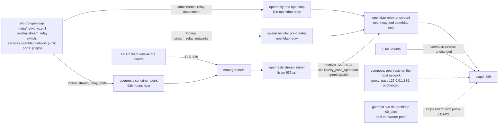

# 090 - OpenLDAP LDAPS through openresty in swarm

## User Story

As an operator of a swarm deployment, I want `services.openldap.network.public` to open LDAPS on port 636 through openresty as it does in compose, so that LDAP clients outside the cluster reach slapd over TLS while no backend port of OpenLDAP is published.

## Decisions (2026-11-05)

1. Until the swarm proof below passes, a swarm deploy with `services.openldap.network.public: true` stops in `svc-db-openldap` right after its run-once flag, before any other task of the role. The message names the switch and this requirement by its title, because a lint forbids requirement numbers and paths in code. The change that ticks the swarm proof removes that guard and its unit test. Compose deploys never hit the guard.
2. openresty stays the TLS terminator for LDAPS in both modes. slapd keeps speaking plain LDAP on its internal port; in swarm that hop runs only on the encrypted relay network of decision 3.
3. A provider declares `overlay.stream_relay` in its `meta/networks.yml` with a `switch` (a config path on the provider) and the `ports` it relays. While the switch is true, and only in the modes where the reverse proxy (`svc-prx-openresty`) itself runs on overlays (its own `networks.overlay.modes`, today `[swarm]`), the provider and the reverse proxy join a dedicated network `<entity>-relay` (`openldap-relay`), and no other role joins it. The provider carries its entity name as alias there. The reverse proxy never joins the provider's overlay. In compose openresty keeps the host network and reaches the published loopback port as before.
4. `stream_relay.ports` lists the `ports.public` protocols the relay listens on. In swarm openresty publishes each of them in `mode: host` next to 80 and 443, through `container_ports` with a per-term `application_id`. One declaration drives both the relay network and the published port.
5. The relay resolves its upstream per connection. In swarm, `stream{}` gets the Docker embedded resolver (`NETWORK_DOCKER_EMBEDDED_DNS_RESOLVER`), and the stream server renders `set $proxy_pass_upstream "openldap:<ports.internal.ldap>";` plus `proxy_pass $proxy_pass_upstream;`. The `proxy_pass` lookup renders it with `stream=True` from the same `resolve_upstream` the HTTP vhosts use, so openresty starts while openldap is still down and follows a new task address.
6. Compose renders stay byte-identical with one deliberate exception. The listen line rendered `listen 636ssl;`, which nginx rejects as an invalid port, so public LDAPS could not load in compose either. It renders `listen 636 ssl;` in both modes.
7. The relay widens no proxy trust. The relay network is no role network: `compute_external_network_roles` leaves it out, so the pre-created role overlays and `proxy_hops` of every application, the LDAP clients included, stay byte-identical with the switch on and off. Sharing the openldap overlay instead would have put openresty next to every LDAP client, `svc-ai-agent-provisioner` included, and Docker DNS would then route openresty's HTTP requests to those clients over it, so each client would have to trust that subnet as a proxy. Excluding the subnet from `proxy_hops` while still sharing the overlay was rejected for the same routing reason.
8. No inventory and no variant sets `services.openldap.network.public` today, and its default stays `false`.
9. The swarm deploy handler pre-creates the relay network for both stacks, so whichever of openldap and openresty deploys first finds it. Swarm assigns its subnet from the default address pool, as it does for openresty's own overlay. Switching the relay off leaves the empty network behind; nothing references it any more.

## State before this requirement (2026-11-05, `c1611ffdaf`)

- `roles/svc-db-openldap/templates/nginx.stream.conf.j2` proxies to `127.0.0.1:<services.openldap.ports.local.ldap>`. In swarm that is openresty's own loopback, not slapd, so the stream never reached slapd in swarm, before requirement 074 and after it.
- Since requirement 074, `container_ports` publishes no `ports.local` term that carries a host ip in swarm (`plugins/lookup/container_ports.py:252-261`), so OpenLDAP publishes no loopback port there.
- `roles/svc-prx-openresty/templates/compose.yml.j2:16-19` publishes only 80 and 443 in swarm, and one `container_ports` call reads the ports of one `application_id`.
- openresty shares no network with openldap. The openldap overlay declares no consumer, so the default `services_flags` kind admits only roles with `services.ldap.enabled` and `services.ldap.shared` (`utils/networks/attachments.py:51-59`), and openresty has neither.
- `roles/sys-svc-webserver-core/templates/nginx.conf.j2:67-69` renders `stream{}` without a `resolver`; only `http{}` has one, at line 10.
- The listen line of the stream template has no space before `ssl`.

## Approach

## Acceptance Criteria

### Guard

- [x] A swarm deploy with `services.openldap.network.public: true` fails in `svc-db-openldap` right after its run-once flag, before its container or stream config is touched, with a message that names the switch and this requirement by its title (`roles/svc-db-openldap/tasks/00_core.yml:4-14`, `tests/unit/python/roles/svc-db-openldap/test_swarm_public_ldaps_guard.py`).
- [x] Every compose deploy, and every swarm deploy without public LDAPS, passes the guard (same test, with negative controls for a guard without its condition and one that ignores the mode).
- [ ] The change that ticks the swarm proof removes the guard and its unit test.

### Relay network

- [ ] `utils/networks/attachments.py` reads `overlay.stream_relay` and gives exactly the provider and `svc-prx-openresty` an attachment to `<entity>-relay`, the provider with its entity alias, only in a mode listed in the reverse proxy's own `networks.overlay.modes` and only while the provider's `switch` path is true. A relay without a switch fails loudly.
- [ ] `compose_networks` and `container_networks` key such an attachment by its network name. In swarm with the switch on, openresty renders `openldap-relay` as external and attached and renders no `openldap` network; openldap renders `openldap-relay` with the alias `openldap`.
- [ ] `roles/svc-db-openldap/meta/networks.yml` declares `stream_relay` with `switch: services.openldap.network.public` and `ports: [ldaps]`, and the networks of every LDAP client render the same with the switch on and off in both modes.
- [ ] `lookup('stream_relay_networks')` returns `["openldap-relay"]` for openresty and for openldap in swarm with the switch on, and an empty list otherwise. The swarm deploy handler creates each of them as an attachable, encrypted overlay before `docker stack deploy` and fails on a driver drift.
- [ ] With the switch off, and in compose with the switch on, the network blocks of openresty and openldap render as before.

### Published port

- [ ] A `container_ports` term accepts `application_id`, reads its ports from that application, and every term without it reads the call's application as before.
- [ ] `lookup('stream_relay_ports')` returns one `container_ports` term per relay port for the reverse proxy (`service`, `protocol`, `application_id` of the provider, `container: same`, `mode: host`) and an empty list for every other role, the provider included, every mode the proxy is not on overlays, and a switch that is off. It derives the ports from the same relay attachment, so it never publishes a port for a relay network the proxy has not joined.
- [ ] In swarm with the switch on, the rendered `ports:` of openresty publishes `ports.public.ldaps` (636) to the same container port in `mode: host`, next to 80 and 443.
- [ ] With the switch off, openresty's swarm `ports:` block renders as before, and the compose render keeps `network_mode: "host"` with no `ports:` block.

### Stream config

- [ ] In swarm `stream{}` of `nginx.conf` carries `resolver <NETWORK_DOCKER_EMBEDDED_DNS_RESOLVER> valid=10s ipv6=off;`, and the compose render of `nginx.conf` is byte-identical to before.
- [ ] In swarm the openldap stream server renders `set $proxy_pass_upstream "openldap:389";` and `proxy_pass $proxy_pass_upstream;`; in compose it renders `proxy_pass 127.0.0.1:389;` as before.
- [ ] The listen line renders `listen 636 ssl;` in both modes, and nothing else of the compose stream config changes. A render test fails on the former `listen 636ssl;` line.
- [ ] `lookup('proxy_pass', ..., stream=True)` renders the stream directives from `resolve_upstream` and refuses the HTTP-only `tail` and `location` keywords.

### Proxy trust

- [ ] `compute_external_network_roles` skips relay attachments, so `compose_external_networks` of openresty, openldap and every LDAP client is equal with the switch on and off.
- [ ] `proxy_hops` of every web-facing LDAP client is equal with the relay off and on, in compose and in swarm, and never holds the openldap overlay subnet in swarm. The test turns red when openresty joins the openldap overlay instead.

### Swarm proof

- [ ] `openresty -t` passes in the swarm openresty task with the rendered `nginx.conf` and stream config.
- [ ] A deploy that switches `services.openldap.network.public` on creates `openldap-relay` and redeploys the openldap and openresty stacks with it and port 636, with no manual step.
- [ ] From a host outside the swarm, a TLS connect to port 636 of the manager node completes the handshake with the certificate of the openldap domain, and `ldapsearch -H ldaps://<domain>:636 -x -b '' -s base` through it returns the root DSE of slapd.
- [ ] After the openldap service gets a new task, a new LDAPS connection reaches slapd without an openresty reload.
- [ ] `docker network inspect openldap-relay` lists only the openldap and openresty tasks, and the trusted proxy addresses of an LDAP client in its running container are the same as before the switch.
- [ ] With the switch off, port 636 is closed on every swarm node.
- [ ] A compose deploy with the switch on answers the same `ldapsearch` on port 636.

### Tests

- [ ] Unit tests cover the relay attachment, the network key of the renders, `stream_relay_ports`, `stream_relay_networks`, both lookups, the per-term `application_id` of `container_ports`, the stream form of `proxy_pass`, and the renders of `nginx.conf.j2` and `nginx.stream.conf.j2` in both modes; an integration test renders openresty's `compose.yml.j2` and the networks of openldap and the LDAP clients against the real role tree in both modes and both switch states. Each comes with a negative control.
- [ ] The compose renders of the changed templates are pinned, and a one-off render of base commit `c1611ffdaf` against this change differs in compose only in the listen line of the stream config.

### Documentation

- [ ] The overlay schema in `utils/networks/render.py` documents `stream_relay`, its `switch`, its `ports` and the relay network.
- [ ] `roles/svc-db-openldap/README.md` says how public LDAPS reaches slapd in compose and in swarm, and `roles/sys-svc-compose/tasks/utils/network/README.md` documents `create/relay.yml`.
