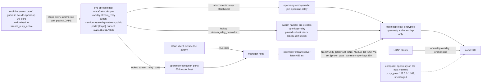

# 090 - OpenLDAP LDAPS through openresty in swarm

## User Story

As an operator of a swarm deployment, I want `services.openldap.network.public` to open LDAPS on port 636 through openresty as it does in compose, so that LDAP clients outside the cluster reach slapd over TLS while no backend port of OpenLDAP is published.

## Decisions (2026-11-05)

1. Until the swarm proof below passes, a swarm deploy with `services.openldap.network.public: true` is refused in two places. `svc-db-openldap` stops right after its run-once flag, before any other task of the role. `stream_relay_active` raises for a switch that is on in a mode of `UNPROVEN_STREAM_RELAY_MODES` (today `swarm`), so every network lookup of openresty and openldap fails: openresty's compose render, the relay pre-create and every `proxy_hops` lookup included. A play that runs openresty without openldap therefore never creates the relay network, never joins it and never publishes 636, so a failing relay task cannot take down the front proxy. Both messages name the switch and this requirement by its title, because a lint forbids requirement numbers and paths in code. The change that ticks the swarm proof removes both refusals and their tests. Compose deploys never hit either.
2. openresty stays the TLS terminator for LDAPS in both modes. slapd keeps speaking plain LDAP on its internal port; in swarm that hop runs only on the encrypted relay network of decision 3.
3. A provider declares `overlay.stream_relay` in its `meta/networks.yml` with a `switch` (a config path on the provider), the `ports` it relays and the `subnet` of the relay network. While the switch is true, and only in the modes where the reverse proxy (`svc-prx-openresty`) itself runs on overlays (its own `networks.overlay.modes`, today `[swarm]`), the provider and the reverse proxy join a dedicated network `<entity>-relay` (`openldap-relay`), and no other role joins it. The provider carries its entity name as alias there. The reverse proxy never joins the provider's overlay. In compose openresty keeps the host network and reaches the published loopback port as before.
4. `stream_relay.ports` lists the `ports.public` protocols the relay listens on. In swarm openresty publishes each of them in `mode: host` next to 80 and 443, through `container_ports` with a per-term `application_id`. One declaration drives both the relay network and the published port.
5. The relay resolves its upstream per connection. In swarm, `stream{}` gets the Docker embedded resolver through the shared `NETWORK_DOCKER_DNS_NGINX_DIRECTIVE` (`valid=30s`, `ipv6` from `NETWORK_IPV6_ENABLED`); stream needs no values of its own, and the hard-coded resolver line of `http{}` stays outside this requirement. The stream server renders `set $proxy_pass_upstream "openldap:<ports.internal.ldap>";` plus `proxy_pass $proxy_pass_upstream;`. The `proxy_pass` lookup renders it with `stream=True` from the same `resolve_upstream` the HTTP vhosts use, so openresty starts while openldap is still down and follows a new task address.
6. Compose renders stay byte-identical with one deliberate exception. The listen line rendered `listen 636ssl;`, which nginx rejects as an invalid port, so public LDAPS could not load in compose either. It renders `listen 636 ssl;` in both modes.
7. The relay widens no proxy trust. The relay network is no role network: `compute_external_network_roles` leaves it out, so the pre-created role overlays and `proxy_hops` of every application, the LDAP clients included, stay byte-identical with the switch on and off. Sharing the openldap overlay instead would have put openresty next to every LDAP client, `svc-ai-agent-provisioner` included, and Docker DNS would then route openresty's HTTP requests to those clients over it, so each client would have to trust that subnet as a proxy. Excluding the subnet from `proxy_hops` while still sharing the overlay was rejected for the same routing reason.
8. No inventory and no variant sets `services.openldap.network.public` today, and its default stays `false`.
9. The swarm deploy handler pre-creates the relay network for both stacks, so whichever of openldap and openresty deploys first finds it, and it runs that lookup only in swarm, so a compose flush pays nothing for it. The relay network is an attachable overlay on the pinned `stream_relay.subnet` (`192.168.105.48/28`, from the /28 block of the role subnet pool), which the allocator, the pool lint and the overlap test see like a `local.subnet`. It carries the `com.docker.compose.network`, `com.docker.compose.project` and `com.docker.stack.namespace` labels of the provider's stack, so `docker stack rm openldap` removes it once openresty has left it; until then, switching the relay off leaves the empty network in place.
10. The pre-create takes absence only from an exact name in `network ls`; any failed probe fails the deploy. A network of that name must be an attachable swarm overlay on the pinned subnet, with the configured encryption and the provider's namespace, or the deploy fails and asks to remove it. Encryption is the presence of the `encrypted` option (moby `daemon/libnetwork/drivers/overlay/ov_network.go:119-121` checks only the key), so the option is left out when `swarm.network.encryption` is off.
11. When the switch goes off, removing the stream config notifies `restart-openresty` like rendering it does.

## State before this requirement (2026-11-05, `c1611ffdaf`)

- `roles/svc-db-openldap/templates/nginx.stream.conf.j2` proxies to `127.0.0.1:<services.openldap.ports.local.ldap>`. In swarm that is openresty's own loopback, not slapd, so the stream never reached slapd in swarm, before requirement 074 and after it.
- Since requirement 074, `container_ports` publishes no `ports.local` term that carries a host ip in swarm (`plugins/lookup/container_ports.py`), so OpenLDAP publishes no loopback port there.
- `roles/svc-prx-openresty/templates/compose.yml.j2` publishes only 80 and 443 in swarm, and one `container_ports` call reads the ports of one `application_id`.
- openresty shares no network with openldap. The openldap overlay declares no consumer, so the default `services_flags` kind admits only roles with `services.ldap.enabled` and `services.ldap.shared` (`utils/networks/attachments.py`), and openresty has neither.
- `roles/sys-svc-webserver-core/templates/nginx.conf.j2` renders `stream{}` without a `resolver`; only `http{}` has one, at line 10.
- The listen line of the stream template has no space before `ssl`.

## Approach

## Acceptance Criteria

### Guard

- [x] A swarm deploy with `services.openldap.network.public: true` fails in `svc-db-openldap` right after its run-once flag, before its container or stream config is touched, with a message that names the switch and this requirement by its title (`roles/svc-db-openldap/tasks/00_core.yml`, `tests/unit/python/roles/svc-db-openldap/test_swarm_public_ldaps_guard.py`).
- [x] Every compose deploy, and every swarm deploy without public LDAPS, passes the guard (same test, with negative controls for a guard without its condition and one that ignores the mode, and five mutations of the real file: mode dropped, switch dropped, condition negated, guard moved behind the docker include, title removed; `TestMutationsOfTheRealFileFailTheChecks`).
- [x] `stream_relay_active` refuses a switch that is on in a mode of `UNPROVEN_STREAM_RELAY_MODES` (`utils/networks/attachments.py`), so a swarm render of openresty with the switch on fails, Ansible's own `query('stream_relay_ports')` through a real Templar fails, and so do openldap's `container_networks`, openresty's `stream_relay_networks` and the `proxy_hops` of a proxied client, each with the requirement's title; compose and the switch off render (`TestTheRelayIsRefusedUntilItsSwarmProof` in `tests/unit/python/utils/networks/test_stream_relay.py`, `TestTheRelayIsRefusedInSwarmUntilItsProof` in `tests/integration/ansible/lookups/test_stream_relay_openresty.py`). The tests below lift the refusal with a patch to cover the relay past its proof.
- [ ] The change that ticks the swarm proof removes the guard, the refusal and their tests.

### Relay network

- [x] `utils/networks/attachments.py` reads `overlay.stream_relay`. `stream_relay_active` holds only in a mode listed in the reverse proxy's own `networks.overlay.modes` and only while the provider's `switch` path is true, and a relay without a switch fails loudly. `_stream_relay_attachment` gives exactly the provider and `svc-prx-openresty` an attachment to `<entity>-relay`, the provider with its entity alias, and `_compute_attachments` appends it after the role attachments. Tests: `TestTheRelayIsActiveOnlyWhereTheProxyRunsOnOverlays` and `TestOnlyTheProxyAndTheProviderJoinTheRelayNetwork` in `tests/unit/python/utils/networks/test_stream_relay.py`.
- [x] `compose_networks` and `container_networks` key such an attachment by its network name (`utils/networks/render.py`). In swarm with the switch on, openresty renders `openldap-relay` as external and attached, and renders no `openldap` network; openldap renders `openldap-relay` with the alias `openldap`, and the switch adds exactly that block (`TestTheRelayNetworkRenders`; `test_swarm_with_the_switch_on_joins_the_relay_network_only` and `test_swarm_with_the_switch_on_adds_the_relay_network_under_the_alias` in `tests/integration/ansible/lookups/test_stream_relay_openresty.py`).
- [x] `roles/svc-db-openldap/meta/networks.yml` declares `stream_relay` with `switch: services.openldap.network.public`, `ports: [ldaps]` and `subnet: 192.168.105.48/28`, and the networks of every LDAP client render the same with the switch on and off in both modes (`test_a_client_attaches_the_same_with_the_switch_on` for `web-app-nextcloud`, `web-app-lam` and `svc-ai-agent-provisioner`, each asserted to be an LDAP consumer in swarm).
- [x] `lookup('stream_relay_networks')` returns `[{name: openldap-relay, subnet: 192.168.105.48/28, stack: openldap}]` for openresty and for openldap in swarm with the switch on, an empty list otherwise, and fails for a relay without a pinned subnet (`utils/networks/stream_relay.py`, `plugins/lookup/stream_relay_networks.py`; `TestTheRelayNetworksToPreCreate`, `test_swarm_with_the_switch_on_pre_creates_the_relay_network`).

### Relay network lifecycle

- [x] The swarm deploy handler includes `create/relay.yml` for each of them before `docker stack deploy`, once on the stack host, and runs the lookup only in swarm (`roles/sys-svc-compose/handlers/swarm.yml`; `TestTheHandlerLooksUpRelaysOnlyInSwarm` in `tests/unit/python/roles/sys-svc-compose/test_network_relay_create.py` renders the loop in compose without any lookup context).
- [x] `create/relay.yml` takes absence only from an exact name in `network ls`, inspects a present network in a block guarded by that fact and fails unless it is an `overlay` of scope `swarm`, attachable, encrypted exactly when `swarm.network.encryption` is on, on the pinned subnet and in the provider's stack namespace. Neither probe tolerates a failure. It creates the network with `--subnet`, the `com.docker.compose.network`, `com.docker.compose.project` and `com.docker.stack.namespace` labels, and `--opt encrypted=true` only when encryption is on. Tested against mocked probes: absent, a name that only contains the relay name, matching, nine drifts, encryption off on both sides and on one side, and the probe tasks' failure handling (`test_network_relay_create.py`).
- [x] The relay subnet sits in the role subnet pool and is seen by the allocator and the pool lint through `iter_subnets` (`utils/meta/scan.py`), and by the overlap test (`tests/integration/infrastructure/networks/test_unique_valid_and_mapped.py`, `test_a_stream_relay_subnet_is_checked_and_allocated_like_a_role_subnet`; `tests/lint/ansible/roles/meta/test_role_subnet_pool.py` passes with it).
- [x] With the switch off, and in compose with the switch on, the network blocks of openresty and openldap render as before (`test_swarm_with_the_switch_off_renders_as_before`, `test_compose_with_the_switch_on_renders_as_with_it_off`, `test_compose_renders_the_same_with_the_switch_on`, and the render comparison under Tests).

### Published port

- [x] A `container_ports` term accepts `application_id`, reads its ports from that application, and every term without it reads the call's application as before (`plugins/lookup/container_ports.py`; `TestContainerPortsTermApplication` in `tests/unit/python/plugins/lookup/test_container_ports.py`).
- [x] `lookup('stream_relay_ports')` returns one `container_ports` term per relay port for the reverse proxy (`service`, `protocol`, `application_id` of the provider, `container: same`, `mode: host`) and an empty list for every other role, the provider included, every mode the proxy is not on overlays, and a switch that is off (`utils/networks/stream_relay.py`, `plugins/lookup/stream_relay_ports.py`; `TestTheProxyPublishesTheRelayedPorts` in `tests/unit/python/utils/networks/test_stream_relay.py`, `tests/unit/python/plugins/lookup/test_stream_relay_ports.py`). It derives the ports from the same relay attachment, so it never publishes a port for a relay network the proxy has not joined.
- [x] In swarm with the switch on, the rendered `ports:` of openresty publishes `ports.public.ldaps` (636) to the same container port in `mode: host`, next to 80 and 443 (`roles/svc-prx-openresty/templates/compose.yml.j2`; `test_swarm_with_the_switch_on_publishes_ldaps_in_host_mode`).
- [x] With the switch off, openresty's swarm `ports:` block renders as before, and the compose render keeps `network_mode: "host"` with no `ports:` block (`test_swarm_with_the_switch_off_renders_as_before`, `test_compose_keeps_the_host_network_and_publishes_nothing`).

### Stream config

- [x] In swarm `stream{}` of `nginx.conf` carries `NETWORK_DOCKER_DNS_NGINX_DIRECTIVE` (today `resolver 127.0.0.11 valid=30s ipv6=off;`), and the compose render of `nginx.conf` is byte-identical to before (`roles/sys-svc-webserver-core/templates/nginx.conf.j2`; `tests/unit/python/roles/sys-svc-webserver-core/templates/test_nginx_stream_resolver.py`, whose sentinel directive turns red on a hard-coded line).
- [x] Removing the stream config when the switch goes off notifies `restart-openresty`, as rendering it does (`roles/svc-db-openldap/tasks/00_core.yml`; `TestOpenrestyReloadsWhenTheStreamConfigChanges`).
- [x] In swarm the openldap stream server renders `set $proxy_pass_upstream "openldap:389";` and `proxy_pass $proxy_pass_upstream;`; in compose it renders `proxy_pass 127.0.0.1:389;` as before (`roles/svc-db-openldap/templates/nginx.stream.conf.j2`; `tests/unit/python/roles/svc-db-openldap/templates/test_nginx_stream_conf.py`).
- [x] The listen line renders `listen 636 ssl;` in both modes, and nothing else of the compose stream config changes (`nginx.stream.conf.j2`; `test_both_modes_listen_on_the_public_ldaps_port_with_tls`, `test_the_compose_render_is_the_former_one_with_a_valid_listen_line`). Both fail on the former `listen 636ssl;` line.
- [x] `lookup('proxy_pass', ..., stream=True)` renders the stream directives from `resolve_upstream` and refuses the HTTP-only `tail` and `location` keywords (`render_stream_proxy_pass` at `utils/networks/proxy.py`, `plugins/lookup/proxy_pass.py`; `TestRenderStreamProxyPass` in `tests/unit/python/utils/networks/test_proxy.py`, `TestProxyPassStream` in `tests/unit/python/plugins/lookup/test_proxy_pass.py`).

### Proxy trust

- [x] `compute_external_network_roles` skips relay attachments (`utils/networks/render.py`), so `compose_external_networks` of openresty, openldap and every LDAP client is equal with the switch on and off (`TestTheRelayIsNoRoleNetwork`, `test_the_switch_leaves_the_pre_created_role_overlays_unchanged`).
- [x] `proxy_hops` of every web-facing LDAP client is equal with the relay off and on, in compose and in swarm, and never holds the openldap overlay subnet in swarm (`test_the_proxy_hops_of_a_client_are_equal_with_the_relay_off_and_on`, `test_swarm_never_trusts_the_openldap_overlay_as_a_proxy` for `web-app-nextcloud` and `web-app-lam`). Both turn red when openresty joins the openldap overlay instead, as the first draft of this change did, and when the relay skip is removed.

### Swarm proof

- [ ] `openresty -t` passes in the swarm openresty task with the rendered `nginx.conf` and stream config.
- [ ] A deploy that switches `services.openldap.network.public` on creates `openldap-relay` and redeploys the openldap and openresty stacks with it and port 636, with no manual step.
- [ ] From a host outside the swarm, a TLS connect to port 636 of the manager node completes the handshake with the certificate of the openldap domain, and `ldapsearch -H ldaps://<domain>:636 -x -b '' -s base` through it returns the root DSE of slapd.
- [ ] After the openldap service gets a new task, a new LDAPS connection reaches slapd without an openresty reload.
- [ ] `docker network inspect openldap-relay` lists only the openldap and openresty tasks on `192.168.105.48/28` with the openldap stack labels, and the trusted proxy addresses of an LDAP client in its running container are the same as before the switch.
- [ ] A second deploy finds the network without a drift, and `docker stack rm openldap` after openresty left it removes `openldap-relay`.
- [ ] With the switch off, port 636 is closed on every swarm node.
- [ ] A compose deploy with the switch on answers the same `ldapsearch` on port 636.

### Tests

- [x] Unit tests cover the refusal, the relay attachment (proxy and provider only, mode, switch, missing switch), the network key of the renders, `stream_relay_ports`, `stream_relay_networks` (missing subnet included), both lookups, the pre-create task file and its handler, the per-term `application_id` of `container_ports`, the stream form of `proxy_pass`, and the renders of `nginx.conf.j2` and `nginx.stream.conf.j2` in both modes; `tests/integration/ansible/lookups/test_stream_relay_openresty.py` renders openresty's `compose.yml.j2` and the networks of openldap and the LDAP clients against the real role tree in both modes and both switch states, and renders the `ports` expression of the real template through Ansible's Templar so `*query('stream_relay_ports')` runs as in a play. Each comes with a negative control. Deliberate mutations turned them red: openresty attached to the openldap overlay as in the first draft, relay skip removed from `compute_external_network_roles`, relay network key ignored by `container_networks`, the former listen line restored, the refusal lifted, `encrypted=<flag>` passed always, the attachable check dropped, a probe that tolerates failure, the handler lookup run in compose, the relay subnet left out of `iter_subnets`, a hard-coded stream resolver, and the notify removed.
- [x] The renders of the changed templates are pinned: `COMPOSE_RENDER`, `COMPOSE_STREAM_BLOCK`, the compose comparison of openresty, and the swarm render of openresty with the switch off as the literal `SWARM_OFF_RENDER`, from which the switch on differs by exactly port 636 and the two `openldap-relay` blocks. A one-off render of base commit `c1611ffdaf` against this change differs in compose only in the listen line of the stream config. In swarm it differs only in the stream resolver, the stream upstream, and with the switch on in port 636 and `openldap-relay`; `compose_external_networks` of openresty, the networks of `web-app-nextcloud` and its `proxy_hops` are identical.

### Documentation

- [x] The overlay schema in `utils/networks/render.py` documents `stream_relay`, its `switch`, its `ports`, its `subnet`, the relay network and the refusal.
- [x] `roles/svc-db-openldap/README.md` says how public LDAPS reaches slapd in compose and in swarm, and `roles/sys-svc-compose/tasks/utils/network/README.md` documents `create/relay.yml`.
