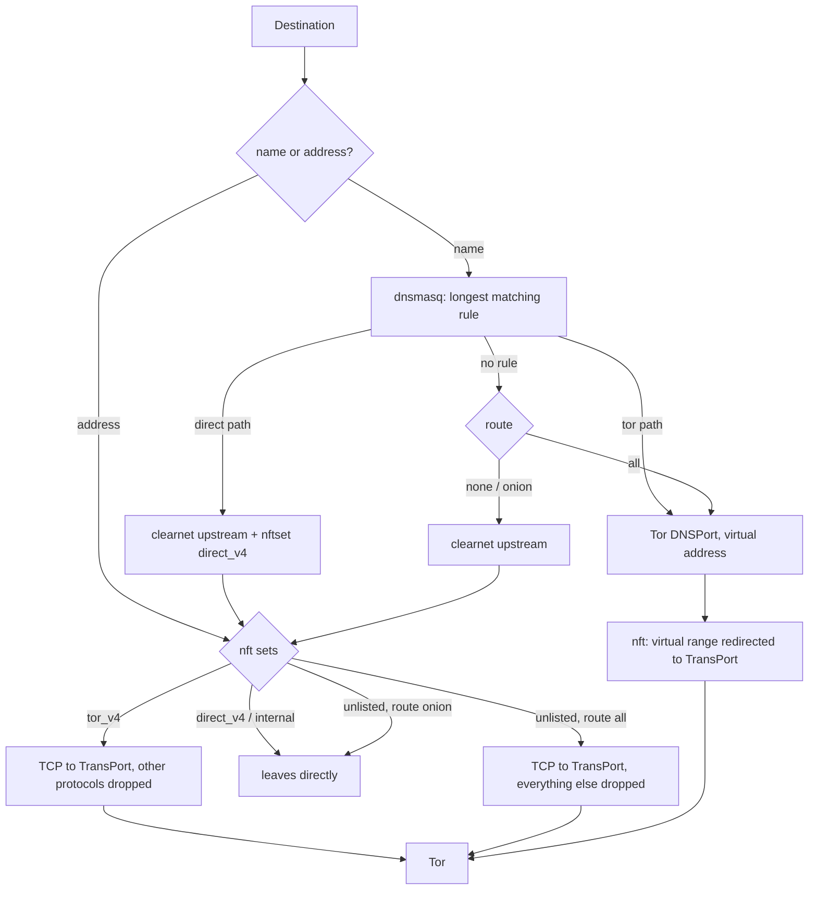

# 091 - svc-net-tor: Egress Route none, onion, all

## User Story

As an operator of a Tor node, I want to choose whether the node's outbound traffic leaves directly, sends only `.onion` through Tor, or goes entirely through Tor with no clearnet fallback, and to name the destinations that always or never take Tor, so that the node's own address reaches only the services I accept, and a stopped Tor stops traffic instead of exposing it.

## Context

[031](031-svc-net-tor-onion.md) shipped `services.tor.egress.enabled` (`TOR_EGRESS_ROUTER_ENABLED`). When `true`, [`tasks/router.yml`](../../roles/svc-net-tor/tasks/router.yml) installs a dnsmasq split-DNS drop-in that sends `.onion` to Tor's DNSPort (`AutomapHostsOnResolve`, `VirtualAddrNetworkIPv4`), points the host resolver at dnsmasq and redirects the virtual range through nft to Tor's TransPort. Every other destination leaves directly. 031 decision 10 and its out-of-scope list exclude full egress torification; this requirement adds it.

## Decisions

Operator decisions:

| # | Decision |
|---|---|
| 1 | `services.tor.egress.route: none \| onion \| all` replaces `egress.enabled`. Default `onion`, which renders exactly what `true` rendered. `TOR_EGRESS_ROUTE` replaces `TOR_EGRESS_ROUTER_ENABLED`. Every consumer migrates; the old key has no alias. |
| 2 | `all` routes all outbound traffic of the node through Tor and fails closed: nft drops every egress that goes neither to Tor nor to a direct destination, and every name outside the direct list resolves only through Tor's DNSPort. With Tor down, Tor-routed traffic fails; there is no clearnet fallback. |
| 3 | Two lists, each with its own exception list: `tor` (always through Tor) and `direct` (never through Tor). Entries are host names, `*.` wildcards, IPs and CIDRs. `except` removes matches from its own `include`. |
| 4 | The infrastructure exceptions pre-fill `direct.include`: distribution package mirrors, the time servers the distributions default to, the container registries the deployed applications pull from, and the ACME endpoint. They are derived from configuration where it exists. These services see the node's address; the operator edits or empties the list. |
| 6 | 031 line 178 and decision 10 point here; the criterion is reworded to the three modes and stays unticked until this requirement's criteria hold. |

Coordinator decisions (open to operator correction):

| # | Decision |
|---|---|
| 5a | `route` decides every destination no list matches: `none` direct, `onion` `.onion` through Tor and the rest direct, `all` Tor. |
| 5b | A destination both lists keep (after their excepts) goes through Tor, which fails closed. A lint reports literal overlaps. |
| 5c | `none` leaves egress untouched. Non-empty lists under `none` fail validation, so the infrastructure pre-fill is empty under `none`. |
| 5d | `.onion` can never enter `direct.include`; validation and a lint enforce it. |
| 5e | Outbound SMTP under `all` is undeliverable unless the MX hosts are in the direct list. |
| 5f | Inbound is unchanged: the onion hidden service plus the clearnet siblings of [055](055-multi-network-serving.md). Replies to inbound connections pass as reply-direction traffic. |
| 7 | Shape refined from the proposal: `egress: { route, tor: { include, except }, direct: { include, except }, infrastructure: { mirrors, ntp, registry_blob_hosts, acme } }`. Every key is required; no code path substitutes a missing list. The removed `enabled` key is refused with a migration hint, and so are unknown keys and an `infrastructure` block of the wrong shape. |
| 8 | A host-name entry covers the name and every name below it, so `example.org` and `*.example.org` are the same entry. dnsmasq matches on label boundaries and has no form for one host without its subdomains, so an exact-host meaning would promise something the resolver cannot keep. Only one leading `*.` is accepted. A CIDR with host bits set is refused, not widened, and a name whose last label is all digits is refused as a mistyped address. |
| 9 | Every name that reaches Tor's DNSPort gets a virtual address: `AutomapHostsSuffixes .` whenever a clearnet name is routed to Tor, `.onion` otherwise. Tor-routed names therefore never share an address with a direct destination, and the exit resolves them. |
| 10 | Direct host names reach the packet filter through dnsmasq `nftset=` (dnsmasq 2.87 or newer, built with nftset). Debian 13 (2.91, `-DHAVE_NFTSET`), Ubuntu (Debian packaging) and Arch (2.93, verified locally) have it; CentOS Stream 10 ships 2.90 built without nftset, Fedora is unverified. Fallback: the deploy reads `dnsmasq --version` and refuses `all` with direct host names when nftset is missing; addresses and CIDRs still work there. |
| 11 | `all` is refused in swarm mode. The egress router runs on the managers only, so every worker would send its containers' traffic direct where `all` must fail closed. |
| 12 | Tor's own relay traffic is exempted by user and group: under `all` the compose service runs as `0:TOR_EGRESS_SOCKET_GID` and nft matches `meta skuid 0 meta skgid TOR_EGRESS_SOCKET_GID`. Root stays the user, so the data directory permissions do not change. The deploy refuses a group the host already knows (`getent group` must exit 2), because root processes of that group would leave in clearnet. |
| 13 | Under `all` dnsmasq drops to `user=dnsmasq`, and the deploy requires that user. Upstream DNS for direct names is admitted only for the effective UID of the running dnsmasq, read from `/proc/<MainPID>/status`. The deploy refuses that UID when it is 0 or 65534 or when processes other than dnsmasq run as it, because the admission would cover them too. |
| 14 | Destinations in `NETWORK_INTERNAL_CIDRS`, link-local, multicast and limited broadcast are not egress and stay direct under `all`, except DNS. Port 53 and 853, UDP and TCP, reach only the `resolvers` set: loopback, the container DNS host and the local subnets of the roles deployed on the node, where role resolvers such as svc-dns-unbound live. The container address pools are not in it, so a LAN resolver inside a pool (`172.30.0.53` in `172.16.0.0/12`) cannot answer for names Tor should resolve. The guard runs before the internal accept, IPv6 DNS is dropped outright, and the nat chain returns TCP DNS so it meets the drop instead of the TransPort. The deploy refuses a `networks.internet.dns` inside the resolver set, because every process could reach it. |
| 15 | `all` requires that svc-net-tor owns the dnsmasq listener; with foreign drop-ins the owner's upstreams would answer names in clearnet DNS. |
| 16 | Requirement number 091: 090 is claimed twice in other worktrees. |
| 17 | The pre-fill is `"{{ lookup('tor_egress_infrastructure') }}"`, a global lookup over `services.tor.egress.infrastructure` (`mirrors`, `ntp`, `registry_blob_hosts`, `acme`). The applications payload renders every role's configuration in every role's context, so a role-local lookup or a role variable would not resolve outside svc-net-tor. Registries are derived from the images of the applications in `group_names`; the mirrors and time servers are one list for all supported distributions, because host facts are not reliably present when the payload renders; ACME and the blob hosts are declared, because no configuration names them. A registry port is stripped, and `localhost`, `*.localhost` and address registries are skipped. The lookup returns an empty list off a Tor node and on a malformed block and never raises, because the payload renders it on every host; the role validates the block in `tasks/00_core.yml`. |
| 18 | Established traffic skips the filter rules only in the reply direction (`ct direction reply`). An original-direction flow skips them only when this table admitted it to a name-filled direct address and marked it (`ct mark TOR_EGRESS_CT_MARK`), so it outlives its set entry; a flow opened before `all` was loaded meets the rules again. |
| 19 | The sets dnsmasq fills (`tor_dns_*`, `direct_dns_*`) expire after `TOR_EGRESS_NFTSET_TIMEOUT` (1h). dnsmasq caps its cache at `max-cache-ttl=300`, so a client that keeps resolving refreshes its entry, and the deploy sends dnsmasq `SIGHUP` after every firewall reload so the next answers refill the emptied sets. |
| 20 | Operator pick (2026-11-13), atomic swap: `route: none` is refused only while the dnsmasq drop-in of an earlier route exists, because dnsmasq would keep sending names to the DNSPort that `none` removes, so the node would lose `.onion` resolution and, after `all`, every name. The failure names the removal steps. Without the drop-in, the deploy replaces the router's svc-net-firewall fragment by the listener guard in one nft load: the guard opens with the create, delete and declare idiom, so the redirects and drops of the earlier route leave in the same transaction the guard arrives in, before Tor restarts without the group its relay traffic was exempted by. No manual `nft delete` is needed. |
| 21 | Under `all` nothing on the host resolves beside dnsmasq: `resolve` leaves the `hosts:` line of nsswitch.conf; systemd-resolved, where present, gets a drop-in with `DNS=127.0.0.1`, an empty `FallbackDNS=` and `Domains=~.`; resolv.conf loses the clearnet nameserver; the docker daemon gets the bridge as its only resolver, because Docker moves on to the next nameserver on the SERVFAIL dnsmasq answers while Tor is down; and the deploy refuses `server`, `resolv-file`, `servers-file` and `conf-file` lines in `/etc/dnsmasq.conf`. |
| 22 | The path follows the name a client asks for: a direct name whose CNAME points at a tor-listed name still goes direct, and dnsmasq puts the final address into the direct set. |
| 23 | Excepts cross kinds in one direction only. An address in `direct.except` also removes the addresses direct names resolve to, because nft checks its `direct_except_*` set before both direct sets, in the filter and in the nat chain. A name except never removes an address include. |
| 24 | Under `all` the forward chain ends in its own `drop` and jumps nowhere, so no rule returns into a chain without one. Both chains accept local IPv6, and the output chain accepts IPv6 neighbour discovery. |

## Approach

The plan is computed once in [`utils/networks/tor_egress.py`](../../utils/networks/tor_egress.py) and handed to the templates through the role filters: dnsmasq rules (only where a rule changes the path its parent gives), literal nft sets after the excepts, and whether Tor must map every suffix.

## Acceptance Criteria

### Flag and migration

- [x] `services.tor.egress.route` with `tor` and `direct` lists replaces `egress.enabled`; `TOR_EGRESS_ROUTE` replaces `TOR_EGRESS_ROUTER_ENABLED`; no reference to the old key or variable remains. (`roles/svc-net-tor/meta/services.yml` declares `route` with both lists and `roles/svc-net-tor/vars/main.yml` reads it as `TOR_EGRESS_ROUTE`. The old key survives only in the refusal at `utils/networks/tor_egress.py`, which decision 7 requires, and `tests/lint/ansible/roles/meta/test_tor_egress_lists.py` fails on a shipped `egress.enabled` through its `removed-enabled` control. `tests/lint/ansible/variables/test_tor_egress_router_enabled_removed.py` fails on any file outside `locale/` and the requirement documents that names the old variable, with a negative control.)
- [x] `onion` with the default lists renders torrc, the dnsmasq drop-in, the nft fragment, resolv.conf and compose byte-identical to `enabled: true` on the same inputs; `none` renders torrc and compose identical to `enabled: false`. Proven by rendering the templates of `40b118f178^1` and the current ones through the render path of `test_egress_route.py`: 7 of 7 identical, with the same lookup calls and no undeclared variable. As a control, the old torrc with `enabled: false` differs from `onion`.

### Lists and precedence

- [x] A host-name entry covers the name and its subdomains, a sibling suffix (`badexample.org`) is not covered, and only one leading `*.` is accepted. Proven by `test_a_name_covers_its_subdomains_but_not_a_sibling_suffix`, `test_a_wildcard_and_a_bare_name_cover_the_same_tree` and `test_a_wildcard_inside_a_name_is_refused`.
- [x] `except` removes matches from its own `include` for names, addresses and CIDRs, and never from the other list. Proven by `test_except_removes_matches_from_its_own_include`, `test_address_entries_match_by_network_with_excepts`, `test_literal_sets_subtract_the_excepts` and `test_except_does_not_reach_into_the_other_list`.
- [x] A destination both lists keep takes Tor, at the DNS layer and at the nft layer. Proven by `test_a_destination_in_both_lists_takes_tor`, `test_every_name_gets_the_path_of_its_deepest_rule` and `test_tor_wins_over_direct_for_an_address_in_both`.
- [x] For every name, the dnsmasq rule with the longest matching domain gives the same path as the plan. Proven by `test_every_name_gets_the_path_of_its_deepest_rule` under `onion` and `all`.

### Route all

- [x] The nft filter output and forward chains end in `drop`, and only reply-direction packets and flows this table marked skip the rules. The output chain accepts the node's own addresses, Tor's sockets (`skuid 0`, `skgid TOR_EGRESS_SOCKET_GID`), dnsmasq to its upstream, internal, non-routable, local IPv6, neighbour discovery and direct destinations; the forward chain jumps nowhere. The nat output chain redirects every remaining IPv4 TCP flow to the TransPort, and container traffic is redirected or dropped the same way. Proven on the rendered fragment by `test_all_fails_closed`, `test_only_flows_this_table_admitted_skip_the_rules`, `test_forwarded_ipv6_and_foreign_sources_meet_the_drop`, `test_neighbour_discovery_keeps_working` and `test_dns_leaves_only_from_dnsmasq_to_its_upstream`.
- [x] DNS (53 and 853, UDP and TCP) reaches only the resolver set, checked before the internal accept, so a LAN resolver inside a container pool gets no query. Proven by `test_the_dns_guard_refuses_lan_resolvers_inside_the_pools`.
- [x] dnsmasq's default upstream is Tor's DNSPort only, and it runs as `user=dnsmasq` with `max-cache-ttl=300`. Direct names resolve through the clearnet upstream and fill the expiring `direct_dns_*` sets; tor-listed names and carve-outs fill `tor_dns_*`. resolv.conf, systemd-resolved and the docker daemon carry no clearnet fallback, and nsswitch no longer consults `resolve`. Proven by `test_all_resolves_unlisted_names_only_through_tor`, `test_dnsmasq_drops_to_its_own_user_and_bounds_its_cache`, `test_listed_names_fill_the_expiring_sets`, `test_resolved_forwards_to_dnsmasq_without_fallback`, `test_nsswitch_loses_resolve_under_all`, `test_route_all_leaves_the_host_no_clearnet_fallback` and `test_route_all_hands_containers_only_the_bridge`.
- [x] Tor runs as `0:TOR_EGRESS_SOCKET_GID` and its relay traffic is neither redirected nor dropped. Proven by `test_all_gives_tor_its_own_group` and by the `skuid`/`skgid` accept and the nat return in `test_all_fails_closed`.
- [x] The deploy refuses `all` in swarm mode, on a shared dnsmasq, with upstreams in `/etc/dnsmasq.conf`, on a dnsmasq without nftset when direct host names exist, on a dnsmasq that resolves as root or nobody or shares its UID, when the Tor group exists on the host, and when the clearnet upstream lies inside the resolver set. Every refusal is evaluated with a passing and a refused input by `test_all_is_refused_in_swarm` and the `TestRouteAllPreflight` tests, and `test_the_preflight_runs_under_route_all_only` pins the gate.
- [x] `none` is refused only while an earlier route's dnsmasq drop-in exists, and a leftover router fragment alone is replaced by the guard in one nft load. Proven by `test_none_is_refused_only_while_the_dnsmasq_drop_in_exists`, which plays the refusal tasks against every combination of no fragment, a router or a guard fragment, with and without the drop-in, and by `test_none_swaps_the_router_table_for_the_guard_in_one_load`.

### Validation and lint

- [x] Deploy-time validation refuses an unknown route, the removed `enabled` key, unknown keys, a misshapen `infrastructure` block, a malformed entry or block (host bits and all-digit names included), lists under `none` and `.onion` in `direct.include`; it reports literal overlaps without failing. Proven by the `TestViolations` tests, `test_an_unknown_route_is_refused_at_deploy` among them; `tasks/00_core.yml` asserts the violations and reports the overlaps as a debug message.
- [x] A lint checks every shipped `tor.egress` block (services and variants) for the same mistakes and for literal overlaps, with negative controls. Proven by `tests/lint/ansible/roles/meta/test_tor_egress_lists.py`.

### Live proofs (open for the single IAM run; split worktrees do not deploy)

- [ ] The rendered fragment passes `nft -c` and loads twice with an identical listing under `onion` and `all` on a host with `CAP_NET_ADMIN`; the unit test skips without it.
- [ ] The route-all preflight (dnsmasq user and UID, Tor group, `/etc/dnsmasq.conf` scan, nftset) passes on a real host, and the time daemon syncs against the pre-filled servers.
- [ ] Tor bootstraps under `all`, and `curl https://check.torproject.org/api/ip` from the host and from a container reports `IsTor: true`.
- [ ] A direct-listed registry pull and a package update leave from the node's own address under `all`.
- [ ] With the Tor container stopped under `all`, an unlisted HTTPS request and an unlisted DNS lookup fail, from the host and from a container; nothing reaches the clearnet.
- [ ] Switching `all` back to `onion` restores direct egress. Switching to `none` is refused with the removal steps while the earlier route's dnsmasq drop-in exists; once it is gone, the deploy replaces the router's packet filter by the guard in one nft load, without a manual `nft delete`.
- [ ] Second deploy under `all` reports no changes beyond the firewall reload and the dnsmasq cache clear.
- [ ] A deploy of any other role on a Tor node renders the svc-net-tor configuration without error, and the deploy-time `direct.include` carries the registries of the node's images.

### Documentation

- [x] The role README documents the three modes, both lists, the precedence, the infrastructure pre-fill and its exposure, and the limitations below.
- [x] [031](031-svc-net-tor-onion.md) decision 10, its egress criterion and its out-of-scope line point here.

## Limitations

- Under `all`, outbound SMTP and any other non-TCP traffic to unlisted destinations is dropped; add the MX hosts to `direct.include` when the node needs them. Time sync works against the pre-filled servers and the names below them only, and Tor itself needs a correct clock.
- Roles that resolve through svc-dns-unbound get no clearnet answers under `all`: unbound's queries to the root servers or to public resolvers meet the DNS guard. Forwarding its `.` zone to Tor's DNSPort under `all` is a follow-up.
- A client that keeps an address past the set timeout (1h) without resolving it again loses direct egress for new connections to it: TCP goes through Tor and everything else is dropped. Flows already admitted keep their mark.
- The path follows the queried name (decision 22), so a direct name can lead to a CNAME target the operator meant to send through Tor.
- A direct host name on a shared CDN address opens that address for every site hosted there. Tor-routed names never collide with it (decision 9), but clients that connect to raw addresses do.
- IPv6 TCP to unlisted destinations under `all`, and to tor-listed IPv6 addresses in any mode, is dropped: the TransPort listens on IPv4 only.
- Under `onion`, a tor-listed address that happens to be a relay Tor needs loops into the TransPort; Tor's group exemption exists under `all` only.
- Mirrors a host picks at runtime (Fedora metalink, Arch mirrorlist entries beyond the default) are not in the pre-fill; their traffic goes through Tor until they are added.

## Tests

- [`tests/unit/python/utils/networks/test_tor_egress.py`](../../tests/unit/python/utils/networks/test_tor_egress.py): parsing, matching, excepts, precedence, longest-match agreement, literal sets, validation, overlaps.
- [`tests/unit/python/roles/svc-net-tor/test_egress_route.py`](../../tests/unit/python/roles/svc-net-tor/test_egress_route.py): torrc, dnsmasq drop-in, nft ruleset, resolv.conf, the systemd-resolved drop-in and compose per route, including the fail-closed drop, the DNS guard against a LAN resolver inside a real client pool, the rule order, the nsswitch rewrite, the `none` refusal and the route-all preflight expressions evaluated with Ansible's templar.
- [`tests/integration/roles/svc-net-tor/test_container_dns_wiring.py`](../../tests/integration/roles/svc-net-tor/test_container_dns_wiring.py): resolv.conf per route, the bridge as the only docker daemon resolver under `all`, and that the route is read on a Tor node only.
- [`tests/unit/python/roles/svc-net-firewall/test_fragments.py`](../../tests/unit/python/roles/svc-net-firewall/test_fragments.py): parses and loads the fragment under `onion` and `all` where `nft` has `CAP_NET_ADMIN`.
- [`tests/lint/ansible/roles/meta/test_tor_egress_lists.py`](../../tests/lint/ansible/roles/meta/test_tor_egress_lists.py): the shipped blocks, with negative controls.
- [`tests/unit/python/plugins/lookup/test_tor_egress_infrastructure.py`](../../tests/unit/python/plugins/lookup/test_tor_egress_infrastructure.py): the pre-fill order, the registry derivation with ports, local and address registries, and the empty list under `none`, off a Tor node and on a malformed block.
