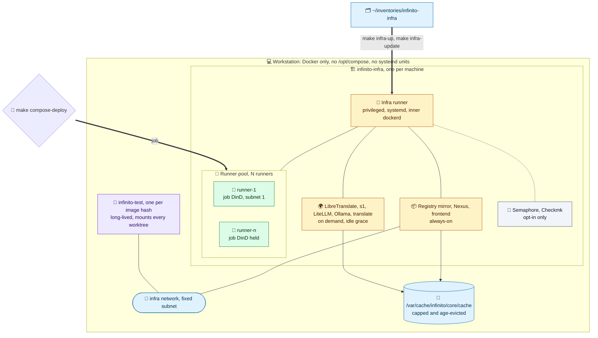
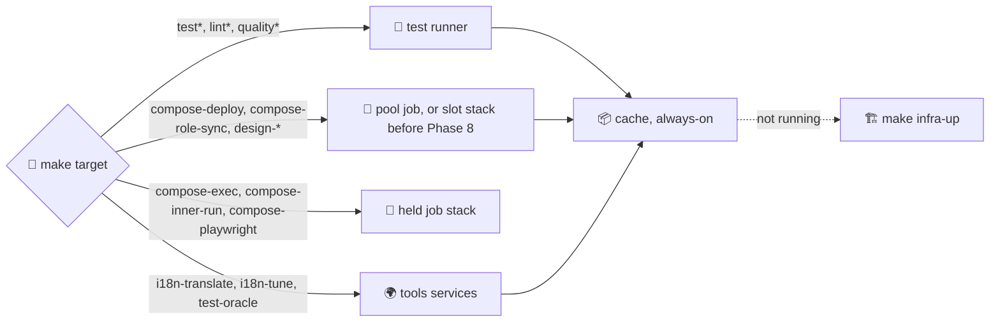
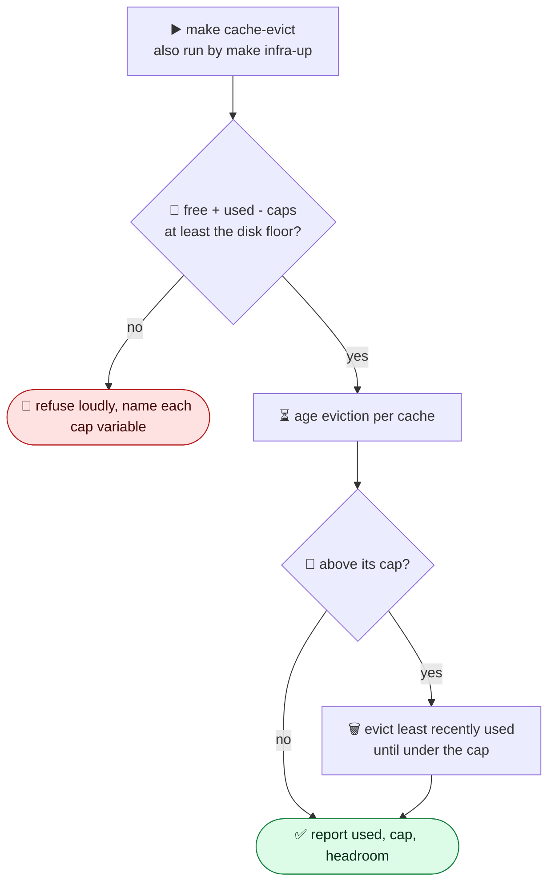
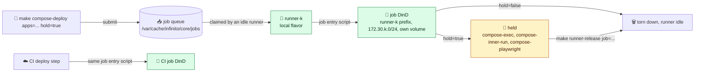

# 092 - Local Stack Architecture: Bounded Caches, One Infra Runner, One Test Runner, One Runner Pool

## User Story

As an operator who runs many worktrees and agents on one workstation, I want every local cache to stay within a fixed size, the cache, tools and deploy-runner services to run once per machine as their own stack deployed through the infinito inventory, every test and quality gate to run in one shared long-lived test runner, and every local deploy to run as a job of a runner pool, so that the disk no longer fills up, a gate no longer builds and starts a stack of its own, parallel deploys never collide, and only the stacks a target needs are running.

## Context (2026-11-05, base 54f2e8a506)

- Disk: `/` holds 1.8 TB with 54 GB free (97 % used). `du` over `/var/cache/infinito/core/cache` ([DIR_CACHE](../../group_vars/all/05_paths.yml), line 27) counts 107 GB, of which `package/data/blobs` (Nexus) is 101 GB, `models/` 5.4 GB and `shared/` 380 MB. The registry mirror is root-owned and unreadable from the host, so its size is not part of the 107 GB.
- Sizing today: the registry mirror's `CACHE_MAX_SIZE` is half the free disk at `make dotenv` time (`utils/env/handlers/infinito/registry_cache_max_size.py:20-25`, removed by Phase 1); the Nexus blob store gets a `softQuota` of half the free disk (`utils/env/handlers/infinito/package_cache/blobstore_max.py:20-22`, removed by Phase 1, [bootstrap.sh:110-114](../../roles/svc-cache-package/files/shell/bootstrap.sh)). A Nexus soft quota only reports a violation and never deletes, which is how the blob store reached 101 GB. The shared folders ([shared-cache.override.yml:5-12](../../compose/shared-cache.override.yml), [pacman.override.yml](../../compose/pacman.override.yml)) and `models/` ([models.py:28-34](../../utils/env/handlers/infinito/tools/models.py)) have no bound at all, and the host's Docker build cache has none either.
- Ownership: registry mirror (`rpardini/docker-registry-proxy:0.6.5`), Nexus 3.91.1 and the nginx frontend are services of the slot-0 checkout's compose project (`compose/cache.override.yml` (removed), started only by the owner in [compose.py:267-269](../../cli/administration/deploy/development/compose.py)). Worktrees join that project's network through `docker inspect infinito-registry-cache` ([lib.sh:95-99](../../scripts/system/worktree/lib.sh), [up.sh:46,75](../../scripts/system/worktree/up.sh), `compose/cache.shared.override.yml` (removed)). `make compose-down` in the owning checkout runs `down --remove-orphans -v` over the whole project ([down.py:57-63](../../cli/administration/deploy/development/down.py)), cache services included.
- Two cache implementations: the inventory roles [svc-registry-cache](../../roles/svc-registry-cache/README.md) (the `registry` image, version 3 in its `meta/services.yml`, Docker Hub only per its README lines 5-7) and [svc-cache-package](../../roles/svc-cache-package/README.md) (Nexus plus nginx frontend, `blobstore_max: 40g` in its `meta/services.yml`). The dev stack uses neither role.
- Tools: the `tools` runner is a second service of every checkout's project (`compose/tools.override.yml` (removed)), layered when the tools keys are set ([env.py:45-46](../../cli/administration/deploy/development/env.py)) and filled by [libretranslate.py:254](../../utils/i18n/libretranslate.py) from the inventory `~/inventories/infinito-tools` (line 37) with the roles of [tools.py:59-63,442-448](../../utils/inventory/tools.py). Entry points: `make test-oracle`, `make i18n-translate`, `make i18n-tune` ([Makefile](../../Makefile)).
- Tests: every `test-*` target goes through [wrapper.sh](../../scripts/tests/code/wrapper.sh), which runs `make compose-up` when no `infinito` container runs (lines 31-37) and then `docker compose exec` without `-p` or `-f` (lines 49-54); [the lint wrapper](../../scripts/lint/wrapper.sh) does the same (lines 45-51). `compose-up` starts `coredns`, `infinito`, `target` and `target-resolver` ([compose.yml:10-180](../../compose.yml)) and resets the target.
- Image: the tag is `<git toplevel basename>/<distro>` ([local.sh:10](../../scripts/meta/resolve/image/local.sh)), so every worktree builds its own image. The [Dockerfile](../../Dockerfile) copies the whole tree (line 58) before the install steps (lines 61-66) and the compile step (line 83), so every commit is a new image input.
- Project name: [compose.yml](../../compose.yml) has no `name:` and nothing sets `COMPOSE_PROJECT_NAME`, so a project is named after its checkout directory.
- Deploy slots: a worktree's slot, subnet `172.30.<slot>.0/24`, bind IP and container names come from [lib.sh:44-69](../../scripts/system/worktree/lib.sh) and are pinned into `custom.env` by [up.sh:58-75](../../scripts/system/worktree/up.sh).
- Runner: [svc-runner](../../roles/svc-runner/README.md) provisions `RUNNER_COUNT` ephemeral GitHub runners (DooD on the host socket). Each CI job gets its own Infinito DinD with a unique compose project, prefix, subnet `172.30.<instance>.0/24` and Docker volume ([runner_instance_env.j2:1-16](../../roles/svc-runner/templates/runner_instance_env.j2)); runners register with a GitHub PAT at start. `RUNNER_COUNT` defaults to CPUs divided by `RUNNER_CPUS` (`defaults/main.yml`). Branch `refactor/svc-runner/default-instance-dir` (`f67d80813a`, merged into IAM soon) moves the runner stack to `/opt/compose/runner`.
- Semaphore and Checkmk: [web-app-semaphore](../../roles/web-app-semaphore/README.md) already hands every task to a remote runner it seeds with a token (`templates/sql/project/prepare.sql.j2`); [web-app-checkmk](../../roles/web-app-checkmk/README.md) runs an agent receiver (README line 31).
- CI: [call-test.yml:16](../../.github/workflows/call-test.yml) runs the tests with `INFINITO_TEST_RUNNER: host`; the cache stack is off on CI ([profile.py:33-36](../../cli/administration/deploy/development/profile.py)); deploy jobs call `make compose-deploy`.
- Incident (MAYDAY 2026-11-05): a `make quality-high` in the main checkout ran `compose-up` and sent a 35.86 GB build context, because `.dockerignore` (a copy of `.gitignore` made by `make fix-dockerignore`) missed `.claude/worktrees/` (36 GB of agent worktrees). The build cache grew from 28 to 86 GB until `/` was full. The hotfix adds `.claude/worktrees/` and `.worktrees/` and makes `compose-up` regenerate the `.dockerignore`; it is pull request #1384, pushed as `d965f00041`, and not on this base.
- [cache.md](../contributing/environment/cache.md) line 3 names a compose profile `cache` that does not exist.

## Decisions (operator, 2026-11-05)

Binding; not reopened by this document. D9 to D22 close the open questions O1 to O14 of the first draft, D27 to D29 the points N1 to N3 of the second.

| # | Decision |
|---|---|
| D1 | Cache bounds are fixed absolute caps plus age eviction. Defaults: registry mirror 40 GB, Nexus 20 GB, shared folders (pip, npm, pacman, Playwright) 10 GB, `models/` 30 GB. Entries without access for 30 days are evicted. Every value is overridable through the inventory and the environment. This replaces the "half the free disk" sizing. |
| D2 | Migration: the first apply evicts the oldest entries until each cache is under its cap. Warm data stays; there is no full wipe. |
| D3 | One long-lived infra runner per machine, built like today's tools lane: a privileged runner container in which a local infinito inventory deploys the cache roles and the tools roles. The workstation host stays untouched (no `/opt/compose`, no systemd units on it); data stays under `/var/cache/infinito`. One cache stack per machine, never one per worktree; every worktree's stack and the test runner attach to its network. Compromise between time and clean architecture: deploy only what is needed. |
| D4 | Lifecycle classes. Locally always-on: cache (registry, Nexus, frontend), deployed once into the infra runner, restart `unless-stopped`. Locally on demand: tools (LibreTranslate, LiteLLM, Ollama and the rest of the lane), only for i18n and oracle targets. Locally long-lived: the test runner, started on the first test call and kept. CI: no cache stack and no inventory deploy (actions cache and the GHCR mirror). Each stack declares its class; make starts only what a target needs. |
| D5 | One shared long-lived test runner mounts every worktree and runs `make test*` with the worktree as working directory. The image tag is a hash of the image inputs (Dockerfile, requirement and lock files, whatever `build.sh` consumes), so all worktrees with the same inputs share one image; only a branch with changed inputs builds its own. |
| D6 | Only the general services are shared (cache, tools, tests, deploy runners). A deploy stack (`target`, `target-resolver`, `coredns`) comes up on demand for deploy iterations and is torn down afterwards. |
| D7 | An environment override points every make target at another stack. |
| D8 | The i8- skills and docs that change are acceptance criteria of this requirement. |
| D9 (O1) | `svc-registry-cache` gets a selectable flavor, `registry` or `multi-proxy`. The infra inventory uses `multi-proxy` (`rpardini/docker-registry-proxy`); server inventories keep `registry`, unchanged. |
| D10 (O2) | The 10 GB shared-folder cap is one total over all shared folders. |
| D11 (O3) | Core refuses `make infra-up` loudly when the cap sum violates the 15 GB disk floor. |
| D12 (O4) | The override is named `INFINITO_STACK_NAME`. |
| D13 (O5) | A slot belongs to a stack, not to a checkout. |
| D14 (O6) | CI keeps running the tests directly on the host ([call-test.yml](../../.github/workflows/call-test.yml)); only deploys go through the shared job entry. |
| D15 (O7) | Tools stop after an idle grace period, default 2 h and overridable, not after each target. |
| D16 (O8) | Published images keep a final stage that copies the tree on top of the shared toolchain stage. |
| D17 (O9) | Runners mount the primary checkout and `~/.local/share/worktrees` by default; the roots are overridable. |
| D18 (O10) | The host Docker build cache is capped at 20 GB: a builder prune keeping that much storage runs after builds; the cap is overridable. |
| D19 (O11) | Tools use the memory and CPU limits their roles define. |
| D20 (O12) | Deploy stacks are torn down explicitly, never by an idle timer; the cleanup lists held and orphaned ones. |
| D21 (O13) | The infra inventory template lives in `inventories/development/` and renders to `~/inventories/infinito-infra`. |
| D22 (O14) | The 30-day eviction becomes the default of the cache roles everywhere. Server size caps stay at today's values; only the infra inventory sets 40, 20, 10 and 30 GB. |
| D23 | Runner pool: `svc-runner` gets a `local` flavor with no GitHub registration, jobs submitted by make, the worktree mounted instead of checked out, and a hold mode that keeps the job's DinD stack after the deploy for `compose-exec` and `compose-inner-run` iteration until a make target releases it. The infra inventory deploys one runner stack with N runners. Every local test deploy runs as a runner job with its own DinD (unique subnet, names and volume, as `svc-runner` does per CI job). CI deploys use the same job entry script. The pool replaces the per-worktree slot scheme for deploys after a live proof. |
| D24 | A script derives the default N from RAM, CPU and free disk minus the cap sum and the 15 GB floor, with per-deploy budgets calibrated from a measured full deploy. N is overridable; its minimum is 1. |
| D25 | Optional integrations, never deployed by default, opt-in in the infra inventory: with `web-app-semaphore` deployed, each pool runner also registers as a Semaphore remote runner (listed on its Runners page, able to take Semaphore deploy tasks); with `web-app-checkmk` deployed, Checkmk monitors runner state (idle, busy, held), held-stack age, cache fill against cap and the disk floor. |
| D26 | Phases 0 to 9 as listed below, each independently mergeable, with acceptance criteria and tests per phase. |
| D27 (N1) | Checkmk rates the age of a held job: warning at 24 h, critical at 7 d, both overridable. |
| D28 (N2) | The disk term of the N detection subtracts only the remaining cache growth, the sum over the caches of `max(0, cap - current use)`, plus the 15 GB floor, not the full cap sum. This refines D24. |
| D29 (N3) | A job submitted while every runner is busy or held waits in the queue and prints its position. An optional `timeout=` makes make give up loudly; by default there is no timeout. |
| D30 | Operator, 2026-11-14: the infra network is one fixed /24 outside `172.30.0.0/16`, declared once in `default.env` as `INFINITO_INFRA_SUBNET` and checked against every network the repository declares; the runner takes host `.2`. The tools ports are published on `127.0.0.1` only. |
| D31 | Operator, 2026-11-14: `make infra-up` writes a generated compose override from `INFINITO_WORKTREE_ROOTS` through `extra_mounts.write_mounts_override`, each root at its host path; only declared roots are visible in the runner. |
| D32 | Operator, 2026-11-14: Phase 5 (the caches move into `infinito-infra`, every stack and the test runner attach to the infra network) is built first and the tools of Phase 6 on top of it, as one migration. |
| D33 | Operator, 2026-11-14: stacks and the test runner join the infra network and reach the tools by name, never through a host port. |

## Approach

### Machine topology (after Phase 8)

Phases 2 to 7 keep one deploy stack per slot on the host, attached to the infra network; Phase 8 moves deploys into the pool and retires the slots after the live proof.

### Lifecycle classes

| Class | Stack | Starts locally | Stops locally | On CI |
|---|---|---|---|---|
| always-on | cache services in `infinito-infra` | the first target that needs a cache, or `make infra-up` | never by a target; `restart: unless-stopped` | absent |
| always-on | idle runners of the pool | `make infra-up` from Phase 8 | never by a target | absent |
| on-demand | tools services in `infinito-infra` | `i18n-translate`, `i18n-tune`, `test-oracle` | after `INFINITO_TOOLS_IDLE_GRACE` (default `2h`) without a tools target | absent |
| long-lived | `infinito-test-<hash>` | the first `test*` or `lint*` call | `make test-runner-down` or `i8-cleanup` | absent; tests run on the host |
| on-demand | a job's DinD stack (before Phase 8: the slot's deploy stack) | a deploy target | at the job's end, or with `hold=true` when `make runner-release` releases it | per job, through the same job entry |

Each stack declares its class in one machine-readable file (proposed: `compose/stacks.yml`), and each make target that needs a stack names it there. A target starts only the stacks it names:

### Cache bounds and eviction

| Cache | Path | Cap variable | Infra default | Age eviction | Size eviction |
|---|---|---|---|---|---|
| Registry mirror | `DIR_CACHE/registry/mirror` | `INFINITO_CACHE_REGISTRY_MAX_SIZE` (exists) | `40g` | `multi-proxy`: nginx `proxy_cache_path inactive`; `registry`: the image's proxy expiry | `multi-proxy`: nginx cache manager against `max_size`; `registry`: none on servers (D22) |
| Nexus | `DIR_CACHE/package/data` | `INFINITO_CACHE_PACKAGE_BLOBSTORE_MAX` (exists) | `20g` | a cleanup policy on every proxy repository (last downloaded before the idle window), then blob store compaction | an evictor deletes the least recently downloaded assets until the compacted blob store is under the cap |
| Shared folders | `DIR_CACHE/shared` (pip, npm, pacman, ms-playwright together, D10) | `INFINITO_CACHE_SHARED_MAX_SIZE` (new) | `10g` | files without access in the idle window | least recently accessed files first |
| Models | `DIR_CACHE/models` | `INFINITO_TOOLS_MODELS_MAX_SIZE` (new) | `30g` | model units without use in the idle window | least recently used units first |
| Host build cache | the host Docker daemon's BuildKit store | `INFINITO_BUILD_CACHE_MAX_SIZE` (new) | `20g` | none | a builder prune keeping at most the cap after every image build (D18) |
| Idle window | the four cache folders | `INFINITO_CACHE_MAX_IDLE_DAYS` (new) | `30` | | |

New variable names are proposals. The infra inventory takes every value from the environment, so an override in `custom.env` or the shell reaches the roles; a role default never wins over it. The roles default to the 30-day window everywhere, while server inventories keep today's size caps (D22).

Trip-wires the implementation must handle:

- A Nexus soft quota only alerts; disk is freed only by deleting components and compacting the file blob store afterwards.
- The `registry` image's proxy expiry counts from the time a blob was cached, not from its last access; the implementation confirms the setting against the pinned version before it calls it age eviction.
- `relatime` updates the access time at most once a day, which is enough for a 30-day window. On a `noatime` mount the sweeper falls back to the modification time and `make cache-status` names the fallback.
- An Ollama model is a manifest plus blobs other models may share, and a LibreTranslate language is a package directory. A model unit is removed whole through its owning tool or as its whole package, never file by file, and never while a tools service runs.
- npm's `_cacache` keeps index entries next to content files; the sweeper deletes a content file only together with its index entry, unless the implementation proves npm treats a dangling entry as a miss.
- The BuildKit prune flag that keeps a storage amount has changed names between Docker releases; the implementation uses the one the installed engine accepts and fails loudly when none does.
- The migration (D2) is the first `make cache-evict` on a cache above its cap: it runs the same age and size eviction, so warm entries inside the cap stay and no cache directory is removed or recreated. `make clean-cache` keeps its wipe semantics and is never called by another target.

Disk floor: the caps fit the machine only when `free + used - sum(caps) >= floor`. With the 2026-11-05 numbers and the build cache cap that is at least 54 + 107 - 120 = 41 GB against a floor of 15 GB. The floor is `INFINITO_CACHE_DISK_FLOOR` (new, default `15g`, the stop threshold of the operator's admission tool). `make cache-evict` checks it in Phase 1 and `make infra-up` refuses on a violation from Phase 5 (D11). `make cache-status` prints one JSON object per cache (path, used, cap, headroom, eviction fallback), so the admission tool, which lives in the skills repository, can count the remaining cache growth.

### Infra runner and its inventory

- `make infra-up` creates, once per machine, the network `infinito-infra` (proposed name) on a fixed subnet outside `172.30.0.0/16`, and the privileged runner container of the compose project `infinito-infra`. It renders `inventories/development/infra.yml.j2` (replacing [tools.yml.j2](../../inventories/development/tools.yml.j2)) to `~/inventories/infinito-infra` (D21), deploys the cache roles into the runner, and runs `make cache-evict`. It holds a machine-wide lock, so two concurrent calls start one runner, and a call against a running runner with unchanged inputs changes nothing. The runner's healthcheck in `compose/infra.yml` asks systemd alone: the local image is the toolchain stage, whose `/opt/src/infinito` holds no `cli/`, so the image's own probe (`infinito --help`) never passes in the runner, which runs core from the checkout at its host path (first live cut-over, 2026-11-14 22:58: unhealthy after the systemd checks passed, rolled back).
- `make infra-update` redeploys the roles from the invoking checkout, for a changed role or a changed cap. `make infra-down` stops the runner and keeps every byte under `/var/cache/infinito`. `make infra-status` reports the runner state, the deployed roles, the pool and `make cache-status`.
- The runner bind-mounts the cache directories at their host paths, as `compose/tools.override.yml` (removed) does for `models/` today, so the inner services reuse the data the dev stack wrote (D2, D3). It mounts the worktree roots at their host paths (D17) and deploys from the invoking checkout, so no single checkout has to outlive the runner. Files the roles write below `/opt/compose`, the runner stack of `f67d80813a` included, land in the runner's filesystem, never on the host.
- `svc-registry-cache` gains the flavor key (proposed `cache.flavor`, beside the existing `cache.healthcheck.flavor`): `registry` keeps today's rendering for servers, `multi-proxy` renders the proxy the dev stack runs today with its CA, for every registry in `INFINITO_CACHE_REGISTRIES` (D9).
- On the infra network the runner carries the aliases `infinito-registry-cache`, `infinito-package-cache` and `infinito-package-cache-frontend`, and `INFINITO_CACHE_REGISTRY_IP`, `INFINITO_CACHE_PACKAGE_IP` and `INFINITO_CACHE_PACKAGE_FRONTEND_IP` all resolve to its address. The inner services publish their ports (registry proxy 3128, Nexus 8081, frontend 80 and 443) on that address, so the consumers that address the names today keep working unchanged: [01_bootstrap.sh](../../scripts/tests/deploy/swarm/routine/01_bootstrap.sh), [cache-retry.sh](../../scripts/tests/deploy/local/utils/cache-retry.sh), [cache.sh](../../scripts/tests/workspace/utils/cache.sh), [proxy.conf](../../compose/registry-cache/proxy.conf), [cache-consumer.yml.jinja](../../compose/templates/cache-consumer.yml.jinja), [swarm playbook.yml](../../compose/swarm/playbook.yml), [swarm cache.override.yml](../../compose/swarm/cache.override.yml), [registry_cache.yml](../../compose/swarm/registry_cache.yml) and [web-app-matrix vars](../../roles/web-app-matrix/vars/main.yml). The host-level uses of the container names ([lib.sh:95-99](../../scripts/system/worktree/lib.sh), [registry-ca.sh](../../scripts/docker/cache/registry-ca.sh), [apply.sh](../../scripts/system/cache/apply.sh), [clean.sh](../../scripts/system/cache/clean.sh)) move to the runner.
- The tools roles deploy into the same runner and inventory on the first tools target and keep the limits their roles define (D19). Every tools target stamps its start and end; a timer inside the runner stops the tools services once `INFINITO_TOOLS_IDLE_GRACE` has passed since the last end and no tools target runs (D15). `make i18n-pause` and `make i18n-resume` pause and resume the tools services inside the runner, never the runner, because pausing the runner would freeze every stack's pulls.
- `compose/gpu.override.yml` applies its `tools` block to the infra runner when a GPU is reservable.

### Shared test runner and image tag

- The image tag is `<name>/<distro>:<hash>`, with a name that is the same in every worktree and `<hash>` a digest over the Dockerfile, every file its toolchain stage copies, the build arguments and the digest of the parent image as pulled. The parent digest is part of it because `INFINITO_PARENT_IMAGE_TAG` defaults to `latest`, and a moved `latest` would otherwise keep a stale tag.
- The input set is derived from the `COPY` sources of the toolchain stage, never kept as a second list. The Dockerfile gains that stage: the install steps of lines 61-66 and the compile step of line 83, which today run after the whole-tree copy of line 58, move into it with explicit copies of exactly what they read. Local runners, pool jobs and the test runner use the toolchain stage and bind-mount the checkout. Published images add a final stage that copies the tree on top of it (D16).
- The local build context is the input set and nothing else, so a nested checkout, an agent worktree or any other untracked directory can never enter it, whatever `.gitignore` lists. This keeps the hotfix's guarantee without depending on it. After every image build, the build cache is pruned to `INFINITO_BUILD_CACHE_MAX_SIZE` (D18).
- The test runner `infinito-test-<hash>` keeps the runtime of today's `infinito` service (privileged, systemd as PID 1, inner dockerd), so no test changes its environment. It attaches to the infra network and trusts the frontend CA like the deploy runner does.
- It mounts the worktree roots at their host paths: the primary checkout (which also holds `.claude/worktrees/` and `.worktrees/`) and `~/.local/share/worktrees`, overridable through `INFINITO_WORKTREE_ROOTS` (new, D17). The worktrees' `.git` files then resolve, because they point into the primary checkout's `.git`.
- `make test*` and `make lint*` exec into it with the invoking checkout as working directory and `INFINITO_SRC_DIR`, and with a per-checkout `TMPDIR`, so two checkouts never share a scratch path. A console script installed at build time would point at the build-time tree, so the toolchain image installs dependencies only and tests reach the code through the working directory.
- A checkout whose inputs hash differently gets its own runner and image; the shared one stays. `make build-cleanup` removes local toolchain images that no registered worktree resolves and no container runs.
- On CI the tests keep running on the host as in [call-test.yml](../../.github/workflows/call-test.yml) (D14).

### Stack override and slots

Every compose call goes through one helper that passes `-p` and the `-f` list of [env.py:18-59](../../cli/administration/deploy/development/env.py). Without `INFINITO_STACK_NAME` (D12), the project name equals today's implicit one, so running stacks and their volumes are adopted, not orphaned. With `INFINITO_STACK_NAME=<name>`, every deploy, exec, test and lint target addresses the stack `<name>`; test and lint targets then run in that stack's `infinito` container instead of the shared test runner, which gives an isolated gate on purpose. From Phase 8 a held job stack carries a name, and the same override addresses it.

A slot belongs to a stack (D13): the allocator records each stack name with its slot in a machine registry (proposed `/var/cache/infinito/core/stacks/`, outside the cache folders, so neither eviction nor `make clean-cache` touches it). A stack keeps its slot across restarts, two stack names from one checkout get two slots, and `make worktree-up` allocates the slot of the worktree's default stack name. Phase 8 retires the slots for deploys once the pool's live proof is recorded.

### Runner pool (Phase 8)

- `svc-runner` gains the flavor key (proposed `runner.flavor`): `github` keeps today's behaviour, `local` registers nowhere, needs no PAT, takes jobs from the local queue, mounts the worktree roots at their host paths instead of checking out `RUNNER_GIT_REF`, and keeps the per-instance DinD environment of [runner_instance_env.j2](../../roles/svc-runner/templates/runner_instance_env.j2) (unique project, prefix, subnet and volume), with the cache addresses pointing at the shared caches of the infra runner.
- The infra inventory deploys one runner stack with N `local` runners into the infra runner; their DooD socket is the infra runner's inner daemon, so a job DinD is one Docker level deeper than today's slot stack. The live proof covers that depth.
- Deploy targets submit a job (checkout path, target, arguments, `hold`), make follows the job's log and exits with the job's status. A job record holds its state (`queued`, `running`, `held`, `done`, `failed`), runner, timestamps and log path. With every runner busy or held, a job waits in the queue, and make prints its position, the held jobs and the release command; `timeout=<duration>` makes make give up loudly and withdraw the job once the wait exceeds it, and without `timeout=` it waits indefinitely (D29).
- `hold=true` keeps the job's DinD after the deploy. `INFINITO_STACK_NAME=<job stack>` (or `job=<id>`) points `compose-exec`, `compose-inner-run`, `compose-playwright` and `compose-role-sync` at it. A held runner takes no job until `make runner-release job=<id>` tears the stack down. `make runner-status` lists every runner with its state, job and held age; the cleanup lists held jobs and orphaned stacks without a job record (D20).
- The job entry script (proposed `scripts/tests/deploy/job/entry.sh`) is the one deploy path: a pool runner runs it for a local job and every CI deploy step calls it (D23), so local and CI deploys share one code path.
- N (D24, D28): `make runner-count` prints the default N and every term: `min(RAM / ram_per_deploy, CPUs / cpus_per_deploy, (free disk - growth - floor) / disk_per_deploy)`, rounded down, at least 1, where `growth` is the sum over the caches of `max(0, cap - current use)`. Bytes a cache already holds are not free disk, so they are not subtracted a second time. The per-deploy budgets come from a checked-in calibration file that records the measured full deploy (applications, commit, date, peak memory, CPU, disk growth). `INFINITO_RUNNER_COUNT` (new) overrides N.
- Rollout: the pool runs behind `INFINITO_DEPLOY_VIA_POOL=true` (new) until the live proof is recorded; then it becomes the default, and `make worktree-up` stops allocating deploy slots.

### Optional integrations (Phase 9)

- The infra inventory deploys `web-app-semaphore` and `web-app-checkmk` only when the operator opts in (proposed `INFINITO_INFRA_SEMAPHORE` and `INFINITO_INFRA_CHECKMK`, both `false`); each brings only the providers its role needs.
- With Semaphore, every pool runner is seeded as a Semaphore remote runner the way `prepare.sql.j2` seeds the task runner, appears on the Runners page, and runs a Semaphore deploy task through the same job entry, so a Semaphore task and a make job never share a runner at once.
- With Checkmk, the infra runner reports one service per pool runner (idle, busy, held), one per held job with its age (warning from `INFINITO_HELD_JOB_WARN_AGE`, default `24h`, critical from `INFINITO_HELD_JOB_CRIT_AGE`, default `7d`, both new, D27), one per cache with its fill against the cap (critical above the cap) and one for the disk floor (critical below it).

### CI

| Concern | Local | CI |
|---|---|---|
| Registry and package caches | `infinito-infra`, always-on | actions cache and the GHCR mirror (`INFINITO_GHCR_MIRROR`) |
| Inventory deploy of caches, tools and pool | yes | none |
| Tests | `infinito-test-<hash>`, long-lived | on the host, as today (D14) |
| Deploys | pool jobs through the job entry | the job entry, in the job's own DinD |

The capability `INFINITO_CACHE_STACK` decides, never a runtime identity check: with it false, no target starts the infra runner, renders the infra inventory, submits a pool job or attaches to the infra network.

## Phases

Each phase merges alone and leaves every target working. Each phase updates the docs and skills its change touches.

0. **Hotfix**: pull request #1384 (`d965f00041`), the `.dockerignore` entries and the `compose-up` prerequisite.
1. **Bounded caches**: fixed caps, age eviction, `make cache-evict`, `make cache-status`, the disk floor, the migration and the host build cache cap. This alone removes the disk risk.
2. **Stack addressing**: one compose helper with `-p` and `-f` for every call, explicit default project name, `INFINITO_STACK_NAME`, slots owned by stacks.
3. **Shared image**: toolchain stage, input-hash tag, context limited to the inputs, published final stage, image cleanup.
4. **Shared test runner**: tests and lints in `infinito-test-<hash>`; no test or lint target starts a deploy stack.
5. **Infra runner with the cache roles**: `make infra-up`, `infra-update`, `infra-down`, `infra-status`; the registry flavor; aliases; every stack attaches; no checkout owns a cache.
6. **Tools in the infra runner**: on-demand class with the idle grace; the `tools` service leaves the checkout stack; pause and resume target the tools services.
7. **Lifecycle declarations**: `compose/stacks.yml`; make starts only what a target names.
8. **Runner pool**: `local` flavor, job queue, hold mode, N script, the shared job entry for CI deploys, then the slot scheme retired after the live proof.
9. **Opt-in integrations**: Semaphore remote runners and Checkmk monitoring.

## Superseded Statements

| Earlier | Superseded statement | Replaced by |
|---|---|---|
| [089](089-agents-restructuring.md) line 545 | `make i18n-pause` pauses the tools lane container | It pauses the tools services inside `infinito-infra`; the runner and the caches keep running |
| [089](089-agents-restructuring.md) line 545 | stopping the lane is never used | The tools stop after the idle grace (D15); a pause inside the grace keeps them warm |
| `default.env`, `INFINITO_INSTANCE` | slot 0 owns the cache stack; a slot belongs to a checkout | No slot owns a shared service, a slot belongs to a stack, and from Phase 8 deploys take no slot |

## Acceptance Criteria

Proof tiers: `[unit]` a unit test or lint, `[host]` the operator's workstation, `[ci]` a CI run.

### Phase 0: Hotfix

- [ ] Pull request #1384 is merged into the base of this work, and its lint for the `.dockerignore` entries and the `compose-up` prerequisite is green there. `[ci]`

### Phase 1: Bounded caches

- [x] `make dotenv` writes `INFINITO_CACHE_REGISTRY_MAX_SIZE=40g`, `INFINITO_CACHE_PACKAGE_BLOBSTORE_MAX=20g`, `INFINITO_CACHE_SHARED_MAX_SIZE=10g`, `INFINITO_TOOLS_MODELS_MAX_SIZE=30g`, `INFINITO_BUILD_CACHE_MAX_SIZE=20g`, `INFINITO_CACHE_MAX_IDLE_DAYS=30` and `INFINITO_CACHE_DISK_FLOOR=15g` unless the environment or `custom.env` sets them, and no written value depends on the free disk space. `[unit]`
- [x] The registry mirror's effective nginx configuration carries `max_size` equal to `INFINITO_CACHE_REGISTRY_MAX_SIZE` and `inactive` equal to the idle window in days. `[unit]`
- [x] Every Nexus proxy repository the bootstrap creates is attached to a cleanup policy on last download older than the idle window, and Nexus holds scheduled tasks that run the cleanup and a blob store compaction at least once a day. `[unit]`
- [x] With the Nexus blob store above its cap after the age cleanup, `make cache-evict` deletes the least recently downloaded assets and compacts until the blob store is at or below the cap. `[unit]`
- [x] `make cache-evict` removes shared-folder files and model units without access in the idle window, then the least recently accessed ones until the shared folders together and the models folder are each at or below their cap; it deletes nothing outside the four cache paths and no model unit while a tools service runs. `[unit]`
- [x] On a cache above its cap, the first `make cache-evict` leaves it at or below the cap, keeps entries accessed inside the idle window as far as the cap allows, and keeps the cache root directory (same inode) and the service's metadata. `[unit]`
- [x] `make cache-evict` exits non-zero and names every cap variable when `free + used - sum(caps)` is below `INFINITO_CACHE_DISK_FLOOR`, and passes otherwise. `[unit]`
- [x] `make cache-status` prints one JSON object per cache, the build cache included, with path, used bytes, cap bytes, headroom and the access-time fallback flag, and exits 0 without any running stack. `[unit]`
- [x] Every image build ends with a builder prune that leaves the host build cache at or below `INFINITO_BUILD_CACHE_MAX_SIZE`; the prune fails the build loudly when the engine accepts none of the known keep-storage flags. `[unit]`
- [x] `svc-registry-cache` and `svc-cache-package` default to the 30-day idle window in every inventory, and their server size defaults (`blobstore_max: 40g`, no size cap for the `registry` flavor) are unchanged. `[unit]`
- [ ] On the workstation, after the first `make cache-evict`, each cache measures at or below its cap (registry mirror measured from inside its container), and a pull of an image pulled before the migration is a cache hit. `[host]`
- [x] No target other than `make clean-cache` removes a cache directory, and `make clean-cache` is called by no other target. `[unit]`
- [x] [cache.md](../contributing/environment/cache.md) documents the caps, the idle window, the eviction per cache, the build cache cap, `make cache-evict`, `make cache-status` and the floor, and no longer names a `cache` profile. `[unit]`

### Phase 2: Stack addressing

- [x] Every `docker compose` call in `scripts/`, `cli/` and `utils/` goes through one helper that passes `-p` and the `-f` list; a lint fails on any other `docker compose` call, the two wrappers included. `[unit]`
- [x] Without `INFINITO_STACK_NAME`, the helper's project name equals the name compose derives from the checkout directory today, so a running stack is adopted with its volumes. `[unit]`
- [x] With `INFINITO_STACK_NAME=<name>`, `compose-up`, `compose-exec`, `compose-deploy`, `compose-down`, `test*` and `lint*` address the project `<name>`, its container names derive from `<name>`, and the checkout's default stack stays untouched. `[unit]`
- [ ] The slot allocator keys slots by stack name: one stack keeps its slot across a down and an up, two stack names from one checkout get two slots, and `make worktree-up` records the slot under the worktree's default stack name. `[unit]`
- [ ] [default.env](../../default.env) and [variables.md](../contributing/environment/variables.md) document `INFINITO_STACK_NAME` and the slot registry. `[unit]`

### Phase 3: Shared image

- [x] [local.sh](../../scripts/meta/resolve/image/local.sh) returns a tag whose name part is the same in every worktree and whose hash covers the Dockerfile, every file the toolchain stage copies, the build arguments and the parent image digest. `[unit]`
- [ ] The hashed file set is derived from the toolchain stage's `COPY` sources; a lint fails when the stage reads a repository path at build time that is not in the set. `[unit]`
- [x] Two checkouts with identical inputs resolve the same tag; a change to a file outside the set leaves the tag unchanged; a change inside the set, to a build argument or to the parent digest changes it. `[unit]`
- [ ] The local build context holds exactly the input set: a 1 GB file under `.claude/worktrees/`, `.worktrees/` or an untracked directory leaves the context size the build reports unchanged. `[unit]`
- [ ] The published image is the toolchain stage plus a final stage that copies the tree, and its build passes in CI. `[ci]`
- [ ] A second worktree with the same inputs runs `make build-missing` without building. `[host]`
- [x] `make build-cleanup` removes local toolchain images that no registered worktree resolves and no container runs, and keeps the others. `[unit]`

### Phase 4: Shared test runner

- [ ] The first `make test-unit` on the machine starts one `infinito-test-<hash>` and no `coredns`, `target`, `target-resolver` or deploy runner; a later `make test` from another checkout with the same tag reuses it (same container ID). `[host]`
- [x] The test runner mounts the primary checkout and `~/.local/share/worktrees` by default and the roots of `INFINITO_WORKTREE_ROOTS` when set. `[unit]`
- [x] The wrapper execs with the invoking checkout as working directory, `INFINITO_SRC_DIR` and a per-checkout `TMPDIR`, and never calls `make compose-up`. `[unit]`
- [ ] Two checkouts running `make test-unit` at the same time both finish, each writes its JUnit reports into its own `build/test-reports`, and a probe test in each prints a module `__file__` inside its own checkout. `[host]`
- [x] A checkout outside the mounted worktree roots is refused with a message naming the root and the target that recreates the runner. `[unit]`
- [ ] A checkout with a different input hash gets its own runner, and the first runner keeps running. `[host]`
- [ ] The test runner survives `make compose-down` and `make worktree-down` of every checkout; `make test-runner-down` stops it. `[host]`
- [x] `make lint*` with `INFINITO_LINT_RUNNER=docker` runs in the same runner. `[unit]`
- [x] With `INFINITO_STACK_NAME` set, `make test*` and `make lint*` run in that stack's `infinito` container instead. `[unit]`
- [ ] On a warm runner, `make quality-high` builds no image, sends no build context and starts no container. `[host]`
- [ ] [call-test.yml](../../.github/workflows/call-test.yml) keeps `INFINITO_TEST_RUNNER: host`, and a CI test run starts no container. `[ci]`

### Phase 5: Infra runner with the cache roles

- [ ] `make infra-up` creates the infra network, the runner and `~/inventories/infinito-infra` from `inventories/development/infra.yml.j2`, deploys `svc-registry-cache` (flavor `multi-proxy`) and `svc-cache-package` into the runner and runs `make cache-evict`; a second call with unchanged inputs reports no changed task. `[host]`
- [x] `make infra-up` exits non-zero before it starts anything and names every cap variable and the floor when `free + used - sum(caps)` is below `INFINITO_CACHE_DISK_FLOOR`. `[unit]` (`tests/unit/python/utils/test_infra.py`: `TestUp`, `TestFloorRefusal`, with the passing floor as the negative control)
- [x] Two concurrent `make infra-up` calls, from two checkouts, leave exactly one runner. `[unit]` (`tests/unit/python/utils/test_infra.py`: `TestConcurrentUp`, where the same race without the machine lock starts two)
- [ ] After `make infra-up`, the host has no new entry under `/opt/compose` and no new systemd unit, and every cache byte lives below `/var/cache/infinito/core/cache` at the path the dev stack used. `[host]`
- [ ] After a host reboot, the runner and the three cache services answer without a make call. `[host]`
- [x] `svc-registry-cache` renders today's server configuration byte-identical with the flavor `registry`, which stays its default, and with `multi-proxy` serves every registry in `INFINITO_CACHE_REGISTRIES` with a CA the runners trust. `[unit]` (`tests/unit/python/roles/svc-registry-cache/test_flavor.py` against the `fixtures/registry.json` snapshot of today's render)
- [x] The cache roles take their caps and the idle window from the environment through the infra inventory; a changed cap is in effect after `make infra-update`. `[unit]` (`tests/unit/python/utils/test_infra.py` inventory tests, a missing cap key raising as negative control; `tests/unit/python/roles/svc-cache-package/test_host_paths.py`)
- [x] The names `infinito-registry-cache`, `infinito-package-cache` and `infinito-package-cache-frontend` resolve to the runner on the infra network, and the three cache IP variables equal its address. `[unit]` (`tests/unit/python/utils/test_infra_cutover.py` aliases on `infinito-infra`; `tests/unit/python/utils/env/handlers/infinito/test_infra.py` IP equality, a stale exported address replaced by the runner address)
- [x] Every deploy stack and every test runner attaches to the infra network; `make worktree-up` writes no `INFINITO_CACHE_NETWORK` and runs no `docker inspect` of a cache container. `[unit]` (`tests/unit/python/cli/administration/deploy/development/test_env_compose_file_args.py`, `tests/unit/python/scripts/tests/code/test_wrapper_shared_runner.py`, `tests/unit/python/scripts/tests/deploy/swarm/routine/test_01_bootstrap.py`, `tests/unit/python/utils/test_infra_cutover.py` with a planted pin as negative control)
- [x] No checkout starts a cache service: the cache services leave the checkout's compose files, the owner branch of `compose.py` is gone, and `Profile.owns_cache_stack` no longer exists. `[unit]` (`tests/unit/python/cli/administration/deploy/development/test_env_compose_file_args.py` with a planted cache service as negative control, `test_compose.py`, `test_profile.py`)
- [ ] `make compose-down` in the primary checkout leaves the caches running, and a worktree's next image pull is a cache hit. `[host]`
- [ ] Exactly one cache stack runs per machine, whatever number of worktrees runs. `[host]`
- [x] The cut-over cannot run two cache stacks on one cache base: `make infra-up` refuses while a legacy cache container runs or `docker ps` cannot answer, and writes `<DIR_CACHE>/infra.owner` before it starts the runner, so a failed start or a later `make infra-down` keeps the base claimed. `[unit]` (`tests/unit/python/utils/test_infra.py`: `TestLegacyRefusal`, `TestUp` marker cases, where the start without the marker write fails three of them)
- [ ] A checkout without the cut-over deploys without its legacy cache stack while `<DIR_CACHE>/infra.owner` exists (operator pick 2026-11-14: the lock goes to `main` as a hotfix, owned by Main). `[unit]`

### Phase 6: Tools in the infra runner

- [ ] `make i18n-translate`, `make i18n-tune` and `make test-oracle` deploy or start the tools services in the infra runner through the infra inventory, with the limits their roles define; the caches keep running. `[host]`
- [x] The tools services stop once `INFINITO_TOOLS_IDLE_GRACE` (default `2h`) has passed since the last tools target ended, never while one runs, and a tools target inside the grace finds them running. `[unit]` (`tests/unit/python/utils/inventory/test_tools_idle_grace.py` for the stop decision with a live run and a stamp inside the grace as negative controls; `tests/unit/python/utils/test_infra.py` `TestIdleTimer` and `TestToolsCommands` for the timer inside the runner that stops only the tools projects)
- [x] No checkout's compose project has a `tools` service: `compose/tools.override.yml` (removed) and its layering in `env.py` are gone. `[unit]` (`tests/unit/python/cli/administration/deploy/development/test_env_compose_file_args.py`; `tests/unit/python/utils/i18n/test_libretranslate.py` `TestDeployGoesThroughTheInfraRunner`)
- [ ] `make i18n-pause` and `make i18n-resume` pause and resume only the tools services; the registry mirror answers during a pause. `[host]`
- [ ] The tools keep their models under `models/` across a stop and a start without a new download. `[host]`
- [ ] With a reservable GPU, the infra runner gets the GPU reservation and the tools services see the device. `[host]`

### Phase 7: Lifecycle declarations

- [x] `compose/stacks.yml` lists every stack with its class (`always-on`, `on-demand`, `long-lived`) and the targets that need it. `[unit]`
- [x] A dry-run resolver prints the stacks a target starts: `test`, `lint` and `quality-high` the test runner and the cache; `compose-deploy` the cache and the deploy stack; `i18n-translate` and `test-oracle` the cache and the tools. A unit test pins the table. `[unit]`
- [x] A lint fails on a make target that reaches the compose helper and is missing from the declaration. `[unit]` (`tests/lint/repository/test_targets_declare_stacks.py` over the reach graph of `utils/stacks/reach.py`, `compose-down` dropped from `compose/stacks.yml` as negative control, and `test_every_starter_is_declared_under_the_stack_it_starts` over the start sites of the deploy stack and the test runner, where only a wrapper's named-stack `make compose-up` behind an `INFINITO_STACK_NAME` guard that ends in an unconditional `exit` counts under the test runner's `override: deploy`, and a target under `stops` of any stack or under `unaddressed` fails when it starts either of them through prerequisites, `$(MAKE)` or scripts; the cache and tools stacks have no detected start site, so their starts are not covered; `tests/unit/python/compose/test_stacks_declaration.py` `TestReaching` and `TestImportEdges` for the graph, `TestStartProblems` and `TestStopsOnTheRealTree` with the `infra-down`, `test-runner-down` and `i18n-pause` start mutations, an unguarded wrapper start, a lint wrapper guard whose exit is conditional or an fd-closing `exec`, and `swarm-role-sync` starting no deploy stack as negative controls)
- [x] With `INFINITO_CACHE_STACK=false`, no target starts the infra runner, renders the infra inventory, submits a pool job or attaches to the infra network. `[unit]` (`tests/unit/python/utils/test_infra_cutover.py` `TestDisabledCacheStackStartsNoInfra` for `up`, `update` and `attach`, an enabled stack as negative control; `test_compose.py`; no pool exists yet)
- [ ] A deploy stack keeps running between deploy targets and is removed only by `make compose-down`, `make worktree-down` or a release; no timer removes it. `[unit]`

### Phase 8: Runner pool

- [x] `svc-runner` with the flavor `github` renders today's files byte-identical; with `local` it renders no registration, no PAT and no checkout step, and mounts the worktree roots at their host paths. `[unit]` (`tests/unit/python/roles/svc-runner/test_local_flavor.py` against the `fixtures/github.json` snapshot of today's render)
- [ ] The infra inventory deploys one runner stack with N `local` runners into the infra runner; `make runner-status` lists N idle runners afterwards. `[host]`
- [x] `make runner-count` prints N and its RAM, CPU and disk terms, computed from the calibration file and the host values; the disk term subtracts the sum over the caches of `max(0, cap - current use)` and the floor from the free disk, never the full cap sum; N is at least 1, and `INFINITO_RUNNER_COUNT` overrides it. `[unit]`
- [ ] The calibration file records the measured full deploy it comes from (applications, commit, date, peak memory, CPU, disk growth), and a lint fails on a budget without that record. `[unit]`
- [x] A deploy target with `INFINITO_DEPLOY_VIA_POOL=true` submits a job, prints its id, follows its log and exits with the job's status, on success and on failure. `[unit]`
- [ ] Two worktrees deploying at the same time run in two runners with distinct project names, prefixes, subnets and volumes, and both finish green. `[host]`
- [ ] A job's DinD pulls through the shared registry mirror and installs through Nexus (cache hits after a first pull), and no per-instance cache service starts. `[host]`
- [ ] With `hold=true`, the job's DinD stays after the deploy, its runner reports `held` and takes no job, `INFINITO_STACK_NAME=<job stack>` (or `job=<id>`) points `compose-exec`, `compose-inner-run`, `compose-playwright` and `compose-role-sync` at it, and `make runner-release job=<id>` removes it and returns the runner to `idle`. `[host]`
- [x] With every runner busy or held, a submitted job waits in the queue, and make prints its position, the held jobs and the release command; without `timeout=` it keeps waiting. `[unit]`
- [x] With `timeout=<duration>`, a job still queued when the duration ends is withdrawn from the queue, and make exits non-zero with a message naming the timeout and the queue position. `[unit]`
- [ ] The cleanup lists every held job with its age and every job stack without a job record. `[unit]`
- [ ] Every CI deploy step calls the job entry script, and a lint fails on a workflow deploy step that bypasses it. `[unit]`
- [ ] A CI deploy through the job entry is green, and its log shows the entry's start line. `[ci]`
- [ ] The live proof is recorded in the implementing pull request: two concurrent pool deploys from two worktrees, one held-stack iteration with `compose-exec` and `compose-playwright`, and one CI deploy through the job entry, each green. `[host]`
- [ ] After the live proof, the pool is the default for deploys, `make worktree-up` allocates no deploy slot, and `custom.env` of a new worktree holds no `INFINITO_INSTANCE` or `INFINITO_SUBNET`. `[unit]`

### Phase 9: Opt-in integrations

- [ ] Without the opt-in variables, the infra inventory holds neither `web-app-semaphore` nor `web-app-checkmk`. `[unit]`
- [ ] With `INFINITO_INFRA_SEMAPHORE=true`, every pool runner is listed on Semaphore's Runners page, and a Semaphore deploy task runs through the job entry on a pool runner that runs no make job at the same time. `[host]`
- [ ] With `INFINITO_INFRA_CHECKMK=true`, Checkmk lists one service per pool runner with its state, one per held job with its age, one per cache with its fill against the cap and one for the disk floor; a cache above its cap and free disk below the floor turn their service critical. `[host]`
- [x] A held job's service is OK below 24 h, warning from 24 h and critical from 7 d, and `INFINITO_HELD_JOB_WARN_AGE` and `INFINITO_HELD_JOB_CRIT_AGE` move both thresholds. `[unit]`

### Skills and docs (D8)

- [ ] [i8-quality](../../agents/skills/i8-quality/SKILL.md) and [i8-quality-high](../../agents/skills/i8-quality-high/SKILL.md) state that the gate runs in the shared test runner and starts no stack, and name the target that shows the runner. `[unit]`
- [ ] [i8-worktree-create](../../agents/skills/i8-worktree-create/SKILL.md) no longer joins a cache network or hands over `make compose-up` for tests; before Phase 8 it reports the stack's slot, subnet, bind IP and container names, from Phase 8 it reports none. `[unit]`
- [ ] [i8-worktree-down](../../agents/skills/i8-worktree-down/SKILL.md) stops only the worktree's own deploy stack or releases its held jobs, and never the infra runner, the pool or a test runner. `[unit]`
- [ ] [i8-cleanup](../../agents/skills/i8-cleanup/SKILL.md) never offers the infra runner, the pool, its network or `DIR_CACHE`, offers stale test runners and toolchain images through `make build-cleanup`, lists held and orphaned job stacks, frees cache space through `make cache-evict` instead of `make clean-cache`, and drops `infinito-nexus-core_default` from the shared list. `[unit]`
- [ ] [i8-iterate-compose](../../agents/skills/i8-iterate-compose/SKILL.md), [i8-iterate-playwright](../../agents/skills/i8-iterate-playwright/SKILL.md), [i8-iterate-roundtrip](../../agents/skills/i8-iterate-roundtrip/SKILL.md), [i8-iterate-swarm](../../agents/skills/i8-iterate-swarm/SKILL.md), [i8-iterate-runner](../../agents/skills/i8-iterate-runner/SKILL.md) and [i8-iterate-workflow](../../agents/skills/i8-iterate-workflow/SKILL.md) deploy with `hold=true`, iterate against the held stack, and release it when the iteration ends. `[unit]`
- [ ] [i8-test](../../agents/skills/i8-test/SKILL.md) and the routines `testing` and `iterate/compose` under [agents/routines](../../agents/routines/__init__.py) name the shared test runner, pool jobs and the release step. `[unit]`
- [ ] [cache.md](../contributing/environment/cache.md), [setup.md](../contributing/environment/setup.md), [variables.md](../contributing/environment/variables.md), [compose.yml.md](../contributing/artefact/files/compose.yml.md), [sandbox.md](../contributing/tools/agents/claude/sandbox.md), [cheatsheet.md](../contributing/tools/agents/cheatsheet.md) and the [svc-runner README](../../roles/svc-runner/README.md) describe the stack kinds, their classes, the pool, the make targets and the override. `[unit]`
- [x] [089](089-agents-restructuring.md) line 545 carries a one-line pointer to this file. `[unit]`

## Tests

Each test names what fails without the change.

Phase 1:

- `tests/unit/python/utils/env/handlers/infinito/test_cache_caps.py`: the fixed caps, the build cache cap, the idle window and the floor land in `.env`, and an override wins. Fails today: both cache handlers write half the free disk and no build cache cap exists.
- `tests/unit/python/utils/cache/test_evict.py`: age then size eviction on a temporary tree with forged access times, one cap over all shared folders, the D2 migration case, the floor refusal, the `noatime` fallback, the model unit rule and a path outside the four caches. Fails today: no evictor exists.
- `tests/unit/python/roles/svc-cache-package/test_cleanup.py`: the bootstrap's request bodies attach a cleanup policy to every proxy repository and create the cleanup and compaction tasks; the 30-day default and `blobstore_max: 40g` stay the role defaults. Fails today: [bootstrap.sh:110-114](../../roles/svc-cache-package/files/shell/bootstrap.sh) sets only a soft quota.
- `tests/unit/python/scripts/image/test_build_cache_prune.py`: a build ends with the keep-storage prune at the cap and fails loudly without a supported flag. Fails today: [build.sh](../../scripts/image/build.sh) prunes nothing.

Phase 2:

- `tests/lint/repository/test_compose_calls_through_helper.py`: no `docker compose` call outside the helper. Fails today on [wrapper.sh](../../scripts/tests/code/wrapper.sh) lines 31, 35 and 50 and on [the lint wrapper](../../scripts/lint/wrapper.sh) lines 45 and 51.
- `tests/unit/python/cli/administration/deploy/development/test_stack_name.py`: default project name, the override and the slot registry keyed by stack name. Fails today: no call passes `-p`, and [lib.sh:44-69](../../scripts/system/worktree/lib.sh) reads the slot from the checkout's `custom.env`.

Phase 3:

- `tests/unit/python/scripts/meta/resolve/image/test_local_tag.py`: same tag for two trees with equal inputs, a stable tag for an outside change, a new tag for an inside change, a build argument or a parent digest. Fails today: [local.sh:10](../../scripts/meta/resolve/image/local.sh) returns the toplevel basename and ignores the inputs.
- `tests/unit/python/scripts/image/test_build_context.py`: the local context file list equals the input set and excludes `.claude/worktrees/`, `.worktrees/` and untracked directories. Fails today: the context is the repository root and the Dockerfile copies the whole tree.
- `tests/lint/repository/test_toolchain_stage_inputs.py`: a `RUN` of the toolchain stage that names a repository path outside the stage's `COPY` sources, with a negative control, and a final stage that copies the tree on top of the toolchain stage. Fails today: lines 61-66 of the Dockerfile run install scripts out of the whole-tree copy of line 58, and there is no toolchain stage.
- `tests/unit/python/scripts/image/test_cleanup_keep.py`: toolchain images resolved by a registered worktree or used by a container stay, the rest go. Fails today: [cleanup.sh](../../scripts/image/cleanup.sh) has no notion of an input hash or a worktree.

Phase 4:

- `tests/unit/python/scripts/tests/code/test_wrapper_shared_runner.py`: working directory, `INFINITO_SRC_DIR` and `TMPDIR` per checkout, the default worktree roots, no `make compose-up`, the named-stack branch and the refusal outside the roots. Fails today: the wrapper starts the stack and execs in `INFINITO_SRC_DIR` of the image.
- `tests/lint/repository/test_ci_tests_on_host.py`: [call-test.yml](../../.github/workflows/call-test.yml) runs the tests on the host. Passes today; it guards D14 against a later move into a container, and is shown red first on a copy of the workflow with `INFINITO_TEST_RUNNER: docker`.

Phase 5:

- `tests/unit/python/roles/svc-registry-cache/test_flavor.py`: `registry` renders byte-identical to today, `multi-proxy` renders the proxy with `max_size`, `inactive` and every registry; the 30-day default holds for both. Fails today: the role has one rendering and no bound.
- `tests/unit/python/utils/inventory/test_infra_inventory.py`: the rendered infra inventory carries the cache roles with the `multi-proxy` flavor, the caps from the environment and the same-path data mounts. Fails today: no infra inventory exists.
- `tests/unit/python/cli/administration/deploy/development/test_infra_up_floor.py`: `make infra-up` refuses before starting anything on a floor violation and names the variables. Fails today: no `infra-up` exists.
- `tests/unit/python/cli/administration/deploy/development/test_up_no_cache_services.py`: `up` starts no cache and no tools service for any slot, and the compose files define none. Fails today: [compose.py:267-269](../../cli/administration/deploy/development/compose.py) adds the three cache services for slot 0, and [env.py:45-46](../../cli/administration/deploy/development/env.py) layers the tools service.
- `tests/unit/python/scripts/system/worktree/test_up_infra_network.py`: `worktree-up` pins no cache network and inspects no container. Fails today: [lib.sh:95-99](../../scripts/system/worktree/lib.sh) inspects `infinito-registry-cache`.

Phase 6:

- `tests/unit/python/utils/inventory/test_tools_idle_grace.py`: start and end stamps, the stop decision after the grace, no stop while a tools target runs, the override of the grace. Fails today: the lane has no idle stop, and [libretranslate.py:254](../../utils/i18n/libretranslate.py) deploys into the checkout's own `tools` service.

Phase 7:

- `tests/unit/python/compose/test_stacks_declaration.py` and `tests/lint/repository/test_targets_declare_stacks.py`: the class table, the target resolution and a compose-reaching target missing from the declaration. Fail today: no declaration exists.
- `tests/unit/python/cli/administration/deploy/development/test_infra_capability.py`: with `INFINITO_CACHE_STACK=false` no infra start, render, pool job or network attachment. Passes today, because nothing infra exists yet; it fails as soon as the new infra start loses its capability gate, so it is written red first against a stub start that ignores the gate.

Phase 8:

- `tests/unit/python/roles/svc-runner/test_local_flavor.py`: `github` renders byte-identical to today; `local` renders no registration, no PAT and no checkout, and the worktree mounts. Fails today: the role has no flavor and always registers with GitHub.
- `tests/unit/python/utils/runner/test_count.py`: the three terms, the disk term with half-full and over-full caches (growth `max(0, cap - use)`, never the full cap sum), the minimum of 1, the override and the refusal of a budget without its calibration record. Fails today: `RUNNER_COUNT` is CPUs divided by `RUNNER_CPUS` (`defaults/main.yml`) and knows neither RAM nor disk.
- `tests/unit/python/utils/runner/test_jobs.py`: submit, claim by one idle runner only, state transitions, exit status passthrough, hold, release, the queue position with every runner held, the default wait without a timeout, the loud give-up and withdrawal with `timeout=`, and orphan detection. Fails today: no local job queue exists.
- `tests/lint/repository/test_ci_deploy_through_entry.py`: every workflow deploy step calls the job entry script. Fails today: the workflows call `make compose-deploy` directly.

Phase 9:

- `tests/unit/python/utils/inventory/test_infra_optin.py`: neither role without its opt-in, each with it, and one seeded Semaphore runner per pool runner. Fails today: no infra inventory and no runner seeding for the pool exist.
- `tests/unit/python/utils/runner/test_checkmk_local_check.py`: the local check prints one service per runner, held job, cache and the floor, with critical states above the cap and below the floor, and a held job OK below 24 h, warning from 24 h, critical from 7 d and at overridden thresholds. Fails today: no such check exists.

## Open Questions

None. O1 to O14 of the first draft are closed as D9 to D22, and N1 to N3 of the second draft as D27 to D29.

## Cross-linking

- Related: [065 - Shared stack caches](065-shared-stack-caches.md) (folder layout and mount contract stay), [089 - Agents and AI Restructuring](089-agents-restructuring.md) (translator pause rule), [svc-runner](../../roles/svc-runner/README.md) (per-job DinD scheme the pool reuses).
- Follow-up: [095 - Shared artefact cache](095-shared-artefact-cache.md) builds the pinned model store, the missing upstreams, the speech role and the host cache sync on this infra base.
- Hotfix: pull request #1384.
- Implementing PR: to be added.
