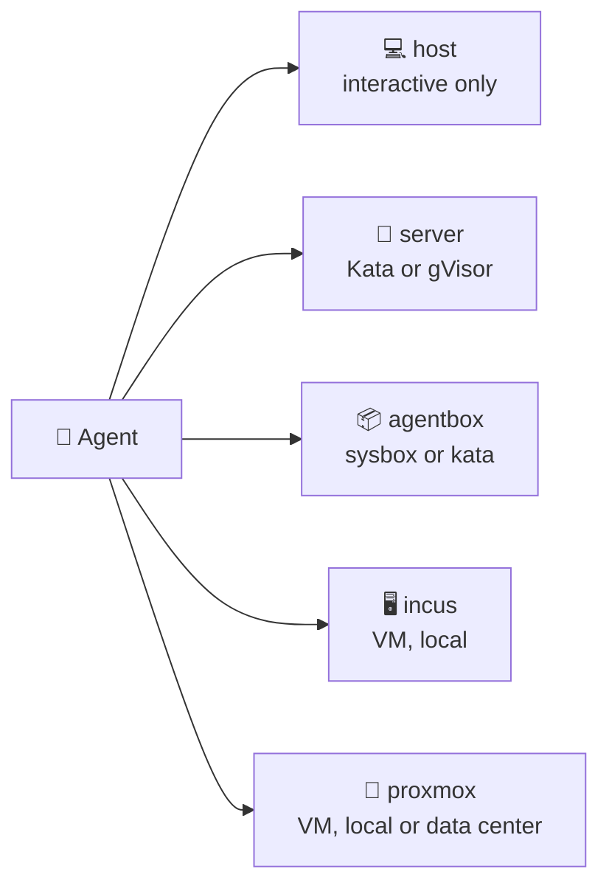
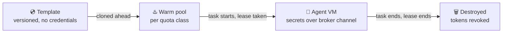
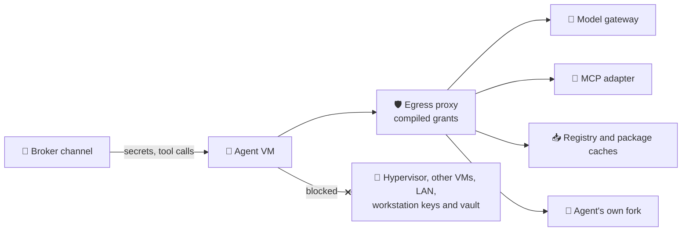
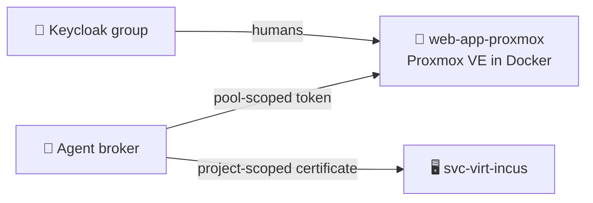

# 093 - Agents: VM Workspaces on Incus and Proxmox

## User Story

As an operator, I want an agent to work in its own virtual machine, on a local Incus host or on Proxmox VE in a data center, so that it can run the whole Infinito.Nexus development and test matrix behind its own kernel and has no path to my workstation's Docker daemon, keys or production vault.

## Scope

- Extends the Workspaces section of [089 - Agents and AI Restructuring](089-agents-restructuring.md) by two VM kinds, `incus` and `proxmox`, and adds Kata as a second box runtime of `dsk-agentbox`.
- The 089 sections Lifecycle, Identity and credentials, Forge working model, Workspaces, Agent firewall and Safety controls apply to a VM workspace. Where this file deviates, it says so and 089 carries a pointer back.
- Why a VM: the user namespace of a sysbox box blocks loop devices, dm-crypt, kernel filesystem modules and kernel NFS mounts. Three parts of the test matrix need them: the swarm NFS probe mount (`roles/svc-storage-nfs-client/tasks/main.yml`), the backup LUKS drill (`scripts/tests/deploy/swarm/routine/backup/02_luks_device.sh`) and the btrfs and zfs filesystem axis (`scripts/tests/deploy/utils/filesystem/docker_dataroot.sh`).
- Proxmox VE runs as a Docker container of the new role `web-app-proxmox`, in a data center or locally. No role installs Proxmox VE on a bare server.
- Login mode is a deliberate exception to [082](082-agents-phase-5-identity-and-workspaces.md) line 22 and to 089's Identity and credentials: in login mode the VM holds its agent's vendor login. In gateway mode, no workspace holds a model provider credential, as before.
- The harness settings modes `autopilot`, `copilot` and `zero-trust` live in the skills repository. Core passes the mode a workspace starts with; the managed settings that [080](080-agents-phase-3-firewall-compiler.md) compiles stay authoritative.
- Builds on: `roles/svc-ai-agent-broker`, `roles/svc-ai-agent-orchestrator`, `roles/svc-ai-mcp-adapter`, `roles/svc-ai-litellm`, `roles/svc-virt-kata`, `roles/dsk-agentbox`, `roles/dsk-gnt-claude`, `roles/dsk-gnt-codex`, `roles/dsk-gnt-pi`, `roles/svc-registry-cache`, `roles/svc-cache-package`, `roles/web-app-keycloak`, `roles/web-app-gitea` and the agent firewall of 089 compiled by 080.
- External dependencies: the agentbox repository (Kata runtime, clone-based workspace, no privileged fallback) and the skills repository (settings mode template).
- Proof tiers: every criterion is tagged `[unit]` (unit test or lint), `[ci]` (a CI row on a runner with `/dev/kvm`) or `[host]` (the named proof host). A `[host]` criterion is deployed to its host through an SSH inventory target by the operator. Every probe is recorded in `agents/criteria.yml` once it exists; no 093 probe exists yet, so the file holds no 093 entry.
- Depends on: [082](082-agents-phase-5-identity-and-workspaces.md).

## Approach

Where an agent can live:

Life of one VM per task, driven by `svc-ai-agent-broker`:

What an agent VM may reach:

Who manages the hypervisors:

## Acceptance Criteria

### Configuration

- [ ] `agent.yml` gains the field `workspace` with the sub-keys `kind`, `target`, `box_runtime`, `model_access`, `settings_mode` and `resources`; `kind` defaults to `server`, and lint L01 checks the new keys. `[unit]` Deviation: `kind` and `model_access` are required and have no default, because a default let an empty `workspace: {}` pass; the operator decides between the required keys and this wording.
- [x] `workspace.kind` takes `host`, `server`, `agentbox`, `incus` or `proxmox`; any other value fails the lint. `[unit]`
- [x] `workspace.kind: host` is refused for an autonomous role. `[unit]`
- [ ] `workspace.kind: incus` or `proxmox` without a `target` that names an inventory host fails the lint. `[unit]` Partly met: L01 checks the target against the repository's agents inventory only; an operator inventory is checked at deploy by `agent_vm_problems` against `groups['all']`, which is unit-tested but has not run in a deploy.
- [x] `workspace.kind: incus` or `proxmox` is refused for a role with `lifecycle: always_on`. `[unit]`
- [x] `workspace.kind: incus` or `proxmox` is refused for a role whose runtime is not in the VM template. `[unit]`
- [x] VM size comes from `workspace.resources` (vCPU, RAM, disk); the existing `quotas` field keeps its meaning. `[unit]`

### Incus host

- [ ] `svc-virt-incus` installs Incus on a Debian or Arch host, and `incus info` reports the server ready. `[ci]`
- [ ] The role creates the agent storage pool on a copy-on-write driver (btrfs, zfs or lvm-thin) and refuses the `dir` driver. `[ci]`
- [ ] The role refuses a host without `/dev/kvm` with an actionable message. `[unit]` Open: lands with B6.
- [ ] With Docker running on the same host, an agent VM reaches the egress proxy on the agent bridge. `[ci]`
- [ ] The broker reaches Incus only through a TLS client certificate restricted to project `agents-<instance>`. `[ci]`
- [ ] Through that certificate, creating a privileged instance or attaching a host-path disk is refused. `[ci]`

### Proxmox VE container

- [ ] `web-app-proxmox` builds its image from the official Proxmox VE `pve-no-subscription` repository at a pinned version; it uses no third-party image and no subscription workaround. `[unit]` Partly met: the build refuses an empty keyring sha512 and any unpinned package, and the keyring sha512 and the versions of `pve-manager`, `pve-cluster`, `pve-qemu-kvm` and `qemu-server` are pinned; the `vm` flavor of 110 installs from the pinned official ISO and takes only `proxmox-auto-install-assistant` from the repository, at a pinned version (`roles/web-app-proxmox/templates/Dockerfile.j2`). No image was built.
- [ ] Its `meta/services.yml` declares compose mode only; swarm is disabled. `[unit]` Open: lands with B7.
- [ ] Its compose file lists every device, capability and host namespace it uses, and the role README gives a reason for each. `[unit]` Partly met: the test matches each compose grant to a README entry and pins the corrected user namespace and port lines; it cannot prove a reason right, and the README was wrong on both before. The console websocket and the HTTPS upstream are open gaps the README names.
- [x] The role refuses a host that also runs `web-app-keycloak`, `svc-ai-litellm` or `web-app-openbao`, either in its own groups or on another inventory host whose `ansible_host` is the same after normalising case, the trailing dot, the IPv6 form and loopback (`localhost`, `127.0.0.1`, `::1` and `ansible_connection: local` count as one machine). As [110](110-proxmox-test-target-and-pool-token-per-workspace.md) decision 3 sets, the refusal has no override and runs under the `container` flavor only; no `proxmox.shared_host` key exists. `[unit]` `roles/web-app-proxmox/filter_plugins/proxmox_cohosted.py`; `test_the_container_refusal_has_no_override` and `test_no_shared_host_key_ships` in `tests/unit/python/roles/web-app-proxmox/test_flavors.py`; `test_each_exclusive_peer_in_own_groups_is_refused`, `test_peer_on_another_inventory_name_of_the_same_machine_is_refused` and `test_other_spellings_of_the_same_machine_are_refused` in `tests/unit/python/roles/web-app-proxmox/test_proxmox_role.py`. Not covered: two different names or addresses that reach the same machine through DNS or NAT.
- [ ] The role refuses a host without `/dev/kvm` with an actionable message. `[unit]` Open: lands with B6 and B7.
- [x] The container's memory and CPU limits cover (warm pool + `agents.max_running`) times the largest VM size plus the Proxmox VE overhead; the deploy refuses smaller limits. `[unit]` `vm_demand` in `utils/agents/budget.py` and `agent_vm_capacity` in `plugins/filter/agent_vm_capacity.py`, fed `PROXMOX_LIMITS` and `services.proxmox.agents.overhead` by `roles/web-app-proxmox/tasks/00_core.yml`; `test_container_limits_below_demand_plus_overhead_are_refused` and `test_enough_host_and_limits_pass` in `tests/unit/python/plugins/filter/test_agent_vm_capacity.py`, `test_container_limits_are_proven_against_the_vm_demand` in `tests/unit/python/roles/web-app-proxmox/test_proxmox_role.py`. Not run in a deploy.
- [ ] The role creates one resource pool and one broker token per Infinito.Nexus instance. `[host]`
- [ ] The broker token is privilege-separated and holds exactly the privileges the role README lists. `[host]`
- [ ] Through the broker token, moving a VM to another bridge, adding a host or foreign-storage disk, or touching a VM outside the pool is refused. `[host]`
- [ ] After a container restart, the pool, the token, the OIDC realm and the templates are unchanged. `[host]`
- [ ] After a container restart, the broker destroys every agent VM that was running and refills the warm pool. `[host]`
- [ ] A redeploy waits until no VM is assigned, or refuses with the list of assigned VMs. `[host]`
- [ ] The backup covers the Proxmox VE configuration and the templates and excludes agent VM disks. `[host]`
- [ ] Raising the pinned version and redeploying keeps the pool, the token, the realm and the templates working. `[host]`
- [ ] VM traffic leaves the container only through its own VM network; the host, port 8006 and every other Docker network the container joins are unreachable from an agent VM (probe recorded). `[host]`

### Proxmox web UI

- [ ] `web-app-proxmox` serves the Proxmox VE web UI at its own domain through the front proxy with a valid certificate. `[host]`
- [ ] From outside, only port 443 of the front proxy answers; ports 8006, 3128, 111, 5405 and 22 of the container are closed. `[host]`
- [ ] A Keycloak user in the role's administrator group logs in through the OpenID Connect realm and gets the `Administrator` role. `[host]`
- [ ] A Keycloak user outside the role's groups is stopped by the front proxy's group check and gets no Proxmox ticket. `[host]`
- [ ] The public domain refuses `/api2/` requests that carry an API token; the broker uses an internal address. `[host]`
- [ ] A login through the public domain with a `@pam` or `@pve` user fails, and `root@pam` has a locked password. `[host]`

### VM template

- [ ] One make target builds the template per VM kind. `[unit]` Partly met: the target renders the mkosi project into a new, empty directory and its dry run is unit-tested; the build itself has not run, which is a `[ci]` proof.
- [ ] The build reads host files only from the role's template directory and its pinned package list; any other host path fails the build (test: a file from `~/.netrc`). `[unit]` Partly met: the plan refuses symlinks, hard links, non-regular files, a used output directory and a runtime role outside `roles/`, each with a test, and mkosi builds from a copy of the rootfs that is checked right before and after the copy. The runtime and `act` sha256 sums are not filled in, so the render refuses to run. Gap, dependencies unverified: npm resolves the dependencies of each runtime tarball from the registry without a lockfile or a checked sum. Whether mkosi itself reads host configuration is a `[ci]` proof.
- [ ] gitleaks with the repository's configuration reports zero findings on the template's filesystem. `[ci]`
- [ ] The same gitleaks run reports a token seeded into a test build. `[ci]`
- [ ] The template holds no SSH host key and an empty `/etc/machine-id`; two clones started together differ in host keys, machine ID and IP address. `[ci]`
- [ ] In a VM from the template, `docker info`, `claude --version`, `codex --version`, `pi --version`, `zpool version`, `mkfs.btrfs -V`, `cryptsetup --version`, `mount.nfs -V` and `act --version` each exit with 0. `[ci]`
- [ ] The zfs module loads in an Incus VM; the role names the secure boot setting that allows it. `[ci]`
- [ ] Every agent VM reports the template version it was cloned from. `[ci]`
- [ ] A new template drains the warm pool, and the old template is removed once no VM uses it. `[ci]`

### Lifecycle

- [ ] A task is one orchestrator routine run or one claimed work package, and one VM serves one task. `[unit]` Partly met: a VM kind refuses `lifecycle: always_on`; no broker code binds one VM to one task yet.
- [ ] When the task ends, the broker destroys the VM and its disks; a listing on the hypervisor shows neither afterwards. `[ci]`
- [ ] The agent's persistent state (credentials volume, harness home and the `.kdbx` without a Nextcloud grant) lives outside the VM, and the `.kdbx` survives two consecutive tasks unchanged. `[ci]`
- [ ] Warm pools are kept per size class at the count the inventory names. `[ci]`
- [ ] With an empty pool, a start clones from the template; when the host lacks RAM or disk, the start waits in the broker queue and the broker reports the shortage. `[ci]`
- [ ] `agents.max_running` concurrent starts all succeed. `[ci]`
- [x] The deploy refuses a host whose free RAM or storage is below (warm pool + `agents.max_running`) times the largest VM size plus a reserve. `[unit]` Incus counts its storage pool size and adds its own running VMs back into free RAM. `web-app-proxmox` reads, while its Proxmox VE runs, the host memory (`memhost`) of the running VMs of the agent pool `agents-<DOMAIN_PRIMARY>` and the space their volumes take on the node's local image storages, and `agent_vm_capacity` in `plugins/filter/agent_vm_capacity.py` adds both back (`own_disk`, 0 from Incus). A fixed storage pool must hold the demand without the reserve, which stays with the host path; under the `vm` flavor the guest storage that holds the agent disks is that pool (its `total` and `used` from `pvesh`, the guest disk size before the guest answers), under `container` the Docker root stays the only bound. `proxmox_agent_usage` and `proxmox_agent_pool` in `roles/web-app-proxmox/filter_plugins/proxmox_capacity.py`, wired by `roles/web-app-proxmox/tasks/00_core.yml`; `test_a_small_guest_pool_is_refused_although_the_host_disk_is_large`, `test_control_a_large_guest_pool_passes`, `test_a_first_vm_deploy_is_bounded_by_the_guest_disk` and `test_the_host_reserve_stays_outside_the_guest_pool` in `tests/unit/python/roles/web-app-proxmox/test_capacity.py`, `test_a_fixed_pool_holds_the_demand_without_the_reserve` in `tests/unit/python/plugins/filter/test_agent_vm_capacity.py`. `test_space_of_the_roles_own_vm_disks_counts_as_free` and `test_negative_control_without_own_disks_the_same_host_is_refused` in `tests/unit/python/plugins/filter/test_agent_vm_capacity.py`; `test_a_redeploy_counts_the_agent_vms_as_free`, `test_negative_control_counting_them_as_used_refuses_the_same_host` and `test_a_first_deploy_reads_nothing_and_still_runs_the_check` in `tests/unit/python/roles/web-app-proxmox/test_capacity.py`; `test_a_redeploy_counts_its_agent_vms_as_free` and `test_a_first_deploy_reads_nothing_before_the_check` in `tests/unit/python/roles/web-app-proxmox/test_proxmox_role.py`; `test_capacity_counts_the_pool_and_the_running_vms` in `tests/unit/python/roles/svc-virt-incus/test_incus_role.py`. Not run in a deploy, and no step creates the agent pool yet (the resource pool box above), so until it does a Proxmox redeploy counts nothing back.
- [ ] The budget check of 089 counts warm pool VMs next to `agents.max_running`. `[unit]` Not met: the VM capacity check counts the warm pool, but 089's `budget.fits` has no caller outside its tests.
- [ ] vCPU, RAM and disk of a running agent VM, read back from the hypervisor, equal its `workspace.resources`. `[ci]`
- [ ] Every agent VM carries a lease (instance, broker, expiry); after the broker is killed mid-task, the restarted broker destroys every VM without a live lease and revokes its tokens within 5 minutes. `[ci]`
- [ ] After a hypervisor reboot, no VM from before the reboot runs, and the warm pool is refilled. `[host]`
- [ ] `make agents-stop` stops every agent VM on every Incus and Proxmox host. `[ci]`
- [ ] Every token minted for a VM (gateway, forge, MCP) is refused within 1 minute after the VM is destroyed. `[ci]`
- [ ] Before destroying a VM, the broker pushes each branch with commits not on the fork to `rescue/<instance>/<branch>` through the pre-push scan, and lists those branches and any uncommitted paths in the run directory. `[ci]`
- [ ] A pre-push scan hit at release keeps the VM stopped for operator review instead of destroying it. `[ci]`

### Broker channel and credentials

- [ ] Secrets and tool calls enter a VM only after it is assigned, over the broker channel the role README names (vsock on Incus, the guest agent on Proxmox), never through cloud-init, VM configuration or snippets. `[ci]`
- [ ] `incus config show`, `qm config` and the cloud-init drive of a running agent VM hold no secret (probe recorded). `[ci]`
- [ ] The orchestrator runs tool nodes inside a VM through the broker channel with its per-workspace token. `[ci]`
- [ ] In `keepass.mode: broker`, no `.kdbx` and no private key file is inside the VM, and a signed push from the VM succeeds through the forwarded credential helper and SSH agent. `[ci]`
- [ ] In `keepass.mode: agent`, the `.kdbx` reaches the VM over the broker channel. `[ci]`
- [ ] A probe compares every private key, keyring and vault-shaped file and every process environment in the VM against the fingerprints of the operator's GPG and SSH keys and the digest of the vault password, and finds no match. `[ci]`
- [ ] The same probe finds a copy planted in a test VM. `[ci]`
- [ ] The workstation's Docker socket, home directory and credential files are unreachable from inside the VM (probe recorded). `[ci]`

### Network

- [ ] Outside the VM, the hypervisor allows only DNS to its resolver, DHCP, and TCP to an egress proxy that admits the hosts of the agent's compiled `egress` grants by SNI or Host header. `[ci]`
- [ ] The hypervisor-side egress proxy is a compile target of the agent firewall next to the container network allowlist of 089. `[unit]` Not met: `vm_egress_proxy` exists as a library with no caller; gateway mode lacks the model gateway, the MCP adapter and the fork, and DNS to the resolver is not pinned.
- [ ] MAC, IPv4 and IPv6 filtering is on for the VM's network card. `[ci]`
- [ ] As root in the VM, after flushing the VM firewall, changing IP and MAC and setting another resolver, a request to a non-granted host fails, a request to a granted IP with a foreign SNI fails, any IPv6 request fails, and a granted host still succeeds. `[ci]`
- [ ] A TCP scan from an agent VM of every hypervisor address finds only DNS, DHCP and the egress proxy open. `[ci]`
- [ ] Two agent VMs on one host cannot exchange a packet. `[ci]`
- [ ] On the LAN, only the granted cache and gateway endpoints answer an agent VM. `[host]`
- [ ] `incus config show` and `qm config` of an agent VM list no disk or share from a host path. `[ci]`

### Caches

- [ ] Inside the VM, apt, PyPI and npm installs go through `svc-cache-package`. `[ci]`
- [ ] `svc-registry-cache` serves every registry the deployed roles pull from (Docker Hub, ghcr.io, quay.io, gcr.io, registry.gitlab.com). `[ci]`
- [ ] A ghcr.io pull that bypasses the cache is refused, and the same image through the cache succeeds. `[ci]`

### Models

- [ ] `workspace.model_access` takes `gateway` or `login` and defaults to `gateway`. `[unit]` Deviation: the two values are enforced, but `model_access` is required and has no default; see the `workspace` field above.
- [ ] In gateway mode, the VM reaches models only through `svc-ai-litellm` with a short-lived key that belongs to the agent's LiteLLM user, so one budget, one model list and one spend log cover all its VMs. `[ci]`
- [ ] In login mode, the operator logs in once per agent through the vendor's device flow, and the token is stored in the agent's `.kdbx`. `[host]`
- [ ] In login mode, the token reaches the VM only over the broker channel after assignment. `[ci]`
- [ ] In login mode, the vendor login file is excluded from the home snapshot and from its restore; a probe over the uploaded snapshot finds no login token. `[ci]`
- [ ] In login mode, the pre-push scan stops a diff that contains the token. `[ci]`
- [ ] In login mode, egress adds only the vendor hosts declared in `agents/firewall/providers/`. `[unit]` Partly met: the compiler adds only declared login hosts and applies the deny rule after the union, every egress target is compared lowercase without a trailing dot, and L08 refuses wildcards, other spellings and the user-content hosts `claude.ai` and `chatgpt.com`. A Codex VM signed in with a ChatGPT account therefore has no login path; no deploy calls the compiler yet.
- [ ] In login mode, `make agents-stop` destroys every login-mode VM. `[ci]`
- [x] In login mode, the deploy of the hypervisor host the agent targets prints that LiteLLM's model list, quotas and spend log do not apply and that the token stays valid at the vendor until the operator revokes it; login mode is refused outside `incus` and `proxmox`, and a VM workspace whose target runs no hypervisor of its kind fails the deploy once per play. `[unit]` The `svc-ai-agent-broker` deploy runs the target check too (`roles/svc-ai-agent-broker/tasks/utils/vm/agents.yml`), so a play without any hypervisor host still refuses a stray target; the refusal of login mode outside `incus` and `proxmox` is met by L01.
- [x] 082 line 22 and 089's Identity and credentials carry a one-line pointer to this login-mode exception. `[unit]`

### Return path

- [ ] Code leaves the VM only as pushes to the agent's fork on a forge (Gitea, GitLab, GitHub). `[ci]`
- [ ] The forge token used in the VM can write only to the agent's fork; a push to another repository of the same account, or to the upstream, is refused. `[ci]`

### Test matrix inside a VM

- [ ] `make compose-deploy` of `web-app-gitea` is green inside an agent VM. `[host]`
- [ ] `make swarm-zombie app=web-app-gitea` is green inside an agent VM, including its NFS mount and the LUKS device step of the backup drill. `[host]`
- [ ] The filesystem axis runs with `REQUIRED=true` inside an agent VM and logs `effective=btrfs` and `effective=zfs`. `[host]`
- [ ] The proof host for the test matrix has at least 100 GB free disk and is named in `agents/criteria.yml`. `[host]`

### Agentbox flavor

- [ ] `dsk-agentbox` requires an agentbox version with the Kata runtime and a clone-based workspace. `[unit]`
- [ ] A role installs the Kata shim for Docker; the role is named in the `dsk-agentbox` README. `[ci]`
- [x] 089's isolation rule for nested Docker allows `kata` next to sysbox and gVisor. `[unit]`
  - Evidence: `089-agents-restructuring.md` names sysbox, gVisor and kata and keeps the refusal of a privileged fallback.
- [ ] Without the runtime the inventory sets, the box start is refused; there is no privileged fallback. `[ci]`
- [ ] Under `kata`, `docker inspect` reports the Kata runtime for the box, and `systemd-detect-virt` inside it reports `kvm`. `[ci]`
- [ ] A box works on its own clone of each repository, never on a bind mount of a host checkout or its `.git`. `[ci]`

### Harness settings

- [ ] A workspace start passes `workspace.settings_mode` to the skills repository's settings template; core holds no copy of that template. `[unit]`
- [ ] A settings mode can only narrow the managed settings compiled by 080; a probe shows that a mode cannot widen a compiled `deny`. `[ci]`

## Cross-linking

- Index: [089 - Agents and AI Restructuring](089-agents-restructuring.md); 089's Phases and Cross-linking sections list 093.
- Related: [032](032-agent-employees-firecracker.md), [080](080-agents-phase-3-firewall-compiler.md), [082](082-agents-phase-5-identity-and-workspaces.md).
- Implementing PR: to be added.
