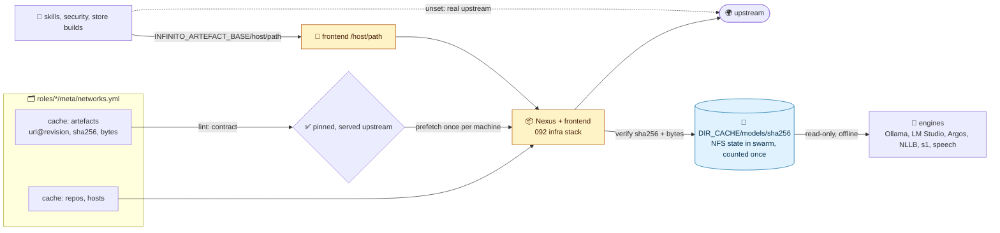

# 095 - Shared Artefact Cache: Pinned Model Store, Missing Upstreams, Speech and Host Cache Sync

## User Story

As an operator who runs core, the skills orchestrator, the security check and the store on the same machines, I want every model, wheel, Nix closure and container image fetched once through the core caches of [092](092-local-stack-architecture.md), pinned to an immutable revision with its digest and size, so that no rebuild, deploy or swarm node downloads the same artefact twice, no peer repository runs a cache of its own, and every peer still builds standalone against the real upstream.

## Context (2026-11-07, base 2ad6d753f6)

- Cache SPOT: `cache:` in a role's `meta/networks.yml`, collected by [hosts.py](../../utils/cache/hosts.py) into the Nexus repositories, the frontend's hijacked hosts, its leaf certificates and the consumers' `extra_hosts` ([cache.md](../contributing/environment/cache.md), "Adding a New Upstream").
- Model downloads bypass that SPOT today. `AI_LOCAL_MODELS` ([16_ai.yml](../../group_vars/all/16_ai.yml)) pins `sha256` and `bytes` but resolves `resolve/main`; NLLB, s1, LTEngine's GGUF and Open WebUI's embedding model carry no revision at all. Llama-3.2-1B is held twice (Ollama blob and LM Studio GGUF), the Argos packages twice (~13 GB each in `svc-ai-libretranslate-engine` and baked into `web-svc-libretranslate`), torch twice (NLLB pinned, s1 unpinned).
- `download.pytorch.org` ([nllb build.sh](../../roles/svc-ai-nllb-engine/files/shell/build.sh), [s1 build.sh](../../roles/svc-ai-s1/files/shell/build.sh)) and `cache.nixos.org` have no declaration. The torch wheel index links every wheel absolutely to `download-r2.pytorch.org` (all 1255 links of `whl/cpu/torch/`, measured 2026-11-07), so a raw proxy of `download.pytorch.org/whl/` behind `--index-url` serves the index but caches no wheel: pip fetches each one from that second host, past Nexus.
- [svc-registry-cache](../../roles/svc-registry-cache/README.md) mirrors Docker Hub only; ghcr.io, quay.io and mcr.microsoft.com go upstream on servers (#1374, branch `fix/svc-registry-cache/vendor-registries`).
- No speech service exists in core; whisper.cpp and piper live only in the skills orchestrator image.
- [065](065-shared-stack-caches.md) mounts an Arch host's pacman cache read-only and defers "deriving the default distro from the host" to a follow-up; this requirement is that follow-up.

## Decisions (operator, 2026-11-07)

Binding; not reopened by this document.

| # | Decision |
|---|---|
| D1 | Models: the Nexus proxy plus a pinned per-role artefact manifest (URL at an immutable revision, sha256, size), prefetched once through Nexus into `<DIR_CACHE>/models` (092's cap applies) and mounted read-only in offline mode; the Argos, Llama and torch duplicates go. Consumers fetch `<base>/<host>/<path>` with the base from `INFINITO_ARTEFACT_BASE`, so an unset variable means the real upstream (see the contract below for how core and peers read it). |
| D2 | Speech: a new opt-in core role `svc-ai-speech` (whisper.cpp and piper). Consumers stay layered (configured service, then mirror, then upstream), and the skills orchestrator keeps its in-container default. |
| D3 | Topology: 092's infra stack per machine (`svc-registry-cache` and the package cache) plus [076](076-remote-litellm-gateway.md)'s central LiteLLM gateway. One environment variable makes the host's own package cache sync with the cache provider's cache, so no package is held twice. Deploys prefer the distro already on the host: an Arch host deploys Arch so its pacman cache is already there; Debian and Ubuntu hosts equivalently with apt. |
| D4 | Nix: `cache.nixos.org` as a Nexus raw proxy plus `extra-substituters`. |
| D5 | Skills: a deployable custom role, with `make orchestrator-install` kept as the standalone path. |
| D6 | The registry cache also proxies ghcr.io, quay.io and mcr.microsoft.com (#1374), besides Docker Hub. |
| D7 | The store's (infinito-nexus/gui) own build caches are retired fully; it uses the core cache. Core only provides the interface; the gui side is planned in that repository. |
| D8 | This is a new requirement that 092 references, implemented in parallel. |
| D9 | Store owner: a new role `svc-ai-models` owns the model store under `<DIR_CACHE>/models` and declares its `min_storage`, counted once per digest; the AI engines only read from it. |
| D10 | Host cache sync on Debian and Ubuntu: with D3's variable set, the host's apt points at the provider's Nexus apt proxy, so host and stack share one cache. |
| D11 | PyTorch: cached by hijacking `download.pytorch.org` and `download-r2.pytorch.org` through the existing frontend, only after a host proof shows pip installing through Nexus. |
| D12 | The cache stack's version pin is out of scope here and goes to [096](096-cache-stack-pin.md). |
| D13 | Registry vendors on servers (operator pick, decision round 2026-11-12): [092](092-local-stack-architecture.md) D9's "server inventories keep `registry`, unchanged" reads as "same flavor plus vendor endpoints". `svc-registry-cache` keeps the `registry` flavor and adds one `registry:3` pull-through cache per vendor registry a role image names, behind one TLS front on the role network's gateway that admits `GET` and `HEAD` only. Its self-signed certificate is trusted in `/etc/docker/certs.d/<gateway>:<port>/` and nowhere else. On the cache host in compose mode the image lookup and the prepull route vendor references through the front; swarm deploys keep the swarm prefix. Vendor pulls there then depend on the cache being up, while Docker Hub keeps Docker's own fallback to `registry-1.docker.io`. With no vendor listed every render and every pull list stays byte-identical, so 092's byte-identity box for the `registry` flavor holds. |
| D14 | Swarm vendor pulls (operator pick, 2026-11-13 ~07:20 UTC): D13's vendor front stays compose-only, and swarm deploys do not route through it. Swarm nodes pull from the cluster registry, and `registry_sync` pulls an image upstream only while the cluster registry lacks it, so a repeated pull is a cluster-registry hit; only a rebuilt cluster and a new tag reach the vendor. The prepull on the stack host and image builds keep pulling upstream. |

Constraints (2026-11-07), binding for the store:

| # | Constraint |
|---|---|
| C1 | The store works in swarm: every node reads it, through NFS state or per-node seeding, and no node downloads an artefact on first use. |
| C2 | The store's size counts once in `min_storage`. `STORAGE_CONSTRAINED` sums the declared need per round, so a store counted per consumer flips more rounds into pruning (GitLab#3 flipped at 92.1 GiB need against 91.6 GiB free). |

## Model-Source Contract

The interface the skills orchestrator image, the security check and the store consume is written once, in [cache.md](../contributing/environment/cache.md), "Pinned Artefacts": who declares an artefact, its keys and quoting, the repository and host route its url resolves to, the `INFINITO_ARTEFACT_BASE` expression and how a consumer verifies what it fetched. Phase 1 fixes it in [artefacts.py](../../utils/cache/artefacts.py); a change to it is a change to that section.

## Approach

- Declarations stay the single source: the lint ties every pinned artefact to the one repository and host route its url resolves to, and `AI_LOCAL_MODELS` becomes a view over the manifest instead of a second list.
- A new upstream with no hijack (`raw-nixos-cache`) is proxied by Nexus and changes no consumer's name resolution or certificate; phase 4 points Nix's `extra-substituters` at it. PyTorch's wheels take the hijack of D11 instead, because the index links them to a second host.
- The store is content-addressed under `<DIR_CACHE>/models/<sha256>`; 092's `INFINITO_TOOLS_MODELS_MAX_SIZE` and the idle window bound it, and an artefact still declared by a deployed role is never evicted.

## Phases

Each phase merges alone and leaves every target working.

1. **Contract and upstream declarations**: the manifest and its lint, the raw proxy for `cache.nixos.org`, the docs.
2. **Store and base**: the `svc-ai-models` role (D9), the `cache_artefacts` lookup and the prefetch that is its first consumer, the shared store, swarm seeding, the `min_storage` accounting, the frontend's `/<host>/<path>` base, `INFINITO_ARTEFACT_BASE` for peers, the Hugging Face redirect proof.
3. **Engine migration and dedupe**: every model pinned in the manifest, engines on the read-only store in offline mode, one copy each of Llama, Argos and torch, torch through the PyTorch hijack of D11.
4. **Registry vendors and Nix**: ghcr.io, quay.io and mcr.microsoft.com through the registry cache on servers (#1374), Nix substituters wired.
5. **Host cache sync and distro preference**.
6. **Speech**: `svc-ai-speech` and its LiteLLM routes.
7. **Peers**: the skills custom role and the core interface the store's retirement relies on.

## Acceptance Criteria

Proof tiers: `[unit]` a unit test or lint, `[host]` the operator's workstation, `[ci]` a CI run, `[review]` a reviewer reading the change, for documentation no test can judge.

### Phase 1: Contract and upstream declarations

- [x] `utils.cache.artefacts` collects every `cache: artefacts:` entry of every role through the same `cache:` reader as the repositories and hosts. `[unit]`
- [x] A second role declaring an artefact name raises naming both roles, even with identical keys. `[unit]`
- [x] The contract check passes a pinned artefact under a served upstream on `huggingface.co` (models, datasets and spaces) and on `raw.githubusercontent.com`. `[unit]`
- [x] It refuses a revision that is not a 40-digit lowercase hex commit, on either host, one digit short or long, uppercase or date-shaped included. `[unit]`
- [x] It refuses a revision that is not the ref segment of its url. `[unit]`
- [x] It refuses a url on a host with no known ref layout. `[unit]`
- [x] It refuses a Hub url without an org, a repo or a file, or with `resolve` twice. `[unit]`
- [x] It refuses a url with `%` anywhere, encoded refs such as `ma%69n` included. `[unit]`
- [x] It refuses a url with a query or a fragment. `[unit]`
- [x] It refuses a url whose path carries a character outside the [path charset](../contributing/environment/cache.md#pinned-artefacts-), whitespace and shell metacharacters included. `[unit]`
- [x] It refuses a url with an empty or all-dot path segment. `[unit]`
- [x] It refuses a url with userinfo or an explicit port. `[unit]`
- [x] It refuses a non-`https` url. `[unit]`
- [x] It refuses a url under no repository upstream, a served host outside every upstream path included. `[unit]`
- [x] It resolves a url to the repository with the longest upstream prefix, and refuses a url under two repositories with the same upstream. `[unit]`
- [x] It refuses a url whose host breaks the [TLS route rule](../contributing/environment/cache.md#pinned-artefacts-): undeclared under `cache: hosts:`, without `443` among its `ports`, routing its TLS listener to another repository, or with a repository whose upstream is not the host's root. `[unit]`
- [x] It refuses an artefact name outside the [name pattern](../contributing/environment/cache.md#pinned-artefacts-). `[unit]`
- [x] It refuses a malformed digest, one digit short or long included. `[unit]`
- [x] It refuses a size outside the [`bytes` rule](../contributing/environment/cache.md#pinned-artefacts-). `[unit]`
- [x] It reports an `artefacts:` section or entry that is not a mapping, and an entry key other than `url`, `revision`, `sha256` and `bytes`. `[unit]`
- [x] The contract check of the declared artefacts reads only the artefacts it is handed; the shape check reads every role. `[unit]`
- [x] It refuses one digest declared with two sizes. `[unit]`
- [x] `url_for` returns the upstream for an empty base and for the shell default `https:/`, and `<base>/<host>/<path>` otherwise; it and `records` refuse every base the [base rule](../contributing/environment/cache.md#pinned-artefacts-) excludes, naming the reason. `[unit]`
- [x] The commit and sha256 patterns are defined once, in [digests.py](../../utils/digests.py), and imported by the manifest, the VM template, the repository-ref updater and the custom-role declaration. `[unit]` (`test_the_hex_patterns_have_one_definition` in `tests/unit/python/utils/cache/test_artefacts.py` covers those four plus the orchestrator webhook and the changelog jumps, which import `COMMIT` instead of restating it)
- [x] `store_bytes` counts one digest once however many names or roles declare it (C2). `[unit]`
- [x] `store_bytes` refuses one digest declared with two sizes. `[unit]`
- [x] A lint fails on every declared artefact that breaks the contract, and its own negative control reports a `resolve/main` pin under no repository upstream. `[unit]`
- [x] `svc-cache-package` declares `raw-nixos-cache` (`https://cache.nixos.org/`) as a raw repository that no hijacked host routes to. `[unit]`
- [x] [cache.md](../contributing/environment/cache.md) documents the repository and, as the one copy of the Model-Source Contract, the artefact declaration with its quoting rules, its repository and host route, its lint, `INFINITO_ARTEFACT_BASE` and the consumer's digest check. `[review]`
- [ ] After `make cache-apply`, `http://<package cache>:8081/repository/raw-nixos-cache/nix-cache-info` answers 200, and a second fetch of one `.nar` file is served from the blob store. `[host]`

### Phase 2: Store and base

- [x] The lookup `cache_artefacts`, which the prefetch reads as its first consumer, returns the records keyed by name, narrows to the roles named as terms, rewrites `url` under `base=` and keeps `upstream`, and fails the play naming the role and artefact when one breaks the contract. `[unit]` (`tests/unit/python/plugins/lookup/test_cache_artefacts.py`: `TestCacheArtefactsLookup`, with `test_a_contract_break_fails_naming_role_and_artefact` and `test_a_malformed_base_fails` as the negative controls; `roles/svc-ai-models/vars/main.yml` feeds it to the seed.)
- [x] A prefetch task fetches every artefact of the deployed roles once through Nexus into `<DIR_CACHE>/models/<sha256>`, verifies digest and size, and fails naming the artefact on a mismatch; a second run downloads nothing. `[unit]` (`tests/unit/python/roles/svc-ai-models/library/test_artefact_store.py` proves the store, the digest and size refusals and the idle rerun; `tests/unit/python/roles/svc-ai-models/test_nexus_route.py` proves that the development inventory hands `INFINITO_ARTEFACT_BASE`, forwarded by `compose.yml`, to the seed, which fetches every artefact through the frontend while the cache stack runs and upstream otherwise, with the role's own empty `artefact_base` as the negative control.)
- [x] In swarm, the store lives on NFS state (or is seeded on every node before any consumer starts), and no consumer container downloads an artefact on first use; a consumer whose artefact is missing fails before start instead (C1). `[unit]` (`tests/unit/python/roles/svc-ai-models/test_seed_nodes.py` renders `MODELS_SEED_NODES` for a swarm and a compose inventory and checks that the seed and the refusal loop over it; the engines read their pinned models offline behind the gates of `tests/unit/python/roles/svc-ai-models/test_engine_gates.py`. This holds for the artefacts the store seeds only: a LibreTranslate selection the pins do not cover, with fewer than two packages, a `load_only` code without a pinned package or a pair under `both` without its reverse, is not seeded even under the default `model_store: true`, so `svc-ai-libretranslate-engine` falls back to its `loading_model`, by default `lazy`, and downloads the package index and packages inside its container at start. `web-svc-libretranslate` runs no LibreTranslate of its own and forwards to that engine (086:19).)
- [x] The store's `min_storage` is `store_bytes` of the digests `svc-ai-models` seeds, declared once by `svc-ai-models` (D9) and never by an engine, so the round sum of `STORAGE_CONSTRAINED` counts each of those digests once (C2). `[unit]` (`tests/lint/ansible/roles/meta/test_store_min_storage_once.py`: `TestStoreMinStorageOnce`, with `test_the_guard_reports_a_drifted_store_and_a_second_owner` and `test_a_libretranslate_selection_stays_out_of_the_floor` as the negative controls; the declared value is the static sum, packed and unpacked, over the artefacts `svc-ai-models` seeds itself, every declared artefact except the Argos and MiniSBD records `libretranslate_unselected` leaves to the LibreTranslate consumers, so it equals its value before those pins and the store's floor does not move; only a row whose services include a LibreTranslate consumer moves, by that consumer's selection. No `min_storage` counts a consumer's selection, whose size follows its `load_only` and `directions`, about 650 MB for `en,de` under `both` up to about 19 GB for every pair; the round sum adds it on top, as the next box records.)
- [x] The round sum of `STORAGE_CONSTRAINED` counts the digests a LibreTranslate consumer seeds as its selection, each once, so a row whose `load_only` and `directions` select up to the 180 Argos and MiniSBD records of `svc-ai-libretranslate-engine`, about 19 GB, is not under-stated (C2). `[unit]` (`tests/unit/python/utils/storage/test_constrained.py`: `TestLibretranslateSelection`. `required_storage_bytes` adds `selection_storage_bytes` of the walked services, which sizes the `libretranslate_selection` of every service declaring `directions`, `load_only` and `model_store`, packed and unpacked, each digest once. Every pair counts 180 records at their declared 19,019,255,166 bytes, and `en,de` counts 2 packages plus the 82 MiniSBD models. Two consumers selecting `en,de` in one round count it once, as `test_two_consumers_selecting_one_digest_count_it_once` proves on two synthetic consumer roles, and `svc-ai-libretranslate-engine` is the only role in the tree that declares a selection. No selected digest is in the floor of `svc-ai-models`. The negative control `test_the_round_sum_counts_what_load_only_selects` fails with `0 != 18370189652` against the sum without the term. The CI planner prices a compose row under the round's variants, as the deploy sums it (`tests/unit/python/cli/meta/ci/iterate/test_budget.py`: `TestComposeRoundVariants`), and `closure_storage` puts each selected digest on the first role of a closure that seeds it (`TestClosureSelection`).)
- [x] The frontend answers `/<host>/<path>` for every served host by routing to that host's repository, the one its TLS listener serves under the [TLS route rule](../contributing/environment/cache.md#pinned-artefacts-). `[unit]`
- [x] `default.env` declares `INFINITO_ARTEFACT_BASE` with the value `https:/`, and `make dotenv` writes the frontend's base only while the cache stack runs. `[unit]`
- [ ] A pinned `huggingface.co` file fetched through `raw-huggingface` lands in the blob store although the Hub redirects it to its LFS or Xet host; if Nexus does not follow the redirect, those hosts get their own declarations. `[host]`
- [x] Eviction under 092's models cap never removes an artefact that a deployed role still declares. `[unit]`

### Phase 3: Engine migration and dedupe

- [x] `AI_LOCAL_MODELS` reads `url`, `sha256` and `bytes` from the manifest, and every entry resolves a 40-digit commit instead of `resolve/main`. `[unit]` (`tests/unit/python/plugins/filter/litellm/test_local_model.py` `TestLocalModelsPinned`: the pins come from the named artefact, a declaration that pins the file itself is refused, every shipped model resolves a 40-digit commit)
- [x] NLLB, s1, LTEngine's GGUF and Open WebUI's embedding model are pinned artefacts, and their engines start with their offline switch (`HF_HUB_OFFLINE=1` or the engine's equivalent) on a read-only mount of the store. `[unit]` (each engine's `meta/networks.yml` pins the files its loader reads at one Hub commit; `test_every_engine_pins_its_model_in_one_tree` and the gate checks in `tests/unit/python/roles/svc-ai-models/test_engine_gates.py`, `test_the_engine_pins_its_model_in_one_tree` in `tests/unit/python/roles/svc-ai-nllb-engine/test_store_gate.py`, the store floor in `tests/lint/ansible/roles/meta/test_store_min_storage_once.py`)
- [x] `web-svc-libretranslate` bakes no models into an image of its own; the engine's Argos store is mounted read-only. `[unit]` (`svc-ai-libretranslate-engine` pins the 49 `en` to `x` Argos packages of argospm-index commit `ff90de60728f7c1338ff6b75974e4c89b2442d22`, their 49 `x` to `en` reverses from the same commit and the 82 MiniSBD v0.0.1 models. Since 086:19 the web role runs no LibreTranslate and forwards to the engine, so the engine is the only consumer. With `model_store: true`, its default, the engine seeds, requires and mounts only the pairs its `load_only` and `directions` select, one read-only bind per package in `ARGOS_PACKAGES_DIR`, so a CI row with `load_only: [en, de]` seeds 2 packages and the MiniSBD models, about 650 MB, instead of the whole 19 GB. A selection of fewer than two packages keeps its `loading_model`, because LibreTranslate fetches the package index and installs on every start below two, and `svc-ai-models` leaves the Argos and MiniSBD records to the consumers' selections instead of seeding all 98 packages. `tests/unit/python/roles/svc-ai-libretranslate-engine/test_store_gate.py` proves on these declared pins that `from_source` and `both` open the gate and bake nothing, that the engine hands its `load_only` to the selection and its bind-mount switch, that `en,de` holds exactly `en_de` and `de_en` under `both` and `en,de,fr` exactly `en_de` and `en_fr` under `from_source`, and that the store role's own seed drops exactly the engine's records; the negative controls are a removed reverse pin, an unpinned code, a single-package selection (`from_source` with `en,de`), `model_store: false` and `test_both_directions_need_every_pinned_pair_in_reverse`. The `build` and `task` variants of the engine keep `model_store: false`, so the bake and task paths stay deployed; `lazy` with the store off is left to the unit render of that file, since the lazy variant now runs the store. Under the default `model_store: true` a selection the pins do not cover is not seeded: the engine downloads it inside its container at start under `lazy` (`test_the_lazy_path_serves_a_selection_the_pins_do_not_cover`); `tests/unit/python/roles/web-svc-libretranslate/test_front.py` proves the web role builds nothing and reads no model store. `svc-ai-models` counts the packed and unpacked bytes of what it seeds itself once in its `min_storage`, which leaves out the LibreTranslate selections; the round sum of `STORAGE_CONSTRAINED` counts each consumer's selection instead, as the selection box of Phase 2 records.)
- [ ] Llama-3.2-1B is held once on a host that deploys both Ollama and LM Studio. `[host]`
- [ ] A host proof shows pip installing torch through Nexus with `download.pytorch.org` and `download-r2.pytorch.org` hijacked, before the hijack merges (D11). `[host]`
- [ ] The NLLB and s1 builds install torch through that hijack at one pinned version. `[unit]` (Open: both builds install torch at `AI_TORCH_VERSION` of `group_vars/all/16_ai.yml`, proven with a negative control by `tests/unit/python/roles/svc-ai-s1/test_torch_pin.py`; the hijack waits on the D11 host proof above.)

### Phase 4: Registry vendors and Nix

- [ ] On a server, `svc-registry-cache` serves ghcr.io, quay.io and mcr.microsoft.com besides Docker Hub, and a second pull of an image from each is a cache hit (#1374). `[host]`
- [ ] `dev-nix` and the quality repository's Nix image list the `raw-nixos-cache` URL in `extra-substituters` with `cache.nixos.org`'s public key, and a second build of the same closure fetches nothing upstream. `[host]`

### Phase 5: Host cache sync and distro preference

- [x] One variable (proposed `INFINITO_CACHE_HOST_SYNC`, default off) makes the host's package cache and the cache provider's cache hold each package once: packages the stack downloaded land in the host cache, and packages the host holds are served to the stack without a download. `[unit]`
- [x] With the variable set on a Debian or Ubuntu host, the host's apt sources point at the provider's Nexus apt proxy (D10): every suite of an archive it proxies, a country alias of that archive included, reaches the repository of the suite's pocket, else the archive's release repository, and no repository and suite get copies from two archives. Amended after the operator pick of 2026-11-12 ~23:40 UTC, which asked for one Nexus repository per suite where that is architecturally clean: it is not, since a Nexus apt proxy already serves every suite of its archive. `[unit]`
- [x] With the variable off, every rendered compose file and cache configuration is byte-identical to the render before this phase. `[unit]`
- [x] Without an explicit `INFINITO_DISTRO`, a stack on an Arch host deploys Arch, and one on a Debian or Ubuntu host deploys that distro; an explicit value wins. `[unit]` (`tests/unit/python/utils/env/handlers/infinito/test_distro.py`: `TestHostDistro`, with `test_any_other_host_keeps_the_fallback` and `test_a_ci_runner_keeps_the_fallback` as the negative controls.)

### Phase 6: Speech

- [x] `svc-ai-speech` serves transcription with the whisper.cpp server, its image pinned to a release commit and its model a pinned artefact of the shared store, and is opt-in: it deploys only where an inventory names it, and every consumer's `speech` flag follows `'svc-ai-speech' in group_names`. `[unit]` (`test_the_image_is_the_cpu_build_of_a_pinned_commit` and `test_the_model_comes_read_only_from_the_pinned_store` in `tests/unit/python/roles/svc-ai-speech/test_server.py`, `test_the_declared_flag_follows_the_speech_role` in `tests/unit/python/roles/svc-ai-litellm/templates/test_config_audio_routes.py`, `test_the_speech_flag_follows_the_deployed_backend` in `tests/unit/python/roles/web-app-nextcloud/test_speech_to_text_gate.py`.)
- [x] `svc-ai-speech` serves speech synthesis with piper as a pinned artefact, opt-in the same way. `[unit]` (`TestSynthesisServer` in `tests/unit/python/roles/svc-ai-speech/test_server.py`: `test_the_server_answers_the_openai_speech_route`, `test_the_voice_comes_read_only_from_the_pinned_store` and `test_the_voice_is_pinned_at_a_commit` prove the `piper` container of the role serves `/v1/audio/speech` from the `en_US-libritts-high` voice and its `.onnx.json` config pinned at one `rhasspy/piper-voices` commit with sha256 and size, read-only from the store, `test_the_start_waits_for_every_voice_file_in_the_store` that the start is refused without both voice files, and `test_the_image_is_built_from_hash_pinned_wheels` that the engine is `piper-tts` 1.8.0 from hash-pinned wheels, with `test_an_unhashed_or_unpinned_requirement_is_caught` as the negative control; `tests/unit/python/roles/svc-ai-speech/files/test_server.py` proves the request shape, the WAV answer and the refusals of the synthesis server, with `test_the_server_is_healthy_only_with_piper_and_both_voice_files` as the health negative control. The voice pins pass the contract lint of `tests/lint/ansible/roles/meta/test_cache_artefacts_pinned.py`. Synthesis is a second container of the same role, so it deploys only where an inventory names `svc-ai-speech`; `test_the_synthesis_route_follows_the_speech_role` in `tests/unit/python/roles/svc-ai-litellm/templates/test_config_audio_routes.py` proves the consumer flag follows `'svc-ai-speech' in group_names`, with an empty `group_names` publishing no synthesis route.)
- [x] LiteLLM routes `/v1/audio/transcriptions` to it when it is deployed and has no audio route otherwise. `[unit]` (`test_the_speech_server_publishes_one_transcription_route` in `tests/unit/python/roles/svc-ai-litellm/templates/test_config_audio_routes.py`, with `test_without_the_speech_server_no_audio_route_is_published` as the negative control.)
- [x] LiteLLM routes `/v1/audio/speech` to it when it is deployed and has no synthesis route otherwise. `[unit]` (`test_the_speech_server_publishes_one_synthesis_route` and `TestSynthesisRoute` in `tests/unit/python/roles/svc-ai-litellm/templates/test_config_audio_routes.py`: one `audio_speech` route for `services.piper.model_alias` (`tts-1`) whose `api_base` reaches the piper inference path, with the server's timeout and no provider key; `test_without_the_speech_server_no_synthesis_route_is_published` and `test_a_flag_without_the_shared_network_publishes_no_route` are the negative controls.)
- [ ] A transcription and a synthesis through LiteLLM answer on the workstation. `[host]`

### Phase 7: Peers

- [ ] The skills repository's custom role deploys the orchestrator through core, `make orchestrator-install` keeps working without any core stack, and the orchestrator image builds with and without `INFINITO_ARTEFACT_BASE`, verifying the same digests. `[host]`
- [x] The cache interface the store consumes (registry mirror address, package cache URLs, frontend CA, `INFINITO_ARTEFACT_BASE`) is documented in [cache.md](../contributing/environment/cache.md) as one table. `[review]`

## Tests

Each test names what fails without the change.

Phase 1:

- `tests/unit/python/utils/cache/test_artefacts.py`: collection, one test per refusal of the contract (commit on both hosts and its length and case, ref segment, Hub org, repo and file, percent escapes, query and fragment, path characters, dot segments, userinfo and port, upstream prefix, longest upstream and tie, TLS listener, TLS route and root upstream, name charset, section and entry shape, unknown keys, digest length, one digest with two sizes), the rewrite including the shell default and the malformed base with its reason, the digest-once sum, records, the duplicate-name refusal, the quoting rule, the contract check over only the artefacts handed in and the one definition of the commit and sha256 patterns. Fails without the change: `utils.cache.artefacts` does not exist.
- `tests/lint/ansible/roles/meta/test_cache_artefacts_pinned.py`: the contract over every role, with a negative control on a fixture tree. Fails without the change: no guard exists, and the fixture's `resolve/main` entry goes unreported.
- `tests/unit/python/roles/svc-cache-package/test_unhijacked_repos.py`: `raw-nixos-cache` is a raw proxy of `cache.nixos.org` that no hijacked host routes to. Fails without the change, since no role declares the repository, and again once a host routes to it.

Phase 2:

- `tests/unit/python/plugins/lookup/test_cache_artefacts.py`: role narrowing, the base passthrough and the contract failure. It lands with the prefetch, because `tests/integration/ansible/lookups/test_usage.py` refuses a lookup without a production caller.
- `tests/unit/python/utils/cache/test_prefetch.py`: one download per digest, the digest refusal, the idempotent rerun, the eviction exemption, the swarm seeding before any consumer starts and the fail-before-start of a consumer whose artefact is missing.
- `tests/unit/python/roles/svc-cache-package/test_artefact_base.py`: the frontend's `/<host>/<path>` routes and the `INFINITO_ARTEFACT_BASE` value with and without the cache stack.
- `tests/lint/ansible/roles/meta/test_store_min_storage_once.py`: only `svc-ai-models` declares the store's bytes in its `min_storage`, and no engine does.

Phase 3 to 7 add one test per criterion tagged `[unit]`, each shown red on the tree before its phase.

## Open Questions

None. O1 to O3 of the earlier draft (the store owner, the Debian and Ubuntu sync direction, the PyTorch path) are decided as D9 to D11 on 2026-11-07.

## Cross-linking

- Builds on: [092 - Local Stack Architecture](092-local-stack-architecture.md) (infra stack, models cap), [065 - Shared stack caches](065-shared-stack-caches.md) (host pacman cache, distro follow-up), [076 - Remote LiteLLM Gateway](076-remote-litellm-gateway.md) (central gateway).
- Split off: [096 - Cache stack pin](096-cache-stack-pin.md) (the cache stack's version pin, D12).
- Related: #1374 (registry vendors).
- Implementing PR: to be added.
