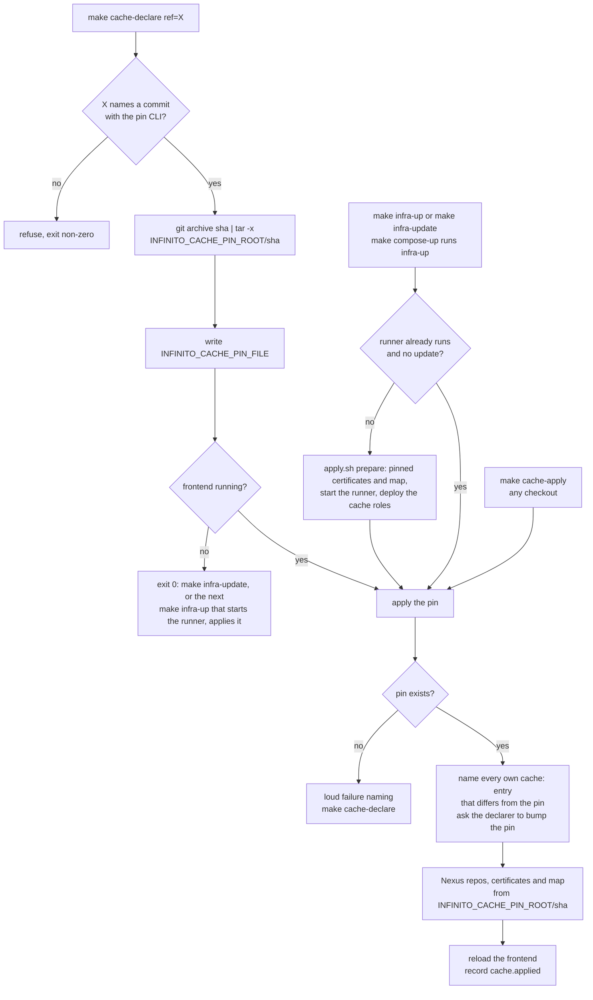

# 096 - Cache Stack Pin: One Declared Version for the Shared Cache Stack

## User Story

As an operator who runs many worktrees and agents against one shared cache stack, I want that stack to serve the cache declarations of one declared commit, the way `make install-skills` installs the committed state of one pinned ref, so that no worktree overwrites what another one is served, the primary checkout carries no cache stack state, and every worktree on every branch is served the same set.

## Context (2026-11-07, base e74b882b21)

- `make cache-apply` ([apply.sh](../../scripts/system/cache/apply.sh)) renders the calling checkout's `cache:` declarations, creates their Nexus repositories, issues their certificates and copies the calling checkout's nginx map onto the file the frontend mounts. `make compose-up` runs it for every checkout that shares the stack ([compose.py](../../cli/administration/deploy/development/compose.py), `_apply_shared_cache`). Whoever applied last wins.
- The frontend mounts the owning checkout's `compose/package-cache-frontend/upstreams.conf` (`compose/cache.override.yml` (removed), `INFINITO_CACHE_PACKAGE_FRONTEND_CONF`). Every apply from a worktree writes that file in the primary checkout, so the primary checkout holds a map another branch rendered.
- [cache.md](../contributing/environment/cache.md), "Adding a New Upstream", documents the overwrite as expected behaviour.
- The skills already solve the same problem: [skills.sh](../../scripts/install/skills.sh) installs the committed state of `INFINITO_SKILLS_REF`, never a working tree.

## Decisions (operator, 2026-11-07)

Binding; not reopened by this document.

| # | Decision |
|---|---|
| D1 | Host-local pin. The declared version is one host file, `${XDG_STATE_HOME:-~/.local/state}/infinito/cache.ref`. Only `make cache-declare ref=<commit>` writes it. Every worktree reads it, whatever branch it is on, so all are on the same state. |
| D2 | The declarer bumps the pin. A worktree never applies its own `cache:` declarations to the shared stack. A new or changed declaration lands on a commit first; then the declarer (the agent who owns the cache, by order of the operator) moves the pin to that commit and applies it once. |
| D3 | The cache stack and its declarations come from the committed state of the pinned commit, checked out outside every worktree and outside the primary checkout, below `~/.local/share/infinito/cache/<sha>`, in the simplest immutable form. |

## Approach

### Paths

| Key | Value | Written by |
|---|---|---|
| `INFINITO_CACHE_PIN_FILE` | `$XDG_STATE_HOME/infinito/cache.ref`, `~/.local/state` when the variable is unset or relative | `make cache-declare` |
| `INFINITO_CACHE_PIN_ROOT` | `$XDG_DATA_HOME/infinito/cache`, `~/.local/share` when the variable is unset or relative | `make cache-declare`, `make cache-apply` |
| `INFINITO_CACHE_PACKAGE_FRONTEND_CONF` | `$INFINITO_CACHE_PIN_ROOT/upstreams.conf`, the map the frontend mounts | `make cache-apply` |

Both pin keys are owned by [pin.py](../../utils/env/handlers/infinito/cache/pin.py), which lists them in `STATIC_READS`: `custom.env` wins, then an exported value, then a non-empty value in [default.env](../../default.env), then the XDG derivation. No shell script carries a default. `INFINITO_CACHE_PACKAGE_FRONTEND_CONF` is derived from the pin root after `custom.env` is applied, so a custom root moves the map with the checkouts. The applied commit is recorded beside the pin as `cache.applied`.

Agents write both locations: an agent sandbox MUST list `~/.local/share/infinito/cache` (or the configured `INFINITO_CACHE_PIN_ROOT`) and `~/.local/state/infinito` (the directory of `INFINITO_CACHE_PIN_FILE`) in `sandbox.filesystem.allowWrite`; the rationale is in [sandbox.md](../contributing/tools/agents/claude/sandbox.md). `INFINITO_CACHE_PIN_ROOT` must be absolute and outside the checkout, or every pin script refuses it. Where the cache stack is driven from a container through the host's Docker socket, the pin root must have the same path in the container and on the host, because the frontend bind-mounts the map from it; [call-test-workspace.yml](../../.github/workflows/call-test-workspace.yml) mounts `/mnt/cache/pin` that way and its bootstrap declares its own `HEAD` before `make compose-up`.

### Materialization

`make cache-declare` resolves the ref to a full commit (`git rev-parse --verify <ref>^{commit}`), refuses a ref that names no commit or a commit without the pin CLI, and extracts the commit with `git archive <sha> | tar -x` into `$INFINITO_CACHE_PIN_ROOT/<sha>`, leaving out `locale/`, `tests/` and `docs/`, which the cache path never reads. It renders the derived cache files inside that directory, below the resolved pin root, requires the rendered map and moves it into place atomically, so a half-extracted or unrendered checkout never carries the name of a commit; a scratch directory is removed when the shell exits, also on an interrupt, and a symlinked checkout is refused. Materializing, pinning and applying hold an exclusive `flock` on `$INFINITO_CACHE_PIN_ROOT/.lock`; the apply reads the pin again once it holds the lock. The directory has no `.git`, belongs to no branch and is never listed by `git worktree list`. Writing the pin prunes the checkout of every other commit except the previous pin, which stays for a rollback and for an apply another worktree may still be running from it; the served map, scratch directories of a materialization in progress and anything not named by a full commit id stay, and a checkout that cannot be removed is left in place.

### Apply

- Every `make infra-up` and `make infra-update`, and so every `make compose-up`, applies the pin in full: after the start, the deploy of the cache roles and the installs and before `make cache-evict`, which on a fresh Nexus logs in only after the apply's bootstrap; also when the start or an install fails, unless an interrupt or a takeover rollback ends the call, which applies nothing; and when it finds the runner running and deploys nothing; there is no skip. Under the infra runner the apply is the only writer of the Nexus repositories: the infra inventory sets `services.bootstrap.enabled: false`, which drops the role's bootstrap sidecar and its repository task, so no restart or recreate of the stack brings a caller's repositories back. A failed apply only warns; the call then runs `make cache-evict`, which fails the call only on a fresh or wiped Nexus, where it cannot log in without the apply's bootstrap. `make cache-apply` exits 4 only for a frontend whose map lies outside the pin root, and the warning then names `make infra-update`; it exits 3 without a readable pin, 2 for an unknown stage, 1 for a stopped frontend or runner (its message names `make infra-update`), a failed `docker ps` or `docker inspect` or a frontend without a mounted map, and with the failing step's own code otherwise.

- `make cache-apply` reads the pin, exports the declaration-derived keys (`INFINITO_CACHE_HOSTS`, `INFINITO_CACHE_TLS_HOSTS`, `INFINITO_CACHE_UPSTREAMS`) computed by the pinned checkout's own code, runs the pinned checkout's `bootstrap.sh` and `certs.sh`, copies the pinned map in place onto the file the frontend bind-mounts (a rename would leave the frontend on the old inode), ignoring interrupts during the copy, leaves it read-only and reloads nginx. The caller's working tree contributes nothing but its `.env`.
- A checkout whose own declarations differ from the pinned ones is told which repositories and hosts differ and to ask the declarer to bump the pin. The message never fails a deploy.
- Every call that starts or recreates the infra runner (`make infra-up` while it does not run or with `takeover=true`, `make infra-update`, and the `make compose-up` that runs them), from whichever checkout, runs `apply.sh prepare` first: it issues the pinned certificates and installs the pinned map at `INFINITO_CACHE_PACKAGE_FRONTEND_CONF`, so the frontend starts on the pinned map. `make infra-up` refuses a map outside `INFINITO_CACHE_PIN_ROOT`, also one below the cache base.
- A checkout's `compose.cache-consumer.yml` hijacks and apt sources name only the hosts the pinned checkout declares identically (`agreed` in [pin.py](../../utils/cache/pin.py)); a host declared only or differently in the caller keeps its real address instead of reaching a frontend without its server block or certificate. While the configured pin, its checkout or its declarations cannot be read, for example in an act container that sees the host's frontend but not its pin, no host is hijacked and a warning says so; only an environment without `INFINITO_CACHE_PIN_FILE` renders the caller's own declarations. Inner Dockerfile builds are not filtered yet: the runner's `build.extra_hosts` ([compose.py](../../roles/sys-svc-compose/files/python/compose.py)) still hijacks every host in the caller's `INFINITO_CACHE_HOSTS` and `INFINITO_CACHE_HTTP_HOSTS`.
- `make cache-apply` refuses, before it touches anything, a frontend whose map mount lies outside the resolved `INFINITO_CACHE_PIN_ROOT` (another host's root, an act container sharing the host daemon, a frontend from before the pin) and names both paths; a `docker ps` that fails is an error, never a stopped frontend.
- `make cache-status` prints a `cache: pin` row on stderr: pin file, pinned commit, applied commit, checkout and whether it exists. Stdout keeps one object per cache, the contract `make runner-count` and the Check_MK local check read.

### Without a pin

There is no fallback to any working tree.

| Caller | Behaviour |
|---|---|
| `make cache-apply` | exits non-zero with `no cache pin at <file>; the declarer runs make cache-declare ref=<commit>`; nothing is touched |
| `make infra-up` that would start the runner, `make infra-update`, and the `make compose-up` that runs them | stops before any service starts: `apply.sh prepare` prints the message above (or `INFINITO_CACHE_PIN_FILE is not set; run make dotenv` while `.env` predates the pin), then `ERROR: the cache stack does not start without its pin`, naming `make dotenv`, `make cache-declare ref=<commit>` and [cache.md](../contributing/environment/cache.md); a cache stack already running keeps running |
| `make infra-up` that finds the runner running, and the `make compose-up` that runs it | prints the same message and a warning, keeps the map the frontend already serves, continues the deploy |
| `make cache-status` | prints the pin row with `"pin": null` and the message on stderr, exits 0 |
| `make cache-declare` while the frontend or the infra runner is not running | writes the pin, says `make infra-update`, or the next `make infra-up` or `make compose-up` that starts the infra runner, applies it, exits 0; while the runner runs without its frontend, `make cache-apply` exits 1 and `make infra-up` warns and exits 0 without applying it, so only `make infra-update` applies it |
| `make cache-declare` while `docker ps` fails or the frontend serves another pin root | writes the pin, says it is not applied and why, exits non-zero |

### Rollout

1. After the merge every checkout on this code runs `make dotenv-force` once from a fresh shell, which writes the two pin keys and moves `INFINITO_CACHE_PACKAGE_FRONTEND_CONF` below the pin root; until then `make cache-apply` exits with `INFINITO_CACHE_PIN_FILE is not set; run make dotenv`. [load.sh](../../scripts/meta/env/load.sh) lets an exported value win over `.env`, so a shell that still exports the old `INFINITO_CACHE_PACKAGE_FRONTEND_CONF` keeps the in-checkout path, and every apply then refuses the frontend.
2. The declarer runs `make cache-declare ref=<merge commit>` once. While only the legacy per-checkout stack runs, its frontend on the primary checkout's `compose/package-cache-frontend/upstreams.conf`, no infra runner runs, so the pin is written and the call exits 0. An infra runner started by older code runs its frontend on the role's own map, outside the pin root, so there the pin is written and the apply refuses, naming that mount.
3. `make infra-up takeover=true` stops the legacy containers and starts the infra runner, whose frontend mounts the pinned map below the pin root; a plain `make infra-up` or `make compose-up` refuses while a legacy cache container runs. A runner started by older code is recreated with `make infra-update`; a plain `make infra-up` or `make compose-up` on it only applies, which exits 4 and warns naming `make infra-update`. From then on the primary checkout's `compose/package-cache-frontend/upstreams.conf` is unused and may be deleted.
4. A worktree still on older code keeps running its own apply; its copy onto the read-only map fails, the frontend keeps the pinned map, and its deploy continues with the warning it already prints.

## Acceptance Criteria

Proof tiers: `[unit]` a unit test or lint, `[host]` the operator's workstation.

- [x] `make cache-declare ref=<ref>` writes the full commit `<ref>` names to `INFINITO_CACHE_PIN_FILE` atomically. `[unit]`
- [x] `make cache-declare` refuses an abbreviated id written as a pin, a tree, a blob, an unknown ref, a ref starting with `-` and a commit without `cli/meta/cache/pin`, and writes no pin for any of them. `[unit]`
- [x] The pin and the checkout paths derive from `XDG_STATE_HOME` and `XDG_DATA_HOME`, with the `~/.local/state` and `~/.local/share` fallbacks for an unset or relative value, through an env handler; no shell script carries an inline default for them. `[unit]`
- [x] The pinned commit is materialized from its committed state below `INFINITO_CACHE_PIN_ROOT/<sha>`, outside every checkout, without uncommitted changes, without `locale/`, and without a scratch directory left behind. `[unit]`
- [x] Writing a pin removes the checkout of every commit but the new and the previous pin, and keeps the served map, scratch directories and every entry not named by a full commit id; an invalid pin removes nothing. `[unit]`
- [x] `make cache-apply` runs the Nexus bootstrap and the certificate issuer of the pinned checkout with the pinned declarations, installs the pinned map onto the mounted file read-only and records the applied commit; nothing of the caller's working tree reaches the stack. `[unit]`
- [x] Before any call starts or recreates the infra runner, the pinned certificates and the pinned map are in place. `[unit]`
- [x] `make infra-up`, `make infra-update` and so `make compose-up` apply the pinned declarations in full on every call, after a deploy and before the eviction, also after a failed deploy that neither an interrupt nor a takeover rollback ends, and on a runner that already runs, for every checkout that shares the stack, and nothing else writes the runner's Nexus repositories: the infra inventory drops the role's bootstrap sidecar and repository task. `[unit]`
- [x] A checkout whose `cache:` declarations differ from the pinned ones gets one line per differing repository or host and `ask the declarer to bump the pin`, and its deploy does not fail for that. `[unit]`
- [x] Without a pin, `make cache-apply` exits non-zero naming `make cache-declare` and touches nothing, a `make infra-up`, `make infra-update` or `make compose-up` that would start or recreate the runner stops before any service starts with an error naming `make dotenv` and `make cache-declare ref=<commit>`, a `make compose-up` that finds the runner running continues, and `make cache-status` reports `"pin": null`. `[unit]`
- [x] `make cache-status` prints the pinned and the applied commit. `[unit]`
- [x] `INFINITO_CACHE_PACKAGE_FRONTEND_CONF` lies outside the checkout, so `make dotenv` in a worktree never writes the map the frontend mounts. `[unit]`
- [ ] After the first `make cache-declare` and the call that starts or recreates the infra runner on this code (`make infra-up takeover=true` from the legacy stack, `make infra-update` for a runner started by older code, `make compose-up` where none runs), `python -m cli.administration.infra docker inspect package-cache-frontend` shows the map mounted from `INFINITO_CACHE_PIN_ROOT`, `python -m cli.administration.infra docker ps -a` lists no `package-cache-bootstrap`, two worktrees on different branches are served the same map, and `make cache-status` shows pin and applied commit equal. `[host]`
- [x] [cache.md](../contributing/environment/cache.md) documents the pin, `make cache-declare`, the behaviour without a pin and the rollout. `[unit]`

## Tests

- `tests/unit/python/utils/cache/test_pin.py`: validation, read, atomic write, the applied record, declare with pruning, resolution and refusal, drift lines, the status row and the CLI exit codes.
- `tests/unit/python/scripts/system/cache/test_apply.py`: `apply.sh` against stubs, with a caller checkout and a materialized pin that differ; `prepare`; no pin; the lock and the re-read pin; exit 4 only for a map outside the pin root, exit 1 for a failed inspect, a frontend without a map and a refused pin root; no stage that skips the apply; an interrupt during the map copy leaves the served map whole on its inode; the materialization and rendering of a temporary repository's committed state through a symlinked root, the refused roots and checkouts, the scratch cleanup; `declare.sh` refusing a commit without the pin CLI and pinning without a running frontend; the workspace bootstrap declaring its `HEAD`.
- `tests/unit/python/utils/cache/test_render.py`: the hijacks and apt sources keep only the hosts the pin declares identically.
- `tests/unit/python/utils/env/handlers/infinito/test_cache_conf.py`: the XDG derivation and the map below the pin root.
- `tests/unit/python/utils/test_infra.py` and `tests/unit/python/utils/test_infra_pin.py`: `make infra-up` and `make infra-update` prepare the pin before they start or recreate the runner and apply it after the deploy and before `make cache-evict`, also when the deploy raises but not on an interrupt, a failed takeover rolls back and applies nothing, a failed eviction keeps a finished takeover, a call that finds the runner running only applies it, a record that names the pin never skips the apply, no step reads or writes a record itself, only a foreign map's warning names `make infra-update`, and every other warning leaves the fix to the message of `apply.sh`; a failed prepare stops the call with the declarer hint and starts nothing, a failed apply never stops anyone. `tests/unit/python/utils/test_infra_cutover.py`: `make infra-up` refuses a map outside the pin root, also one below the cache base. `tests/unit/python/roles/svc-cache-package/test_host_paths.py`: the infra inventory hands the frontend the map at `INFINITO_CACHE_PACKAGE_FRONTEND_CONF` and drops the bootstrap sidecar and the role's repository task, which a role deploy without the key keeps.
- `tests/integration/meta/env/test_dotenv_generator.py`: the pin handler declares both keys in `STATIC_READS`.

## Cross-linking

- Related: [092 - Local Stack Architecture](092-local-stack-architecture.md) (one cache stack per machine; Phase 5 moves the stack into the infra runner, which then reads the same pin), 095 - Shared Artefact Cache (not on this branch yet), [065 - Shared stack caches](065-shared-stack-caches.md).
