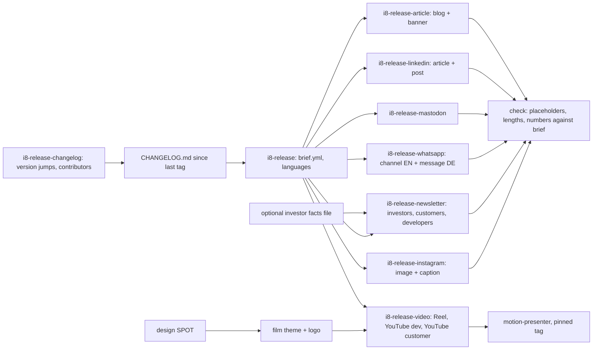

# 097 - Release Skills: One Release Brief for Every Channel

## User Story

As the operator who ships an Infinito.Nexus release, I want one `i8-release` skill that turns the changelog into every announcement a release needs (blog article, LinkedIn article and post, Mastodon post, WhatsApp messages, three audience newsletters, a Reel, two YouTube films, an Instagram image and the changelog entry), so that each release reaches investors, customers and developers in the project's voice, with no claim the changelog does not carry, and at the lowest token cost.

## Context (2026-11-08, base 446b3b1652)

- [i8-release-article](../../agents/skills/i8-release-article/SKILL.md) routes to the `release_article` routine, which writes the blog article, the banner and the Mastodon and LinkedIn texts in one skill. Its steps cite a "writing standard" that no file defines; only the templates ([article.html](../../agents/skills/i8-release-article/templates/article.html), [banner.svg](../../agents/skills/i8-release-article/templates/banner.svg)) exist, and `banner.svg` carries its own colours instead of the design SPOT.
- [PR #997](https://github.com/infinito-nexus/core/pull/997) by Alejandro Roman adds `skills/presentaitor`: narrated multi-chapter presentation films of any product. It is a fork of [kaventro/motion-designer](https://github.com/kaventro/motion-designer) at `7d0b8bb` (MIT), not an npm package:
  - 16 reference files and 15 scripts are unchanged copies of upstream;
  - 15 upstream files are changed (about +330/-71): voice-timed `film()` with `line()` and `scene()`, the voice-first `voiceover.py`, the mask clip fix (`TRAVEL`), `render.mjs --fps/--scale/--preview`, the Chatterbox length window, the `install.sh` `eval` fix;
  - about 930 new engine lines: `timing.py`, `silence.py`, `footage.py`, `camera.mjs`, `presets.js` with 14 motion presets, a playground, 2 tests;
  - the series layer: `tools/` (film, join, reflow, voice_all, contact_sheet, playground), a setup interview, a scene library, the `infinito` preset (its own colours `#142CAD` against the SPOT `#001f3f`, a 1 MB copy of [logo.png](../../assets/img/logo.png)), about 11 MB of music and voice.
- Upstream merges no external pull requests: all merged PRs (#1 to #8) are the owner's; #9, a one-line frontmatter fix, was closed on 2026-11-03 without a merge.
- The design SPOT is `design.colors.base` and `design.font` in [services.yml](../../roles/web-svc-design/meta/services.yml), turned into tokens by [palette.py](../../utils/design/palette.py) (`build_palette`).
- The general skills repository (`kvb-<category>-<name>`) holds `kvb-release-changelog`, which writes the `pkgmgr release` message, and pins third-party skills in `skills-lock.json`.
- Reference channels: [blog.infinito.nexus](https://blog.infinito.nexus/) release posts (version, colon, benefit headline; lead; upgrade callout; short benefit subheads; "If you… / Then…" checklist; "More Reliable" and "Updated Applications" lists; about 500 to 600 words), [Mastodon](https://microblog.infinito.nexus/@kevinveenbirkenbach) release posts (about 480 to 510 characters: version and headline, one benefit paragraph, "Also new:" line, a `s.infinito.nexus/infinitoNN` short link, hashtags), the [LinkedIn company page](https://www.linkedin.com/company/107414216/).
- The core 17.0.0 changelog run (Main, 2026-11-08) spent most hand work on version jumps and contributors: a commit list over 2430 commits misses net changes, and a meta-only scan misses renamed pins, `requirements.yml` collections, `pyproject.toml` and Dockerfiles under `roles/*/files`.

## Decisions (operator, 2026-11-08)

Binding; not reopened by this document.

| # | Decision |
|---|---|
| D1 | A collector skill `i8-release` calls one subskill per channel, `i8-release-<channel>`. |
| D2 | General skills hold the methods and prefer a project `<prefix>-release-<channel>` skill when one exists; the `i8-release-*` skills hold only project facts and reference the general method. |
| D3 | WhatsApp: a channel post in English and a personal message in German. |
| D4 | Newsletters: one each for investors, customers and developers. |
| D5 | The investor newsletter states only what the repository proves, plus figures from an optional facts file the operator passes; a section without evidence is left out, never filled with a placeholder. |
| D6 | Video: a Reel of 30 seconds, a YouTube film for developers (technical overview) and a YouTube film for customers (end-user, feature-oriented). Instagram: one image with text. |
| D7 | Superseded by D10 and D11: presentaitor does not enter core. |
| D8 | LinkedIn: a company-page article and a short post that links it. |
| D9 | The collector asks once per release which languages to write; the default is English only. |
| D10 | The film tooling lives in its own repository `infinito-nexus/motion-presenter`, a GitHub fork of `kaventro/motion-designer` with two skills: `skills/motion-designer` (upstream plus Alejandro Roman's engine commits) and `skills/motion-presenter` (the narrated series layer). The fork is the engine changes' permanent home; upstream is merged in with `git merge`, an upstream PR is optional. |
| D11 | PR #997 is not merged into core. Its commits move to the fork with Alejandro Roman's authorship, and PR #997 gets a comment with the link. Alejandro Roman released his additions under MIT. |
| D12 | The name is `motion-presenter` (repository and skill). |
| D13 | motion-presenter carries no brand and no project data: theme tokens and the logo path are inputs with a neutral default, and the scene code takes its data as input. Core renders the Infinito theme from the design SPOT and writes the scene data per release from the changelog; nothing generated is checked in. |
| D14 | The skills repository lists motion-presenter only through a `skills-lock.json` pin, never a copy. |
| D15 | The music and voice defaults ship in the fork, with their credits and consent files. |
| D16 | `i8-release-changelog` reads version jumps and contributors deterministically, so the agent only writes prose. |

## Approach

### Layers

| Layer | Responsibility | Home |
|---|---|---|
| Engine | short films from code: scenes, beat, render, voice timing | `motion-presenter/skills/motion-designer` |
| Presentation | narrated series of any product: interview, chapters, scene library, presets, music, voice | `motion-presenter/skills/motion-presenter` |
| Brand | Infinito colours, fonts, logo | core design SPOT |
| Content | what a release says | core `i8-release-*` |

### Release brief

The collector reads the changelog once and writes `brief.yml`: version, date, headline benefit, three to five benefits with their changelog lines, upgrade notes, updated applications, links. Every channel subskill reads only the brief and its own channel facts, never the changelog, so the facts live in one place and the changelog is read once per release instead of once per channel.

### Channels

| Subskill | Output | General method |
|---|---|---|
| `i8-release-article` | blog article HTML, banner PNG and alt text | `kvb-create-article` |
| `i8-release-linkedin` | company-page article, post | `kvb-create-article`, `kvb-create-post` |
| `i8-release-mastodon` | post | `kvb-create-post` |
| `i8-release-whatsapp` | channel post (English), personal message (German) | `kvb-create-post` |
| `i8-release-newsletter` | subject, preheader and Markdown body per audience, pasteable as a [listmonk](../../roles/web-app-listmonk/README.md) campaign | `kvb-create-article` |
| `i8-release-instagram` | 1080 x 1350 image with text, caption | `kvb-create-post` |
| `i8-release-video` | Reel 9:16 30 s, YouTube 16:9 for developers and for customers (2 to 3 minutes each, chapters), YouTube descriptions with chapter marks | `motion-presenter` |
| `i8-release-changelog` | the release entry | `kvb-release-changelog` |

The collector is `kvb-create-release`. The general names follow the skills repository's `kvb-<category>-<name>` rule; the Skills agent confirms them. Outputs land in `/tmp/release-<version>/`. Nothing is published by an agent; the hand-over lists every file for the operator.

## Acceptance Criteria

### motion-presenter repository

- [ ] The repository is a GitHub fork of `kaventro/motion-designer` under `infinito-nexus` and keeps upstream's history and MIT licence.
- [ ] `skills/motion-designer` differs from upstream `7d0b8bb` only by Alejandro Roman's engine commits (authored by him) and by separate security-fix commits: the sha1 cache keys use `usedforsecurity=False`, `music_gen.py` calls only http(s) URLs on the configured server, runtime asserts raise. Upstream's own code style stays, so `git merge upstream` stays cheap.
- [ ] `skills/motion-presenter` holds the series layer from PR #997 (authored by Alejandro Roman) and reaches the engine as `../motion-designer`; no engine file is copied.
- [ ] No brand and no project data: a neutral default theme, the theme contract (tokens `--bg`, `--bg2`, `--ink`, `--ink2`, `--ink3`, `--accent`, `--accent2`, `--sans`, `--mono`, a logo path) and the scene data contract are documented; the scene library reads its names, titles and versions from the data input; no file names Infinito.Nexus.
- [ ] `.claude-plugin/marketplace.json` lists both skills; `npx skills add infinito-nexus/motion-presenter` installs them.
- [ ] Upstream's tests and the engine tests (`test_silence`, `test_timing`) pass; one draft render of a two-chapter demo series finishes.
- [ ] A NOTICE names the upstream commit, the changed upstream files and the credits of every shipped medium.

### Core (this repository)

- [ ] PR #997 carries a comment with the fork link and the move of its commits; core contains no file of it.
- [x] A theme renderer under `utils/design/` maps `build_palette(design.colors.base)` and `design.font` to the motion-presenter theme tokens, takes the logo from `assets/img/logo.png`, and a unit test proves the mapping against the SPOT. (`theme` in `utils/design/film_theme.py`; `test_every_contract_token_is_set`, `test_colours_come_from_the_dark_palette_of_the_base`, `test_fonts_come_from_the_design_font` and `test_logo_is_the_design_logo` in `tests/unit/python/utils/design/test_film_theme.py`.)
- [ ] One `make` target installs the pinned motion-presenter tag and its tools, using the existing headless shell installer ([mermaid_cli.py](../../utils/install/lint/mermaid_cli.py)) instead of a second Chrome download.
- [ ] `agents/skills/i8-release/SKILL.md` exists, asks for the languages once (default English), writes `brief.yml` and calls every subskill in the table above.
- [ ] Each `i8-release-<channel>` skill in the table exists, holds only project facts (channel, voice, measured length bounds, links, hashtags, templates) and names its general method.
- [x] `i8-release-article` writes only the blog article and banner; the Mastodon and LinkedIn texts move to their own subskills, so no channel is written by two skills; `banner.svg` takes its colours from the theme renderer. (`agents/skills/i8-release-article/SKILL.md` beside `i8-release-mastodon` and `i8-release-linkedin`; `test_every_channel_is_written_by_exactly_one_skill` in `tests/unit/python/agents/routines/test_release.py`, `test_templates_carry_no_colour_literal` in `tests/unit/python/utils/design/test_film_theme.py`.)
- [ ] `i8-release-video` writes the scene data from `brief.yml`, renders the theme, and calls motion-presenter; no theme, logo or scene data is checked in.
- [x] `i8-release-changelog` runs a deterministic extractor before any prose step (`cli/contributing/changelog/extract`, called first in `agents/skills/i8-release-changelog/SKILL.md`; `test_jumps.py`, `test_pins.py`, `test_contributors.py` and `test_entry.py` in `tests/unit/python/cli/contributing/changelog/extract/`):
  - version jumps from the net diff between the last tag and the target, across `roles/*/meta/**/*.yml`, `requirements.yml` collections, `pyproject.toml` and Dockerfiles under `roles/*/files`, including renamed and added pins and versions inside URLs;
  - per-role rows collapsed into one line per role;
  - contributors from `git shortlog -sne` over the range, mapped to their GitHub profile URL, without bots, with co-author trailers counted;
  - the entry inserted into a scratch copy of `CHANGELOG.md` and checked with markdownlint;
  - a unit test per source proves the extraction.
- [x] The routine behind `i8-release` reads the changelog in one step and every channel step reads `brief.yml`; `python -m agents.routines show release` prints the steps. (`agents/routines/release.py`; `test_show_prints_every_step` and `test_every_channel_step_reads_the_brief_only` in `tests/unit/python/agents/routines/test_release.py`.)
- [x] The routine's check step is deterministic: it fails on a leftover placeholder, an em dash, a length outside the channel's bounds or a number absent from the brief, and a unit test proves each failure. (`problems` in `agents/routines/tools/release.py`; `test_a_leftover_placeholder_fails`, `test_an_em_dash_fails`, `test_a_length_outside_the_bounds_fails` and `test_a_number_absent_from_the_brief_fails` in `tests/unit/python/agents/routines/tools/test_release.py`.)
- [x] The investor newsletter omits a section the repository and the facts file cannot prove, and a test proves the omission. (`outline` in `agents/routines/tools/release.py`; `test_a_section_without_evidence_is_omitted` in `tests/unit/python/agents/routines/tools/test_release.py`.)
- [ ] `agents/roles/release/agent.yml`, the [cheatsheet](../contributing/tools/agents/cheatsheet.md) and every other reference name the new skills.
- [ ] The lints under `tests/lint/agents/` and the repository lints pass for every new file, and its Markdown follows [documentation.md](../contributing/documentation.md).

### General skills (skills repository, reviewed and merged by the Skills agent)

- [ ] `kvb-create-release` collects the changes since the last `vX.Y.Z` tag, writes the brief, and hands each channel to `<prefix>-release-<channel>` when the project has one, else to the general method.
- [ ] `kvb-create-article` and `kvb-create-post` exist with one-line descriptions and no project facts; `kvb-release-changelog` stays the changelog method.
- [ ] `skills-lock.json` pins `infinito-nexus/motion-presenter` at a tag; no file of it is copied.
- [ ] `make test` is green in the skills worktree and the listing budget holds.
