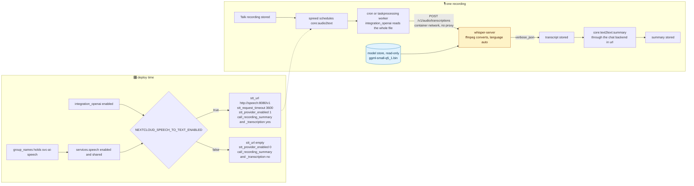

# 134 - Talk Recording Transcription Needs a Speech Backend

## User Story

As a Nextcloud Talk user who records a call, I want every stored recording to end with a transcript and a summary whenever a speech-to-text backend is part of the deployment, and no transcription attempt where none is, so that a recording never ends in a "Failed to transcript call recording" notification and the Assistant never offers a transcription it cannot deliver.

## Context (2026-11-19, echoserver)

Production proved on the live host: Nextcloud 34.0.6, spreed 24.0.8, integration_openai 4.5.2, assistant 3.5.1. The owner of "Recording 2026-11-19 13-27-24.webm" (194.6 MB, about 35 minutes) got "Failed to transcript call recording". The `core:audio2text` task of 14:02:29 UTC failed after 1 s with "OpenAI Whisper transcription failed with: API request error: Client error: POST <https://chat.ai.infinito.nexus/api/audio/transcriptions> resulted in a 413 Request Entity Too Large response". The body of that 413 was the OpenResty error page, so the proxy answered before Open WebUI saw the request. Unauthenticated probes on the same host: `POST /api/audio/transcriptions` answers 405 (no such route, the SPA mount answers), `POST /api/v1/audio/transcriptions` answers 401 (the route exists only under `/api/v1`, behind authentication). spreed held `call_recording_summary=yes`; integration_openai held `url=https://chat.ai.infinito.nexus/api` and no `default_stt_model_id`; `speech_to_text_model` was empty in core and in the echoserver host_vars, so Open WebUI ran no STT engine either.

Every layer between the recording and a transcript failed:

| Layer | Finding | Source |
|-------|---------|--------|
| spreed | Schedules `core:audio2text` for every stored recording while `call_recording_summary` (upstream default `yes`) or `call_recording_transcription` is `yes` and any provider is registered, and a `core:text2text:summary` task on its output | spreed v24.0.8 `lib/Service/RecordingService.php` (`finalizeRecording`, `storeTranscript`), `docs/settings.md` |
| Role | Set `call_recording_summary=yes` whenever integration_openai was enabled, so "an OpenAI-compatible backend" stood in for "a speech-to-text provider" | `roles/web-app-nextcloud/meta/addons/spreed.yml` |
| integration_openai | Registers its `core:audio2text` provider while `stt_provider_enabled` is `1`, its default; reads the whole file into PHP memory and posts it in one multipart request to `<stt_url or url>/audio/transcriptions`, model `whisper-1`, `response_format=verbose_json`, file name always `file.mp3`, no chunking, 240 s timeout | integration_openai v4.5.2 `lib/AppInfo/Application.php`, `lib/Service/OpenAiAPIService.php` (`transcribeFile`, `transcribe`, `request`), `lib/Service/OpenAiSettingsService.php` |
| URL | Points at Open WebUI's `/api` whenever Open WebUI is deployed, else at LiteLLM's `/v1` | `roles/web-app-nextcloud/meta/addons/integration_openai.yml` |
| OpenResty | Answered the 413: Open WebUI has no `meta/server.yml`, so its location keeps the `100m` default and 194.6 MB is above it | `roles/sys-svc-proxy/templates/location/html.conf.j2`, `roles/svc-stack/tasks/proxy/domain.yml` |
| Open WebUI 0.11.0 | Has no `/api/audio/transcriptions` route: its audio router sits under `/api/v1/audio`, and the SPA static mount answers any other POST with 405. A higher body limit would turn the 413 into a 405 | open-webui v0.11.0 `backend/open_webui/main.py` |
| LiteLLM | Routed chat models only; no transcription route existed, and no speech role existed in core | `roles/svc-ai-litellm/templates/config.yaml.j2`, [095](095-shared-artefact-cache.md) |

## Decisions

1. **Off switch (decided 2026-11-19, superseded by decision 2).** The first round declared `addons.integration_openai.config.speech_to_text: false` and gated `stt_provider_enabled` and `call_recording_summary` on it, which stopped the failure notices but transcribed nothing. Decision 2 removes that declaration: no inventory turns transcription on or off by hand.
2. **The backend is `svc-ai-speech`, reached directly (operator, 2026-11-19).** The operator asked for transcription that works, switched on wherever the service exists. The role is the opt-in speech role of [095](095-shared-artefact-cache.md) D2: the whisper.cpp server (`ghcr.io/ggml-org/whisper.cpp`, tag `main-<commit>` of release v1.9.5, CPU, amd64), the multilingual model `ggml-small-q5_1.bin` pinned as a store artefact at a Hugging Face commit with its sha256 and size, and `POST /v1/audio/transcriptions` on the container network.
   - **Activation:** `web-app-nextcloud` carries `services.speech` with `enabled` and `shared` set to `'svc-ai-speech' in group_names`, the way it carries every other partner. `NEXTCLOUD_SPEECH_TO_TEXT_ENABLED` is true exactly while integration_openai is enabled and that flag is on and shared. It drives `stt_url` (`http://speech:8080/v1`, else empty), `stt_provider_enabled` (`1`/`0`) and spreed's `call_recording_summary` and `call_recording_transcription` (`yes`/`no`).
   - **Direct, not behind LiteLLM:** LiteLLM could carry the route, since its OSS proxy sets no upload cap (`max_file_size_mb` applies only when configured, and only for premium), but it is the wrong hop here. Its `/v1/audio/transcriptions` handler reads the whole upload into the gateway's memory, which is a 2 GiB container every chat consumer shares. With a remote gateway (`gateway_host`, [076](076-remote-litellm-gateway.md)) the recording would cross the mesh to another host, and `svc-ai-speech` in this host's `group_names` would say nothing about that gateway's routes. Nextcloud holds a LiteLLM key only while Open WebUI is absent, so the echoserver topology would need a second key path. And the gateway's model list feeds chat machinery (router alias, speed measurement, Open WebUI grants) that a transcription route would have to be excluded from. 095's criterion for LiteLLM audio routes stays open for other consumers.
3. **No raised body limit on Open WebUI (decided).** Raising `client_max_body_size` on the Open WebUI vhost proves nothing: the route is absent, the built-in engine is unproven to finish a 35-minute recording on 2 CPUs within integration_openai's 240 s timeout, it downloads its model from Hugging Face on first use, and the limit would apply to every path of a public chat frontend. The new path crosses no proxy at all, so no limit is raised anywhere.
4. **`call_recording_transcription` follows the same gate (decided 2026-11-19, replaces "stays unmanaged").** spreed writes `<recording>.md` only while `call_recording_transcription` is `yes`; at its upstream default `no` the transcript feeds the summary and is dropped (`storeTranscript`). A stored transcript lands in the owner's recording folder with a notification that offers to share it; nothing is posted into the conversation on its own. The operator's proof expects a transcript and a summary, so the role writes `yes` exactly when it writes `call_recording_summary=yes`.
5. **Hour-long recordings fit along the whole path (decided).** A WebM video recording measured 5.56 MB per minute, about 334 MB per hour. Each hop is sized for that:

| Hop | Limit | Value |
|-----|-------|-------|
| spreed | schedules the task with the file id, nothing is uploaded | none |
| Nextcloud `cron` and `taskprocessing` | both claim `core:audio2text` tasks, and integration_openai holds the whole file as a PHP string; PHP `memory_limit` is half of Nextcloud's `mem_limit` | `memory_limit` 1536 MB; container limit 1 GB each (cron raised from 512 MB) |
| integration_openai | `stt_request_timeout`, read from `services.speech.request_timeout` of `svc-ai-speech` | 3600 s (upstream default 240 s) |
| Proxy | none: `stt_url` is the container-network address, `integration_openai` allows local addresses for a non-OpenAI URL | none |
| LiteLLM | not on the path | none |
| whisper.cpp upload | the bundled cpp-httplib sets no payload maximum; its read and write timeouts (600 s) apply per socket operation, not per request | unlimited |
| whisper.cpp memory and disk | the upload, its 16 kHz WAV and the PCM buffer stay in memory while one request runs; the upload and the WAV go to `/tmp` | `mem_limit` 3 GB, about 1.4 GB and 450 MB per recorded hour |

Out of scope: integration_openai's `tts_provider_enabled` has the same flaw (Open WebUI serves no `/api/audio/speech`); it needs its own requirement, and piper, the TTS half of 095 D2, belongs there.

## Approach

- The summary goes to integration_openai's main `url`, the chat backend that already serves the Assistant. On the Open WebUI topology it authenticates with the recording owner's API key, or the admin key where one is set.
- `svc-ai-models` seeds the model into every node's store once; its `min_storage` counts the 190085487 bytes.
- `web-app-nextcloud` variant 2 (Open WebUI) pins `speech` on, every other variant pins it off, so CI deploys the backend in the topology echoserver runs.

## Acceptance Criteria

### Backend

- [x] `svc-ai-speech` runs `whisper-server` from the pinned CPU image with `--host 0.0.0.0`, the role's internal port, `--inference-path /v1/audio/transcriptions`, `--convert`, `--tmp-dir /tmp`, `--language auto` and as many threads as its CPU cap, and never with `--detect-language` (`test_the_server_answers_the_openai_transcription_route`, `test_every_upload_is_converted_before_inference`, `test_the_language_is_detected_and_then_transcribed`, `test_threads_follow_the_cpu_cap` in `tests/unit/python/roles/svc-ai-speech/test_server.py`).
- [x] The model is a multilingual ggml file pinned in `meta/networks.yml`, read from the model store mounted read-only (`test_the_model_comes_read_only_from_the_pinned_store`, `test_the_pinned_model_is_multilingual`), and `svc-ai-models` counts it in its `min_storage` (`tests/lint/ansible/roles/meta/test_store_min_storage_once.py`).
- [x] The health check reads `/health`, and the image is the CPU build of one pinned commit (`test_the_health_probe_reads_the_ready_route`, `test_the_image_is_the_cpu_build_of_a_pinned_commit`).
- [x] The role README describes the server, its route, its model cache and its limits (`roles/svc-ai-speech/README.md`).

### Nextcloud wiring

- [x] No inventory declaration is left: the gate reads no `addons.integration_openai.config` key, and `services.speech` renders on exactly while `svc-ai-speech` is in `group_names` (`test_no_manual_declaration_is_left`, `test_the_speech_flag_follows_the_deployed_backend` in `tests/unit/python/roles/web-app-nextcloud/test_speech_to_text_gate.py`).
- [x] `NEXTCLOUD_SPEECH_TO_TEXT_ENABLED` is true only while integration_openai is enabled and `services.speech` is enabled and shared (`test_the_gate_needs_the_addon_and_a_reachable_backend`).
- [x] Without the backend, the echoserver topology renders `call_recording_transcription=no`, `call_recording_summary=no`, `stt_provider_enabled=0` and an empty `stt_url` (`test_an_openai_backend_without_speech_backend_transcribes_nothing`); with it, `yes`, `yes`, `1` and `http://speech:8080/v1` (`test_a_deployed_backend_turns_transcript_summary_and_route_on`); the backend without the addon turns nothing on (`test_the_backend_without_the_addon_turns_nothing_on`).
- [x] The URL integration_openai posts to is the server's inference path (`test_the_route_reaches_the_server_inference_path`), and `stt_request_timeout` is the server's `request_timeout`, at least one hour (`test_the_request_waits_as_long_as_the_server_allows_a_recording`).
- [x] Nextcloud's `cron` service runs with the same 1 GB limit as `taskprocessing`, and the Talk section of `roles/web-app-nextcloud/README.md` documents the wiring and the path.
- [x] `web-app-nextcloud` variant 2 pins `speech` on and every other variant pins it off (`tests/integration/roles/meta/variants/test_coverage.py`, `test_bond_baseline.py`, `test_resource_budget.py`).

### Live

- [ ] CI deploys `web-app-nextcloud` variant 2 with `svc-ai-speech`, and the `speech` container reports healthy.
- [ ] After a deploy on echoserver with `svc-ai-speech` in its inventory, `occ config:app:get integration_openai stt_url` prints `http://speech:8080/v1`, `stt_provider_enabled` prints `1`, and `occ config:app:get spreed call_recording_summary` and `call_recording_transcription` print `yes`.
- [ ] A new Talk recording on echoserver ends with its transcript (`<recording>.md`) and its summary (`<recording> - summary.md`) in the owner's recording folder and no "Failed to transcript call recording" notification.
- [ ] A recording of at least 60 minutes transcribes within `stt_request_timeout`; the measured duration and recording size are noted here.
- [ ] On a host without `svc-ai-speech`, `stt_provider_enabled` prints `0`, `call_recording_summary` and `call_recording_transcription` print `no`, Nextcloud's TaskProcessing task types carry no `core:audio2text`, and a new recording is stored without a failure notification.

## Tests

- Unit: `tests/unit/python/roles/web-app-nextcloud/test_speech_to_text_gate.py` renders the speech-to-text vars of `vars/main.yml` and the `configvalue`s of `meta/addons/` against stubbed `config` and `container_url` lookups that answer from `svc-ai-speech`'s real `meta/services.yml`, and renders the `speech` flag of `meta/services.yml` against `group_names`.
- Unit: `tests/unit/python/roles/svc-ai-speech/test_server.py` renders `vars/main.yml` with the real artefact records and `templates/compose.yml.j2` with its includes and lookups stubbed, and checks the server's argv, entrypoint, exposed port and store mount.
- Negative controls, each run and then restored:
  - Gate on the addon alone (the original bug), `stt_url` without `/v1`, `stt_request_timeout` removed, `config.speech_to_text: false` back and a static `speech.enabled`: every gate test fails except the addon-off case, which the next control covers.
  - Gate on the backend alone: `test_the_backend_without_the_addon_turns_nothing_on` fails.
  - A static `call_recording_transcription: no`: `test_a_deployed_backend_turns_transcript_summary_and_route_on` fails on `'no' != 'yes'`.
  - Compose without `--convert`, with `-dl` instead of `--language auto`, with `--inference-path /inference`, with eight threads, and the store mounted without `:ro`: the five matching server tests fail.
  - Health path `inference`, the `main-cuda-<commit>` tag and an `.en` model file: the three remaining server tests fail.
  - `svc-ai-models` `min_storage` at its former value: `test_store_min_storage_once.py` names the 6886615325 bytes the store needs.
- Lint: the addon schema, partner gate, role-vars-in-meta, architecture pin, cache artefact and variant lints under `tests/lint/` and `tests/integration/roles/meta/` pass with the new role and flag.
- Live: the criteria under Live, read with `occ` on echoserver and on a Talk recording made there.
