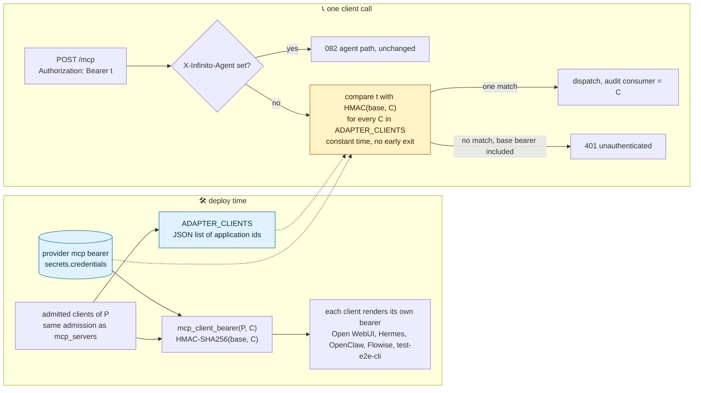

# 136 - MCP Adapter Per-Consumer Bearers

## User Story

As an operator who reads the audit trail of an `svc-ai-mcp-adapter` sidecar, I want every non-agent client to present a bearer of its own, with the adapter deriving the consumer from that bearer, so that each audit record names the client that really called and no holder of a bearer can claim to be another client.

## Context (2026-11-21)

Tracked in [infinito-nexus/core#2433](https://github.com/infinito-nexus/core/issues/2433).

The adapter authenticates two kinds of callers in `roles/svc-ai-mcp-adapter/files/python/server.py`:

| Path | Authentication | Consumer in the audit record |
|------|----------------|------------------------------|
| Agent, `X-Infinito-Agent` set | The agent's own bearer from `ADAPTER_AGENT_TOKENS`, compared in constant time by `authorize_agent` in `auth.py` | The agent name |
| Client, no agent header | The one shared `ADAPTER_BEARER` of the provider, through `authorize_client` | `X-Infinito-Consumer` as the caller sends it, else `unknown` |

- No client in core sends `X-Infinito-Consumer`: a grep over `roles/` finds it only in `server.py`. Every non-agent call is therefore audited as `unknown`.
- The header is self-declared. Any holder of the shared bearer can write any consumer into the audit record.
- Every admitted client receives the same provider bearer through `lookup('mcp_client_bearer', <provider>)` (`plugins/lookup/mcp_client_bearer.py`): Open WebUI, Hermes and OpenClaw through `lookup('mcp_servers')` in their `meta/services.yml`, Flowise through `FLOWISE_MCP_SERVERS`, and the test client through `roles/test-e2e-cli/templates/mcp/test.env.j2`. A leak from one client exposes every other client's access.
- [082](082-agents-phase-5-identity-and-workspaces.md) covers per-agent tokens on the agent path only. Its partial note "the adapter holds one bearer, not one token per agent" names the same single bearer. [050](050-mcp-role-integration.md) defines the provider and client wiring but no consumer identity.

## Decisions

1. **Scope is the audit identity (operator via Main, 2026-11-21).** The consumer a token resolves to goes into the audit record, and nothing more. No per-consumer tool grants are added: the contract's tool list stays the only authorization on the client path. Per-consumer authorization, if it is ever needed, gets its own requirement.
2. **The consumer is derived from the token, never from a header.** The adapter stops reading `X-Infinito-Consumer`. A bearer that matches no admitted consumer is refused with `401`, exactly as a wrong bearer is today.
3. **Consumer bearers are derived, not stored.** The bearer for consumer `C` of provider `P` is `HMAC-SHA256(key = P's mcp bearer, message = C's application_id)`, hex-encoded. `mcp_client_bearer` computes it on the controller. The adapter computes the same value from its own key and the admitted consumer list it is started with (`ADAPTER_CLIENTS`, a JSON list of application ids). No new secret is stored in the inventory, and the provider's base bearer never reaches a client container.
   - Trade-off: rotating the provider's base bearer rotates every consumer bearer at once. Revoking a single consumer works by removing it from `ADAPTER_CLIENTS`, which the next deploy renders. Independent rotation per consumer would need a stored secret per provider and consumer pair, and is out of scope.
4. **The base bearer is no longer a client credential.** Once the derived bearers are live, the adapter refuses the base bearer on the client path, so no path through the adapter skips consumer identity.
5. **The agent path is unchanged.** `X-Infinito-Agent` with `ADAPTER_AGENT_TOKENS` stays as it is, and so does 082's firewall decision. A derived consumer bearer presented with an agent header is refused, as any foreign token is today.

## Approach

## Acceptance Criteria

### Adapter

- [ ] A client call whose bearer equals the derived bearer of a consumer in `ADAPTER_CLIENTS` is dispatched, and its audit record names that consumer (unit test in `tests/unit/python/roles/svc-ai-mcp-adapter/files/test_server.py`).
- [ ] A client call naming another consumer in `X-Infinito-Consumer` is audited under the consumer its bearer resolves to, never under the header's value (unit test).
- [ ] The provider's base bearer, a bearer derived for a consumer outside `ADAPTER_CLIENTS` and an empty `ADAPTER_CLIENTS` each answer `401` on the client path (unit tests).
- [ ] The presented bearer is compared with every admitted consumer's bearer through `hmac.compare_digest`, with no early exit on a match (unit test in `tests/unit/python/roles/svc-ai-mcp-adapter/files/test_auth.py`).
- [ ] A derived consumer bearer sent together with `X-Infinito-Agent` answers `401`, and every existing agent path test passes unchanged.
- [ ] `server.py` no longer reads `X-Infinito-Consumer` (grep).

### Clients

- [ ] `lookup('mcp_client_bearer', <provider>, <consumer>)` returns the derived bearer for an `implementation: adapter` provider and stays unchanged for native and plugin providers (`tests/unit/python/plugins/lookup/test_mcp_client_bearer.py`).
- [ ] Open WebUI, Hermes, OpenClaw, Flowise and `test-e2e-cli` render the bearer derived for their own application id, and no client template renders a provider's base `mcp_bearer`. A lint next to `tests/lint/ansible/services/test_mcp_adapter_bearer.py` enforces this.
- [ ] Every adapter sidecar is started with `ADAPTER_CLIENTS` holding exactly the clients `mcp_servers` admits for that provider (unit test that renders the compose template).

### Documentation

- [ ] `roles/svc-ai-mcp-adapter/README.md` describes the derived consumer bearers, `ADAPTER_CLIENTS`, the refusal of the base bearer and the rotation trade-off of decision 3.

### Live

- [ ] After a deploy with Open WebUI and one adapter provider, a tool call from Open WebUI leaves an audit record with consumer `web-app-openwebui`, and the `test-e2e-cli` MCP probe leaves one with consumer `test-e2e-cli`.
- [ ] On the same stack, a request with the provider's base bearer and no agent header answers `401`.

## Tests

- Unit: `test_server.py` and `test_auth.py` under `tests/unit/python/roles/svc-ai-mcp-adapter/files/` start the handler with a fixed base bearer and `ADAPTER_CLIENTS`, then check the dispatch, the audit consumer and the refusals above.
- Unit: `test_mcp_client_bearer.py` checks the derivation against a fixed HMAC vector and the unchanged result for a native provider.
- Lint: the client bearer lint fails on any client template that renders a provider's base bearer.
- Negative controls, each run and then restored:
  - Consumer read from `X-Infinito-Consumer` again: the header test fails.
  - Base bearer accepted on the client path: the base bearer refusal test fails.
  - Comparison loop that returns on the first match: the no-early-exit test fails.
  - One client template switched back to `lookup('mcp_client_bearer', <provider>)` without a consumer: the client lint names it.
- Live: the criteria under Live, read from the adapter's audit log on the deployed stack.
