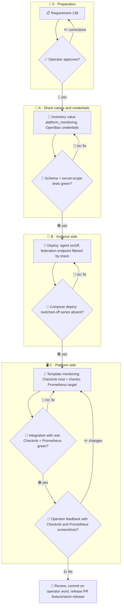

# 138 - Customer Instances Shared With the Platform's Checkmk and Prometheus

## User Story

As the administrator of an Infinito.Nexus platform that runs customer instances for the store, I want every customer instance in the platform's Checkmk and Prometheus with exactly the data its customer shares, everything by default and each kind switchable off, so that I see the health of every instance in one place, the customer keeps control over what leaves the instance, and the store holds no monitoring credential.

## Decisions (operator-confirmed 2026-11-27; do not re-litigate)

1. **Core is the only monitoring writer.** A core Semaphore template `monitoring` adds, updates and removes a customer instance in the platform's `web-app-checkmk` (REST API) and `web-app-prometheus` (scrape targets); the store only dispatches it and follows the task, as for every Keycloak write (GUI 062 Decisions 19 and 25). Rejected: the store calling the Checkmk or Prometheus API itself (a store compromise could rewrite the platform's monitoring); Checkmk pulling a host list from the store (the Raw edition creates no hosts from a data source).
2. **Raw edition stays** (core 029 Decision 2). Rejected: an edition with auto-registration or dynamic host management (proprietary licence).
3. **The customer decides what is shared, everything by default.** Five share kinds, each on unless the customer switches it off: `reachability` (Checkmk ICMP, HTTPS per instance domain, TLS certificate expiry, from outside), `agent` (Checkmk agent: CPU, memory, file systems, services), `health` (the instance's `infinito_hlth_*` series and `stack_up`), `system` (node-exporter and cadvisor series), `traffic` (the instance's nginx `/metricz` series). Rejected: off by default (the operator wants the full picture unless a customer objects); one switch for everything (a customer who objects to one kind would have to give up all).
4. **The instance enforces the share, not the platform.** The customer instance serves a federation endpoint whose allowed series the deploy derives from the share kinds; the platform's Prometheus cannot widen it. Rejected: filtering on the platform side (a platform compromise or a wrong scrape config would read what the customer switched off).
5. **Work branch.** Built on core branch `feature/store-release`, branched from `feature/iam-profile-rbac`, shipped as its own release and pull request.
6. **The agent is pulled over SSH** (parent decision 2026-11-27 after the independent review). Checkmk reads the agent through its datasource program over SSH with one platform monitoring key; the customer host holds only the public key, locked to `check_mk_agent` and the Checkmk address. Rejected: TLS registration at the agent receiver (the Raw edition offers one registration login for every host, so a customer reading it on its own host could re-register any other host, and `--trust-cert` exposes it to a man in the middle); a Checkmk user per host (needs user-management rights, which allow role escalation).

## Approach

## Acceptance Criteria

### Share values

- [ ] The inventory schema accepts a host value `platform_monitoring` with the booleans `reachability`, `agent`, `health`, `system` and `traffic` and refuses any other key; an absent value or an absent key means `true` (Decision 3), and the schema test proves both.
- [ ] The store may set `platform_monitoring` through the schema-checked inventory values (GUI 062 Decision 3); core's inventory guard accepts it as a host variable.
- [ ] The store writes no Checkmk value: of the monitoring values only `platform_monitoring` and `ssh_host_key` are inventory values, and core's inventory guard refuses any `applications.svc-net-platform-monitoring` or `applications.web-app-checkmk` value on a host or group, which a negative test proves.

### Credentials

- [ ] Deploying `web-app-checkmk` creates one Checkmk automation user for the `monitoring` template, allowed only to manage hosts and folders below `/workspaces` and to activate changes; a test proves it cannot change users, global settings or rules outside `/workspaces`.
- [ ] That user's secret and the per-instance federation tokens live only in OpenBao at paths the Semaphore task JWT of the `monitoring` template alone may read (`bound_claims` on its `template_id`); a negative test proves another template and the store's AppRole are refused.

### Instance side (core deploy)

- [ ] With `agent` true the deploy installs the Checkmk agent of the platform's site without any listener (no port 6556, no agent controller registration) and adds the platform's monitoring public key to the login user's `authorized_keys` restricted to a forced command that runs `check_mk_agent`, `restrict` and `from=` the Checkmk host's address; Checkmk pulls the agent output over SSH with the matching private key, which only `web-app-checkmk` holds; with `agent` false the deploy removes the agent and that key line. No secret of the platform ever reaches a customer host. The key pair is platform-global and the address, SSH user, port and host key Checkmk connects with come from the store-written inventory, so the key line is bound to its workspace (round 32): the forced command (`utils/platform_monitoring.py` `agent_key_line`) first prints the section `<<<infinito_workspace>>>` and `ws-<id>` of the `WORKSPACE` the host's own deploy ran for, then execs `check_mk_agent`; `infinito_agent_ssh` of `web-app-checkmk` compares it with the Checkmk host's `workspace` label, which only `monitoring apply` sets (from its own workspace, never from the inventory, and which also has to open the host name), and on a missing label, a missing section or another workspace prints none of the agent output and exits non-zero with the reason on stderr. A workspace that aims its host at another tenant's host and host key therefore gets no agent data of it, which a negative test proves. The line pattern that the deploy, an agent-off deploy and the release match (`AGENT_KEY_PATTERN`) also matches a line written before the binding, so a deploy rewrites it and a release removes it; until the host's next deploy such a line yields no agent data (fail closed). Script, marker and digest handling (round 24) are unchanged: the binding lives in the key line, not in the agent script.
- [ ] No platform request follows a redirect an instance answers (round 32): the federation scrape sets `follow_redirects: false`, and the Checkmk REST clients of `monitoring.py` and `provision/monitoring_identity.py` open requests through an opener that follows no 3xx, so a redirect surfaces as its status and the `Authorization` header never reaches another URL; a test against a local redirecting site proves one request only. Residual: the `httpv2` HTTPS checks keep Checkmk's default redirect handling, since the option key of the `httpv2` ruleset valuespec of the deployed Checkmk 2.4.0p42 could not be proven offline; an instance can redirect that check to another URL, which yields only that check's state, carries no platform secret and is re-checked against the internal-address rule only at `apply`.
- [ ] The platform injects its Checkmk server, site and address and the SHA-256 of the agent script its own site serves into the workspace deploy's environment, all derived by the platform deploy from its own `web-app-checkmk`; the instance deploy downloads the agent only over verified TLS and refuses it unless its SHA-256 matches, naming the fix "re-apply the workspace after a Checkmk upgrade", and refuses an empty or malformed injected value; a test proves a wrong digest refused.
- [ ] With any of `health`, `system` or `traffic` true the deploy serves `/federate` on the instance's Prometheus behind a per-instance bearer token from OpenBao, answering only series of the switched-on kinds whatever `match[]` the caller sends; with all three false it serves no `/federate`. In a workspace deploy `/federate` answers only the platform Prometheus host's address, which the platform injects as `PLATFORM_PROMETHEUS_ADDRESS` from its own `web-app-prometheus` (never from the store); every other source, loopback included (nothing on the instance scrapes `/federate` since the release probe is gone), gets 403 even with the right bearer, and an empty or malformed address fails the deploy.
- [ ] The DNS names and addresses the store writes (`ansible_host`, canonical domains, and the `deploy_domain` built from its label) never aim a platform check inward: `utils/platform_monitoring.py` `internal_address` refuses every address that is not globally reachable unicast, independent of the interpreter's `ipaddress` version (`requires-python` admits 3.11): `INTERNAL_NETWORKS` lists every block of the IANA IPv4 and IPv6 special-purpose registries that is not globally reachable, whole (`0.0.0.0/8`, `10.0.0.0/8`, `100.64.0.0/10`, `127.0.0.0/8`, `169.254.0.0/16`, `172.16.0.0/12`, `192.0.0.0/24`, `192.0.2.0/24`, `192.88.99.0/24`, `192.168.0.0/16`, `198.18.0.0/15`, `198.51.100.0/24`, `203.0.113.0/24`, `240.0.0.0/4`, `::/128`, `::1/128`, `64:ff9b:1::/48`, `100::/64`, `100:0:0:1::/64`, `2001::/23`, `2001:db8::/32`, `2002::/16`, `3fff::/20`, `5f00::/16`, `fc00::/7`, `fe80::/10` and the deprecated site-local `fec0::/10`), except the globally reachable assignments the registries list inside them (`GLOBAL_EXCEPTIONS`: `192.0.0.9/32`, `192.0.0.10/32`, `2001:1::1/128`, `2001:1::2/128`, `2001:1::3/128`, `2001:3::/32`, `2001:4:112::/48`, `2001:20::/28`, `2001:30::/28`), so the registries alone decide and `is_global` of `ipaddress` never does; `192.52.193.0/24` (AMT) and `192.175.48.0/24` (AS112) stay external like their IPv6 twins `2001:3::/32` and `2620:4f:8000::/48`; every multicast group (`224.0.0.0/4`, `ff00::/8`) refuses too. It reads literals in every form (IPv4-mapped, `inet_aton`, bracketed, zoned), the names `localhost`, `localhost.localdomain`, `ip6-localhost`, `ip6-loopback` and everything below `.localhost`, and every IPv6 address whose embedded IPv4 (IPv4-mapped, NAT64 `64:ff9b::/96`, SIIT `::ffff:0:0:0/96`, the deprecated IPv4-compatible `::/96`) is not globally reachable unicast, pinned by `INTERNAL_VECTORS` and `EXTERNAL_VECTORS` (92 vectors, 65 internal and 27 external) which the store mirrors; only a network the platform's own `private_targets` opens (the test variant) passes. `monitoring` also resolves `ansible_host` and every checked domain (A and AAAA) and applies the same rule to each answer; a name that resolves to nothing refuses unless `WORKSPACE_PRIVATE_TARGETS` opens a network. Checkmk gets the checked address of `ansible_host` (the first IPv4 answer, else the first), never the name, so a DNS rebinding after the check cannot aim its ICMP check or agent inward. Residual: the `httpv2` HTTPS checks take the domain as their URL and resolve it at each check, as the domain is their SNI and Host; whether `httpv2` can connect to a pinned address while it sends the domain is not verified here, so a ws domain that is a customer's CNAME (115 decision 7) and rebinds inward later aims that one HTTPS check inward until the next `apply` refuses it. The same residual holds for the Prometheus federation scrape: its target is the federation domain, which Prometheus resolves at each scrape. A pinned address target with `tls_config.server_name` would keep the SNI and the certificate check on the domain, but Prometheus sends the target as the HTTP `Host` (Go's client takes no `Host` from `http_headers`), so the instance's vhost would not answer `/federate`; pinning is therefore not done. The scrape sets `insecure_skip_verify: false`, so the bearer token goes only over TLS verified for the federation domain: a rebinding aims the request inward, but an inward endpoint without that domain's certificate never receives the token. An IPv6 scope id is refused in every host.
- [ ] A compose deploy test switches each of `health`, `system` and `traffic` off in turn and asserts that `/federate` returns no series of that kind and still returns the others.
- [ ] Core's `release` (discharge) removes the agent, its key line and the federation digest file with the other platform keys, erases the host's federation token (`platform/data/monitoring/federation/<ws-id>/<host>`) and its digest record (`monitoring/data/<ws-id>/federation/<host>`) in OpenBao, whatever the current shares say. The proof is on disk over SSH: the agent script and the host's own line of the digest file `federate.conf.j2` reads (`utils/platform_monitoring.py` `digest_path`) are absent after the removal; that file holds one line `<host_segment> <sha256>` per host of the stack (`digest_entry`), which each host's deploy rewrites or drops alone through the stack host with `digest_line.py` under the `flock` on `<file>.lock` the release takes too, so no deploy and no release lose the other's edit, and `/federate` checks line by line; the segment is injective (round 24: `canonical_host` with `:` as `_`, and `canonical_host` refuses every name holding `_`). In a workspace only the stack host federates: `monitoring apply` and the deploy refuse `health`, `system` and `traffic` on a worker, whose workspace tasks pin only its own host key and never reach the stack host, so no worker holds a digest line, and the stack host's release deletes every digest file with every line, so `/federate` admits no bearer of a released host; no HTTP probe runs, so a suspended or stopped instance releases too (round 13 pick: a planted bearer gets no answer from a stopped instance). The OpenBao records are erased only after the host's removal and that proof succeeded. The federation digest lives on the stack host: when `groups['svc-swarm-manager']` (children resolved recursively, in Ansible's order) names another host first, the host is a worker, which releases its keys and agent like any host and leaves the stack's digest file to its manager (said on stderr), and an ambiguous order fails loud. The digest files the release removes and checks are the platform record's plus the one the workspace's present core deploys (`utils/platform_monitoring.py digest-file` of the runner's core tree), so a deploy on a newer core than the last `monitoring apply` leaves no digest behind. The agent script counts as the platform's only while the marker `/etc/infinito.nexus/platform-monitoring-agent`, which the agent install writes only after its own download of the script landed and which records that script's SHA-256, exists and matches (round 24: install, agent-off and release touch the script only while its SHA-256 equals the recorded one; a mismatch is a foreign agent, which stays while the marker goes and the run says so; a script found without the marker refuses the install and is never overwritten or marked, and a failed first download removes the script and the marker this run wrote); the release and an agent-off deploy remove the script only then and drop the marker after it, so an agent the host installed otherwise stays. The release runs in two steps: `release/host.py share` removes the agent and the digest file and proves them gone on disk without touching a key, then the task writes the release tombstone `monitoring/data/<ws-id>/released/<host>` (`release/federation.py mark`: the share line with its counts and the UTC time, create-only, an earlier run's tombstone kept) and only then `release/host.py apply` drops the keys. Whether a host was ever monitored, and which digest file the release removes and checks, lives in the platform record `platform/data/monitoring/inventory/ws-<id>/hosts/<host>` (field `digest_files`, every digest file an apply ever named for the host, so a core upgrade that moves the file keeps the old one on the list and the release removes and checks all of them), which only the `monitoring` role writes (create, read, update) and the tenant role only reads, with no grant on its metadata, `delete`, `destroy` or `undelete` path, so no workspace task writes or deletes it; deleting the tenant-side digest record changes nothing. `monitoring apply` writes it, after the label binding, with the digest file the deploy writes: the workspace runner image records the digest file of its own core tree at build (`/usr/local/share/semaphore-runner/federation-digest-file`, `utils/platform_monitoring.py digest-file`), `workspace apply` hands it to OpenBao beside the inventory read key (`platform/data/monitoring/inventory/ws-<id>`, field `digest_file`), and `monitoring apply` refuses before any write while OpenBao holds none; the core of the platform runner that runs `monitoring` never decides it. The digest record holds the hash alone. `monitoring remove` keeps the platform record; only the workspace destroy erases it. With the platform record the release checks its `digest_files`, and an empty list or a value that is not an absolute plain path ending in `federate.sha256` fails loud before any login. Only that record decides; the tombstone and the digest record, which the workspace writes, never name a digest file. A host without it was never monitored: `release/federation.py claim` says so on stderr and the release runs as before this requirement (round 23, so the store's master keeps parsing it): `release/host.py apply` without `--monitoring`, the five counts of `README.md` `release`, byte for byte the same last line, no tombstone and no erase; whether monitoring is left is decided by evidence, not by the environment (round 24): it reads, without changing them, the agent marker, the monitoring key line and, on the stack host, the digest file of the present core, and refuses with exit code 2, naming each, a host holding any of them; a rerun the host refuses fails as a release without its result. Residual: a host shared for reachability alone leaves nothing on the host, so its Checkmk host stays for the store's `monitoring remove`. A platform that runs neither `web-app-checkmk` nor `web-app-prometheus` (`PLATFORM_CHECKMK_SERVER` and `PLATFORM_PROMETHEUS_ADDRESS` both empty) releases the same way without even the claim; only a monitored host's release adds the three monitoring counts and can end `{"already": true}`. Before it reads the platform record, and only after `release/host.py check` ran every host-side refusal read-only (round 25: a refused release leaves no claim, so a later `monitoring apply` of that live host still works; round 26: the check gets the arguments of the apply, `--monitoring` and `--federation-digest` read from the platform record without a write, and a record a `monitoring apply` wrote before the claim stops the release with exit 1, which a re-run recovers; round 27: that stop and every other exit without a helper result line end with one `{"host", "released": false, "failed"}` line, or `"refused"` with exit 2, from the EXIT trap of host.sh, so the store gets the re-run guidance; round 28: TERM, HUP and INT end the release the same way, `failed` naming the signal and exit 1, and the proof helper path is resolved before the task directory, so only a failing `mktemp` ends without a result line, before any write; round 29: helpers record their result line in the task directory and the EXIT trap alone prints it, exiting with the line's own code (0 released, 2 refused, 1 failed), so a signal that waits for a helper neither turns a release into a non-zero exit nor adds a second line; a host changed between the check and the apply, such as an edited `authorized_keys`, still refuses after the claim, a residual that ends when a re-run of the release on the fixed host releases it), the release writes the claim `monitoring/data/<ws-id>/releasing/<host>` (create-only, kept when it exists, erased only by the workspace destroy); `monitoring apply` refuses a host whose tombstone or claim exists, checked by existence (a 404 alone is absence, any other answer, 403, 5xx or an unreachable OpenBao, fails the task closed), and checks again after it wrote the platform record and once more after its token, digest and agent key writes, erasing those three before it refuses, and the shell runs `monitoring.py settle` after the Checkmk host and the scrape file are written, which on a claim undoes both (`monitoring remove` of the host) and fails with exit code 3 (round 24: the undo is armed before the first write, takes back the secrets, then the scrape file, then the Checkmk host, goes on past a failing step, exits 4 naming every leftover, and runs on TERM and HUP too, exiting 4; round 26: also on INT, exiting with the code of the signal, 143, 129 or 130, once the undo took back everything and 4 only when it left anything, the signals ignored from before the applied state drops; a SIGKILL stays a residual the store's `monitoring remove` retry covers, and `monitoring remove` activates the automation user's own pending changes with its removal instead of refusing them; round 25: only the undo of an apply, whose preflight found no pending change, counts the automation user's pending changes as its own (`MONITOR_UNDO`, round 26: set by that undo alone, an inherited one refuses before any write) and activates them, also when the folder is already gone, those of a concurrent run of the same automation user included (a residual below); any other remove refuses pending changes of the automation user or another user and names each, so no other run activates what it did not write, and a second TERM or HUP during the undo is ignored); so whenever a release claims, no token, digest, agent mirror, Checkmk host or scrape file of that apply stays behind except one a claim after `settle` finds, which the release erase (token, digest, mirror) and the store's `monitoring remove` cover. The claim is read before it is written: the tenant holds create and read but no update on it, so OpenBao answers 403 to a second create, and a rerun keeps the first claim. Apply, release and the deploy name a host by its `canonical_host` form (`utils/platform_monitoring.py`: the `ipaddress` text of an IP literal, a lowercase hostname otherwise), so `2001:DB8::1`, `2001:db8:0::1` and `Target` name the paths of `2001:db8::1` and `target`; only a name a legacy IPv4 reader takes for an address (`01.2.3.4`, `127.1`, `0x7f000001`) is refused, before any request. The agent key mirror is per host (`monitoring/data/<ws-id>/agent/<host>`, which the deploy reads for that host alone); `monitoring apply` without the agent share, `monitoring remove` and the release erase it, and `monitoring apply` never writes it for a released or claimed host, so no later workspace deploy of a released host finds the key line to install. The `monitoring` role holds exactly what apply and remove need on the monitoring mount: create, read and update on `+/federation/+`, `+/agent/+` and `+/labels/+`, delete on their metadata, list on `+/labels/`, and read alone on `+/released/+` and `+/releasing/+`, so no platform task writes or deletes a tombstone; only the workspace destroy does. `monitoring apply` refuses, before any write, a host whose tombstone exists in the workspace (`host <host> was released in ws-<id>: use a new host name or destroy the workspace`), so a released host name never gets an agent again and a refused login stays proof of the earlier release. The tombstone is permanent: no release erases it, and the tenant role holds only `read` on its metadata, so no workspace task deletes it; only the workspace destroy removes it, with the whole monitoring tree of the workspace (`monitoring/ws-<id>/`, `platform/monitoring/federation/ws-<id>/` and `platform/monitoring/inventory/ws-<id>/`, `tasks/workspace/destroy.yml` of `web-app-openbao`). The erase takes the federation token, then the digest record, and stops at the first DELETE that fails or the first record still present after its DELETE, so a rerun finds the tombstone and the remaining records and retries. A rerun whose login the host refuses counts as released by an earlier run only when the tombstone exists (`release/federation.py marked`), goes on to the erase and ends `{"host": <host>, "released": true, "already": true}` once every fresh login is refused too; a complete release the store retries after its result line was lost finds the tombstone and ends the same way. Without the tombstone a refused login always fails loud, whatever records are left, with `<host> refuses the platform key and no release marker proves an earlier run removed its monitoring share; restore access or remove the agent binary, the monitoring key line and the federation digest file manually`. A refused login without the tombstone never passes as released: neither a host that locks the key out by `StrictModes` or a changed key, nor a host that was never monitored, nor one that got `monitoring remove` before its discharge; each needs the manual removal. Accepted: a release that runs before the tenant policy with the tombstone grants is deployed aborts at `mark` with 403, before any key drop, and a rerun after the policy deploy recovers. Residual: the tenant role may create tombstones below its own workspace (`monitoring/data/ws-<id>/released/+`, create and read; `read` alone on its metadata; `ws-<id>` taken from the caller's own JWT role), so a workspace task can forge one for any host of the same workspace, never of another tenant; a forged tombstone or claim makes `monitoring apply` refuse that host and lets a later refused rerun pass as released and erase that host's federation token, digest record and agent key mirror, while the agent, its key line and the digest file may still be on the host. Decision (round 21): the release runs as the workspace template, and the `monitoring` role, the only writer of the platform record, is bound to the monitoring template alone, so the released fact cannot move to a platform writer without a platform-side release step; the tombstone stays tenant-written and no longer decides anything but that refused-login rerun. Its worst case is the bound accepted here: the workspace's own host keeps the platform agent and key line while the platform drops its token, digest record and Checkmk host, which only blinds the platform's monitoring of that workspace's own host; it never names a digest file, never reaches another workspace and never lets the platform key back onto a released host. The Checkmk host and the scrape target stay the store's job: it dispatches `monitoring remove` for the host on teardown and discharge (GUI 074). Accepted residuals (round 25, not fixed): an OpenBao outage fails a release while the platform environment names Checkmk or Prometheus; a marker without its script needs a manual cleanup; an upgrade whose marker write fails sees the platform's new agent as foreign; a deploy whose SSH session is still open can rewrite a digest line after the release; a stack host demoted to a worker keeps its digest file until the store's `monitoring remove`; the printed form of an IPv4-mapped IPv6 address differs before Python 3.13; a SIGKILL skips the undo; a share for reachability alone leaves its Checkmk host for the store's remove; an undo that runs while another monitoring run of the same automation user has unactivated changes activates them too; a host changed between the release's check and its apply, such as an `authorized_keys` edit, refuses after the claim, which stays and makes `monitoring apply` refuse the host until a re-run of the release on the fixed host releases it; a pending change of an earlier run needs the operator to activate or revert it in Checkmk before `monitoring remove` proceeds.

### Template `monitoring`

- [ ] The platform's Workspaces project holds a template `monitoring` with the survey variables `WORKSPACE` (a lowercase UUID, as `files/python/workspace.py` checks it), `MONITOR_ACTION` (`apply`, `remove`), `MONITOR_HOST` (one inventory host name, checked as an inventory host name) and, for `apply`, `INVENTORY_COMMIT` and `DNS_LABEL` (the host's deploy label, a lowercase DNS label); any other value refuses before any write with the last line `{"workspace": <id>, "refused": <reason>}` (GUI 062 Decision 28 format).
- [ ] `apply` reads `MONITOR_HOST`, its domains and its `platform_monitoring` from the task's own pinned inventory commit (the store pins one host per task) and creates or updates that one Checkmk host, never touching another host of the workspace, in folder `/workspaces/<ws-id>` with labels `workspace:<ws-id>` and `instance:<host>` and no personal data: with `reachability` an ICMP check, one HTTPS check per domain under `ws-<id>.<zone>` (a canonical domain outside it gets none, so the platform never probes a third party's site) and a TLS expiry check whose warn and crit days come from `web-app-checkmk` config; with `agent` the agent data source; with neither, no host.
- [ ] An instance's primary domain has one source: `deploy_domain` of `lib.sh` builds `<DNS_LABEL>.ws-<id>.<WORKSPACE_DNS_ZONE>` from the label the store sends and the zone `workspace apply` placed the workspace in (in the deploy project's environment and, for `monitoring`, beside the read key in OpenBao, never store-written). `deploy`, `update` and `monitoring` (each with the survey variable `DNS_LABEL`, optional for `update`) all use it, `update` passes it as `-e DOMAIN_PRIMARY` like `deploy` when the store sends one and otherwise keeps the inventory's, and the inventory's `DOMAIN_PRIMARY` never decides the scrape target. `monitoring apply` binds the label to `MONITOR_HOST` at `monitoring/data/<ws-id>/labels/<label>` (field `host`), create-only and before any other OpenBao write, so of two concurrent applies of one label for different hosts one refuses, and a later `apply` refuses a label bound to another host before any write; a refusal after the OpenBao writes (a pending Checkmk change that appeared after the preflight) leaves only what a rerun of the same `apply` keeps unchanged, so the rerun converges; `monitoring remove` refuses `DNS_LABEL` and `INVENTORY_COMMIT`. The workspace deploy environment (`environment_variables` of the `ws-<id>` templates, 102 decision 3) is exactly what `operation.yml` writes: `BAO_ADDR`, `BAO_CACERT`, `BAO_ROLE`, `PLATFORM_CHECKMK_ADDRESS`, `PLATFORM_CHECKMK_AGENT_SHA256`, `PLATFORM_CHECKMK_SERVER`, `PLATFORM_CHECKMK_SITE`, `PLATFORM_PROMETHEUS_ADDRESS`, `WORKSPACE`, `WORKSPACE_DNS_ZONE`, `WORKSPACE_INVENTORY_FILE` and `WORKSPACE_TARGETS`. `monitoring remove` erases, after the Checkmk removal, every label binding that names `MONITOR_HOST`, so a later host may take the label.
- [ ] `apply` writes one Prometheus scrape target per host with any of `health`, `system` or `traffic` true, scraping the instance's `/federate` with its token over a verified certificate, following no redirect, at the instance's Prometheus domain (an inventory pin only when it is the `deploy_domain` or a subdomain of it, else the domain core derives from it) and labelling every series `workspace` and `instance`, and removes the target of a host with all three false; Prometheus reloads without a restart.
- [ ] Before any write, to OpenBao or Checkmk, the run reads the pending changes and refuses with `checkmk has pending changes of another user` when one is not its own and with `checkmk has pending changes of an earlier run` when its own automation user left any (they may touch another host, and only the undo of an apply activates changes of the automation user, see the residuals), so a run never half-applies; pending changes are never force-activated. Every refusal (survey, zone, label, pending changes) runs before the first OpenBao write; `remove` erases the federation token and digest only after the Checkmk removal succeeded. Residual by design: a run that fails after its first Checkmk write (a host, a rule or a folder) leaves its own pending changes, and every later `monitoring` run refuses with `checkmk has pending changes of an earlier run` until a Checkmk administrator resolves them in the Checkmk GUI under Setup > Activate pending changes: either activates them with Activate on selected sites after reviewing that they are the intended half of the run, or discards them with Revert changes; the run is then dispatched again.
- [ ] A second `apply` with the same inventory leaves no pending Checkmk change and no Prometheus reload; `remove` deletes the Checkmk host and scrape target of `MONITOR_HOST` and the folder once it is empty; a `remove` of an unknown host succeeds with nothing changed.
- [ ] The last stdout line of every successful run is `{"workspace": <id>, "host": <host>, "checkmk": true|false, "prometheus": true|false}`.
- [ ] `workspace apply` hands the inventory read key the template clones with to OpenBao. It replaces the workspace's read key pair only while OpenBao holds no copy of it, a one-time migration for workspaces older than this requirement; every later `apply` restores the Semaphore key from that copy and prints the same `read_key`. The store re-registers the workspace repository's read-only deploy key whenever `read_key` changes (GUI 074).

### Tests

- [ ] Unit: the share schema, the `/federate` series filter per kind, the template script's input validation, refusal lines, folder and label naming, idempotence diff and last line, against fake Checkmk and Prometheus APIs.
- [ ] Integration: in the Semaphore test variant, a real `web-app-checkmk` and `web-app-prometheus` receive `apply` for a `target` instance with all kinds on, then with `agent` and `traffic` off, then `remove`; each step shows exactly the expected hosts, checks and series.
- [ ] E2E: a Playwright spec signs in to Checkmk as `administrator` and finds the `target` host in `/workspaces/<ws-id>` with its reachability checks and agent services green; a second spec queries the platform's Prometheus for the `target` instance's `stack_up` and finds no traffic series after `traffic` was switched off.
- [ ] E2E: a Playwright spec asserts that an account without the `administrator` role sees no `/workspaces` host in Checkmk and no customer series in Prometheus.
