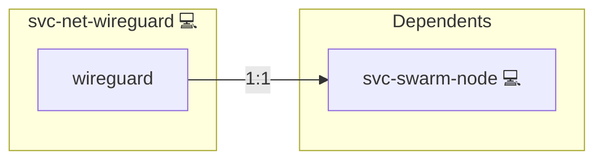

# WireGuard

## Description

[WireGuard](https://www.wireguard.com/) is an in-kernel VPN protocol. Peers
authenticate each other with Curve25519 keypairs and exchange encrypted UDP
datagrams, so a tunnel needs no session state, no certificate authority and no
daemon of its own.

## Overview

This role puts WireGuard under a swarm deployment so that swarm control,
overlay and storage traffic never crosses an untunnelled network. It configures
the hub-and-spoke meshes the deployment declares, any number of them, with the
swarm manager as the hub of each. The manager forwards between them, which is
how a worker reaches an NFS export it is not a member of.

Without a swarm manager, as in a Compose deployment spread over several hosts,
every declared mesh is a full mesh instead. Each member knows the key of every
other member and dials it directly, and nothing forwards between meshes: a host
reaches exactly the members of the meshes it joined.

The meshes are inventory values, and every role ships them empty.
`networks.meshes` of this role declares them in the hub's `host_vars`, or in
the `host_vars` of every member when there is no hub, and `networks.meshes` of
every other role lists the meshes its hosts join. The
development lab declares two, `swarm` and `data`, in
[wireguard.yml](../../inventories/development/wireguard.yml);
[wireguard-three-meshes](../../inventories/examples/wireguard-three-meshes/README.md)
declares three. Consumers read a host's mesh address through
`lookup('mesh_address', <host>)` instead of naming a mesh.

The role plans nothing. Every key, address and peer list is written into the
inventory beforehand by `cli.administration.inventory.mesh`, the one pass that
sees every host at once; this role renders what its own host was handed and
then proves the result. It acts on every host in the `svc-net-wireguard`
group; outside swarm mode a host the mesh CLI gave no mesh is skipped.

## Cosmos

The diagram places WireGuard in the Infinito.Nexus cosmos: the components it deploys (capabilities), the central services it consumes (dependencies), and its outward reach (federation and bridged external networks).



Solid `1:1` edges are fixed relationships; dashed `0..1` edges are conditional (enabled only in matching deployments); red `0..0` edges are turned off in this role. Node markers show the role's deploy modes (💻 host, 🐳 compose, 🐝 swarm); ❌ marks a service that is explicitly turned off, and ⚙️ an Ansible role dependency declared in `meta/main.yml`.

## Features

- Any number of hub-and-spoke meshes around one hub, so the planes stay
  separate while remaining mutually reachable.
- Full meshes when the inventory has no hub, each member peered with every
  other and no route between meshes.
- A host may be a spoke of several meshes: it routes the pool through its
  first declared one and only the mesh subnet through the others, so no two
  interfaces claim one route.
- Per-host interfaces rendered from inventory state, with each private key
  vault-encrypted in exactly one host's `host_vars`.
- Forwarding enabled only on the hub, which is the only member with peers in
  every plane.
- A hard gate that fails the deploy before swarm initialises when any peer is
  unreachable or the path will not carry a full-size payload.

## Quick Setup

### Development

Clone, set up the workstation, and deploy WireGuard onto the local stack:

```bash
git clone https://github.com/infinito-nexus/core.git
cd core
make onboard
make compose-deploy mode=reinstall apps=svc-net-wireguard full_cycle=false
```

### Production

Install WireGuard directly onto the target machine: clone the repository, install the OS prerequisites and the repository toolchain, then deploy against localhost over a local connection (no SSH, no container):

```bash
git clone https://github.com/infinito-nexus/core.git
cd core
bash scripts/install/package.sh
make install
source scripts/meta/env/load.sh

APP=svc-net-wireguard
DOMAIN=<your-domain>
TLS_MODE=self_signed
SSH_PUBLIC_KEY="<your-ssh-public-key>"
INVENTORY=inventories/production
infinito administration inventory provision "$INVENTORY" \
  --inventory-file "$INVENTORY/devices.yml" \
  --host localhost \
  --include "$APP" \
  --vars "{\"TLS_MODE\": \"$TLS_MODE\", \"DOMAIN_PRIMARY\": \"$DOMAIN\", \"users\": {\"administrator\": {\"authorized_keys\": [\"$SSH_PUBLIC_KEY\"]}}}"
infinito administration deploy dedicated "$INVENTORY/devices.yml" \
  --password-file "$INVENTORY/.password" \
  --diff -vv
```

## Administration

The mesh must exist in the inventory before the play runs. Write it once over
every inventory of the deploy, including any sibling file that holds hosts the
cluster inventory does not:

```bash
python3 -m cli.administration.inventory.mesh \
  --inventory /tmp/inv/devices.yml \
  --inventory /tmp/inv/backup.yml \
  --host-vars-dir /tmp/inv/host_vars \
  --vault-password-file /tmp/inv/.password
```

It reads the declarations and memberships from the `host_vars` it writes to,
and records each host's addresses, keys and peers in that host's
`svc-net-wireguard.networks.interfaces`.

Re-running is a no-op. To replace every keypair, add `--rotate`; that rewrites
the whole mesh in one pass, because rotating one member alone partitions it.

### Compose hosts

For Compose hosts the inventory holds no `svc-swarm-manager`, so the writer
plans full meshes. Put the same `svc-net-wireguard.networks.meshes`
declaration into the `host_vars` of every member, list the meshes a host joins
under `networks.meshes` of a role it carries, add the hosts to the
`svc-net-wireguard` group, write the mesh as above and deploy. Each member
listens on the mesh port, so that UDP port must be open between the members.
The role brings the interfaces up and gates on a handshake with every peer;
an application uses the tunnel only where it is pointed at a peer's mesh
address, which `lookup('mesh_address', <host>)` returns.

Inspect a live interface on any member:

```bash
wg show <mesh-name>
```

A peer with no recent handshake is either unreachable on the underlay or
carrying a key its peer does not know. The second case means the inventory and
the running interface disagree: re-run the mesh writer and redeploy rather than
editing `/etc/wireguard` by hand, which the next deploy overwrites.

## Credits

Implemented by **[Evangelos Tsakoudis](https://github.com/evangelostsak)**.
Part of the [Infinito.Nexus Project](https://s.infinito.nexus/code) and maintained by [Kevin Veen-Birkenbach](https://www.veen.world).
Licensed under the [Infinito.Nexus Community License (Non-Commercial)](https://s.infinito.nexus/license).
