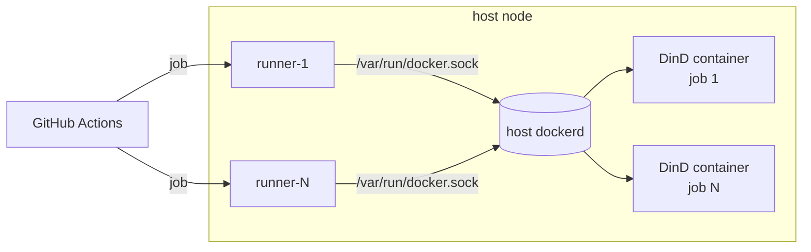
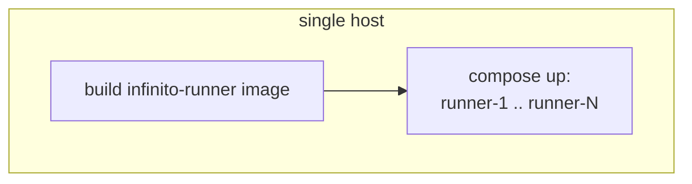
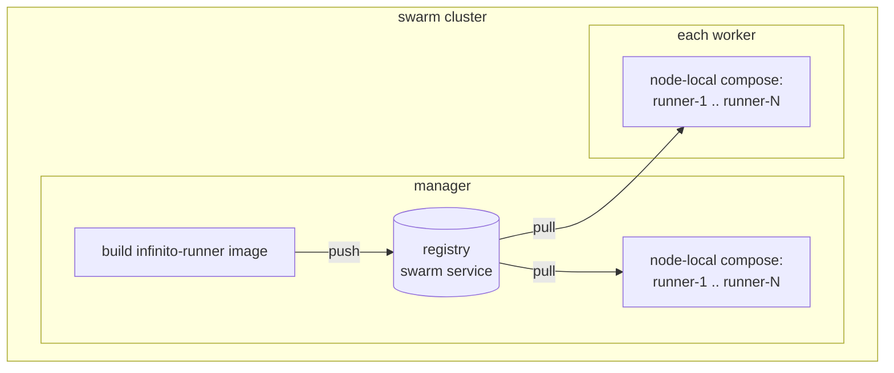
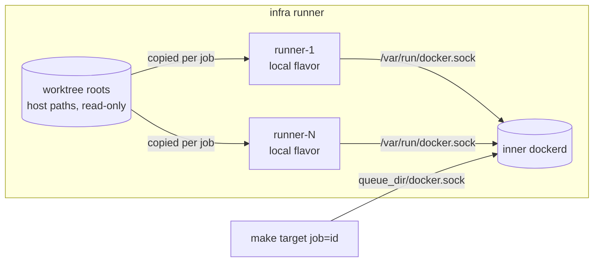

# Self-Hosted Runner

## Description

The [GitHub Actions self-hosted runner](https://docs.github.com/en/actions/hosting-your-own-runners/managing-self-hosted-runners/about-self-hosted-runners) is an agent that runs GitHub Actions workflow jobs on your own infrastructure instead of GitHub-hosted machines.

## Overview

This role provisions a dedicated machine as one or more GitHub Actions self-hosted CI runners for Infinito.Nexus. Each runner instance runs as an ephemeral Docker container (DooD — Docker out of Docker): the container mounts the host's `/var/run/docker.sock` and uses it to start a fresh Infinito DinD container for each CI job, then tears it down when the job finishes.

Registration tokens are fetched from the GitHub API at container start time via `RUNNER_API_TOKEN` (a GitHub PAT with repo scope). The token is stored in a per-instance `.env` file on disk (mode `0600`, owned by `RUNNER_USER`).

The `RUNNER_DISTRIBUTION` variable selects distro-specific package installation tasks (Debian, Ubuntu, Arch Linux, or Fedora/EL). The role is designed to be driven by the `make runner-ci-deploy` target; see the end-to-end guide below.

## Features

- **Self-hosted:** Run CI jobs on your own server without consuming GitHub-hosted runner minutes.
- **Multi-instance:** Provisions N runner instances per host via `RUNNER_COUNT`; each handles one CI job at a time.
- **Ephemeral containers:** Each runner instance is a Docker container (`restart: unless-stopped`). After each job the container re-registers with GitHub as a fresh ephemeral runner (`--ephemeral`).
- **DooD isolation:** Runner containers mount the host Docker socket. Each job gets its own Infinito DinD container with a unique subnet, container names, and Docker volume — parallel jobs never conflict.
- **Automatic registration:** The runner container fetches a short-lived GitHub registration token from the API at startup using `RUNNER_API_TOKEN`.
- **Multi-distro:** Supports Debian, Ubuntu (`apt`), Arch Linux (`pacman`), and Fedora/EL (`dnf`) via distro-specific task files.
- **Idempotent:** The compose stack lives in the default instance directory and runs through the default compose handlers; re-running the deploy recreates the containers when their image, compose file or instance environment changed, without manual cleanup.
- **CI workflow ready:** All deploy-test workflows route to GitHub-hosted runners by default; set `CI_SELF_HOSTED_RUNNER_COUNT` to overflow jobs to your runners.
- **Two flavors:** `services.runner.flavor` selects `github` (the default, everything this page describes) or `local`, which registers nowhere, needs no PAT, checks nothing out, mounts the worktree roots at their host paths instead and takes its jobs from the local job queue; see [Local flavor](#local-flavor).

## End-to-end guide

### Prerequisites

- A GitHub Personal Access Token (PAT) with `repo` scope, exported as `RUNNER_API_TOKEN` (or `GH_TOKEN`) on the control machine.
- SSH access to the target host (key-based authentication).
- `make install` completed on the control machine (installs Ansible and Python dependencies).

### Step 1 — Provision runner instances on the target server

```bash
RUNNER_API_TOKEN=ghp_... make runner-ci-deploy HOST=runner.example.com DISTRO=ubuntu
```

For a fork, supply your GitHub username so runners register against your repository:

```bash
RUNNER_API_TOKEN=ghp_... make runner-ci-deploy HOST=runner.example.com DISTRO=ubuntu OWNER=youruser
```

Follow the live deploy log in a separate terminal:

```bash
tail -f /tmp/infinito-runner-deploy.log
```

When complete, verify the runners appear in GitHub:

```bash
gh api repos/youruser/infinito-nexus/actions/runners -q '.runners[].name'
```

They should be listed as Idle in `github.com/<owner>/infinito-nexus/settings/actions/runners`.

### Step 2 — Activate self-hosted CI routing

Set the `CI_SELF_HOSTED_RUNNER_COUNT` repository variable so the deploy-test matrix routes overflow jobs to your runners:

```bash
make runner-ci-enable COUNT=2
# or for a fork:
make runner-ci-enable COUNT=2 OWNER=youruser
```

This variable persists until explicitly changed. Confirm it is set at:
`github.com/<owner>/infinito-nexus/settings/variables/actions`

### Step 3 — Push and observe

Push any commit. The runners will pick up jobs routed to `[self-hosted, linux]` once activated.

### Deactivating

To route all CI back to GitHub-hosted runners (e.g. if the server goes down):

```bash
make runner-ci-disable
# or for a fork:
make runner-ci-disable OWNER=youruser
```

## Make targets

| Target | Parameters | Description |
|--------|-----------|-------------|
| `make runner-ci-deploy` | `HOST`, `DISTRO`, `COUNT` (optional), `PORT`, `OWNER`, `REPO` | Provision runner instances on the target host. |
| `make runner-ci-enable` | `COUNT`, `OWNER`, `REPO` | Set `CI_SELF_HOSTED_RUNNER_COUNT` repo variable to activate split routing. |
| `make runner-ci-disable` | `OWNER`, `REPO` | Zero the variable — all CI reverts to GitHub-hosted runners. |
| `make runner-status` | none | Print one JSON object per pool runner with its state (`idle`, `busy` or `held`), its job and stack, and for a held job its age and release command; exits 3 while no runner has registered. |
| `make runner-release` | `job` | Remove the stack of a held or stranded pool job from the infra runner's daemon, end the job and free its runner. |
| `make runner-cleanup-report` | none | Print one JSON object per held pool job with its age and every job stack no running or held job owns; removes nothing. |
| `make runner-count` | none | Print the default pool size and its RAM, CPU and disk terms as JSON; `INFINITO_RUNNER_COUNT` overrides it. |

## CLI parameters

The `make runner-ci-deploy` target invokes `python -m cli.administration.deploy.runner`. You can also call it directly:

```bash
python -m cli.administration.deploy.runner <hostname> \
    --distribution <os> \
    --roles svc-runner \
    [--runner-count N] \
    [--owner youruser] \
    [--repo infinito-nexus] \
    [--port 22] \
    [--output /tmp/infinito-runner-deploy.log]
```

| Parameter | Required | Default | Description |
|-----------|----------|---------|-------------|
| `hostname` | yes | — | Target server hostname or IP address. |
| `--distribution` | yes | — | OS: `debian`, `ubuntu`, `archlinux`, `fedora`, `centos`. |
| `--roles` | yes | — | Roles to deploy; `svc-runner` is always prepended. |
| `--runner-count` | no | auto (vCPUs ÷ 2) | Number of runner instances to provision. |
| `--owner` | no | role default (`infinito-nexus`) | GitHub user or org the runners register with. |
| `--repo` | no | role default (`core`) | Repository name the runners register with. |
| `--port` | no | Ansible default (22) | SSH port of the target host. |
| `--output` | no | `/tmp/infinito-runner-deploy.log` | File path for deploy stdout/stderr. |

## Role variables

| Variable | Default | Description |
|----------|---------|-------------|
| `RUNNER_GITHUB_OWNER` | `meta/services.yml` | GitHub user or organisation that owns the target repository. |
| `RUNNER_GITHUB_REPO` | `meta/services.yml` | Repository name the runners register with. |
| `RUNNER_API_TOKEN` | `GH_TOKEN` env var | GitHub PAT with repo scope for runner registration. Stored in per-instance `.env` (mode `0600`). |
| `RUNNER_NAME` | `{{ inventory_hostname }}` | Base name; each instance is named `<RUNNER_NAME>-<N>`. |
| `RUNNER_LABELS` | `self-hosted,linux,{{ RUNNER_DISTRIBUTION }}` | Comma-separated labels assigned to every runner instance. |
| `RUNNER_INSTALL_DIR` | `/opt/github-runner` | Base installation directory; instances land in `<dir>/<N>/`. The compose stack and the image build context live in the default instance directory, `/opt/compose/runner/`. |
| `RUNNER_USER` | `github-runner` | System user account that owns all runner files and processes. |
| `RUNNER_COUNT` | auto (`RESOURCE_HOST_CPUS // RUNNER_CPUS`) | Number of runner instances; auto-scales to available CPU cores. |
| `RUNNER_CPUS` | `2` | CPU limit per runner instance (matches GitHub-hosted 2-core quota). |
| `RUNNER_DOCKER_BASE` | `/mnt/docker` | Base path for per-instance Docker volume directories. |
| `RUNNER_PROJECT_PREFIX` | `runner` | Prefix for per-instance Docker Compose project names and `INFINITO_RUNNER_PREFIX`. |
| `RUNNER_SYSCTL_OWNER` | `runner` | Owner name under which [sys-sysctl](../sys-sysctl/) writes the runner-host kernel tuning to `/etc/sysctl.d/99-runner.conf`. |
| `RUNNER_SYSCTL_PARAMETERS` | three `fs.inotify.*` limits and `vm.max_map_count: 262144` | Inotify limits for parallel runner containers, and the memory-map floor Wazuh, OpenSearch and Elasticsearch need inside DiD; host-global, so skipped inside a container. |
| `RUNNER_FLAVOR` | `meta/services.yml` (`github`) | `services.runner.flavor`: `github` registers every instance with GitHub; `local` renders no registration, no PAT and no checkout ref, skips the GitHub runner binary and mounts `RUNNER_WORKTREE_ROOTS`. Any other value fails the deploy. |
| `RUNNER_WORKTREE_ROOTS` | `meta/services.yml` (`[]`) | `services.runner.worktree_roots`: absolute directories every `local` instance mounts read-only at its host path. The `local` flavor fails the deploy without one, and on a root that is `/`, holds `:`, or is a home directory (`/root`, `/home/<user>`, `/Users/<user>`, `/var/home/<user>`) or a parent of one. |
| `RUNNER_QUEUE_DIR` | `meta/services.yml` (`""`) | `services.runner.queue_dir`: the local job queue every `local` instance mounts writable at its host path and takes its jobs from. The `local` flavor fails the deploy unless it is an absolute directory other than `/`, without `:`. |
| `RUNNER_QUEUE_GID` | `meta/users.yml` (`runner-queue`, gid `901`) | The group the `local` flavor creates `RUNNER_QUEUE_DIR` for, `root:runner-queue` with mode `3770`, its `jobs`, `logs` and `runners` folders `root:runner-queue` with mode `2770`, and adds every `local` instance to. The sticky root keeps a job, which runs with the group, from renaming or removing those folders. Joining it equals root on the host, because its members reach the daemon of the privileged infra runner. The operator joins it once on the host (`sudo groupadd -g 901 runner-queue`, `sudo usermod -aG runner-queue "$USER"`), and the commands refuse while gid `901` names another group there; `make compose-deploy` with `INFINITO_DEPLOY_VIA_POOL=true`, `make runner-status`, `make runner-release` and `make runner-cleanup-report` refuse with that step until then, and refuse a root without the sticky bit or a folder that is missing, a link or owned by another user than the root until `make infra-update` restores the layout. |

`RUNNER_DISTRIBUTION` is **required** and has no default; it is passed automatically by the CLI.

## Testing

The role self-validates via the scripts in `files/test/`, discovered and run by `test-e2e-cli` during deploy. `test.sh` orchestrates two complementary checks:

- **`local.sh` — fully local, no external GitHub.** Checks the runner containers are healthy and the DooD socket works, then `container cp`s the repo into a runner, **builds the Infinito image locally**, and deploys `web-app-dashboard` (all other services disabled) inside a **sealed, throwaway Docker daemon** that shares the runner's network namespace. The sandbox is torn down on exit, so the host stack is never touched and **no GitHub/GHCR access is required**. The copy pins `INFINITO_CACHE_STACK=false` in its `custom.env`: the nested deploy starts no infra runner inside the runner. On the update pass the heavy deploy is skipped (it is validated once on the first pass).
- **`external.sh` — real job-pickup smoke test (optional).** Uses `RUNNER_API_TOKEN` to confirm the runners registered and are online via the GitHub API, dispatches a smoke workflow, and polls it to completion. Skipped automatically when no token is present.

In short: `local.sh` proves the runner can build and deploy entirely on its own hardware; `external.sh` proves it can receive real jobs from GitHub. Under the `local` flavor `test.sh` skips the runner binary and `external.sh`, `local.sh` checks that every worktree root is mounted in every runner, and the nested deploy reads the checkout from its mounted root instead of copying it into the runner.

## Runner Topology

Every runner instance is an ephemeral container that mounts its host's docker
socket (DooD). For each CI job it starts a fresh Infinito DinD container with
a unique subnet and volume, runs the job inside it, and tears it down; the
runner then re-registers with GitHub as a fresh ephemeral runner.



### Compose mode

One host runs the whole fleet: the role builds the `infinito-runner` image
locally, renders one compose project and starts `RUNNER_COUNT` instances.



### Swarm mode

The fleet is deployed on **every** cluster node, but not as a `docker stack`
service (`compose_mode_force: compose` in `vars/main.yml`): each runner needs
the docker socket and the registered identity of exactly its node. The image
is built once on the manager and distributed through the registry dependency
(`svc-registry-docker`), the only part that runs as a swarm service.



Because no stack service exists, the swarm test gates that poll
`docker service ls` (`converge`, `seed`, `drain`, `assert`) skip themselves
(`has_swarm_service` in `scripts/tests/deploy/swarm/utils/_context.sh` finds
no service of the stack); the deploy itself, the registry distribution
chain and the CLI e2e suite run in full.

### Local flavor

The `local` flavor serves a local runner pool that works on the host's
worktrees and registers with no GitHub repository. An inventory selects it on
the role's service entity:

```yaml
applications:
  svc-runner:
    services:
      runner:
        flavor: local
        queue_dir: /var/cache/infinito/core/cache/jobs
        worktree_roots:
          - /home/<user>/Repositories/github.com/infinito-nexus/core
          - /home/<user>/.local/share/worktrees
```

The infra inventory renders exactly this entry, with `RUNNER_COUNT` from
`make runner-count`, while `INFINITO_DEPLOY_VIA_POOL=true`; with it unset or
`false` the infra deploy drops the role from `~/inventories/infinito-infra`.

Each instance keeps its per-instance DinD environment (compose project,
prefix, subnet `172.30.<N>.0/24` and Docker volume), but its `.env` carries
none of the registration variables (`RUNNER_NAME`, `RUNNER_LABELS`,
`RUNNER_GITHUB_OWNER`, `RUNNER_GITHUB_REPO`, `RUNNER_API_TOKEN`), the role
downloads no GitHub runner binary, and the e2e environment carries no
`GITHUB_TOKEN` and no `RUNNER_GIT_REF` but `RUNNER_FLAVOR` and
`RUNNER_WORKTREE_ROOTS`. Every root of `worktree_roots` is
mounted read-only at its host path, so a worktree's `.git` file resolves into
the primary checkout as it does on the host, and `queue_dir` is mounted
writable at its host path for the `runner-queue` group every instance joins.
Every `local` instance runs `services.runner.toolchain_image` (the invoking
checkout's `INFINITO_IMAGE`, venv baked in, which `make infra-update` loads
into the infra runner's daemon) as `operator_uid:operator_gid`, the operator
who ran `make infra-update`, and owns `RUNNER_INSTALL_DIR/<N>` as that user.
Its entrypoint, `files/shell/entrypoint-local.sh` read from
`services.runner.src_dir`, registers nowhere; it runs the pool loop of
[utils/runner/loop.py](../../utils/runner/loop.py) from that checkout, which
`make infra-update` takes from `INFINITO_RUNNER_SRC_DIR` and refuses to guess:
unset, or outside every worktree root, it aborts naming the key. The loop
registers the instance under its compose project (`runner-<N>`), ends any job
it still ran when it last stopped, claims the oldest queued job whose checkout
resolves inside `INFINITO_RUNNER_WORKTREE_ROOTS` (never a root itself, and
only one holding `scripts/tests/deploy/job/entry.sh`), and copies into its own
`INFINITO_RUNNER_CHECKOUT` (`RUNNER_INSTALL_DIR/<N>/checkout`) only what git
sees in that checkout: tracked files and untracked ones that no ignore rule
covers, never `.env`, plus the checkout's `custom.env` (mode `0600`) with
`INFINITO_POOL_RUNNER=true` and `INFINITO_DEPLOY_VIA_POOL=false` pinned. The
copy of the job before goes first, removed as root by a throwaway container of
the runner's own image that mounts `RUNNER_INSTALL_DIR/<N>` alone, so files the
job's root container wrote into it never block the next job. The copy gets a
`.git` file naming the checkout's git directory as mounted, so
`git rev-parse` works in it. The job runs there as
`<copy>/scripts/tests/deploy/job/entry.sh make <target> <args>` with
`INFINITO_STACK_NAME=runner-<N>`, `PYTHONDONTWRITEBYTECODE=1`, the two pinned
keys and without the loop's own `PYTHONPATH`. The job keeps the cache consumer
(CA, proxy and mirror configuration, the cache names mapped to the infra
runner's address on `INFINITO_INFRA_SUBNET`) through
`compose/pool-consumer.override.yml`, but starts and attaches to no infra
runner, joins no `infinito-infra` network and submits no pool job, and its
stack goes afterwards unless the job was submitted with `hold=true`. The job writes into
that copy and a held stack runs from it while the worktrees stay read-only.
`make compose-role-sync` and `make compose-playwright` with `job=<id>` first
mirror the checkout the job's record names into its copy: changed files are
copied again, and a file copied before that git no longer lists goes, while
files the job wrote itself stay. When the removal as root fails, the instance
turns `failed`, names the path in `make runner-status`, retries the removal
once a minute instead of every poll and takes no job until a later removal
succeeds. The `local` instances carry no health check, since
the toolchain image's own probe never passes in them.

The `local` flavor also hands the inner dockerd a second socket,
`RUNNER_QUEUE_SOCKET` (`docker.sock` in `queue_dir`, `root:runner-queue`,
mode `0660`), through the `runner-queue-docker.socket` unit and a
`docker.service` drop-in, restarting both when either changes. Since
`queue_dir` lies in the cache base the infra runner binds at its host path,
the host reaches the daemon every job stack runs on there:
`make <target> job=<id>` exports `INFINITO_POOL_JOB`, and
`scripts/meta/env/load.sh` sets `DOCKER_HOST` to that socket and
`INFINITO_STACK_NAME` to the job's `runner-<N>`, so `make compose-exec`,
`make compose-inner-run`, `make compose-playwright` and
`make compose-role-sync` reach the stack of a held or running job unchanged,
and `make runner-release` removes stacks through it. `INFINITO_STACK_NAME=runner-<N>`
without `job=` is refused, because it would address the host's daemon. The
`runner-queue` group is one trust domain, and membership in it equals root on
the host: its members reach the daemon of the infra runner, which runs
privileged with the host's cgroups, so add only users who may be root there.
A held instance, and one whose stack removal failed, takes no job
until `make runner-release job=<id>` removes the stack; `make runner-status`
lists every instance as `idle`, `busy`, `held` or `failed`, and whether a process still
serves the queue as it. An instance removed while it ran a job, such as one
beyond a smaller `RUNNER_COUNT`, leaves that job running with no process
serving it; `make runner-status` names its release, and
`make runner-release job=<id>` removes its stack and fails it with 137, which
ends the submitter's follow. Without the key, every
inventory renders the `github` flavor byte-identical to the role before the
flavor existed.



## Further Resources

- [GitHub Actions self-hosted runner documentation](https://docs.github.com/en/actions/hosting-your-own-runners)
- [actions/runner releases](https://github.com/actions/runner/releases)
