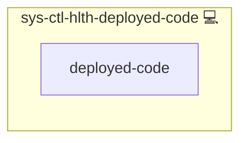

# Deployed Code Check

## Description

A scheduled check that the code a host deploys from is what was reviewed: every configured Git checkout must sit on a commit that is on its default branch on GitHub, carry a verified signature, and have no modified tracked file. Every finding goes to [Wazuh](https://wazuh.com/), next to the agent's real-time file integrity monitoring (FIM) of the same checkouts.

## Overview

[sys-svc-wazuh-agent](../sys-svc-wazuh-agent/README.md) includes this role on every agent host. It does nothing unless the host lists checkouts in `DEPLOYED_CODE_CHECKOUTS` (default empty, see `group_vars/all/05_paths.yml`), so hosts without a checkout get no timer and no FIM change. For each listed checkout a systemd timer runs the check once per hour, day and night (`SYS_SCHEDULE_HEALTH_DEPLOYED_CODE`), and every deploy runs it once at its end.

Per checkout:

| Check | How | Finding | Rule | Level |
|---|---|---|---|---|
| `fetch` | `git ls-remote --symref` finds origin's default branch, `git fetch` updates `origin/<branch>`, `git merge-base --is-ancestor` tests `HEAD` | commit not on the default branch | 100172 | 12 |
| `status` | `git status --porcelain`, tracked files only | one per modified, deleted or renamed tracked file (at most 50, then one "N more files") | 100173 | 10 |
| `verification` | GitHub API `commits/<sha>`, `verification.verified` | commit without a verified signature | 100171 | 10 |

A check that cannot run (not a checkout, origin unreachable, origin not on GitHub, token missing or rejected, API error or rate limit) raises rule 100174 (level 7) and is never reported as fine. Each run ends with a summary line (rule 100170, level 0). The script exits 0 after logging, so a finding never fails a deploy; only a crash of the script alerts through [sys-ctl-alm-compose](../sys-ctl-alm-compose/README.md).

Git runs as the checkout's owner, never as root, so the hourly fetch cannot leave root-owned files in a user's repository. Error texts are stripped of credentials in URLs.

The agent watches each listed checkout in real time, without `report_changes`, so a tampered file alerts within seconds through Wazuh's own FIM rules (for example 550, checksum changed) and no copy of the code is kept on the agent. Each checkout's `.git` is ignored, because the check's own fetch writes there every hour.

## Token

The signature check uses the read-only `github_settings_token` of [web-svc-github-webhook](../web-svc-github-webhook/README.md) (it includes Contents read), stored root-only (mode 0600) next to the script. Without it, every run raises 100174 for the `verification` check.

## Development

The dev checkout (`INFINITO_SRC_DIR`, `/opt/src/infinito`) is not in the list: it runs a feature branch, so the check would alert on every run. The development inventory lists only `DEPLOYED_CODE_PROOF_CHECKOUT`, a throwaway clone that the Wazuh role's CLI test (`roles/web-app-wazuh/files/test/deployed_code.sh`) rebuilds from a local origin posing as a GitHub repository. It proves each rule against a local API stub: a clean, verified commit on main raises nothing, a modified tracked file raises 100173 and a FIM alert, a commit only on a feature branch 100172, an unverified commit 100171, and a failing API 100174. The test refuses to rebuild a checkout whose origin is not the proof URL. Real-time FIM cannot watch a directory that is missing when the agent starts (it would only see it at the next full scan, every 12 hours), so `sys-svc-wazuh-agent` creates the proof directory before it starts and restarts the agent when it had to create it. A real checkout listed in `DEPLOYED_CODE_CHECKOUTS` must likewise exist before the agent starts. Between test runs, the hourly check of the proof clone raises 100174, because the dev token is empty.

## Cosmos

The diagram places Deployed Code Check in the Infinito.Nexus cosmos: the components it deploys (capabilities), the central services it consumes (dependencies), and its outward reach (federation and bridged external networks).

Solid `1:1` edges are fixed relationships; dashed `0..1` edges are conditional (enabled only in matching deployments); red `0..0` edges are turned off in this role. Node markers show the role's deploy modes (💻 host, 🐳 compose, 🐝 swarm); ❌ marks a service that is explicitly turned off, and ⚙️ an Ansible role dependency declared in `meta/main.yml`.

## Features

- **Reviewed code only:** alerts when the deployed commit is not on the default branch or not signed.
- **Tamper evidence twice:** the hourly status check and real-time FIM both report a changed tracked file.
- **Loud failures:** a check that cannot run raises its own rule.
- **Opt-in per host:** nothing is installed or watched without a listed checkout.

## Follow-ups

- **Production deployments without a checkout** (deploys from a packaged release) are not covered yet.
- **Untracked files** are not reported by the status check; FIM's new-file alerts cover them.

## Developer Notes

The checks are unit-tested against real temporary Git repositories in `tests/unit/python/roles/sys-ctl-hlth-deployed-code/files/test_script.py`.

## Credits

Implemented by **[Prageeth Panicker](https://github.com/pragepani)**.
Part of the [Infinito.Nexus Project](https://s.infinito.nexus/code) and maintained by [Kevin Veen-Birkenbach](https://www.veen.world).
Licensed under the [Infinito.Nexus Community License (Non-Commercial)](https://s.infinito.nexus/license).
