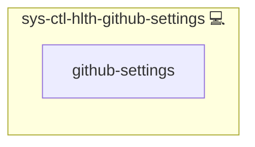

# GitHub Settings Check

## Description

A scheduled check that compares the security settings of the GitHub organization and its repositories with their expected state and reports every difference to [Wazuh](https://wazuh.com/). It complements the event stream of [web-svc-github-webhook](../web-svc-github-webhook/README.md): webhooks report a change when it happens, this check reports the state, so a change whose event was lost, or a setting that has no webhook event, still alerts.

## Overview

`web-svc-github-webhook` includes this role on its stack host, because it holds the token. A systemd timer runs the check once per hour, day and night (`SYS_SCHEDULE_HEALTH_GITHUB_SETTINGS`), and every deploy runs it once at its end.

The expected state lives in [files/expected.yml](./files/expected.yml). Per organization and repository the check compares:

| Check | Source | Expected field |
|---|---|---|
| `owners` | organization members with the admin role | `owners` |
| `branch_protection` | classic branch protection and the active rulesets on the default branch, combined: required signed commits, required approving reviews, code-owner review, stale-review dismissal, force push blocked, deletion blocked | `branch_protection` |
| `collaborators` | direct collaborators and their role | `collaborators` |
| `deploy_keys` | deploy keys by ID, with title and read-only flag | `deploy_keys` |
| `actions` | Actions permissions and default workflow token permissions | `actions` |
| `pull_request_target` | workflow files on the default branch triggered by `pull_request_target` | `pull_request_target` |
| `secret_scanning` | open secret-scanning alerts | `open_secret_scanning_alerts` |
| `dependabot` | open Dependabot alerts | `open_dependabot_alerts` |

Every differing field is one JSON line under the reserved journald tag `infinito-github-settings`, which the Wazuh agent collects:

| Rule | Level | Event |
|---|---|---|
| 100161 | 10 | A field differs from its expected value |
| 100162 | 10 | A workflow on the default branch runs on `pull_request_target` and is not in the expected list |
| 100163 | 7 | A check could not run (API unreachable, token missing, expired or lacking a permission, rate limit), so its drift is unknown |

A failed check is always its own event and never reads as "no drift". Each run ends with a summary line (`gs_kind: run`, rule 100160, level 0) that counts the drift and failed checks. The script exits 0 after it has logged, so a drift or a GitHub outage does not fail the deploy; only a crash of the script itself alerts through [sys-ctl-alm-compose](../sys-ctl-alm-compose/README.md).

## Expected State

Values marked `# unverified` in `files/expected.yml` are placeholders: they could not be read without the token and must be replaced at rollout. The others were checked: the branch protection fields against the public ruleset on `main` (except `required_signatures`, see below) and the `pull_request_target` workflows against `main`.

At rollout, generate the file from the live settings instead of guessing, review it, and commit it:

```bash
sudo python3 /opt/scripts/systemctl/sys-ctl-hlth-github-settings/script.py --print-current \
  --api-url https://api.github.com \
  --token-file /opt/scripts/systemctl/sys-ctl-hlth-github-settings/token \
  --expected /opt/scripts/systemctl/sys-ctl-hlth-github-settings/expected.json \
  --timeout 30 > expected.yml
```

`--print-current` prints the current settings of the organization and repositories the deployed file lists, in the same format, and logs nothing. If any value cannot be read, it prints nothing and exits non-zero, naming every failed read. Review the generated file before committing it: it records what is set now, including anything that should not be.

## Recommended GitHub Settings

- **Require signed commits on the default branch** (ruleset rule "Require signed commits" or classic branch protection). `files/expected.yml` expects it, and the check reports `required_signatures` as drift until it is set.

## Token

The check reads the `github_settings_token` credential of `web-svc-github-webhook`, stored root-only (mode 0600) next to the script. It must be a fine-grained token of a dedicated bot account, never a personal one, with an expiry date and only these read-only permissions: Administration, Metadata, Contents, Secret scanning alerts, Dependabot alerts (repository) and Members (organization). Renew it before it expires; an expired token makes every hourly run raise rule 100163. See the [GitHub setup](../web-svc-github-webhook/README.md#github-setup) of the webhook role.

## Cosmos

The diagram places GitHub Settings Check in the Infinito.Nexus cosmos: the components it deploys (capabilities), the central services it consumes (dependencies), and its outward reach (federation and bridged external networks).



Solid `1:1` edges are fixed relationships; dashed `0..1` edges are conditional (enabled only in matching deployments); red `0..0` edges are turned off in this role. Node markers show the role's deploy modes (💻 host, 🐳 compose, 🐝 swarm); ❌ marks a service that is explicitly turned off, and ⚙️ an Ansible role dependency declared in `meta/main.yml`.

## Features

- **State, not only events:** catches settings changed while a webhook delivery was lost.
- **One alert per field:** every drifted field is its own Wazuh alert with expected and actual value.
- **Loud failures:** an API error, a bad token or a rate limit raises its own rule instead of passing silently.
- **Read-only:** the token can read the settings, never change them.

## Follow-ups

- **Team access and bypass actors** are not compared yet: a team with write or admin access, and a ruleset bypass list, can weaken protection without changing the fields above.
- **`pull_request_target` detection** reads the workflow text line by line, not as YAML; an unusual layout of the `on:` block can hide a trigger.

## Developer Notes

The diff logic and `--print-current` (against an in-process GitHub API stub, including that a printed state has no drift against itself) are unit-tested in `tests/unit/python/roles/sys-ctl-hlth-github-settings/files/test_script.py`. The deploy test of `web-svc-github-webhook` runs the deployed script against a host-local API stub and waits for each alert.

## Credits

Implemented by **[Prageeth Panicker](https://github.com/pragepani)**.
Part of the [Infinito.Nexus Project](https://s.infinito.nexus/code) and maintained by [Kevin Veen-Birkenbach](https://www.veen.world).
Licensed under the [Infinito.Nexus Community License (Non-Commercial)](https://s.infinito.nexus/license).
