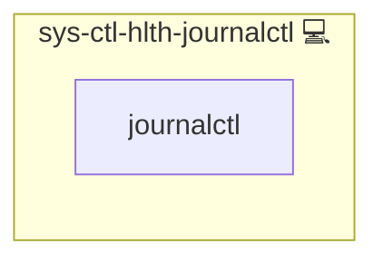

# sys-ctl-hlth-journalctl

## Description

Scans `journalctl` over the last day for “error” entries outside container logs and alerts if any are found.

## Overview

This role searches the systemd journal for errors over the past day and alerts if any are found.
Container output is skipped, because every compose service logs to journald and application errors would otherwise trigger the host check.
Docker daemon and system errors are still reported.

## Cosmos

The diagram places sys-ctl-hlth-journalctl in the Infinito.Nexus cosmos: the components it deploys (capabilities), the central services it consumes (dependencies), and its outward reach (federation and bridged external networks).

Solid `1:1` edges are fixed relationships; dashed `0..1` edges are conditional (enabled only in matching deployments); red `0..0` edges are turned off in this role. Node markers show the role's deploy modes (💻 host, 🐳 compose, 🐝 swarm); ❌ marks a service that is explicitly turned off, and ⚙️ an Ansible role dependency declared in `meta/main.yml`.

## Features

- Reads the last day of the journal as JSON with every field in full (`--all`) and drops every entry that carries a `CONTAINER_ID` field.
- Joins a repeated `MESSAGE` field into one line before matching.
- Matches the remaining messages case-insensitively against `error`.
- Prints one `source: message` line per match, naming the systemd unit or, without one, the syslog identifier, so alerts show who logged the error.
- Exits non-zero on matches, and also when `journalctl` itself fails, so a broken check never passes silently.
- Scheduled via systemd timer.
- Alerts via `sys-ctl-alm-compose` on detection.

## Usage

Include the role; set `on_calendar_health_journalctl` for your preferred schedule.

## Credits

Implemented by **[Kevin Veen-Birkenbach](https://www.veen.world)**.
Part of the [Infinito.Nexus Project](https://s.infinito.nexus/code) and maintained by [Kevin Veen-Birkenbach](https://www.veen.world).
Licensed under the [Infinito.Nexus Community License (Non-Commercial)](https://s.infinito.nexus/license).
