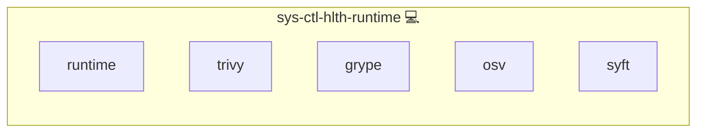

# Container Runtime Health Check

## Description

This role scans the node it runs on for known vulnerabilities with [Trivy](https://trivy.dev/), [Grype](https://github.com/anchore/grype) and [OSV-Scanner](https://google.github.io/osv-scanner/) over a [Syft](https://github.com/anchore/syft) SBOM, and checks the effective PHP hardening of each service that mounts the shared hardening ini from [`sys-svc-compose-php`](../sys-svc-compose-php/README.md).

## Overview

The role installs a check script with a `systemd` service and a timer at 00:00 UTC, and the deploy runs it once at its end. `severity` maps each reported severity to `fail` or `warn`: an unsuppressed finding mapped to `fail` fails the check, one mapped to `warn` is a `⚠️` line, a suppressed one an `ℹ️` line. The check also fails, and the failure notifier from [`sys-ctl-alm-compose`](../sys-ctl-alm-compose/README.md) alerts, when an engine or its database fails, or when a service that declares `php_hardening` in its `meta/volumes.yml` still reports `expose_php` or `session.upload_progress.enabled` as on. The daily mirror scan of `cron-images-mirror-all.yml` tracks every mapped finding, `fail` and `warn` alike, as issues and fails only on an engine or mirror error; the findings of every `main` deploy become `vulnerability-runtime` issues, see [README.md](../../cli/contributing/security/README.md). The scan configuration and the engine pins live in [services.yml](./meta/services.yml).

## Cosmos

The diagram places Container Runtime Health Check in the Infinito.Nexus cosmos: the components it deploys (capabilities), the central services it consumes (dependencies), and its outward reach (federation and bridged external networks).

Solid `1:1` edges are fixed relationships; dashed `0..1` edges are conditional (enabled only in matching deployments); red `0..0` edges are turned off in this role. Node markers show the role's deploy modes (💻 host, 🐳 compose, 🐝 swarm); ❌ marks a service that is explicitly turned off, and ⚙️ an Ansible role dependency declared in `meta/main.yml`.

## Features

- **Targets:** `container` scans the image of every running container through the read-only Docker socket, `host` scans the host root filesystem mounted read-only. In swarm every node scans itself.
- **Engine runtime:** An engine run that reads the host Docker socket runs on `runc`, also on a swarm worker that [`svc-virt-kata`](../svc-virt-kata/README.md) defaults to gVisor or Kata, because those runtimes refuse the bind-mounted socket and every container scan would fail there. Every other engine run, the host scan included, keeps the node's default runtime.
- **Engines:** Syft builds one SBOM per target, Grype and OSV-Scanner read it, Trivy reads the target itself. Without `syft` in `engines`, Grype and OSV-Scanner read the target directly; `osv` then scans containers only.
- **Source-built runtimes:** A runtime compiled into the image, such as the PHP of the official `php` images, is matched by Grype only. With `syft` but without `grype` in `engines`, Grype still scans the binary-classified packages of every SBOM.
- **Threshold:** `severity` maps each reported severity to `fail` or `warn`, `{CRITICAL: fail, HIGH: warn}` by default and in production. The development inventory that `INFINITO_INVENTORY_VARS_FILE` names maps `CRITICAL` to `warn`, so a CI or development deploy reports a CRITICAL finding as a `⚠️` line and a `warn` record without failing, and the daily mirror scan tracks it as a `vulnerability` issue. A severity the mapping does not name is not reported, and `fixed_only` limits the report to findings with a fixed version. The list form of `severity` is rejected.
- **Finding records:** Every output is built from the same records, one per finding and owner: `run_id`, `timestamp` (RFC 3339, UTC), `host`, `environment`, `target` (`<stack>/<service>` or the host name), `kind`, `image` (`<image name>@<image id>` or the host name), `scanner`, `id`, `severity`, `package`, `installed_version`, `fixed_version`, `suppressed`, `suppressed_until` and `verdict` (`fail`, `warn` or `suppressed`).
- **Report:** `report.json` in `DIR_HEALTH_RUNTIME_REPORT` holds the last run: its verdict, the counts per verdict, the engine errors, the counts per target and every record. It is replaced atomically.
- **Findings log:** `findings.jsonl` in `DIR_HEALTH_RUNTIME_LOG` gets one JSON line per record and run, for Wazuh. A logrotate drop-in rotates it weekly and keeps 12 compressed generations.
- **Journal:** Besides the `ℹ️`, `⚠️` and `❌` lines, the check prints one JSON line per target, `{"event": "hlth_runtime.target", "run_id", "target", "kind", "image", "counts", "verdict"}` with `verdict` `fail`, `warn` or `ok`, and last `{"event": "hlth_runtime.summary", "run_id", "counts", "errors", "verdict"}`, for Loki.
- **Metrics:** While `web-app-prometheus` is deployed, the check replaces `infinito_hlth_runtime.prom` in `DIR_METRICS_TEXTFILE` atomically with the gauges `infinito_hlth_runtime_findings{target,kind,image,severity,scanner,verdict}`, `infinito_hlth_runtime_last_run_timestamp_seconds`, `infinito_hlth_runtime_last_run_success` and `infinito_hlth_runtime_scanner_errors{scanner}`. No series carries a CVE id.
- **Suppressions:** A role accepts findings for its own containers under `<service>.security.suppressions` of its `meta/services.yml`, each entry `id` (one CVE) or `image_tag` (every finding of the image while it runs that tag, which MUST equal the service's `version`) plus `until` below a `# nocheck: cve <reason>` marker, see [suppression.md](../../docs/contributing/actions/testing/suppression.md). Host suppressions are the `id` entries under the engine entries of this role and cover that engine's host findings; an `image_tag` entry there covers the engine's own image.
- **Databases:** With `db_update` the engines refresh their databases under `database_dir` before each run, three attempts 30 s apart; without it the databases MUST already be there, and a missing one fails the run. SBOMs of running images are cached under `cache_dir` by image id.
- **Scratch:** Every engine run gets its own temporary directory in the run's work directory under `cache_dir`, removed as soon as the run ends, also when the engine fails, times out or crashes. At most one image export is on disk at a time, whatever `workers` is; the other engine runs keep running in parallel. A run killed mid-scan leaves its work directory to the next run, which removes it first.
- **Deploy-time run:** The deploy runs the check once at its end and fails on its first failure, without the retries `sys-service-terminator` gives other units.
- **Development and CI deploys:** A CI row pins one engine and restores its databases; a local deploy draws one engine and refreshes the shared host directory `INFINITO_VULNERABILITY_DB_HOST_PATH`. Both run it behind Syft plus the Grype runtime pass and read the databases read-only at `INFINITO_VULNERABILITY_DB_DIR`. Production hosts run every engine.
- **Hardening verification:** Runs `php` inside every service that mounts `php_hardening` and fails while `expose_php` or `session.upload_progress.enabled` is on, and lists other PHP containers of a hardened stack as info.
- **Registry scan:** `make test-security` scans every pinned role image of the GHCR mirror with the same pipeline, see [README.md](../../cli/contributing/security/README.md).
