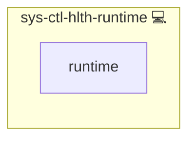

# Container Runtime Health Check

## Description

This role checks the language runtime inside every running Docker container. It reads the PHP version of each container that ships a `php` binary and the effective PHP hardening of each service that mounts the shared hardening ini from [`sys-svc-compose-php`](../sys-svc-compose-php/README.md).

## Overview

The role installs a check script with a `systemd` service and timer. The check fails, and the failure notifier from [`sys-ctl-alm-compose`](../sys-ctl-alm-compose/README.md) alerts, when a container runs PHP below the security floor of its release line or on an end-of-life line, or when a service that declares `php_hardening` in its `meta/volumes.yml` still reports `expose_php` or `session.upload_progress.enabled` as on. The floors, the lowest patched release of each `major.minor` line, live in `HEALTH_RUNTIME_FLOORS` in [main.yml](./vars/main.yml).

## Cosmos

The diagram places Container Runtime Health Check in the Infinito.Nexus cosmos: the components it deploys (capabilities), the central services it consumes (dependencies), and its outward reach (federation and bridged external networks).

Solid `1:1` edges are fixed relationships; dashed `0..1` edges are conditional (enabled only in matching deployments); red `0..0` edges are turned off in this role. Node markers show the role's deploy modes (💻 host, 🐳 compose, 🐝 swarm); ❌ marks a service that is explicitly turned off, and ⚙️ an Ansible role dependency declared in `meta/main.yml`.

## Features

- **Runtime floor:** Fails for every running container whose PHP is below the floor of its `major.minor` line, or on a line older than every listed floor (end of life). A line newer than every floor passes.
- **Hardening verification:** Runs `php` inside every service that mounts `php_hardening` and fails while `expose_php` or `session.upload_progress.enabled` is on, which catches a wrong scan dir, a later ini that overrides the hardening, and an image change.
- **Sidecar report:** Lists other PHP containers of a hardened stack, such as cron or worker sidecars, as info without failing.
- **Registry report:** `make security-runtimes` lists the PHP runtime of every pinned image from registry metadata, without pulling, against the same floors.

## Credits

Implemented by **[Kevin Veen-Birkenbach](https://www.veen.world)**.
Part of the [Infinito.Nexus Project](https://s.infinito.nexus/code) and maintained by [Kevin Veen-Birkenbach](https://www.veen.world).
Licensed under the [Infinito.Nexus Community License (Non-Commercial)](https://s.infinito.nexus/license).
