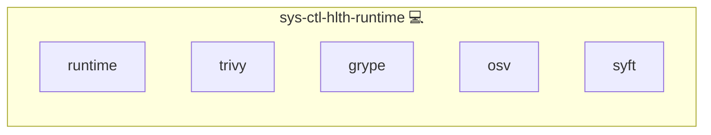

# Container Runtime Health Check

## Description

This role scans the node it runs on for known vulnerabilities with [Trivy](https://trivy.dev/), [Grype](https://github.com/anchore/grype) and [OSV-Scanner](https://google.github.io/osv-scanner/) over a [Syft](https://github.com/anchore/syft) SBOM, and checks the effective PHP hardening of each service that mounts the shared hardening ini from [`sys-svc-compose-php`](../sys-svc-compose-php/README.md).

## Overview

The role installs a check script with a `systemd` service and a timer at 00:00 UTC, and the deploy runs it once at its end. `severity` maps each reported severity to `fail` or `warn`: an unsuppressed finding mapped to `fail` fails the check, one mapped to `warn` is a `⚠️` line, a suppressed one an `ℹ️` line. The check also fails, and the failure notifier from [`sys-ctl-alm-compose`](../sys-ctl-alm-compose/README.md) alerts, when an engine or its database fails, or when a service that declares `php_hardening` in its `meta/volumes.yml` still reports `expose_php` or `session.upload_progress.enabled` as on. The daily mirror scan of `cron-images-mirror-all.yml` tracks every mapped finding, `fail` and `warn` alike, as issues and fails only on an engine or mirror error; the findings of every `main` deploy become `vulnerability-runtime` issues, see [README.md](../../cli/contributing/security/README.md). The scan configuration and the engine pins live in [services.yml](./meta/services.yml).

## Cosmos

The diagram places Container Runtime Health Check in the Infinito.Nexus cosmos: the components it deploys (capabilities), the central services it consumes (dependencies), and its outward reach (federation and bridged external networks).

Solid `1:1` edges are fixed relationships; dashed `0..1` edges are conditional (enabled only in matching deployments); red `0..0` edges are turned off in this role. Node markers show the role's deploy modes (💻 host, 🐳 compose, 🐝 swarm); ❌ marks a service that is explicitly turned off, and ⚙️ an Ansible role dependency declared in `meta/main.yml`.

## Features

- **Targets:** `container` scans the image of every running container through the read-only Docker socket, `host` scans the host root filesystem mounted read-only. In swarm every node scans itself. The host scan skips the paths in `HEALTH_RUNTIME_HOST_EXCLUDES` of [vars/main.yml](./vars/main.yml): kernel and temporary filesystems, the container engine's data root, removable media, the backups including the node-local store `DIR_BACKUPS_NODE`, and the NFS export base. It also skips every mount other than `/` whose type is one of the network or automount filesystem types listed in `NETWORK_FSTYPES` of [script.py](./files/python/script.py), read from `/proc/self/mountinfo`, so a slow or dead remote server cannot stall it, and prints one `ℹ️` line per skipped mount. The `autofs` type also covers local automounts, such as a systemd automount of `/boot` or `/efi`. Software on such a mount is not scanned: a host that mounts `/opt`, `/home`, `/usr/local` or `/var` from NFS, CIFS or sshfs loses the findings there, and a remote `/var` also hides the dpkg, pacman or rpm package database under `/var/lib`. On a swarm node with `storage.backend` `nfs`, `DIR_VAR_LIB` is such a mount and holds the cluster-shared volumes; a compose host keeps its volumes in the skipped Docker data root. Volume content is therefore scanned in neither compose nor swarm mode, and the container scan covers only the image. That leaves out software a service installs into a volume at runtime, such as Nextcloud apps, Odoo addons or agent packages, and the image content Docker copies into an empty named volume on its first mount, such as `hermes_data` at `/opt/data` of [web-app-hermes](../web-app-hermes/meta/volumes.yml): that copy stays at its first version after every image upgrade, and no image scan sees it.
- **Engine runtime:** An engine run that reads the host Docker socket runs on `runc`, also on a swarm worker that [`svc-virt-kata`](../svc-virt-kata/README.md) defaults to gVisor or Kata, because those runtimes refuse the bind-mounted socket and every container scan would fail there. Every other engine run, the host scan included, keeps the node's default runtime.
- **Engines:** Syft builds one SBOM per target, Grype and OSV-Scanner read it, Trivy reads the target itself. Without `syft` in `engines`, Grype and OSV-Scanner read the target directly; `osv` then scans containers only. While Grype runs, Trivy leaves the OS packages of every OS release listed under `trivy.unmatched_os` to Grype until the entry's `until`, because Trivy matches no Red Hat advisory for CentOS Stream 10 and Red Hat Enterprise Linux 10 yet and fails with `unable to find CPE indices`, see [aquasecurity/trivy-db#435](https://github.com/aquasecurity/trivy-db/issues/435) and [aquasecurity/trivy#7452](https://github.com/aquasecurity/trivy/issues/7452).
- **Source-built runtimes:** A runtime compiled into the image, such as the PHP of the official `php` images, is matched by Grype only. With `syft` but without `grype` in `engines`, Grype still scans the binary-classified packages of every SBOM.
- **Threshold:** `severity` maps each reported severity to `fail` or `warn`, `{CRITICAL: fail, HIGH: warn}` by default and in production. The development inventory that `INFINITO_INVENTORY_VARS_FILE` names maps `CRITICAL` to `warn`, so a CI or development deploy reports a CRITICAL finding as a `⚠️` line and a `warn` record without failing, and the daily mirror scan tracks it as a `vulnerability` issue. A severity the mapping does not name is not reported, and `fixed_only` limits the report to findings with a fixed version. The list form of `severity` is rejected.
- **Finding records:** Every output is built from the same records, one per finding and owner: `run_id`, `timestamp` (RFC 3339, UTC), `host`, `environment`, `target` (`<stack>/<service>` or the host name), `kind`, `image` (`<image name>@<image id>` or the host name), `scanner`, `id`, `severity`, `package`, `installed_version`, `fixed_version`, `suppressed`, `suppressed_until` and `verdict` (`fail`, `warn` or `suppressed`).
- **Report:** `report.json` in `DIR_HEALTH_RUNTIME_REPORT` holds the last run: its verdict, the counts per verdict, the engine errors, the counts per target and every record. It is replaced atomically. The directory is node-local beside `DIR_VAR_LIB`, like `DIR_BACKUPS_NODE`, so on a swarm node with `storage.backend` `nfs` each node keeps its own report instead of the nodes overwriting one on the shared state. The role removes the report the shared `hlth-runtime` directory under `DIR_VAR_LIB` held before.
- **Findings log:** `findings.jsonl` in `DIR_HEALTH_RUNTIME_LOG` gets one JSON line per record and run, for Wazuh. A logrotate drop-in rotates it weekly and keeps 12 compressed generations.
- **Journal:** Besides the `ℹ️`, `⚠️` and `❌` lines, the check prints one JSON line per target, `{"event": "hlth_runtime.target", "run_id", "target", "kind", "image", "counts", "verdict"}` with `verdict` `fail`, `warn` or `ok`, and last `{"event": "hlth_runtime.summary", "run_id", "counts", "errors", "verdict"}`, for Loki.
- **Metrics:** While `web-app-prometheus` is deployed, the check replaces `infinito_hlth_runtime.<inventory host>.prom` in `DIR_METRICS_TEXTFILE` atomically with the gauges `infinito_hlth_runtime_findings{host,target,kind,image,severity,scanner,verdict}`, `infinito_hlth_runtime_last_run_timestamp_seconds{host}`, `infinito_hlth_runtime_last_run_success{host}` and `infinito_hlth_runtime_scanner_errors{host,scanner}`, where `host` is the node's inventory host name, which the role passes as `--host` and which is also the `host` of the report and of every record. No series carries a CVE id. On swarm nodes with `storage.backend` `nfs` the directory stays on the shared state on purpose: Prometheus scrapes one node exporter target, whose tasks run on manager nodes only because the exporter inherits `services.prometheus.placement` of [web-app-prometheus](../web-app-prometheus/meta/services.yml), so the files of every node in the shared directory are what that one exporter exposes. The role removes the unlabelled `infinito_hlth_runtime.prom` the nodes overwrote before.
- **Suppressions:** A role accepts findings for its own containers under `<service>.security.suppressions` of its `meta/services.yml`, each entry `id` (one CVE) or `image_tag` (every finding of the image while it runs that tag, which MUST equal the service's `version`) plus `until` below a `# nocheck: cve <reason>` marker, see [suppression.md](../../docs/contributing/actions/testing/suppression.md). Host suppressions are the `id` entries under the engine entries of this role and cover that engine's host findings; an `image_tag` entry there covers the engine's own image.
- **Databases:** With `db_update` the engines refresh their databases under `database_dir` before each run, three attempts 30 s apart; without it the databases MUST already be there, and a missing one fails the run. SBOMs of running images are cached under `cache_dir` by image id. Beside each SBOM the check keeps the last report of every engine that read it (Grype, the Grype runtime pass and OSV-Scanner) and the last Trivy report of each container image. Each report is stored with a fingerprint of the engine image's ordered layer digests (not its image id, which a runtime on the containerd image store reports as the digest of the multi-platform index), its arguments, the size and modification time of every database file and, for an SBOM reader, what the engine matches in the SBOM: the type, name, version and purl of every CycloneDX component for OSV-Scanner, the artifacts and the distro of the Syft JSON for Grype. The serial number, timestamps and references of one Syft run stay out of it, so a host SBOM that Syft rebuilds for the same packages, as between two deploy passes, keeps its reports. A run reuses a report whose fingerprint still matches instead of running the engine again, and OSV-Scanner then reads only the SBOMs that have no reusable report. A refreshed database, a moved engine tag or a changed package therefore always triggers a new scan. Trivy rescans the host on every run, because it reads the root filesystem itself.
- **SBOM seed:** Before Syft exports a container image, the check looks for its SBOM in the `sbom-seed` directory beside the databases. A seeded SBOM is named by the SHA-256 of the image's ordered layer digests, and the check takes it only when the layers it records are the local image's own; otherwise Syft runs as before. For a seeded image the check also takes the Grype, Grype runtime or OSV-Scanner report the seed holds under the same layer key, when its fingerprint is the one this run computes, and caches it like its own. The swarm lab drill fills the seed from the lab registry while the deploy runs, see [README.md](../../utils/tests/swarm/README.md), so the nodes, which share one disk and export behind one lock, read each image once instead of once per node. A production node has no seed and always runs Syft.
- **Run bound:** Every engine run ends after `JOB_TIMEOUT_SECONDS` of [script.py](./files/python/script.py), 4 h, and then fails the check. Trivy gets the same bound as its `--timeout`, because its own default of 5 minutes failed the scan of the 4.5 GB `local_discourse/discourse` image on a busy swarm node with `context deadline exceeded`.
- **Scratch:** Every engine run gets its own temporary directory in the run's work directory under `cache_dir`, removed as soon as the run ends, also when the engine fails, times out or crashes. Engine runs that export an image take turns, whatever `workers` is, and so does the OSV-Scanner run over the SBOMs, which loads the offline database of every ecosystem they name into memory: each holds a lock on `database_dir` from creating its scratch directory until it has removed it, and on a timeout or crash also its container. The lock spans every scan that reads the same `database_dir`, so the swarm lab nodes and the local stacks of every worktree, which all share the host directory `INFINITO_VULNERABILITY_DB_HOST_PATH` of `default.env`, take turns on their one host disk and its memory. The other engine runs keep running in parallel. A run killed mid-scan leaves its work directory to the next run, which removes it first.
- **Deploy-time run:** The deploy runs the check once at its end and fails on its first failure, without the retries `sys-service-terminator` gives other units.
- **Development and CI deploys:** A CI row pins one engine and restores its databases; a local deploy draws one engine and refreshes the shared host directory `INFINITO_VULNERABILITY_DB_HOST_PATH`. Both run it behind Syft plus the Grype runtime pass and read the databases read-only at `INFINITO_VULNERABILITY_DB_DIR`. Production hosts run every engine.
- **Hardening verification:** Runs `php` inside every service that mounts `php_hardening` and fails while `expose_php` or `session.upload_progress.enabled` is on, and lists other PHP containers of a hardened stack as info.
- **Registry scan:** `make test-security` scans every pinned role image of the GHCR mirror with the same pipeline, see [README.md](../../cli/contributing/security/README.md).
