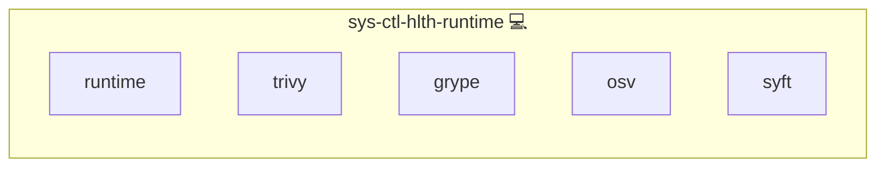

# Container Runtime Health Check

## Description

This role scans the node it runs on for known vulnerabilities with [Trivy](https://trivy.dev/), [Grype](https://github.com/anchore/grype) and [OSV-Scanner](https://google.github.io/osv-scanner/) over a [Syft](https://github.com/anchore/syft) SBOM, and checks the effective PHP hardening of each service that mounts the shared hardening ini from [`sys-svc-compose-php`](../sys-svc-compose-php/README.md).

## Overview

The role installs a check script with a `systemd` service and a timer at 00:00 UTC, and the deploy runs it once at its end. The check fails, and the failure notifier from [`sys-ctl-alm-compose`](../sys-ctl-alm-compose/README.md) alerts, when any engine reports a vulnerability at the threshold that no suppression covers, when an engine or its database fails, or when a service that declares `php_hardening` in its `meta/volumes.yml` still reports `expose_php` or `session.upload_progress.enabled` as on. The scan configuration and the engine pins live in [services.yml](./meta/services.yml).

## Cosmos

The diagram places Container Runtime Health Check in the Infinito.Nexus cosmos: the components it deploys (capabilities), the central services it consumes (dependencies), and its outward reach (federation and bridged external networks).

Solid `1:1` edges are fixed relationships; dashed `0..1` edges are conditional (enabled only in matching deployments); red `0..0` edges are turned off in this role. Node markers show the role's deploy modes (💻 host, 🐳 compose, 🐝 swarm); ❌ marks a service that is explicitly turned off, and ⚙️ an Ansible role dependency declared in `meta/main.yml`.

## Features

- **Targets:** `container` scans the image of every running container through the read-only Docker socket, `host` scans the host root filesystem mounted read-only. In swarm every node scans itself.
- **Engines:** Syft builds one SBOM per target, Grype and OSV-Scanner read it, Trivy reads the target itself. Without `syft` in `engines`, Grype and OSV-Scanner read the target directly; `osv` then scans containers only.
- **Source-built runtimes:** A runtime compiled into the image, such as the PHP of the official `php` images, is matched by Grype only. With `syft` but without `grype` in `engines`, Grype still scans the binary-classified packages of every SBOM.
- **Threshold:** `severity` lists the failing severities and `fixed_only` limits them to findings with a fixed version; the default fails on CRITICAL and HIGH with a fix.
- **Suppressions:** A role accepts a CVE for its own containers under `<service>.security.suppressions` of its `meta/services.yml`, each entry `id` plus `until` below a `# nocheck: cve <reason>` marker, see [suppression.md](../../docs/contributing/actions/testing/suppression.md). Host suppressions sit under the engine entries of this role and cover that engine's host findings.
- **Databases:** With `db_update` the engines refresh their databases under `database_dir` before each run, three attempts 30 s apart; without it the databases MUST already be there, and a missing one fails the run. SBOMs of running images are cached under `cache_dir` by image id.
- **Deploy-time run:** The deploy runs the check once at its end and fails on its first failure, without the retries `sys-service-terminator` gives other units.
- **Development and CI deploys:** A CI row pins one engine and restores its databases; a local deploy draws one engine and refreshes the shared host directory `INFINITO_VULNERABILITY_DB_HOST_PATH`. Both run it behind Syft plus the Grype runtime pass and read the databases read-only at `INFINITO_VULNERABILITY_DB_DIR`. Production hosts run every engine.
- **Hardening verification:** Runs `php` inside every service that mounts `php_hardening` and fails while `expose_php` or `session.upload_progress.enabled` is on, and lists other PHP containers of a hardened stack as info.
- **Registry scan:** `make test-security` scans every pinned role image of the GHCR mirror with the same pipeline, see [README.md](../../cli/contributing/security/README.md).

## Credits

Implemented by **[Kevin Veen-Birkenbach](https://www.veen.world)**.
Part of the [Infinito.Nexus Project](https://s.infinito.nexus/code) and maintained by [Kevin Veen-Birkenbach](https://www.veen.world).
Licensed under the [Infinito.Nexus Community License (Non-Commercial)](https://s.infinito.nexus/license).
