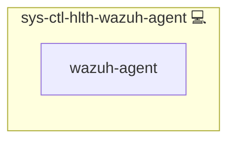

# Wazuh Agent Health

## Description

An independent health check for the [Wazuh](https://wazuh.com/) agent of [sys-svc-wazuh-agent](../sys-svc-wazuh-agent/README.md): a systemd timer checks the agent and, on the manager host, every registered agent, and a failure alerts through [sys-ctl-alm-compose](../sys-ctl-alm-compose/README.md) (email, Telegram), so an agent outage is noticed even when Wazuh itself is down.

## Overview

`sys-svc-wazuh-agent` includes this role on every host that runs an agent. The timer runs every 15 minutes, day and night (`SYS_SCHEDULE_HEALTH_WAZUH_AGENT`); deploys stop all timers while they run, so the check never sees a deploy's own restarts.

On every agent host the check fails when:

- the `wazuh-agent` unit is not active;
- `wazuh-agentd` is not running although the unit is active (the unit keeps `RemainAfterExit=yes`, so it stays active when the daemons die);
- `wazuh-agentd` reports itself not `connected` in `var/run/wazuh-agentd.state` and its last ACK from the manager is older than the threshold.

On every agent host it also fails when the host clock is not synchronized (`timedatectl` `NTPSynchronized` is not `yes`), because Wazuh event times are only as good as the clock (policy P4).

On the manager host it also lists every agent registered on the manager (`agent_control -l`); agents are pre-registered and enrollment is off, so this is the expected set. It fails when the manager is unreachable, or when a registered agent other than the manager's own (`000`) is not `Active` and its last keepalive is older than the threshold or it never connected. This also catches an agent on another host that was registered but never came up.

**Threshold and grace: 180 s**, three times the agent's reconnect interval (`lookup('wazuh_agent').time_reconnect`), the same window the deploy waits for an agent to become Active. A disconnect shorter than that, such as the manager's restart during a deploy, does not alert. The same 180 s are the grace after `wazuh-agentd` starts (judged by the process, not the unit, so the agent's own daemon restart after the manager pushes shared configuration is covered) and after the manager container starts or stops (`State.StartedAt`, `State.FinishedAt`), so a manager restart alerts only when it lasts longer than that.
180 s is a noise threshold, not a loss threshold: at 100 events/s the agent's buffer (5000 events) is full in about 50 s, and later events are dropped. The worst-case time from an outage to an alert is about 15 + 5 + 3 minutes (timer interval, the timer's random delay of up to 5 minutes that `sys-service` adds, threshold), so the alert reports how many events are buffered (`msg_buffer`).

The alert carries the check's output through `systemctl status`. The check reads only the agent's state file, its pid files and `agent_control` status lines; it never reads `client.keys` or any key.

## Cosmos

The diagram places Wazuh Agent Health in the Infinito.Nexus cosmos: the components it deploys (capabilities), the central services it consumes (dependencies), and its outward reach (federation and bridged external networks).

Solid `1:1` edges are fixed relationships; dashed `0..1` edges are conditional (enabled only in matching deployments); red `0..0` edges are turned off in this role. Node markers show the role's deploy modes (💻 host, 🐳 compose, 🐝 swarm); ❌ marks a service that is explicitly turned off, and ⚙️ an Ansible role dependency declared in `meta/main.yml`.

## Features

- **Independent of Wazuh:** alerts by email and Telegram through `sys-ctl-alm-compose`, also when the manager is down.
- **Agent and manager view:** the local agent's own connection state on every host, every registered agent on the manager host.
- **No deploy noise:** timers pause during deploys, and a 180 s grace covers restarts and reconnects.
- **No secrets in alerts:** only status lines, never keys.

## Follow-ups

- **Repeated alerts:** `sys-ctl-alm-compose` has no suppression, so a lasting outage alerts every 15 minutes until it is fixed. The check keeps failing while the agent is down, on purpose; suppression belongs in the alerting role.

## Credits

Implemented by **[Prageeth Panicker](https://github.com/pragepani)**.
Part of the [Infinito.Nexus Project](https://s.infinito.nexus/code) and maintained by [Kevin Veen-Birkenbach](https://www.veen.world).
Licensed under the [Infinito.Nexus Community License (Non-Commercial)](https://s.infinito.nexus/license).
