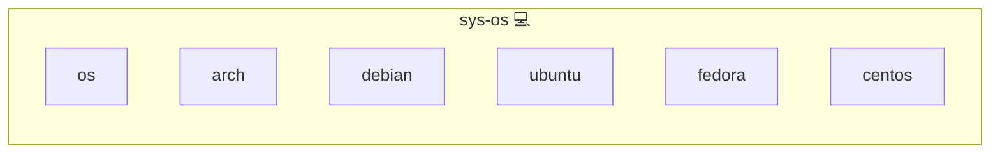

# Operating System Images

## Description

The operating system images are the upstream container images of [Arch Linux](https://archlinux.org/) (through [Manjaro](https://manjaro.org/)), [Debian](https://www.debian.org/), [Ubuntu](https://ubuntu.com/), [Fedora](https://fedoraproject.org/) and [CentOS Stream](https://www.centos.org/centos-stream/), each published per distribution release.

## Overview

This role deploys nothing. Its `meta/services.yml` pins the image and release each distribution's development environment boots from, keyed by the distribution id of [meta/distros.yml](../../meta/distros.yml), and `utils/distros.py` reads the workspace matrix from it. Because the pins live in a role's `meta/services.yml`, the docker updater proposes new releases as pull requests and the image mirror and the vulnerability scan cover them like every other role image. `follow: latest` holds a pin to the release the `latest` tag points at, so Ubuntu moves between LTS releases only and Fedora skips rawhide. Arch stays rolling, and CentOS Stream tags carry no number the updater can order, so its next stream is a manual change.

## Cosmos

The diagram places Operating System Images in the Infinito.Nexus cosmos: the components it deploys (capabilities), the central services it consumes (dependencies), and its outward reach (federation and bridged external networks).

Solid `1:1` edges are fixed relationships; dashed `0..1` edges are conditional (enabled only in matching deployments); red `0..0` edges are turned off in this role. Node markers show the role's deploy modes (💻 host, 🐳 compose, 🐝 swarm); ❌ marks a service that is explicitly turned off, and ⚙️ an Ansible role dependency declared in `meta/main.yml`.

## Features

- One `image` and `version` per distribution id of `meta/distros.yml`
- Workspace test matrix rendered from these pins by `utils/distros.py`
- New releases proposed as updater pull requests
- `follow: latest` keeps Ubuntu on LTS releases and Fedora off rawhide
- Images mirrored and scanned like every other role image

## Credits

Implemented by **[Kevin Veen-Birkenbach](https://www.veen.world)**.
Part of the [Infinito.Nexus Project](https://s.infinito.nexus/code) and maintained by [Kevin Veen-Birkenbach](https://www.veen.world).
Licensed under the [Infinito.Nexus Community License (Non-Commercial)](https://s.infinito.nexus/license).
