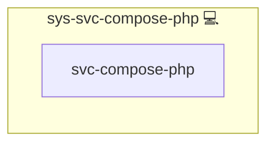

# sys-svc-compose-php

## Description

Internal helper role that installs the shared PHP hardening assets on the
stack host. PHP services of Docker Compose and Swarm stacks mount them as
configs from their own `meta/volumes.yml`.

## Overview

This role installs one PHP ini (`FILE_PHP_HARDENING_INI`) and one PHP-FPM pool
drop-in (`FILE_PHP_FPM_HARDENING_CONF`). A PHP role opts in by declaring a
`type: config` entry with that file as `source` and a file inside the scan dir
of its image as `target`, e.g. `conf.d/zz-infinito-hardening.ini` or, for the
pool, `php-fpm.d/zz-infinito-hardening.conf`.

## Cosmos

The diagram places sys-svc-compose-php in the Infinito.Nexus cosmos: the components it deploys (capabilities), the central services it consumes (dependencies), and its outward reach (federation and bridged external networks).

Solid `1:1` edges are fixed relationships; dashed `0..1` edges are conditional (enabled only in matching deployments); red `0..0` edges are turned off in this role. Node markers show the role's deploy modes (💻 host, 🐳 compose, 🐝 swarm); ❌ marks a service that is explicitly turned off, and ⚙️ an Ansible role dependency declared in `meta/main.yml`.

## Features

- **PHP ini hardening:** `expose_php` off; `session.upload_progress.enabled = 0` and, on PHP 8.5 only, `fatal_error_backtraces = 0` against CVE-2026-109619; the interim `memory_limit = -1` against CVE-2026-109618.
- **PHP-FPM worker recycling:** `pm.max_requests` from `PHP_FPM_MAX_REQUESTS` for images whose `[www]` pool reads `php-fpm.d/*.conf`.
