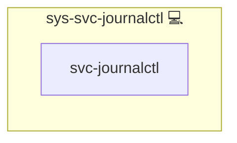

# Journalctl

This Ansible role manages the configuration of `systemd-journald` on target hosts.

## Description

Configures `systemd-journald` on every server: persistent storage, a disk cap, a retention upper bound and rate limits, including the shared limit of every container's log lines. The host journal is the forensic record of events that create no Wazuh alert.

## Overview

`journald.conf` sets, on every host that runs the role, each value overridable per host in `defaults/main.yml`:

| Setting | Value | Reason |
|---|---|---|
| `Storage` | `persistent` | The journal must survive reboots; `auto` depends on whether `/var/log/journal` happens to exist. |
| `SystemMaxUse` | `4G`, but at most 10 % of the journal's filesystem | A 4G target keeps the forensic window independent of the disk size, and the 10 % bound (journald's own default share) keeps a fixed 4G from taking a large part of a small disk. The role measures the filesystem holding `/var/log` at every deploy (`df`) and writes `4G`, or the 10 % in bytes when that is smaller (`SYS_SVC_JOURNALCTL_SYSTEM_MAX_USE`, `SYS_SVC_JOURNALCTL_SYSTEM_MAX_USE_FS_PERCENT`). |
| `SystemKeepFree` | `15%` | journald gives way before the disk fills (upstream default, stated explicitly). |
| `MaxRetentionSec` | `604800` (7 days) | Upper bound for data minimisation; not a guarantee (see the forensic window). |
| `RateLimitIntervalSec` / `RateLimitBurst` | `30s` / `10000` | Per-unit limit of every unit without its own (upstream defaults, stated explicitly). |

A change restarts `systemd-journald`.

These settings, and the Docker drop-in below, apply to every host that runs the role, not only to hosts with Wazuh.

**Docker's log rate limit.** Every container's log line belongs to `docker.service`, so all containers share one rate limit; at the default that is 10000 lines per 30 s, about 333 lines/s for the whole host. A drop-in `/etc/systemd/system/docker.service.d/log-rate-limit.conf` gives `docker.service` its own `LogRateLimitIntervalSec=30s` and `LogRateLimitBurst=50000` (about 1,667 lines/s), an engineering value to be re-measured during rollout. systemd needs version 240 or later for it, which the current releases of all five distributions have.
systemd hands this limit to journald only when `docker.service` starts, and restarting Docker restarts every container, so the role never restarts Docker. On a fresh host `sys-svc-container` writes the drop-in before Docker's first start, so the limit is active from the start. On an existing host it becomes active at the next Docker restart or reboot; until then every deploy prints a warning with the active and the configured value; the active value is what systemd exported for the running unit in `/run/systemd/units/log-rate-limit-{interval,burst}:docker.service`.

**Risk: shared budget.** One noisy or compromised container can use up `docker.service`'s budget and get other apps' lines suppressed in the same interval, which can hide an attack (log-flood evasion). journald logs every suppression as `Suppressed N messages from <unit>`; the Wazuh agent forwards exactly those lines (root-only, from journald's own driver transport) and rule `100140` alerts on them at level 7.

**Forensic window.** With a disk cap, the window is min(`MaxRetentionSec`, `SystemMaxUse` ÷ daily volume on disk). In dev, measured before the load tests of step 2.5 (the `only-future-events` probe added about 20,400 test lines afterwards), the last 24 hours held 27,885 entries, 34.5 MB uncompressed (`journalctl --since -24h -o export | wc -c`), and the journal file grew about 26 MB per day on disk (`journalctl --disk-usage`), so 4G would last about 150 days and the 7-day bound decides. On a production host the cap cuts the window below 7 days above about 585 MB per day (4G ÷ 7). The window is therefore **up to 7 days, best effort**: nothing reserves the disk space, and a host's volume decides. Measure a host with the two commands above.

## Cosmos

The diagram places Journalctl in the Infinito.Nexus cosmos: the components it deploys (capabilities), the central services it consumes (dependencies), and its outward reach (federation and bridged external networks).



Solid `1:1` edges are fixed relationships; dashed `0..1` edges are conditional (enabled only in matching deployments); red `0..0` edges are turned off in this role. Node markers show the role's deploy modes (💻 host, 🐳 compose, 🐝 swarm); ❌ marks a service that is explicitly turned off, and ⚙️ an Ansible role dependency declared in `meta/main.yml`.

## Features

- **Persistent, capped journal:** survives reboots, at most 4G and at most 10 % of its filesystem, entries kept up to 7 days.
- **Docker's own rate limit:** a separate budget for all container lines, active from Docker's first start on fresh hosts.
- **Visible loss:** every suppression becomes a Wazuh alert where the agent runs.
- Integration with `sys-ctl-hlth-journalctl` for downstream monitoring

## Usage

```yaml
- hosts: all
  roles:
    - role: sys-svc-journalctl
```

## Credits

Implemented by **[Kevin Veen-Birkenbach](https://www.veen.world)**.
Part of the [Infinito.Nexus Project](https://s.infinito.nexus/code) and maintained by [Kevin Veen-Birkenbach](https://www.veen.world).
Licensed under the [Infinito.Nexus Community License (Non-Commercial)](https://s.infinito.nexus/license).
