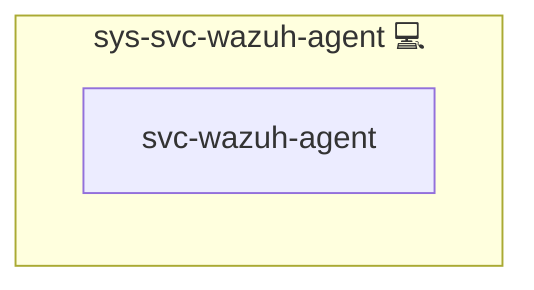

# Wazuh Agent

## Description

The host agent of [Wazuh](https://wazuh.com/): it forwards the journald logs of the roles that opt in to Wazuh, plus `sshd` and `sudo`, to the Wazuh manager deployed by [web-app-wazuh](../web-app-wazuh/README.md).

## Overview

The agent version is the manager's version from `web-app-wazuh`'s `services.manager.version`, installed exactly (`<version>-1`) from the Wazuh package repository and held against upgrades: `dpkg` hold on the Debian family, a repository `exclude` on the RedHat family that only the role's own pinned install lifts.
Before any change, the role fails when the installed agent is newer than the manager; after the install, it fails unless the installed agent equals the manager's version.

The agent does not enroll itself. It writes the entry the manager pre-registered through its API (`lookup('wazuh_agent')`) to `client.keys` (`root:wazuh`, `0640`: `wazuh-agentd` drops to the `wazuh` user before it reads the keys) and connects to the manager's agent port on the local host. Enrollment stays off.

The role renders the whole `ossec.conf`, so none of the package's default log sources are collected. It reads one journald source per tag, filtered on `SYSLOG_IDENTIFIER`: the reserved tags (`infinito-selftest`, `infinito-deploy`, `infinito-fim`), the tag of every opted-in role on this host (`lookup('wazuh_ruleset', scope='host')`, the same source the manager's base decoders come from), `sshd`, `sshd-session` (OpenSSH 9.8 and later logs sessions and failed logins under this name) and `sudo`. The agent buffer is set explicitly.

**Forged journald lines are dropped.** Any local user can write a journald line under any tag (`logger -t <tag>`, or `logger --journald` with arbitrary fields such as `CONTAINER_ID`), and can run a copy of a binary under any name, so `_COMM` is not proof either. Each source therefore adds journald's trusted `_UID`, which a client cannot set: the reserved tags, `sshd`, `sshd-session` and `sudo` are accepted only with `_UID=0`, and app tags only with `_UID=0` and `_COMM=dockerd`, which is how Docker's journald log driver writes container output. The filters in one source combine with AND; a line without a filtered field is dropped.

The Docker listener wodle reports container events (start, die, and the others Docker emits, with the container's labels). Its script, `DockerListener`, starts with `#!/usr/bin/env python3`, so the role installs pinned `docker`, `urllib3` and `requests` into a venv of its own and puts that venv first on the agent's PATH through a systemd drop-in; the package-owned script and the system Python stay untouched. A venv whose Python no longer runs, for example after a distribution Python upgrade, is removed and rebuilt on the next deploy.

The pins differ from Wazuh's documented ones (`docker==7.1.0 urllib3==1.26.20 requests==2.32.2`): `urllib3` 1.26.20 and `requests` 2.32.2 carry known advisories that `pip-audit` reports, so the role uses newer releases that clear them, and upgrades the venv's own `pip` to a pinned release right after creating the venv. The deploy proves the listener still reports events with these versions. `pip-audit` is re-run against the venv on every Wazuh version bump, and the pins follow its result.

Docker labels with dots in their key arrive nested in the event: the label `com.example.app=web` is `data.docker.Actor.Attributes.com.example.app`, an object path, not one flat key. Rules that attribute container events to apps by label must match the nested path.
The listener is on by default; set `WAZUH_AGENT_DOCKER_LISTENER_ENABLED: false` for a host to leave it out of that host's `ossec.conf`.

**Accepted exposure:** the listener reads the Docker socket, which is root-equivalent access to the host. The agent already runs as root, so the listener adds no privilege the agent does not have.

### File integrity monitoring

The agent's FIM module (syscheck) watches the host:

| Paths | Mode | Content diff |
|---|---|---|
| `/etc`, `/usr/bin`, `/usr/sbin`, `/boot` | Scheduled scan every 12 h and at agent start | No |
| `/etc/ssh` (host keys excluded from the diff), `/etc/sudoers.d`, `authorized_keys` in `/root/.ssh` and `/home/*/.ssh` | Real time (who-data where switched on) | Yes |
| `/etc/docker`, the Docker and containerd units in `/usr/lib/systemd/system`, `/etc/systemd/system/docker.service.d`, the compose and instance directories (`DIR_COMPOSITIONS`), the front proxy's nginx directory | Real time (who-data where switched on) | No |
| `/var/ossec/etc` | Real time | No |

`report_changes` keeps a plain copy of each file on the agent and sends the diff to the manager, so it is on only for files that cannot hold credentials: `sshd_config` and its siblings, sudoers rules and public keys. Env files, compose files, rendered config, nginx config, Docker settings (which can carry proxy credentials) and the agent's own `client.keys` are reported with hashes and attributes only.
Data that changes all the time is outside every watched path (`/var/lib/docker` with all volumes and the indexer data, `/var/log`, `/var/cache`), and the bind-mounted `volumes/` directory of each app on the host is ignored. Churning files in `/etc` (`mtab`, `resolv.conf`, `hosts`, `hostname`, `adjtime`) are ignored too.
The real-time paths need about one inotify watch per directory, a few hundred on a full server, far below the kernel's `fs.inotify.max_user_watches`, so no sysctl is changed.

**Who-data** names the user and process behind a change. It is off by default, because Wazuh's eBPF who-data provider in kprobe mode (the mode on kernels without BPF LSM, which is most stock kernels) misses every change made by rename: Ansible's `template` and `copy`, `sed -i` and most editors write a temporary file and rename it over the original. With who-data on, such a change shows up only at the next scheduled scan, without user and process; plain real time (inotify) sees it at once. Detection comes first, so real time is the default on every path. Upstream: [wazuh/wazuh#37023](https://github.com/wazuh/wazuh/pull/37023) adds the missing `vfs_rename` hook, [wazuh/wazuh#39708](https://github.com/wazuh/wazuh/pull/39708) reports remaining rename loss in kprobe mode; re-test on each Wazuh version bump.
A host can switch who-data on with `WAZUH_AGENT_FIM_WHODATA_ENABLED: true`. The role then uses the eBPF provider, which needs no `auditd`; where eBPF does not start (no BTF or ring buffer), Wazuh falls back to `auditd`, which the role installs only on hosts that also set `WAZUH_AGENT_FIM_AUDITD_ENABLED: true`. Without either, the paths stay in real time.
Without who-data, FIM alerts still have context: the `sudo` and `sshd`/`sshd-session` logs, which cannot be forged by a local user, show who became root or logged in, and the deploy markers show which changes came from a deploy.
After every deploy the role reads syscheckd's verdict from the agent log and writes it to journald under `infinito-fim`: `whodata=ebpf` or `whodata=audit` stay silent, while `whodata=unavailable` (switched off, the default, or fell back to real time) and `whodata=unknown` (no verdict in the current log) raise an alert, so missing attribution is never silent. Each FIM alert also carries `syscheck.mode` (`whodata`, `realtime` or `scheduled`).

Per-host switches: `WAZUH_AGENT_FIM_ENABLED` (default `true`), `WAZUH_AGENT_FIM_WHODATA_ENABLED` and `WAZUH_AGENT_FIM_AUDITD_ENABLED` (both default `false`).

**Deploy markers.** Every deploy writes `deploy start run=<id>` at its beginning and `deploy end run=<id>` at its end to journald under `infinito-deploy`, and both become level 3 alerts. FIM alerts keep their normal level; a change whose time falls between the two markers of one run came from that deploy. A deploy that fails or is aborted writes no end marker: a start marker without its end is the signal.
The deploy that first ships rules `100120`/`100121` to the manager logs its start marker before those rules exist, so that one start marker reaches the archive but raises no alert; its end marker does.

## Cosmos

The diagram places Wazuh Agent in the Infinito.Nexus cosmos: the components it deploys (capabilities), the central services it consumes (dependencies), and its outward reach (federation and bridged external networks).

Solid `1:1` edges are fixed relationships; dashed `0..1` edges are conditional (enabled only in matching deployments); red `0..0` edges are turned off in this role. Node markers show the role's deploy modes (💻 host, 🐳 compose, 🐝 swarm); ❌ marks a service that is explicitly turned off, and ⚙️ an Ansible role dependency declared in `meta/main.yml`.

## Features

- **Pinned to the manager:** the agent version follows `web-app-wazuh`'s manager version, held against upgrades, and never newer than the manager.
- **Pre-registered key:** no enrollment; the key comes from the manager's pre-registration.
- **Opt-in log sources:** journald entries of opted-in tags only, plus `sshd` and `sudo`.
- **Explicit buffer:** the agent's event buffer is set, not inherited.
- **Docker events:** container events through the Docker listener, from a self-healing venv with audited, pinned dependencies.
- **Trusted journald sources:** lines are accepted only from root, and app lines only from Docker's log driver, so a local user cannot forge them.
- **File integrity monitoring:** critical host paths, the deployed configuration and Wazuh's own config in real time, with optional eBPF who-data and a visible alert whenever who-data is not running.
- **Deploy markers:** start and end of every deploy, next to the FIM alerts it causes.

## How a host gets an agent

This is a `sys-svc` role, so other roles include it; it runs at most once per host:

1. `sys-stk-backend` includes it for every role that opts in with `services.wazuh: {enabled: true, rule_block: ...}`, so the opt-in alone puts the agent on that role's host.
2. `web-app-wazuh` includes it for its own host.

Set `WAZUH_AGENT_ENABLED: false` for a host (host or group vars) to switch its agent off; the role then skips with a message.
When `web-app-wazuh` has no host in the deployment, for example in an opted-in app's own CI, the role skips itself with a message before it sets up a repository or installs anything.

Limits:

- A host with neither an opted-in role nor the manager gets no agent yet; host monitoring without an app (FIM) comes later.
- After its first connection the agent restarts its own daemons once to apply the shared configuration the manager pushes, and journald lines written before that first connection are not collected; the loss is measured later under criterion K.
- The first journald line a user ever writes on a host can be lost: journald opens a new per-user journal file for it, and the agent treats the new file as a rotation and moves its read position past the line (`(9204): 'Journald' timestamp was refreshed due to rotation`). Root's and Docker's lines go to the system journal, which already exists, so this hits only non-root writers, whose lines the `_UID=0` filters drop anyway. Measured under criterion K.
- The Docker listener starts about one interval (60 s) after an agent restart, not at once, so the deploy waits up to two intervals for its process; Docker events before it starts are not collected.
- `web-app-wazuh` verifies the agents at the end of its own deploy, so it only sees agents installed before it finishes. An agent installed later in the same run, for example on another host, is not verified until the independent agent health check (step 2.4).

## Follow-ups

- **Registry version/build schema:** `meta/packages.yml` can neither pin a version derived at deploy time nor verify a source build's checksum, so the exact-version installs call `apt` and `dnf` directly (`nocheck: dynamic-package`) and the Arch source build will live in the role. Proposal for Kevin: extend the registry with a `version` field and `url`/`sha256` on `build`, then move the installs back to `package_install`.

## Credits

Implemented by **[Prageeth Panicker](https://github.com/pragepani)**.
Part of the [Infinito.Nexus Project](https://s.infinito.nexus/code) and maintained by [Kevin Veen-Birkenbach](https://www.veen.world).
Licensed under the [Infinito.Nexus Community License (Non-Commercial)](https://s.infinito.nexus/license).
