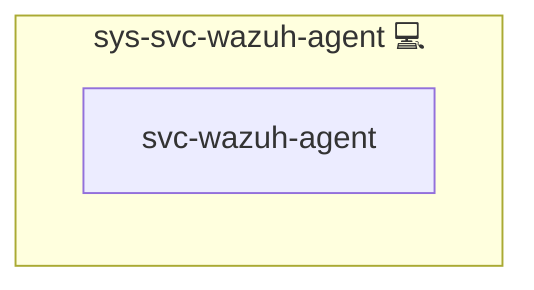

# Wazuh Agent

## Description

The host agent of [Wazuh](https://wazuh.com/): it forwards the journald logs of the roles that opt in to Wazuh, plus `sshd` and `sudo`, to the Wazuh manager deployed by [web-app-wazuh](../web-app-wazuh/README.md).

## Overview

The agent version is the manager's version from `web-app-wazuh`'s `services.manager.version`, installed exactly (`<version>-1`) from the Wazuh package repository and held against upgrades: `dpkg` hold on the Debian family, a repository `exclude` on the RedHat family that only the role's own pinned install lifts.
Before any change, the role fails when the installed agent is newer than the manager.

The agent does not enroll itself. It writes the entry the manager pre-registered through its API (`lookup('wazuh_agent')`) to `client.keys` (`root:wazuh`, `0640`: `wazuh-agentd` drops to the `wazuh` user before it reads the keys) and connects to the manager's agent port on the local host. Enrollment stays off.

The role renders the whole `ossec.conf`, so none of the package's default log sources are collected. It reads one journald source per tag, filtered on `SYSLOG_IDENTIFIER`: the self-test tag, the tag of every opted-in role on this host (`lookup('wazuh_ruleset', scope='host')`, the same source the manager's base decoders come from), `sshd` and `sudo`. The agent buffer is set explicitly.

## Cosmos

The diagram places Wazuh Agent in the Infinito.Nexus cosmos: the components it deploys (capabilities), the central services it consumes (dependencies), and its outward reach (federation and bridged external networks).

Solid `1:1` edges are fixed relationships; dashed `0..1` edges are conditional (enabled only in matching deployments); red `0..0` edges are turned off in this role. Node markers show the role's deploy modes (💻 host, 🐳 compose, 🐝 swarm); ❌ marks a service that is explicitly turned off, and ⚙️ an Ansible role dependency declared in `meta/main.yml`.

## Features

- **Pinned to the manager:** the agent version follows `web-app-wazuh`'s manager version, held against upgrades, and never newer than the manager.
- **Pre-registered key:** no enrollment; the key comes from the manager's pre-registration.
- **Opt-in log sources:** journald entries of opted-in tags only, plus `sshd` and `sudo`.
- **Explicit buffer:** the agent's event buffer is set, not inherited.

## How a host gets an agent

This is a `sys-svc` role, so other roles include it; it runs at most once per host:

1. `sys-stk-backend` includes it for every role that opts in with `services.wazuh: {enabled: true, rule_block: ...}`, so the opt-in alone puts the agent on that role's host.
2. `web-app-wazuh` includes it for its own host.

Set `WAZUH_AGENT_ENABLED: false` for a host (host or group vars) to switch its agent off; the role then skips with a message.
When `web-app-wazuh` has no host in the deployment, for example in an opted-in app's own CI, the role skips itself with a message before it sets up a repository or installs anything.

Limits:

- A host with neither an opted-in role nor the manager gets no agent yet; host monitoring without an app (FIM) comes later.
- After its first connection the agent restarts its own daemons once to apply the shared configuration the manager pushes, and journald lines written before that first connection are not collected; the loss is measured later under criterion K.
- `web-app-wazuh` verifies the agents at the end of its own deploy, so it only sees agents installed before it finishes. An agent installed later in the same run, for example on another host, is not verified until the independent agent health check (step 2.4).

## Follow-ups

- **Registry version/build schema:** `meta/packages.yml` can neither pin a version derived at deploy time nor verify a source build's checksum, so the exact-version installs call `apt` and `dnf` directly (`nocheck: dynamic-package`) and the Arch source build will live in the role. Proposal for Kevin: extend the registry with a `version` field and `url`/`sha256` on `build`, then move the installs back to `package_install`.

## Credits

Implemented by **[Prageeth Panicker](https://github.com/pragepani)**.
Part of the [Infinito.Nexus Project](https://s.infinito.nexus/code) and maintained by [Kevin Veen-Birkenbach](https://www.veen.world).
Licensed under the [Infinito.Nexus Community License (Non-Commercial)](https://s.infinito.nexus/license).
