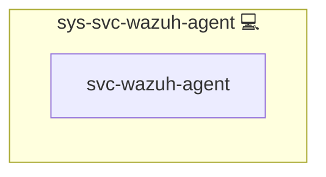

# Wazuh Agent

## Description

The host agent of [Wazuh](https://wazuh.com/): it forwards the journald logs of the roles that opt in to Wazuh, plus `sshd` and `sudo`, to the Wazuh manager deployed by [web-app-wazuh](../web-app-wazuh/README.md).

## Overview

**Single host only.** The agent runs only on the host that runs `web-app-wazuh`. Every host would share agent ID `001` and its vault key, only the manager's host is pre-registered, and the agent connects to `127.0.0.1`. So on any other host an opted-in app skips the agent with the one-line message "manager runs on another host" instead of failing. Agents on further hosts, and on multi-node swarm, are a follow-up.

The agent version is the manager's version from `web-app-wazuh`'s `services.manager.version`, installed exactly (`<version>-1`) from the Wazuh package repository through the package registry (`package_install` with `version` in `meta/packages.yml`) and held against upgrades: `dpkg` hold on the Debian family, a repository `exclude` on the RedHat family. An exact pin overrides the role's own hold or exclude for that one install: apt runs it with `allow_change_held_packages`, and on the RedHat family the role passes the Wazuh repository id as `disable_excludes`, which lifts only that repository's exclude and leaves excludes in the main dnf configuration alone. The role sets the hold again after the install. Arch Linux has no Wazuh package; there the role builds the agent from pinned official source (see below).
The `-1` is the package revision: apt and dnf pin an exact version only as `<upstream version>-<revision>`, and Wazuh publishes every release in its repository as revision 1 (`wazuh-agent_4.14.9-1_amd64.deb`, `wazuh-agent-4.14.9-1.x86_64.rpm`). Should Wazuh ever republish a release as revision 2, the pinned `-1` is no longer found and the install fails loudly instead of taking the rebuild unreviewed.
The repository's signing key is fetched to a staging file and installed only when its fingerprint equals the pinned `WAZUH_AGENT_GPG_KEY_FINGERPRINT` (Debian family: the apt keyring; RedHat family: imported into rpm with the same fingerprint check). Any other key fails the deploy before a repository uses it. The pinned key expires on 2027-05-15; Wazuh's renewed key needs a new pin.
On Arch Linux every manager version needs its own source pins (`WAZUH_AGENT_SOURCE_PINS`): bumping `services.manager.version` without them fails the deploy on purpose, before any change on the host, so nothing is built from unverified source.
Before any change, the role fails when the installed agent is newer than the manager; after the install, it fails unless the installed agent equals the manager's version. Both checks read `version` from the agent's own `/var/ossec/VERSION.json`, which the package and `install.sh` both write, so they work the same with and without a package manager.

The agent does not enroll itself. It writes the entry the manager pre-registered through its API (`lookup('wazuh_agent')`) to `client.keys` (`root:wazuh`, `0640`: `wazuh-agentd` drops to the `wazuh` user before it reads the keys) and connects to the manager's agent port on the local host. Enrollment stays off.

The role renders the whole `ossec.conf`, so none of the package's default log sources are collected. It reads one journald source per tag, filtered on `SYSLOG_IDENTIFIER`: the reserved tags (`infinito-selftest`, `infinito-deploy`, `infinito-fim`), the tag of every opted-in role on this host (`lookup('wazuh_ruleset', scope='host')`, the same source the manager's base decoders come from), `sshd`, `sshd-session` (OpenSSH 9.8 and later logs sessions and failed logins under this name) and `sudo`. The agent buffer is set explicitly.

**Forged journald lines are dropped.** Any local user can write a journald line under any tag (`logger -t <tag>`, or `logger --journald` with arbitrary fields such as `CONTAINER_ID`), and can run a copy of a binary under any name, so `_COMM` is not proof either. Each source therefore adds journald's trusted `_UID`, which a client cannot set: the reserved tags, `sshd`, `sshd-session` and `sudo` are accepted only with `_UID=0`, and app tags only with `_UID=0` and `_COMM=dockerd`, which is how Docker's journald log driver writes container output. The filters in one source combine with AND; a line without a filtered field is dropped.
One more source forwards journald's own suppression notices (`Suppressed N messages from <unit>`, see [sys-svc-journalctl](../sys-svc-journalctl/README.md)): program `systemd-journald`, `_UID=0`, `_TRANSPORT=driver` (journald's own messages; a client cannot write with that transport) and a `MESSAGE` that starts with `Suppressed`, so journald's other messages stay out. The manager alerts on them with rule `100140` at level 7.

**Lines written while the agent is down.** Every journald source sets `only-future-events` to `no`: the agent saves its journal position (a timestamp in `queue/logcollector/file_status.json`) and, after a restart, reads what was written in between. Measured: 200 numbered lines written while the agent was stopped arrived 200 of 200, each once; with the Wazuh default (`yes`) 0 of 200 arrived. A fresh install has no saved position and starts at the present even with `no`; it does not read the existing journal (measured: a 20,000-line backlog was not read, no buffer flood). After a long outage the backlog since the saved position goes through the agent buffer (100,000 events, 1,000 events/s, Wazuh's maximum per decision 9); beyond the buffer, events are dropped (criterion K).

**Synchronized clock.** Before it installs anything, the role requires `timedatectl` to report `NTPSynchronized=yes`, retrying for about a minute for a host that is still converging after boot, and fails with the reason otherwise (policy P4: one time sync service per host, `systemd-timesyncd` or `chrony`). The role checks the clock, it does not install a time service. `sys-ctl-hlth-wazuh-agent` repeats the check every 15 minutes.

The Docker listener wodle reports container events (start, die, and the others Docker emits, with the container's labels). Its script, `DockerListener`, starts with `#!/usr/bin/env python3`, so the role installs pinned `docker`, `urllib3` and `requests` into a venv of its own and puts that venv first on the agent's PATH through a systemd drop-in; the package-owned script and the system Python stay untouched. A venv whose Python no longer runs, for example after a distribution Python upgrade, is removed and rebuilt on the next deploy.

The pins differ from Wazuh's documented ones (`docker==7.1.0 urllib3==1.26.20 requests==2.32.2`): `urllib3` 1.26.20 and `requests` 2.32.2 carry known advisories that `pip-audit` reports, so the role uses newer releases that clear them, and upgrades the venv's own `pip` to a pinned release right after creating the venv. The deploy proves the listener still reports events with these versions. `pip-audit` is re-run against the venv on every Wazuh version bump, and the pins follow its result.

Docker labels with dots in their key arrive nested in the event: the label `com.example.app=web` is `data.docker.Actor.Attributes.com.example.app`, an object path, not one flat key. Rules that attribute container events to apps by label must match the nested path.
The listener is on by default; set `WAZUH_AGENT_DOCKER_LISTENER_ENABLED: false` for a host to leave it out of that host's `ossec.conf`.

**Accepted exposure:** the listener reads the Docker socket, which is root-equivalent access to the host. The agent already runs as root, so the listener adds no privilege the agent does not have.

### File integrity monitoring

The agent's FIM module (syscheck) watches the host:

| Paths | Mode | Content diff |
|---|---|---|
| `/etc`, `/usr/bin`, `/usr/sbin`, `/boot` | Scheduled scan every 12 h and at agent start | No |
| `/etc/ssh` (host keys excluded from the diff), `/etc/sudoers.d`, `authorized_keys` in `/root/.ssh` and `/home/*/.ssh` | Real time (who-data where switched on) | Yes |
| `/etc/docker`, the Docker and containerd units in `/usr/lib/systemd/system`, `/etc/systemd/system/docker.service.d`, the compose and instance directories (`DIR_COMPOSITIONS`), the front proxy's nginx directory | Real time (who-data where switched on) | No |
| `/var/ossec/etc` | Real time | No |

`report_changes` keeps a plain copy of each file on the agent and sends the diff to the manager, so it is on only for files that cannot hold credentials: `sshd_config` and its siblings, sudoers rules and public keys. Env files, compose files, rendered config, nginx config, Docker settings (which can carry proxy credentials) and the agent's own `client.keys` are reported with hashes and attributes only.
Data that changes all the time is outside every watched path (`/var/lib/docker` with all volumes and the indexer data, `/var/log`, `/var/cache`), and the bind-mounted `volumes/` directory of each app on the host is ignored. Churning files in `/etc` (`mtab`, `resolv.conf`, `hosts`, `hostname`, `adjtime`) are ignored too.
The real-time paths need about one inotify watch per directory, a few hundred on a full server, far below the kernel's `fs.inotify.max_user_watches`, so no sysctl is changed.

**Who-data** names the user and process behind a change. It is off by default, because Wazuh's eBPF who-data provider in kprobe mode (the mode on kernels without BPF LSM, which is most stock kernels) misses every change made by rename: Ansible's `template` and `copy`, `sed -i` and most editors write a temporary file and rename it over the original. With who-data on, such a change shows up only at the next scheduled scan, without user and process; plain real time (inotify) sees it at once. Detection comes first, so real time is the default on every path. Upstream: [wazuh/wazuh#37023](https://github.com/wazuh/wazuh/pull/37023) adds the missing `vfs_rename` hook, [wazuh/wazuh#39708](https://github.com/wazuh/wazuh/pull/39708) reports remaining rename loss in kprobe mode; re-test on each Wazuh version bump.
A host can switch who-data on with `WAZUH_AGENT_FIM_WHODATA_ENABLED: true`. The role then uses the eBPF provider, which needs no `auditd`; where eBPF does not start (no BTF or ring buffer), Wazuh falls back to `auditd`, which the role installs only on hosts that also set `WAZUH_AGENT_FIM_AUDITD_ENABLED: true`. Without either, the paths stay in real time.
Without who-data, FIM alerts still have context: the `sudo` and `sshd`/`sshd-session` logs, which cannot be forged by a local user, show who became root or logged in, and the deploy markers show which changes came from a deploy.
After every deploy the role reads syscheckd's verdict from the agent log and writes it to journald under `infinito-fim`: `whodata=ebpf` or `whodata=audit` stay silent, while `whodata=unavailable` (switched off, the default, or fell back to real time) and `whodata=unknown` (no verdict in the current log) raise an alert, so missing attribution is never silent. Each FIM alert also carries `syscheck.mode` (`whodata`, `realtime` or `scheduled`).

Per-host switches: `WAZUH_AGENT_FIM_ENABLED` (default `true`), `WAZUH_AGENT_FIM_WHODATA_ENABLED` and `WAZUH_AGENT_FIM_AUDITD_ENABLED` (both default `false`).

**Deploy markers.** Every deploy writes `deploy start run=<id>` at its beginning and `deploy end run=<id>` at its end to journald under `infinito-deploy`, and both become level 3 alerts. FIM alerts keep their normal level; a change whose time falls between the two markers of one run came from that deploy. A deploy that fails or is aborted writes no end marker: a start marker without its end is the signal.
The deploy that first ships rules `100120`/`100121` to the manager logs its start marker before those rules exist, so that one start marker reaches the archive but raises no alert; its end marker does.

### Arch Linux source build

On Arch Linux the role builds the agent from Wazuh's official release tarball (`WAZUH_AGENT_SOURCE_URL`, for 4.14.6 `https://github.com/wazuh/wazuh/archive/v4.14.6.tar.gz`), only when the installed `VERSION.json` differs from the manager's version, so an unchanged version costs nothing:

1. The version must have an entry in `WAZUH_AGENT_SOURCE_PINS` (`vars/main.yml`); a version bump without one fails before any download, with the steps to add it.
2. The tarball is downloaded and checked against the pinned `source` SHA-256.
3. `make TARGET=agent deps` fetches the external libraries from `packages.wazuh.com/deps/<DEPS_VERSION>/`, source and Wazuh's precompiled ones, without any check of its own. The role hashes every top-level entry of the resulting `src/src/external` tree on its own and compares each with its pin in `deps`. It fails before compiling and names every library whose hash differs, that is pinned but missing, or that is present but not pinned.
   Wazuh replaces files under the same `DEPS_VERSION`: in October 2026 `rpm` and `libbpf-bootstrap` changed under `deps/55`, which broke the single 4.14.9 manifest pin. Per-library pins show which library changed.
4. Download, unpack, `make deps` and the compile run as the unprivileged system user `wazuh-build` in a temporary directory that is removed afterwards, also on failure.
5. The compiler is `gcc15` (`WAZUH_AGENT_ARCH_CC`/`_CXX`): Wazuh recommends GCC 14, which Arch no longer ships, and gcc15 is the closest. There is no fallback to Arch's default gcc; when Arch drops gcc15, the build tool install fails loudly.
6. `install.sh` installs the agent unattended through `etc/preloaded-vars.conf` (agent only, `/var/ossec`, no auto start, active response off, `USER_UPDATE` when an agent is already installed), so paths, the `wazuh` user and the agent's files match the package. `install.sh` still reads answers from stdin despite the preloaded answers; the role runs it without stdin. On an upgrade the role stops the agent first; `client.keys` stays, and `ossec.conf` is rendered by the role anyway.
7. The role then requires the `wazuh-agent.service` unit that `install.sh` registers, and fails with a clear message if there is none. Plan B, if a real Arch host also gets no unit: render it from Wazuh's own unit template in the source tree.

The build tools (`base-devel`, `gcc15`, `python` from the `wazuh-agent-build` id, plus the shared `cmake` id; `curl` for `make deps` is always there as a `pacman` dependency) stay installed after the build: a known trade-off, faster rebuilds on the next version bump versus a compiler on the host.
A build takes about 4 minutes on 8 cores (deps 45-73 s, compile 133-137 s, `install.sh` about 10 s), measured in probes of 4.14.6 and 4.14.9.

**Pinning a new version.** Compute the hashes in a throwaway `archlinux:latest` container with the repository mounted, for example with `make compose-inner-run IMAGE=archlinux:latest INFINITO_RUN_FLAGS='-v /opt/src/infinito:/opt/src/infinito:ro'`. The `sha256sum source.tar.gz` line gives `source`; every line of [`files/shell/deps_manifest.sh`](files/shell/deps_manifest.sh), the script the role runs, is one `deps` entry:

```bash
V=4.14.9
curl -fsSL -o source.tar.gz "https://github.com/wazuh/wazuh/archive/v${V}.tar.gz"
sha256sum source.tar.gz
mkdir src && tar -xzf source.tar.gz -C src --strip-components=1
make -C src/src TARGET=agent deps
cd src/src
bash /opt/src/infinito/roles/sys-svc-wazuh-agent/files/shell/deps_manifest.sh
```

Run it twice from a fresh unpack: both runs must print the same lines before they become pins.
When a deploy fails on a changed library, compare `Last-Modified` of that library's tarballs under `packages.wazuh.com/deps/<DEPS_VERSION>/` with the date of the pin, and re-pin only that entry once the change is understood.

Run `make deps` twice in fresh directories and pin the `deps` hash only when both runs agree.

**What is proven and what is pending.** The probe built and installed the agent in an `archlinux:latest` container inside the dev stack, without systemd; the full role run on an Arch host is pending for the combined Arch and RedHat distro test.

| Item | Probe (Wazuh 4.14.6) | Probe (Wazuh 4.14.9) | Pending for the distro test |
|---|---|---|---|
| `gcc15` from Arch's `extra`, `gcc14` gone | Proven (`gcc15` 15.3.0) | Proven (`gcc15` 15.3.0) | |
| Source SHA-256 | Proven (`1de971b9…`) | Proven (`9d58c1c3…`) | |
| `make deps` manifest stable | Proven, same hash in two fresh runs (`494cd89a…`, 25266 files) | Proven, same hash in two fresh runs (`4fa922ae…`, 25260 files) | |
| Build as non-root with `gcc-15` | Proven, 133 s with `-j8` | Proven, 135-137 s with `-j8` | The role's own `become_user` build steps |
| `install.sh` with preloaded vars, unattended | Proven, `wazuh` user and group created | Proven, `wazuh` user and group created | `USER_UPDATE` upgrade from an older pinned version |
| `VERSION.json` and `wazuh-control info` | Proven (`4.14.6`) | Proven (`4.14.9`) | The role's two version checks on Arch |
| eBPF and Docker listener files | Proven (`libfimebpf.so`, `modern.bpf.o`, `DockerListener`) | Proven (same three files) | Listener under the venv drop-in, FIM state |
| systemd unit from `install.sh` | Not proven: the probe container has no systemd and got no unit | Not proven, same reason | Unit present, agent `Active`, canary, idempotent second run without a rebuild |

## Cosmos

The diagram places Wazuh Agent in the Infinito.Nexus cosmos: the components it deploys (capabilities), the central services it consumes (dependencies), and its outward reach (federation and bridged external networks).



Solid `1:1` edges are fixed relationships; dashed `0..1` edges are conditional (enabled only in matching deployments); red `0..0` edges are turned off in this role. Node markers show the role's deploy modes (💻 host, 🐳 compose, 🐝 swarm); ❌ marks a service that is explicitly turned off, and ⚙️ an Ansible role dependency declared in `meta/main.yml`.

## Features

- **Pinned to the manager:** the agent version follows `web-app-wazuh`'s manager version, held against upgrades, and never newer than the manager.
- **Arch Linux from source:** built from Wazuh's official release with the source and its downloaded dependencies pinned by SHA-256, as an unprivileged user, only when the version changes.
- **Pre-registered key:** no enrollment; the key comes from the manager's pre-registration.
- **Opt-in log sources:** journald entries of opted-in tags only, plus `sshd` and `sudo`.
- **Explicit buffer:** the agent's event buffer is set, not inherited.
- **Docker events:** container events through the Docker listener, from a self-healing venv with audited, pinned dependencies.
- **Trusted journald sources:** lines are accepted only from root, and app lines only from Docker's log driver, so a local user cannot forge them.
- **File integrity monitoring:** critical host paths, the deployed configuration and Wazuh's own config in real time, with optional eBPF who-data and a visible alert whenever who-data is not running.
- **Deploy markers:** start and end of every deploy, next to the FIM alerts it causes.

## How a host gets an agent

This is a `sys-svc` role, so other roles include it; it runs at most once per host:

1. `sys-stk-backend` includes it for every role that opts in with `services.wazuh: {enabled: true, rule_block: ...}`, so the opt-in alone puts the agent on that role's host.
2. `web-app-wazuh` includes it for its own host.

Set `WAZUH_AGENT_ENABLED: false` for a host (host or group vars) to switch its agent off; the role then skips with a message.
When `web-app-wazuh` has no host in the deployment, for example in an opted-in app's own CI, the role skips itself with a message before it sets up a repository or installs anything.

Limits:

- A host with neither an opted-in role nor the manager gets no agent yet; host monitoring without an app (FIM) comes later.
- After its first connection the agent restarts its own daemons once to apply the shared configuration the manager pushes, and journald lines written before that first connection are not collected; the loss is measured later under criterion K.
- The first journald line a user ever writes on a host can be lost: journald opens a new per-user journal file for it, and the agent treats the new file as a rotation and moves its read position past the line (`(9204): 'Journald' timestamp was refreshed due to rotation`). Root's and Docker's lines go to the system journal, which already exists, so this hits only non-root writers, whose lines the `_UID=0` filters drop anyway. Measured under criterion K.
- The Docker listener starts about one interval (60 s) after an agent restart, not at once, so the deploy waits up to two intervals for its process; Docker events before it starts are not collected.
- `web-app-wazuh` verifies the agents at the end of its own deploy, so it only sees agents installed before it finishes. An agent installed later in the same run, for example on another host, is covered by [sys-ctl-hlth-wazuh-agent](../sys-ctl-hlth-wazuh-agent/README.md), which this role includes on every agent host: on the manager host it alerts on every registered agent that is not Active.

## Freezing the log collector while the agent is offline

In Wazuh 4.14.9, `wazuh-logcollector`'s journald reader keeps reading while `wazuh-agentd` has lost the manager: the collector's output thread waits for the agent (`SendMSG` → `os_wait`, `src/shared/mq_op.c`), but its input threads go on and push every line into the output queue (`logcollector.queue_size`, 1024). A full queue discards the line (`w_msg_queue_push`, `src/logcollector/logcollector.c`), and the saved journald position moves past it (`read_journald`, `src/logcollector/read_journald.c`), so the agent's buffer never sees those lines and a later restart does not read them again. Measured: a 5-minute manager outage at 10 events/s lost 2,166 of 4,200 events, everything after the first 1,024.

The role therefore freezes the collector instead: `wazuh-collector-freeze.path` watches `queue/sockets`, the directory where `wazuh-agentd` creates its offline lock `.wait` (`(1137) Lost connection with manager. Setting lock.`) and removes it again (`Releasing lock.`). On every change `wazuh-collector-freeze.service` runs [collector_freeze.sh](files/shell/collector_freeze.sh): with `.wait` present it sends `SIGSTOP` to `wazuh-logcollector`, without it `SIGCONT`, and logs the transition under the reserved tag `infinito-wazuh-watch` (rules `100150` frozen and `100151` resumed, level 3, arriving once the agent is back). A frozen collector reads nothing, so the lines stay in the journal and the collector continues from its in-memory position when it resumes. `logcollector.queue_size` stays at Wazuh's default.

- **Stop and reload:** a drop-in (`wazuh-agent.service.d/collector-release.conf`) runs `collector_freeze.sh release` before `wazuh-control stop` and `reload`. A frozen collector gets `SIGTERM` and then `SIGCONT`, so it handles the pending `SIGTERM` before it reads again and saves the position it was frozen at; the stop never waits on a frozen process. Resuming it first would let it read the backlog into its full queue and save the position past the dropped lines.
- **Health check:** [sys-ctl-hlth-wazuh-agent](../sys-ctl-hlth-wazuh-agent/README.md) alerts outside Wazuh when the collector is frozen while `.wait` does not exist, after a 5 s recheck.
- **Race window:** lines the collector reads between the real disconnect and the freeze go into its queue, which keeps up to 1,024 lines across the freeze. `wazuh-agentd` sets the lock within about a second of losing the manager, and the path unit reacts within milliseconds, so the window is that second.
- **Residual risks:** lines in the collector's queue at the moment the agent stops while frozen are lost (the saved position lies behind them). `wazuh-agentd`'s own restart of its daemons through `wazuh-control restart` (after the manager pushes shared configuration) does not go through the drop-in; it happens right after a reconnect, when the collector has just been resumed. A path-unit event missed during a running freeze service leaves the state wrong until the next change; the health check reports a collector frozen while online.

## Measuring loss (criterion K)

[scripts/tests/wazuh/measure_k.sh](../../scripts/tests/wazuh/measure_k.sh) measures delivery in the dev stack; no role deploys it and CI does not run it. It sends numbered events through an opted-in tag from throwaway journald containers (`--rm`, a per-run label, removed on exit), compares what was sent, what journald stored and what reached the manager's archive, and prints one markdown row per case: missing sequence ranges, duplicates, journald suppression (with alert `100140`) and the agent buffer alerts `202`, `203` and `204`. Before each case it requires the manager archive (`logall_json`) on, the manager running and the agent connected with an empty buffer; on exit, also on failure, it starts the manager and the agent again if a case stopped them. Run one case at a time inside the dev container:

```bash
make compose-exec cmd="K_TAG=pixelfed K_IMAGE=alpine:3.20 K_MANAGER=wazuh.manager K_LOGS_VOLUME=wazuh_manager_logs K_MANAGER_CONF=/opt/compose/wazuh/wazuh_manager.conf K_AGENT_STATE=/var/ossec/var/run/wazuh-agentd.state K_HEALTH_UNIT=hlth-wazuh-agent.16.2.3.infinito.nexus.service K_JOURNAL_UNIT=hlth-journalctl.16.2.3.infinito.nexus.service K_SETTLE_S=60 K_MAX_WAIT_S=1800 K_WATCH_TAG=infinito-wazuh-watch K_SUPPRESSED_RULE=100140 bash /opt/src/infinito/scripts/tests/wazuh/measure_k.sh normal"
```

The cases are `normal`, `burst-buffer`, `burst-journald`, `outage-5`, `outage-15`, `agent-restart`, `restart-frozen`, `agent-down` and `journal-check`; the script's header describes each.

## Follow-ups

- **Registry build schema:** the registry pins the Debian and RedHat installs (`version` in `meta/packages.yml`), but its `build` source cannot verify a source tarball and its downloaded dependencies against pinned checksums, so the Arch source build stays in the role.

## Credits

Implemented by **[Prageeth Panicker](https://github.com/pragepani)**.
Part of the [Infinito.Nexus Project](https://s.infinito.nexus/code) and maintained by [Kevin Veen-Birkenbach](https://www.veen.world).
Licensed under the [Infinito.Nexus Community License (Non-Commercial)](https://s.infinito.nexus/license).
