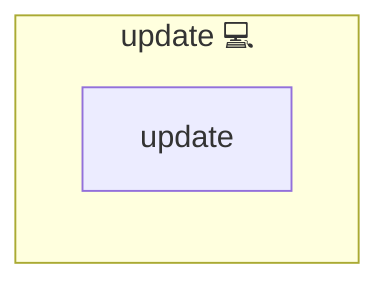

# Package update

## Description

Operating-system package managers such as [apt](https://wiki.debian.org/Apt),
[pacman](https://wiki.archlinux.org/title/pacman) and
[dnf](https://dnf.readthedocs.io/) keep installed software in sync with their
upstream distribution repositories. Each one ships with a different command
surface but they all serve the same goal: refresh the index and upgrade every
installed package on the host.

## Overview

This role refreshes the package index and upgrades every installed package on
the host. `tasks/main.yml` reads `ansible_facts['distribution']` and dispatches
to one task file per package-manager family. Debian and Ubuntu both use
`apt`, so they share a single task file; Fedora and CentOS both use `dnf`, and
CentOS reaches `fedora.yml` through `centos.yml`. A separate `unsupported.yml` fails loudly with a clear
message when a host runs a distribution that this role does not yet cover.

| `ansible_facts['distribution']` | Task file         | Module                     |
| ------------------------------- | ----------------- | -------------------------- |
| `Archlinux`                     | `arch.yml`        | `community.general.pacman` |
| `Debian` / `Ubuntu`             | `debian.yml`      | `ansible.builtin.apt`      |
| `Fedora`                        | `fedora.yml`      | `ansible.builtin.dnf`      |
| `CentOS`                        | `centos.yml`      | `ansible.builtin.dnf`      |
| anything else                   | `unsupported.yml` | `ansible.builtin.fail`     |

`centos.yml` first runs [centos_mirror.sh](files/shell/centos_mirror.sh), which replaces every `metalink=` of the CentOS Stream repo files with a `baseurl=` on `mirror.stream.centos.org` and every `metalink=` of the EPEL repo files with the file's own `baseurl` template on `dl.fedoraproject.org`, and then includes `fedora.yml`. The [Dockerfile](../../Dockerfile) runs the same script before its first `dnf` call, so the CentOS dev and swarm-node images resolve against the same source.

## Cosmos

The diagram places Package update in the Infinito.Nexus cosmos: the components it deploys (capabilities), the central services it consumes (dependencies), and its outward reach (federation and bridged external networks).

Solid `1:1` edges are fixed relationships; dashed `0..1` edges are conditional (enabled only in matching deployments); red `0..0` edges are turned off in this role. Node markers show the role's deploy modes (💻 host, 🐳 compose, 🐝 swarm); ❌ marks a service that is explicitly turned off, and ⚙️ an Ansible role dependency declared in `meta/main.yml`.

## Features

- **Per-family dispatch:** Routes by `ansible_facts['distribution']` so the
  caller never has to gate the role with a `when:` clause.
- **Five-distro coverage:** Supports the five default CI distros (Archlinux,
  Debian, Ubuntu, Fedora, CentOS) without duplicated task code.
- **Loud on unsupported hosts:** Fails with a clear message instead of
  silently skipping when the host runs an unmapped distribution.
- **Once-per-play idempotency:** Wraps the dispatch in
  `when: run_once_update is not defined` and writes the flag via
  `tasks/utils/once/flag.yml`, so repeated invocations within one play are
  no-ops.

## Developer Notes

To extend support for a new distribution, add the distribution name to the
lookup dict in [main.yml](./tasks/main.yml). When the new distribution shares
a package manager with an existing entry, point it at that entry's task file.
When it brings a new package manager, add a new family file under
`tasks/` and keep [meta/main.yml](./meta/main.yml) `platforms` in
sync.

## Further Resources

- [apt](https://wiki.debian.org/Apt)
- [pacman](https://wiki.archlinux.org/title/pacman)
- [dnf](https://dnf.readthedocs.io/)
- [community.general.pacman](https://docs.ansible.com/ansible/latest/collections/community/general/pacman_module.html)
- [ansible.builtin.apt](https://docs.ansible.com/ansible/latest/collections/ansible/builtin/apt_module.html)
- [ansible.builtin.dnf](https://docs.ansible.com/ansible/latest/collections/ansible/builtin/dnf_module.html)
