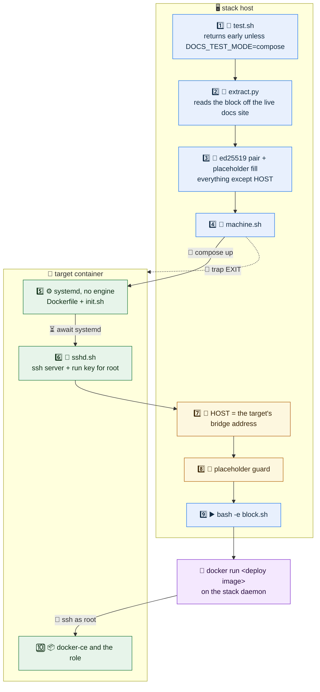

# Instruction replay

The CLI test of `web-app-docs` reads the Production block out of the running documentation site and executes it, so the published instructions are proven rather than reviewed.

## Cast

| | What it is | What runs there |
| --- | --- | --- |
| 🖥️ **Stack host** | the worker the outer play already runs on | `test.sh`, `machine.sh`, and the published block itself |
| 🎯 **Target** | a throwaway container, project `docs-guide-<role>` | systemd and an ssh server, nothing else until the deploy lands |
| 🐳 **Recipe container** | started by the block's own `docker run`, on the stack daemon | the deploy that the instructions tell a reader to run |

The target is what the instructions call "a managed server". It is deliberately bare: everything else it ends up with arrives through the deploy under test.

## Schema

🔵 stack host · 🟢 target · 🟣 the recipe's own container · 🟠 the two steps that bridge them

## Flow

| # | Step | Detail |
| --- | --- | --- |
| 1️⃣ | 🧪 `test.sh` starts on the stack host | returns early unless the deployment mode is compose |
| 2️⃣ | 📖 `extract.py` writes `block.sh` | fetches the role's page over `DOCS_TEST_BASE_URL`; an empty block fails the test, and `bash -n` parses it before anything runs it |
| 3️⃣ | 🔑 key pair and placeholders | an ed25519 pair per run under `DOCS_TEST_WORK`; every placeholder except `HOST` is substituted |
| 4️⃣ | 🚜 `machine.sh` brings the target up | from `compose.yml`, on the default bridge |
| 5️⃣ | ⚙️ the target boots | image built from `Dockerfile` + `init.sh`; `MACHINE_BASE_IMAGE` comes from `INFINITO_PARENT_IMAGE` in the checkout's `.env` |
| 6️⃣ | 🔐 `sshd.sh` is piped in | installs an ssh server, authorizes the run's public key for `root`, writes a `PermitRootLogin prohibit-password` drop-in |
| 7️⃣ | 📍 `HOST` is filled | `container inspect --type container` reads the bridge address; the bridge has no DNS, so it is an address and not a name |
| 8️⃣ | 🚦 the guard runs | fails on any remaining `<your-`; it runs **after** step 7, because the address does not exist before it |
| 9️⃣ | ▶️ the block executes on the stack host | its `docker run` starts the published deploy image on the stack daemon |
| 🔟 | 📦 the deploy reaches the target over ssh as `root` | the target receives `docker-ce` and the role; its `/var/lib/docker` is a named volume, so the installed daemon writes to a real filesystem |
| 🧹 | teardown | `compose down -v --rmi local` from an `EXIT` trap |

## Environment

| Variable | Source | Use |
| --- | --- | --- |
| `DOCS_TEST_BASE_URL` | `templates/test.env.j2` | documentation site the block is read from |
| `DOCS_TEST_ROLE` | `templates/test.env.j2` | role whose page carries the instructions; names the compose project |
| `DOCS_TEST_MODE` | `templates/test.env.j2` | deployment mode; the test runs only for compose |
| `DOCS_TEST_DOMAIN` | `templates/test.env.j2` | fills `<your-domain>` |
| `DOCS_TEST_DNS` | `templates/test.env.j2` | fills `<your-clearnet-resolver>` |
| `DOCS_TEST_SRC_DIR` | `templates/test.env.j2` | checkout holding the generated `.env` |
| `DOCS_TEST_TIMEOUT` | `templates/test.env.j2` | wait for the on-demand documentation build |
| `DOCS_TEST_WORK` | `test.sh` | holds the replay key pair |
| `DOCS_TEST_REPLAY_PUBKEY` | `test.sh` | public half, consumed by `sshd.sh` |

## Files

| File | Role |
| --- | --- |
| `test.sh` | entry point; extraction, key pair, placeholder fill |
| `extract.py` | pulls the Production block off the live documentation site |
| `machine.sh` | target lifecycle, `HOST` fill, guard, replay, teardown |
| `compose.yml` | the target service, on the default bridge, with a named volume at `/var/lib/docker` |
| `Dockerfile` | builds the target from the distribution base image |
| `init.sh` | installs systemd into that image, and deliberately no container engine |
| `sshd.sh` | ssh server and the run's authorized key, piped into the running target |
