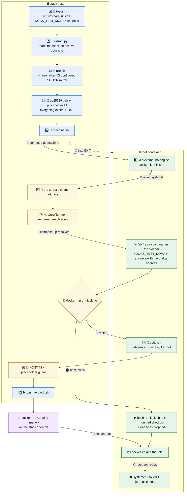

# Instruction replay

The CLI test of `web-app-docs` reads the Production block out of the running documentation site and executes it, so the published instructions are proven rather than reviewed.

## Cast

| | What it is | What runs there |
| --- | --- | --- |
| 🖥️ **Stack host** | the worker the outer play already runs on | `test.sh`, `machine.sh`, and a block that starts a container |
| 🎯 **Target** | a throwaway container, project `docs-guide-<role>` | systemd and an ssh server, nothing else until the deploy lands; a host install also runs there |
| 🛰️ **Resolver** | a CoreDNS sidecar in the target's network namespace | answers every name under `DOCS_TEST_DOMAIN` with the target's own bridge address and forwards the rest |
| 🐳 **Recipe container** | started by the block's own `docker run`, on the stack daemon | the deploy that the instructions tell a reader to run |

The target is what the instructions call "a managed server". It is deliberately bare: everything else it ends up with arrives through the deploy under test.

Its resolver is the one exception. `DOCS_TEST_DOMAIN` is the outer stack's own domain, and the stack daemon hands every bridge container the outer stack's CoreDNS, so without the sidecar the target resolves the domain it is deploying to the outer application container. The sidecar answers the whole domain with the target's bridge address, and with that address rather than `127.0.0.1` so that containers the deploy starts inside the target reach the same vhosts.

A role that ships no container stack publishes a host install instead of a recipe: a block that opens with `git clone` and configures the machine it runs on. The target is that machine, so the block is replayed inside it over the checkout mounted at `DOCS_TEST_SRC_DIR`, and the two clone lines are dropped so the replay reads the tree under test. A block that neither starts a container nor clones the repository fails the test.

## Schema

🔵 stack host · 🟢 target · 🟣 the recipe's own container · 🟠 the steps that bridge them

## Flow

| # | Step | Detail |
| --- | --- | --- |
| 1️⃣ | 🧪 `test.sh` starts on the stack host | returns early unless the deployment mode is compose |
| 2️⃣ | 📖 `extract.py` writes `block.sh` | fetches the role's page over `DOCS_TEST_BASE_URL`; an empty block fails the test, and `bash -n` parses it before anything runs it |
| 🪞 | the GHCR mirror is attached | `mirror.sh` rewrites the block's provision call to write `mirrors.yml` and pass `--mirror`, so the replay pulls every application image from the mirror instead of the upstream registry. Outside CI the two GitHub variables are empty and the block is left exactly as published |
| 3️⃣ | 🔑 key pair and placeholders | an ed25519 pair per run under `DOCS_TEST_WORK`; every placeholder except `HOST` is substituted |
| 4️⃣ | 🚜 `machine.sh` brings the target up | `compose up machine`, on the default bridge |
| 5️⃣ | ⚙️ the target boots | image built from `Dockerfile` + `init.sh`; `MACHINE_BASE_IMAGE` comes from `INFINITO_PARENT_IMAGE` in the checkout's `.env` |
| 6️⃣ | 📍 the bridge address is read | `container inspect --type container`; the bridge has no DNS, so it is an address and not a name |
| 7️⃣ | 🛰️ the resolver takes over the domain | `Corefile.tmpl` is rendered into `DOCS_TEST_WORK` with that address and the nameservers the target already had, `compose up resolver` starts CoreDNS in the target's network namespace, the target's `/etc/resolv.conf` is rewritten to name it, and a probe under `DOCS_TEST_DOMAIN` has to come back as the bridge address before the replay starts |
| 🔀 | the shape decides where the block runs | `docker run` on the stack host, `git clone` inside the target; steps 8️⃣ and 9️⃣ are the first of the two |
| 8️⃣ | 🔐 `sshd.sh` is piped in | installs an ssh server, authorizes the run's public key for `root`, writes a `PermitRootLogin prohibit-password` drop-in |
| 9️⃣ | 🚦 `HOST` is filled and the guard runs | the guard fails on any remaining `<your-` |
| 🔟 | ▶️ the block executes | the recipe shape runs it on the stack host, where its `docker run` starts the published deploy image on the stack daemon and reaches the target over ssh as `root`; the host install runs it inside the target over the mounted checkout. Either way the target receives `docker-ce` and the role, and its `/var/lib/docker` is a named volume, so the installed daemon writes to a real filesystem |
| ⏹️ | the evidence of a failed replay | a non-zero block prints `systemctl --failed` and a `journalctl -xeu` per failed unit from the target, because unit output never reaches the playbook stdout that is the only thing leaving it |
| 🧹 | teardown | `compose down -v --rmi local` from an `EXIT` trap |

## Environment

| Variable | Source | Use |
| --- | --- | --- |
| `DOCS_TEST_BASE_URL` | `templates/test.env.j2` | documentation site the block is read from |
| `DOCS_TEST_ROLE` | `templates/test.env.j2` | role whose page carries the instructions; names the compose project |
| `DOCS_TEST_MODE` | `templates/test.env.j2` | deployment mode; the test runs only for compose |
| `DOCS_TEST_DOMAIN` | `templates/test.env.j2` | fills `<your-domain>`; the zone the resolver answers with the target's bridge address |
| `DOCS_TEST_DNS` | `templates/test.env.j2` | fills `<your-clearnet-resolver>` |
| `DOCS_TEST_SRC_DIR` | `templates/test.env.j2` | checkout holding the generated `.env`; mounted into the target at the same path, where a host install replays from it |
| `DOCS_TEST_TIMEOUT` | `templates/test.env.j2` | wait for the on-demand documentation build |
| `DOCS_TEST_WORK` | `test.sh` | holds the replay key pair and the rendered `Corefile` |
| `DOCS_TEST_REPLAY_PUBKEY` | `test.sh` | public half, consumed by `sshd.sh` |
| `GITHUB_REPOSITORY` | `templates/test.env.j2` | names the GHCR repository the mirror lives under; empty outside CI, which leaves the block unmirrored |
| `GITHUB_REPOSITORY_OWNER` | `templates/test.env.j2` | names the GHCR namespace; empty outside CI |
| `INFINITO_GHCR_MIRROR_PREFIX` | `default.env` in `DOCS_TEST_SRC_DIR` | path segment separating mirrored images from the repository's own |

## Files

| File | Role |
| --- | --- |
| `test.sh` | entry point; extraction, key pair, placeholder fill |
| `extract.py` | pulls the Production block off the live documentation site |
| `mirror.sh` | points the extracted block's provision call at the GHCR image mirror when CI configured one |
| `machine.sh` | target lifecycle, wildcard resolution, `HOST` fill, guard, replay, failed-unit report, teardown |
| `compose.yml` | the target service on the default bridge with a named volume at `/var/lib/docker`, and the resolver service in the target's network namespace |
| `Corefile.tmpl` | the resolver's configuration; `${DOCS_TEST_DOMAIN}`, `${DOCS_TEST_TARGET_IP}` and `${DOCS_TEST_UPSTREAM}` are substituted into `DOCS_TEST_WORK/Corefile` |
| `Dockerfile` | builds the target from the distribution base image |
| `init.sh` | installs systemd into that image, and deliberately no container engine |
| `sshd.sh` | ssh server and the run's authorized key, piped into the running target |
