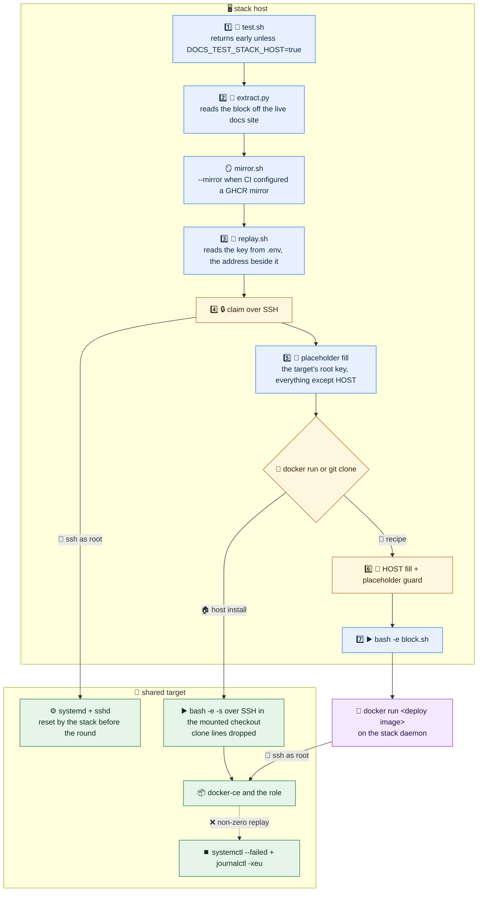

# Instruction replay

The CLI test of `web-app-docs` reads the Production block out of the running documentation site and executes it, so the published instructions are proven rather than reviewed.

## Cast

| | What it is | What runs there |
| --- | --- | --- |
| 🖥️ **Stack host** | the host `IS_STACK_HOST` names: the `infinito` container in a compose round, the swarm manager in a swarm round | `test.sh`, `replay.sh`, and a block that starts a container |
| 🎯 **Target** | the stack's shared `target` service, see [compose/target](../../../../compose/target/README.md) | systemd and an ssh server, nothing else until the deploy lands; a host install also runs there |
| 🛰️ **Resolver** | the target's `target-resolver` | answers `INFINITO_DOMAIN` and every name under it with the target's own address and forwards the rest |
| 🐳 **Recipe container** | started by the block's own `docker run`, on the stack daemon | the deploy that the instructions tell a reader to run |

The target is what the instructions call "a managed server". It is deliberately bare: everything else it ends up with arrives through the deploy under test. The harness owns no part of it; the stack resets it before every deploy round, compose and swarm alike, and this test only claims and uses it. Every other host of a swarm deploy skips, because one reset serves one replay.

`DOCS_TEST_DOMAIN` is the outer stack's own domain, so the target's resolver has to answer it with the target's address, or the target would resolve the domain it is deploying to the `infinito` container. The test fails when the two differ.

A role that ships no container stack publishes a host install instead of a recipe: a block that opens with `git clone` and configures the machine it runs on. The target is that machine, so the block is replayed inside it over SSH in the checkout it mounts at `INFINITO_SRC_DIR`, and the two clone lines are dropped so the replay reads the tree under test. A block that neither starts a container nor clones the repository fails the test.

## Schema

🔵 stack host · 🟢 target · 🟣 the recipe's own container · 🟠 the steps that bridge them

## Flow

| # | Step | Detail |
| --- | --- | --- |
| 1️⃣ | 🧪 `test.sh` starts on every host of the deploy | returns early unless this host is the stack host, so a swarm deploy replays once |
| 2️⃣ | 📖 `extract.py` writes `block.sh` | fetches the role's page over `DOCS_TEST_BASE_URL`; an empty block fails the test, and `bash -n` parses it before anything runs it |
| 🪞 | the GHCR mirror is attached | `mirror.sh` rewrites the block's provision call to write `mirrors.yml` and pass `--mirror`, so the replay pulls every application image from the mirror instead of the upstream registry. Outside CI the two GitHub variables are empty and the block is left exactly as published |
| 🩺 | the stack's runtime severity is carried over | `hlth_runtime.py` puts `applications.sys-ctl-hlth-runtime.services.runtime.severity` with the stack host's own mapping into the block's provision `--vars`, so `sys-ctl-hlth-runtime` in the target acts on findings as the stack host does. It fails when the block's `--vars` already set `applications` |
| 📏 | the stack's disc-space limit is carried over | `disc_space.sh` puts `SIZE_PERCENT_CLEANUP_DISC_SPACE` with the stack host's own value into the block's provision `--vars`, so `sys-ctl-hlth-disc-space` in the target uses the stack host's limit |
| 3️⃣ | 🚜 `replay.sh` finds the target | `INFINITO_DOMAIN`, `INFINITO_SRC_DIR` and `INFINITO_TARGET_KEY` come from the checkout's `.env`, and the address from `INFINITO_TARGET_KEY.address`, which the last reset wrote for this host: the stack address in a compose round, the lab address in a swarm round. A missing `.env` points at `make dotenv`, a missing `.address` at a reset, and a `DOCS_TEST_DOMAIN` other than `INFINITO_DOMAIN` fails the test |
| 4️⃣ | 🔒 the target is claimed | `mkdir /var/lib/infinito-target-claim` over SSH, with the host keys the last reset pinned. A target that refuses the key, or one that something already claimed since its last reset, fails the test with a pointer to `make compose-target-reset`; replays therefore run one at a time |
| 5️⃣ | 🔑 placeholders | `<your-ssh-public-key>` and `<your-ssh-private-key-file>` become the two halves of the target's root key; every other placeholder except `HOST` comes from `test.env` |
| 🔀 | the shape decides where the block runs | `docker run` on the stack host, `git clone` inside the target; step 6️⃣ is the first of the two |
| 6️⃣ | 🚦 `HOST` is filled and the guard runs | `HOST` becomes the address from `INFINITO_TARGET_KEY.address`; the guard fails on any remaining `<your-` |
| 🏗️ | the local image is built | with `INFINITO_PULL_POLICY=never`, `scripts/image/build.sh` builds the checkout at `DOCS_TEST_SRC_DIR` on the stack daemon, tagged with the image the block runs |
| 7️⃣ | ▶️ the block executes | the recipe shape runs it on the stack host, where its `docker run` starts the published deploy image on the stack daemon and reaches the target over SSH as `root`; the host install pipes it into `bash -e -s` on the target over SSH. Either way the target receives `docker-ce` and the role |
| ⏹️ | the evidence of a failed replay | a non-zero block prints `systemctl --failed` and a `journalctl -xeu` per failed unit from the target over SSH, because unit output never reaches the playbook stdout that is the only thing leaving it |
| 🧹 | teardown | the recipe's `$HOME/.infinito.nexus` is removed when the replay created it; the target stays claimed until the stack resets it |

## Environment

| Variable | Source | Use |
| --- | --- | --- |
| `DOCS_TEST_BASE_URL` | `templates/test.env.j2` | documentation site the block is read from |
| `DOCS_TEST_ROLE` | `templates/test.env.j2` | role whose page carries the instructions |
| `DOCS_TEST_STACK_HOST` | `templates/test.env.j2` | `true` on the stack host, the only host that replays |
| `DOCS_TEST_DISC_SPACE_PERCENT` | `templates/test.env.j2` | the stack host's `SIZE_PERCENT_CLEANUP_DISC_SPACE`, written into the replayed deploy's host vars by `disc_space.sh` |
| `DOCS_TEST_HLTH_RUNTIME_SEVERITY` | `templates/test.env.j2` | the stack host's `sys-ctl-hlth-runtime` severity as JSON, written into the replayed deploy's host vars by `hlth_runtime.py` |
| `DOCS_TEST_DOMAIN` | `templates/test.env.j2` | fills `<your-domain>`; must equal `INFINITO_DOMAIN`, the zone the target's resolver answers with the target's address |
| `DOCS_TEST_DNS` | `templates/test.env.j2` | fills `<your-clearnet-resolver>` |
| `DOCS_TEST_COUNTRY` | `templates/test.env.j2` | fills `<your-country>` |
| `DOCS_TEST_SRC_DIR` | `DOCS_TEST_SRC_DIR` in `vars/main.yml`, the node checkout `INFINITO_NODE_SRC_DIR` in a swarm round via `inventories/development/swarm.yml` | checkout on the stack host holding the generated `.env`; the recipe image is built from it |
| `DOCS_TEST_TIMEOUT` | `templates/test.env.j2` | wait for the on-demand documentation build |
| `INFINITO_SRC_DIR` | `.env` in `DOCS_TEST_SRC_DIR` | where the target mounts the stack's checkout, the tree a host install replays from |
| `INFINITO_TARGET_KEY` | `.env` in `DOCS_TEST_SRC_DIR` | the target's root key on this host; `.pub`, `.known_hosts` and `.address` sit beside it, and `.address` is `HOST` of a recipe replay |
| `GITHUB_REPOSITORY` | `templates/test.env.j2` | names the GHCR repository the mirror lives under; empty outside CI, which leaves the block unmirrored |
| `GITHUB_REPOSITORY_OWNER` | `templates/test.env.j2` | names the GHCR namespace; empty outside CI |
| `INFINITO_GHCR_MIRROR_PREFIX` | `default.env` in `DOCS_TEST_SRC_DIR` | path segment separating mirrored images from the repository's own |
| `INFINITO_PULL_POLICY` | `templates/test.env.j2` | `never` makes `replay.sh` build the image the block runs on the stack daemon; any other value leaves the pull to the block's own `docker run` |

## Files

| File | Role |
| --- | --- |
| `test.sh` | entry point; extraction, mirror, syntax check |
| `extract.py` | pulls the Production block off the live documentation site |
| `mirror.sh` | points the extracted block's provision call at the GHCR image mirror when CI configured one |
| `hlth_runtime.py` | hands the extracted block's provision call the stack host's runtime severity |
| `disc_space.sh` | hands the extracted block's provision call the stack host's disc-space limit |
| `replay.sh` | target lookup, claim, placeholder fill, `HOST` fill, guard, local image build, replay, failed-unit report |
