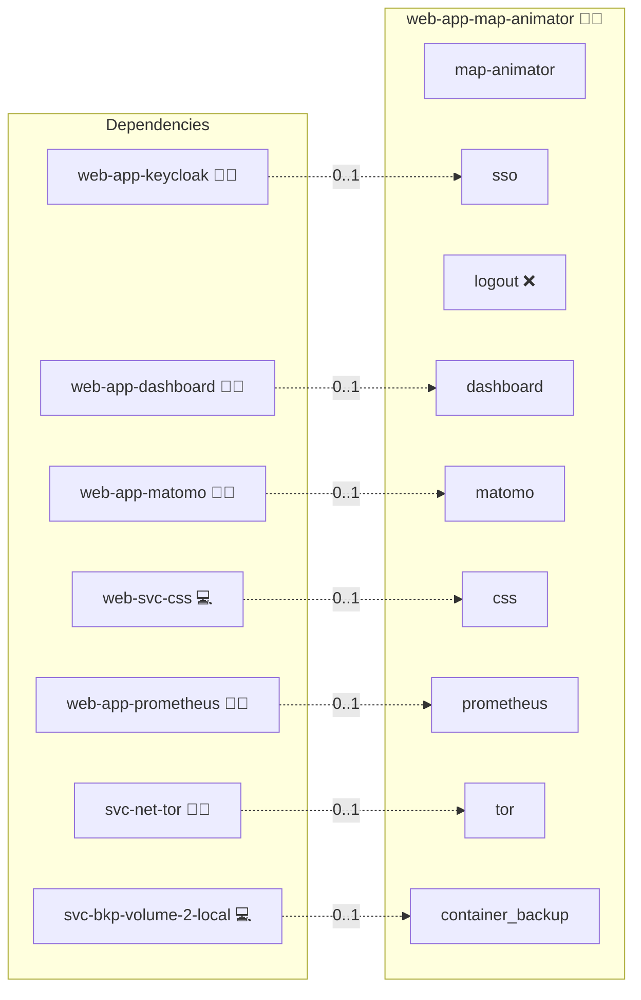

# Map Animator

## Description

[VersaTiles Map Animator](https://github.com/versatiles-org/versatiles-map-animator) is a browser editor for keyframe camera animations on a [VersaTiles](https://versatiles.org/) map. Its render server turns an animation into a video with a headless browser and ffmpeg, keeps a queue of render jobs per user, and offers the finished videos for download.

## Overview

This role deploys the upstream render server image, which serves the editor at `/` and the render queue at `/renders/`. The server puts everything except its login page behind its own login form. When Keycloak is part of the deployment, the oauth2 gate additionally guards the whole domain, so only signed-in platform users reach that form.

The server authenticates against a users file. The role renders it from the directory users whose password is pinned in the inventory (`lookup('users_non_reserved', pinned_only=true)`), so they sign in with their platform username and that password. Bots and accounts with a host login are left out: the host login's password is the server's become password and must not reach a third-party form, so the `administrator` account renders through a personal account. Passwords are stored as scrypt hashes in the format of the upstream `passwd.mjs`; the per-user salt is derived from `secrets.credentials.users_salt_key`, so a rerun writes the same file and only a changed password recreates the container.

Rendered videos live in the `map_animator_data` volume and are deleted by the server after `services.map-animator.keep_days` days.

The upstream server speaks neither OIDC nor a trusted proxy header, which shapes the integration:

- **Second login:** behind the oauth2 gate the render queue still asks for its own login. It accepts the inventory password of the account; a password changed later in Keycloak does not reach it.
- **Shared lockout:** the server counts failed logins per client address, and behind the front proxy every client has the proxy's address. Ten failed logins within fifteen minutes lock the form for everyone. The oauth2 gate keeps anonymous visitors from reaching it; without Keycloak the form is public.
- **Logout:** `logout.enabled` is pinned to `false`, because only the server's own logout button ends its in-memory session.

## Cosmos

The diagram places Map Animator in the Infinito.Nexus cosmos: the components it deploys (capabilities), the central services it consumes (dependencies), and its outward reach (federation and bridged external networks).



Solid `1:1` edges are fixed relationships; dashed `0..1` edges are conditional (enabled only in matching deployments); red `0..0` edges are turned off in this role. Node markers show the role's deploy modes (💻 host, 🐳 compose, 🐝 swarm); ❌ marks a service that is explicitly turned off, and ⚙️ an Ansible role dependency declared in `meta/main.yml`.

## Features

- **Keyframe editor:** Compose camera flights over an OpenStreetMap or satellite map, with annotations, and share them as a link.
- **Render queue:** Turn a share link into an MP4, ProRes, FFV1 or QuickTime Animation video with a chosen width, frame rate and motion blur.
- **Platform accounts:** Directory users with an inventory-pinned password sign in to the render queue with their platform username and that password.
- **Retention:** Finished, failed and cancelled renders are removed after a configurable number of days.

## Quick Setup

### Development

Clone, set up the workstation, and deploy Map Animator onto the local stack:

```bash
git clone https://github.com/infinito-nexus/core.git
cd core
make onboard
make compose-deploy mode=reinstall apps=web-app-map-animator full_cycle=false
```

### Production

Run the published image to provision the inventory and deploy Map Animator to a managed server (the mounted volume persists the inventory):

```bash
APP=web-app-map-animator
HOST=<your-server>
DOMAIN=<your-domain>
TLS_MODE=self_signed
SSH_PUBLIC_KEY="<your-ssh-public-key>"

docker run --rm -it \
  -v "$PWD/inventories:/etc/infinito.nexus/inventories" \
  -e APP="$APP" -e HOST="$HOST" -e DOMAIN="$DOMAIN" -e TLS_MODE="$TLS_MODE" -e SSH_PUBLIC_KEY="$SSH_PUBLIC_KEY" \
  ghcr.io/infinito-nexus/core/debian bash -c '
    INVENTORY=/etc/infinito.nexus/inventories/production
    infinito administration inventory provision "$INVENTORY" \
      --inventory-file "$INVENTORY/devices.yml" \
      --host "$HOST" \
      --include "$APP" \
      --vars "{\"TLS_MODE\": \"$TLS_MODE\", \"DOMAIN_PRIMARY\": \"$DOMAIN\", \"users\": {\"administrator\": {\"authorized_keys\": [\"$SSH_PUBLIC_KEY\"]}}}" &&
    infinito administration deploy dedicated "$INVENTORY/devices.yml" \
      --password-file "$INVENTORY/.password" \
      --diff -vv'
```

## Further Resources

- [Upstream repository](https://github.com/versatiles-org/versatiles-map-animator)
- [Render server documentation](https://github.com/versatiles-org/versatiles-map-animator/blob/main/server/README.md)
- [VersaTiles](https://versatiles.org/)

## Persona contract opt-outs

The `biber` persona passes the oauth2 gate when Keycloak is deployed and then the server's native login form; the `guest` persona is turned away at whichever of the two comes first. The `administrator` persona is blocked in [`templates/playwright.env.j2`](./templates/playwright.env.j2): host-login accounts get no render account, and every account in the users file has the same rights, so there is no admin surface to assert.

## Credits

Implemented by **[Kevin Veen-Birkenbach](https://www.veen.world)**.
Part of the [Infinito.Nexus Project](https://s.infinito.nexus/code) and maintained by [Kevin Veen-Birkenbach](https://www.veen.world).
Licensed under the [Infinito.Nexus Community License (Non-Commercial)](https://s.infinito.nexus/license).
