# Nextcloud

## Description

Elevate your collaboration with Nextcloud, a vibrant self-hosted cloud solution designed for dynamic file sharing, seamless communication, and effortless teamwork. Nextcloud offers a full suite of integrated tools (including LDAP and OIDC authentication, Redis caching, and automated plugin management via OCC) to empower a secure, extensible, and production-ready cloud environment.

## Overview

This role provisions a complete Nextcloud deployment using Docker Compose. It automates the setup of the Nextcloud application along with its underlying MariaDB database and configures the system for secure public access via an NGINX reverse proxy. The deployment includes automated configuration merging into `config.php`, health check routines, and integrated support for backup and recovery operations.

## Cosmos

The diagram places Nextcloud in the Infinito.Nexus cosmos: the components it deploys (capabilities), the central services it consumes (dependencies), and its outward reach (federation and bridged external networks).

```mermaid
flowchart LR
    subgraph deps [Dependencies]
        dep_svc_ai_litellm["svc-ai-litellm 🐳🐝"]
        dep_svc_bkp_volume_2_local["svc-bkp-volume-2-local 💻"]
        dep_svc_db_mariadb["svc-db-mariadb 🐳🐝"]
        dep_svc_db_openldap["svc-db-openldap 🐳🐝"]
        dep_svc_db_redis["svc-db-redis 🐳🐝"]
        dep_svc_net_tor["svc-net-tor 🐳🐝"]
        dep_web_app_bigbluebutton["web-app-bigbluebutton 🐳🐝"]
        dep_web_app_dashboard["web-app-dashboard 🐳🐝"]
        dep_web_app_discourse["web-app-discourse 🐳🐝"]
        dep_web_app_gitlab["web-app-gitlab 🐳🐝"]
        dep_web_app_hermes["web-app-hermes 🐳🐝"]
        dep_web_app_keycloak["web-app-keycloak 🐳🐝"]
        dep_web_app_mastodon["web-app-mastodon 🐳🐝"]
        dep_web_app_matomo["web-app-matomo 🐳🐝"]
        dep_web_app_matrix["web-app-matrix 🐳🐝"]
        dep_web_app_mattermost["web-app-mattermost 🐳🐝"]
        dep_web_app_openclaw["web-app-openclaw 🐳🐝"]
        dep_web_app_openproject["web-app-openproject 🐳🐝"]
        dep_web_app_openwebui["web-app-openwebui 🐳🐝"]
        dep_web_app_peertube["web-app-peertube 🐳🐝"]
        dep_web_app_prometheus["web-app-prometheus 🐳🐝"]
        dep_web_app_seaweedfs["web-app-seaweedfs 🐳🐝"]
        dep_web_app_stalwart["web-app-stalwart 🐳🐝"]
        dep_web_app_xwiki["web-app-xwiki 🐳🐝"]
        dep_web_app_zammad["web-app-zammad 🐳🐝"]
        dep_web_svc_collabora["web-svc-collabora 🐳🐝"]
        dep_web_svc_coturn["web-svc-coturn 🐳🐝"]
        dep_web_svc_css["web-svc-css 💻"]
        dep_web_svc_logout["web-svc-logout 🐳🐝"]
        dep_web_svc_onlyoffice["web-svc-onlyoffice 🐳🐝"]
    end
    subgraph role [web-app-nextcloud 🐳🐝]
        svc_sso["sso"]
        svc_coturn["coturn"]
        svc_logout["logout"]
        svc_ldap["ldap"]
        svc_dashboard["dashboard"]
        svc_matomo["matomo"]
        svc_email["email"]
        svc_redis["redis"]
        svc_mariadb["mariadb"]
        svc_nextcloud["nextcloud"]
        svc_proxy["proxy"]
        svc_context_agent["context_agent"]
        svc_contextagentmcp["contextagentmcp"]
        svc_cron["cron"]
        svc_talk["talk"]
        svc_whiteboard["whiteboard"]
        svc_onlyoffice["onlyoffice"]
        svc_collabora["collabora"]
        svc_bigbluebutton["bigbluebutton"]
        svc_xwiki["xwiki"]
        svc_minio["minio ❌"]
        svc_seaweedfs["seaweedfs"]
        svc_talk_recording["talk_recording"]
        svc_css["css"]
        svc_hcaptcha["hcaptcha"]
        svc_prometheus["prometheus"]
        svc_tor["tor"]
        svc_openproject["openproject"]
        svc_gitlab["gitlab"]
        svc_discourse["discourse"]
        svc_mattermost["mattermost"]
        svc_matrix["matrix"]
        svc_zammad["zammad"]
        svc_openwebui["openwebui"]
        svc_litellm["litellm"]
        svc_mastodon["mastodon"]
        svc_peertube["peertube"]
        svc_moodle["moodle ❌"]
        svc_suitecrm["suitecrm ❌"]
        svc_container_backup["container_backup"]
        svc_hermes["hermes"]
        svc_openclaw["openclaw"]
        svc_flowise["flowise ❌"]
    end
    dep_svc_ai_litellm -. "0..1" .-> svc_litellm
    dep_svc_bkp_volume_2_local -. "0..1" .-> svc_container_backup
    dep_svc_db_mariadb -. "0..1" .-> svc_mariadb
    dep_svc_db_openldap -. "0..1" .-> svc_ldap
    dep_svc_db_redis -. "0..1" .-> svc_redis
    dep_svc_net_tor -. "0..1" .-> svc_tor
    dep_web_app_bigbluebutton -. "0..1" .-> svc_bigbluebutton
    dep_web_app_dashboard -. "0..1" .-> svc_dashboard
    dep_web_app_discourse -. "0..1" .-> svc_discourse
    dep_web_app_gitlab -. "0..1" .-> svc_gitlab
    dep_web_app_hermes -. "0..1" .-> svc_hermes
    dep_web_app_keycloak -. "0..1" .-> svc_sso
    dep_web_app_mastodon -. "0..1" .-> svc_mastodon
    dep_web_app_matomo -. "0..1" .-> svc_matomo
    dep_web_app_matrix -. "0..1" .-> svc_matrix
    dep_web_app_mattermost -. "0..1" .-> svc_mattermost
    dep_web_app_openclaw -. "0..1" .-> svc_openclaw
    dep_web_app_openproject -. "0..1" .-> svc_openproject
    dep_web_app_openwebui -. "0..1" .-> svc_openwebui
    dep_web_app_peertube -. "0..1" .-> svc_peertube
    dep_web_app_prometheus -. "0..1" .-> svc_prometheus
    dep_web_app_seaweedfs -. "0..1" .-> svc_seaweedfs
    dep_web_app_stalwart -. "0..1" .-> svc_email
    dep_web_app_xwiki -. "0..1" .-> svc_xwiki
    dep_web_app_zammad -. "0..1" .-> svc_zammad
    dep_web_svc_collabora -. "0..1" .-> svc_collabora
    dep_web_svc_coturn -. "0..1" .-> svc_coturn
    dep_web_svc_coturn -. "0..1" .-> svc_talk
    dep_web_svc_css -. "0..1" .-> svc_css
    dep_web_svc_logout -. "0..1" .-> svc_logout
    dep_web_svc_onlyoffice -. "0..1" .-> svc_onlyoffice
```



Solid `1:1` edges are fixed relationships; dashed `0..1` edges are conditional (enabled only in matching deployments); red `0..0` edges are turned off in this role. Node markers show the role's deploy modes (💻 host, 🐳 compose, 🐝 swarm); ❌ marks a service that is explicitly turned off, and ⚙️ an Ansible role dependency declared in `meta/main.yml`.

## Features

- **Fully Dockerized Deployment:** Simplifies installation using Docker Compose for the Nextcloud application and its MariaDB backend.
- **Secure Access:** Integrates with an NGINX reverse proxy for encrypted, high-performance access.
- **Robust Authentication:** Supports LDAP and OIDC for secure identity and access management.
- **Automated Configuration Management:** Uses additive configuration files to dynamically merge system settings into `config.php`.
- **Integrated Backup & Recovery:** Provides built-in support for backup and restoration operations to safeguard your data.
- **Extensible Plugin Framework:** Easily manage and configure hundreds of Nextcloud plugins using the OCC command line tool.

## Quick Setup

### Development

Clone, set up the workstation, and deploy Nextcloud onto the local stack:

```bash
git clone https://github.com/infinito-nexus/core.git
cd core
make onboard
make compose-deploy mode=reinstall apps=web-app-nextcloud full_cycle=false
```

### Production

Run the published image to provision the inventory and deploy Nextcloud to a managed server (the mounted volume persists the inventory):

```bash
APP=web-app-nextcloud
HOST=<your-server>
DOMAIN=<your-domain>
TLS_MODE=self_signed
SSH_PUBLIC_KEY="<your-ssh-public-key>"

docker run --rm -it \
  -v "$PWD/inventories:/etc/infinito.nexus/inventories" \
  -e APP="$APP" -e HOST="$HOST" -e DOMAIN="$DOMAIN" -e TLS_MODE="$TLS_MODE" -e SSH_PUBLIC_KEY="$SSH_PUBLIC_KEY" \
  ghcr.io/infinito-nexus/core/debian bash -c '
    INVENTORY=/etc/infinito.nexus/inventories/production
    infinito administration inventory provision "$INVENTORY" \
      --inventory-file "$INVENTORY/devices.yml" \
      --host "$HOST" \
      --include "$APP" \
      --vars "{\"TLS_MODE\": \"$TLS_MODE\", \"DOMAIN_PRIMARY\": \"$DOMAIN\", \"users\": {\"administrator\": {\"authorized_keys\": [\"$SSH_PUBLIC_KEY\"]}}}" &&
    infinito administration deploy dedicated "$INVENTORY/devices.yml" \
      --password-file "$INVENTORY/.password" \
      --diff -vv'
```

## Addons

The config-bearing Nextcloud apps are declared in [`meta/addons/`](./meta/addons/) under the unified addon contract (requirement 026).
Each declaration carries its full `occ config:app:set` payload under `config:`.
The enable-only appstore apps stay under `nextcloud.plugins` in [`meta/services.yml`](./meta/services.yml).

| Addon | Mechanism | Default state | Bridges |
|-------|-----------|---------------|---------|
| `sociallogin` | `plugin` | enabled when the SSO OIDC plugin selector picks it | `sso` → `web-app-keycloak` |
| `user_ldap` | `plugin` | enabled with the `ldap` service | `ldap` → `svc-db-openldap` |
| `bbb` | `plugin` | enabled with the `bigbluebutton` partner | `bigbluebutton` → `web-app-bigbluebutton` |
| `onlyoffice` | `plugin` | enabled with the `onlyoffice` partner | `onlyoffice` → `web-svc-onlyoffice` |
| `richdocuments` | `plugin` | enabled with the `collabora` partner | `collabora` → `web-svc-collabora` |
| `spreed` | `plugin` | enabled with the `talk` service | `talk`, `coturn` |
| `whiteboard` | `plugin` | `required` (always installed) | none (self-hosted backend) |
| `xwiki` | `plugin` | enabled with the `xwiki` partner | `xwiki` → `web-app-xwiki` |
| `app_api` | `plugin` | enabled while `services.context_agent.enabled` is true (it follows `mcp.enabled` unless the inventory sets it), disabled otherwise | none |
| `logreader` | `plugin` | disabled, `log_type` is `errorlog` | none |

The SSO (`sociallogin`) and LDAP (`user_ldap`) login surfaces are covered by the OIDC/LDAP Playwright specs (requirements 017/018).

## Major Upgrades

Every deploy reads `$OC_Version` from `version.php` in the `nextcloud_data` volume and compares its major with the pinned `services.nextcloud.version`, which MUST start with the major number (`34-fpm-alpine`, `32.0.3-fpm-alpine`).

| Data | Behaviour |
|------|-----------|
| No volume or no `version.php` | Fresh install through the image entrypoint |
| Pinned major | Regular deploy, minor updates run in the entrypoint and `occ upgrade` |
| Older major | One upgrade step per major up to the pinned one, then the regular deploy |
| Newer major | The deploy stops, Nextcloud cannot downgrade |

[`tasks/utils/major_upgrade.yml`](./tasks/utils/major_upgrade.yml) runs the steps before the compose handlers start the pinned image:

1. It stops every running container that mounts `nextcloud_data`.
2. Per major it renders [`templates/major_upgrade.yml.j2`](./templates/major_upgrade.yml.j2) as `compose.upgrade.yml`, which swaps the image of the `nextcloud` service for the official `nextcloud:<major><suffix>` image. The suffix comes from the pinned tag, the last step uses the pinned tag itself.
3. `compose run` starts that image with the service's env file, volumes, networks and dependencies and `NEXTCLOUD_UPDATE=1`, so the upstream entrypoint syncs the code and runs `occ upgrade`.
4. Maintenance mode is switched off, `occ status` MUST report the step's major with no pending database upgrade, and every app `occ upgrade` disabled that is still disabled after the step is reported.

After the compose handlers ran, [`tasks/02_manager_ops/03_upgrade.yml`](./tasks/02_manager_ops/03_upgrade.yml) asserts that `occ status` reports the pinned major.

The steps run in compose mode only. A swarm deploy that finds an older major stops with the planned steps; pin one major above the installed one per deploy there.

### Post-Upgrade Pass

[`tasks/02_manager_ops/03_upgrade.yml`](./tasks/02_manager_ops/03_upgrade.yml) includes [`03_upgrade/01_post_upgrade.yml`](./tasks/02_manager_ops/03_upgrade/01_post_upgrade.yml), the appstore app update and `occ maintenance:repair --include-expensive`, only while the version `occ status` reports after `occ upgrade` differs from the one `version.php` declared before the deploy or from `files/mimetype_version`, the server version the expensive repair last ran for.
A fresh install, every upgrade path and a deploy that stopped before the repair run the pass, a redeploy of an unchanged version skips it.

A redeploy of an unchanged version includes [`03_upgrade/02_cached_updates.yml`](./tasks/02_manager_ops/03_upgrade/02_cached_updates.yml) instead, which updates apps without querying the appstore:

1. `occ app:list --enabled --output=json` reads the installed app versions.
2. `occ config:list updatenotification --output=json` reads the newest release per app that the daily `updatenotification` background job found.
3. `occ app:update <id>` runs for every enabled app whose stored release is newer than the installed one, never for an app pinned through `archive`.

An app the background job has not checked yet is not updated until its next run.

## MCP Server

Nextcloud serves a Model Context Protocol endpoint through the AppAPI proxy of the `context_agent` ExApp.

| Property | Value |
|----------|-------|
| Endpoint | `/mcp` on the `contextagentmcp` adapter sidecar |
| Container-network URL | `http://contextagentmcp:8080/mcp` |
| Transport | Streamable HTTP |
| Exposure | internal (the sidecar is reachable on the container network only; the hub's own MCP route is not published to clients) |
| Auth | `credentials.mcp_bearer`, sent as `Authorization: Bearer <bearer>` |
| Identity | the Nextcloud account the app password belongs to; every tool call the adapter forwards runs with that account's permissions |
| Implementation | adapter (`svc-ai-mcp-adapter` in `mcp_passthrough` mode, fronting the `context_agent` ExApp) |
| Default state | off; `mcp.enabled` turns on when `web-app-hermes`, `web-app-openclaw` or `web-app-openwebui` is deployed |

### Deployment

The `context_agent` and `contextagentmcp` services in [`meta/services.yml`](./meta/services.yml) render only while `mcp.enabled` is true. The first runs `ghcr.io/nextcloud/context_agent`, listens on its internal port for AppAPI only, and shares `credentials.context_agent_app_secret` with the ExApp registration as `APP_SECRET`. The second is the adapter sidecar, built from the staged `svc-ai-mcp-adapter` context, read-only with every capability dropped, and it is the only MCP endpoint clients are given.

The sidecar reads its upstream credential from an `upstream.env` file rather than from the compose environment, because the app password does not exist when the stack is first rendered. [`tasks/utils/mcp.yml`](./tasks/utils/mcp.yml) writes that file after the mint and recreates the sidecar through `svc-ai-mcp-adapter`'s `rebuild.yml`: `compose up` resolves `env_file` while creating the container, which a restart would not.

[`tasks/utils/mcp.yml`](./tasks/utils/mcp.yml) waits for the ExApp heartbeat, registers the deploy daemon and the ExApp (route `^/mcp`, verbs `POST,GET,DELETE`, access level `1`), enables the ExApp, mints an app password for the dedicated MCP account via `occ user:auth-tokens:add`, persists it through `sys-token-store` under `users['mcp-web-app-nextcloud'].tokens['web-app-nextcloud']`, and asserts that an authenticated `initialize` call answers `200`.

### Authorization subject

`auth_subject: service_account`: [`tasks/utils/mcp/token.yml`](./tasks/utils/mcp/token.yml) creates the account `NEXTCLOUD_MCP_USERNAME` with `occ user:add` if it is missing, mints the app password against that account, and stores it under `mcp.credential.owner`. Every call carries that account's rights, not the administrator's, no matter who asked the client. Reaching the tool server is gated on the role's `mcp` RBAC group, which is a separate grant from holding a Nextcloud account.

### Tool categories

The 2.7.0 image ships 23 tool categories, which are application names (`calendar`, `files`, `mail`, `talk`, …) rather than operations: each bundles its read and its write tools, and the hub offers no setting that removes only the mutating ones. Enabling the ExApp writes `true` for every category absent from `tool_status`, so the hub itself serves all of them, write tools included.

The adapter is what bounds that. [`files/mcp/tools.json`](./files/mcp/tools.json) names the nine read tools of `calendar`, `contacts` and `files` — the three categories whose upstream `is_available` is unconditional, so the set does not vary with which optional apps a deployment installs. `svc-ai-mcp-adapter` refuses any tool outside that list and any tool marked `mutating` while `mutating_tools_enabled` is false, and it refuses to start at all if the contract's `schema_sha256` does not match the file. The refusal happens in the sidecar, so it holds for every client regardless of what each renders locally.

The hub keeps all its categories. Nextcloud's own Assistant is unaffected by the bound: it reads the same `tool_status`, and nothing here narrows it.

The app password never reaches a client. Clients present `credentials.mcp_bearer` to the sidecar; the sidecar presents the app password upstream. Revoking one does not revoke the other.

```bash
occ app_api:app:config:get context_agent tool_status
occ app_api:app:config:set context_agent tool_status --value '<json map of category to bool>'
```

Widening the exposed set means adding the tool to `files/mcp/tools.json`, recomputing both `adapter.specification_sha256` and `tools.schema_sha256`, and listing it in `mcp.tools.allowlist`.

### Verification

The sidecar is reachable on the container network only, so a client probes it from inside the stack:

```bash
curl -i -X POST \
  -H 'Authorization: Bearer <credentials.mcp_bearer>' \
  -H 'Accept: application/json, text/event-stream' \
  -H 'Content-Type: application/json' \
  --data '{"jsonrpc":"2.0","id":1,"method":"initialize","params":{"protocolVersion":"2025-06-18","capabilities":{},"clientInfo":{"name":"cli","version":"1"}}}' \
  http://contextagentmcp:8080/mcp
```

From outside, every MCP path answers `404`. The hub serves its route under two spellings — with and without the `/index.php` front controller — and `roles/sys-svc-proxy/templates/mcp/vhost.conf.j2` withdraws both, so neither reaches the Context Agent. [`files/playwright/test-mcp-guest.js`](./files/playwright/test-mcp-guest.js) probes all three public paths and asserts each answers `>= 300` without an MCP protocol body.

### Default state

Off. `mcp.enabled` is true only while `web-app-hermes`, `web-app-openclaw` or `web-app-openwebui` is part of the deployment.

### How to disable

Remove the MCP client roles, or pin `mcp.enabled: false` for this role. The `context_agent` service is then not rendered, the ExApp is not registered with AppAPI, no app password is minted, and the `app_api` app is disabled.

## Documentation

A detailed documentation for the use and administration of Nextcloud on Infinito.Nexus you will find [here](docs/README.md).

## Further Resources

- [Nextcloud Official Website](https://nextcloud.com/)
- [Nextcloud Docker Documentation](https://github.com/nextcloud/docker)
- [Nextcloud Admin Manual](https://docs.nextcloud.com/server/latest/admin_manual/)
- [LDAP Integration Guide](https://docs.nextcloud.com/server/latest/admin_manual/configuration_user/user_auth_ldap.html)
- [OIDC Login Plugin (pulsejet)](https://github.com/pulsejet/nextcloud-oidc-login)
- [Sociallogin Plugin (Official)](https://apps.nextcloud.com/apps/sociallogin)

## Persona contract opt-outs

The shared `biber` and `administrator` persona helpers are declared blocked in [templates/playwright.env.j2](./templates/playwright.env.j2). Nextcloud presents three different login surfaces depending on the variant (native, `oidc_login`, `sociallogin`), the native administrator authenticates with the role-local `credentials.administrator_password` rather than the Keycloak secret, and the `#firstrunwizard` modal intercepts the user-menu click the generic logout depends on. Both personas are therefore driven by the role's own login specs — `test-login-admin-native.js`, `test-login-admin-oidc.js`, `test-login-biber-oidc.js` and `test-login-biber-ldap.js` under [files/playwright](./files/playwright/) — which carry the flavor switch, the modal dismissal and the login retry the shared helper lacks.

## Credits

Implemented by **[Kevin Veen-Birkenbach](https://www.veen.world)**.
Part of the [Infinito.Nexus Project](https://s.infinito.nexus/code) and maintained by [Kevin Veen-Birkenbach](https://www.veen.world).
Licensed under the [Infinito.Nexus Community License (Non-Commercial)](https://s.infinito.nexus/license).
