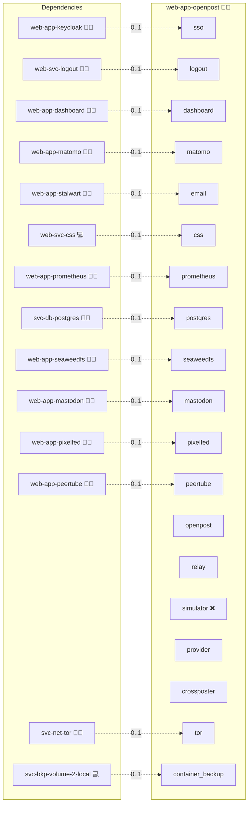

# OpenPost

## Description

[OpenPost](https://github.com/getopenpost/openpost) is a self-hosted publishing desk for social media.
Teams compose posts once, adapt them per network, schedule them and publish them to Mastodon, Pixelfed, PeerTube, Bluesky, Facebook Pages, Instagram, Threads, X, YouTube, LinkedIn and TikTok from one interface.

## Overview

This role deploys the unmodified official `ghcr.io/getopenpost/openpost` image as one `all` process behind the shared OpenResty proxy at `publish.<DOMAIN_PRIMARY>`.
It stores data in the central PostgreSQL, keeps media in the `web-app-seaweedfs` object store when one is deployed, signs users in through Keycloak over OIDC and sends mail through the platform mail service.
An always-on egress relay lets OpenPost publish to the Mastodon, Pixelfed and PeerTube instances of the same deployment without weakening its SSRF guard.
For operation, platform onboarding and the egress design see [Administration.md](./Administration.md).

## Cosmos

The diagram places OpenPost in the Infinito.Nexus cosmos: the components it deploys (capabilities), the central services it consumes (dependencies), and its outward reach (federation and bridged external networks).



Solid `1:1` edges are fixed relationships; dashed `0..1` edges are conditional (enabled only in matching deployments); red `0..0` edges are turned off in this role. Node markers show the role's deploy modes (💻 host, 🐳 compose, 🐝 swarm); ❌ marks a service that is explicitly turned off, and ⚙️ an Ansible role dependency declared in `meta/main.yml`.

## Features

- **Official image only:** The role pins an upstream release tag, configures OpenPost purely through environment variables and lets the update tooling propose new release tags.
- **Keycloak single sign-on:** OpenPost's native OIDC adapter provisions users just in time on their first login, and the platform administrator becomes instance admin through the bootstrap allowlist.
- **No LDAP adapter:** OpenPost ships no LDAP login, so the role declares no `ldap` service; directory accounts sign in through Keycloak's OpenLDAP federation over OIDC.
- **Egress relay:** An nginx stream relay carries the canonical domains of the deployed Mastodon, Pixelfed and PeerTube instances as network aliases on a subnet outside OpenPost's blocked ranges and forwards the untouched TLS stream by SNI to the shared proxy.
- **Break-glass admin:** A local instance admin is bootstrapped on the first deploy so the instance stays manageable when Keycloak is unavailable.
- **Data minimisation:** Diagnostics, the update check, product telemetry, feedback, public profiles, stock media search and workflow AI are switched off.
- **Central credentials:** Developer app credentials for X, Meta, Threads, LinkedIn, YouTube and TikTok come from the central `API` mapping, and a network without credentials stays unavailable.
- **Automated crossposting:** A crossposter sidecar polls configured Mastodon, Pixelfed and PeerTube accounts and hands every new post to OpenPost, as a draft for review or for immediate publishing, with per-network shortening, attribution, opt-out by hashtag, loop prevention and mailed reports of failed deliveries.

## Quick Setup

### Development

Clone, set up the workstation, and deploy OpenPost onto the local stack:

```bash
git clone https://github.com/infinito-nexus/core.git
cd core
make onboard
make compose-deploy mode=reinstall apps=web-app-openpost full_cycle=false
```

### Production

Run the published image to provision the inventory and deploy OpenPost to a managed server (the mounted volume persists the inventory):

```bash
APP=web-app-openpost
HOST=<your-server>
DOMAIN=<your-domain>
TLS_MODE=self_signed
SSH_PUBLIC_KEY="<your-ssh-public-key>"

docker run --rm -it \
  -v "$PWD/inventories:/etc/infinito.nexus/inventories" \
  -e APP="$APP" -e HOST="$HOST" -e DOMAIN="$DOMAIN" -e TLS_MODE="$TLS_MODE" -e SSH_PUBLIC_KEY="$SSH_PUBLIC_KEY" \
  ghcr.io/infinito-nexus/core/debian bash -c '
    INVENTORY=/etc/infinito.nexus/inventories/production
    infinito administration inventory provision "$INVENTORY" \
      --inventory-file "$INVENTORY/devices.yml" \
      --host "$HOST" \
      --include "$APP" \
      --vars "{\"TLS_MODE\": \"$TLS_MODE\", \"DOMAIN_PRIMARY\": \"$DOMAIN\", \"users\": {\"administrator\": {\"authorized_keys\": [\"$SSH_PUBLIC_KEY\"]}}}" &&
    infinito administration deploy dedicated "$INVENTORY/devices.yml" \
      --password-file "$INVENTORY/.password" \
      --diff -vv'
```

## Developer Notes

See [Administration.md](./Administration.md) for the egress relay, the break-glass procedure, per-network onboarding and the staging checklist.

## Further Resources

- [OpenPost on GitHub](https://github.com/getopenpost/openpost)
- [OpenPost provider reference](https://github.com/getopenpost/openpost/blob/0deadaf7bbf3b3be045e783c3eeef323c9e3c440/docs/reference/providers/index.md)

## Credits

Implemented by **[Evangelos Tsakoudis](https://github.com/evangelostsak)**.
Part of the [Infinito.Nexus Project](https://s.infinito.nexus/code) and maintained by [Kevin Veen-Birkenbach](https://www.veen.world).
Licensed under the [Infinito.Nexus Community License (Non-Commercial)](https://s.infinito.nexus/license).
