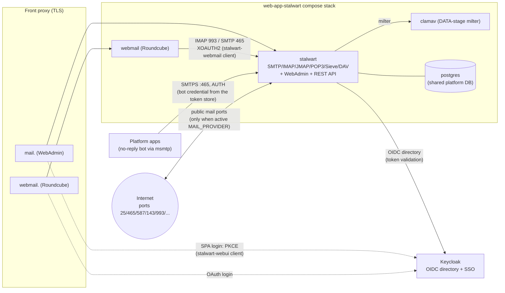

# Stalwart Mail Server

## Description

Runs [Stalwart](https://stalw.art/) — a secure, all-in-one mail and
collaboration server — as the platform's email provider. A single hardened
service speaks **SMTP, Submission, IMAP, POP3, JMAP, ManageSieve, CalDAV,
CardDAV and WebDAV**, with a **built-in spam filter**, **DKIM/DMARC** signing
and a **WebAdmin + REST management API**.

This role replaces the deprecated [`web-app-mailu`](../web-app-mailu/) role.
Applications send mail through the same provider-agnostic abstraction
(`lookup('email')` / [`sys-svc-mail`](../sys-svc-mail/)) — no consumer changes
are needed beyond the provider repoint.

## Overview

Compared with Mailu's multi-container stack, Stalwart collapses the mail server
into one binary. This role runs:

| Container | Purpose |
|-----------|---------|
| `stalwart` | SMTP/IMAP/JMAP/POP3/Sieve/DAV + built-in spam filter + WebAdmin/REST API |
| `webmail` (Roundcube) | Browser webmail (parity with Mailu) |
| `clamav` | Attachment antivirus, called as an SMTP DATA-stage milter |
| `postgres` *(shared)* | Account / mail / metadata store |

Dynamic state (domains, accounts, passwords, DKIM, certificates) is administered
at runtime via the JMAP management API; `config.json` only bootstraps the data
store. Spam filtering is built into Stalwart; **antivirus** is provided by the
`clamav` container (registered via `x:MtaMilter`, `services.clamav.enabled` —
set it to `false` to run spam-only). Infected mail is rejected at DATA.



## Cosmos

The diagram places Stalwart Mail Server in the Infinito.Nexus cosmos: the components it deploys (capabilities), the central services it consumes (dependencies), and its outward reach (federation and bridged external networks).

```mermaid
flowchart LR
    subgraph deps [Dependencies]
        dep_svc_bkp_volume_2_local["svc-bkp-volume-2-local 💻"]
        dep_svc_db_postgres["svc-db-postgres 🐳🐝"]
        dep_svc_net_tor["svc-net-tor 🐳🐝"]
        dep_svc_net_tor_smtp["svc-net-tor-smtp 🐳🐝"]
        dep_web_app_dashboard["web-app-dashboard 🐳🐝"]
        dep_web_app_keycloak["web-app-keycloak 🐳🐝"]
        dep_web_app_matomo["web-app-matomo 🐳🐝"]
        dep_web_app_prometheus["web-app-prometheus 🐳🐝"]
        dep_web_svc_css["web-svc-css 💻"]
        dep_web_svc_logout["web-svc-logout 🐳🐝"]
    end
    subgraph role [web-app-stalwart 🐳🐝]
        svc_sso["sso"]
        svc_logout["logout"]
        svc_dashboard["dashboard"]
        svc_matomo["matomo"]
        svc_container_backup["container_backup"]
        svc_stalwart["stalwart"]
        svc_postgres["postgres"]
        svc_webmail["webmail"]
        svc_clamav["clamav"]
        svc_css["css"]
        svc_prometheus["prometheus"]
        svc_tor["tor"]
        svc_tor_smtp["tor-smtp"]
    end
    subgraph dependents [Dependents]
        dpt_sys_ctl_alm_email["sys-ctl-alm-email 💻"]
        dpt_web_app_akaunting["web-app-akaunting 🐳🐝"]
        dpt_web_app_baserow["web-app-baserow 🐳🐝"]
        dpt_web_app_bigbluebutton["web-app-bigbluebutton 🐳🐝"]
        dpt_web_app_bluesky["web-app-bluesky 🐳🐝"]
        dpt_web_app_bookwyrm["web-app-bookwyrm 🐳🐝"]
        dpt_web_app_bridgy_fed["web-app-bridgy-fed 🐳🐝"]
        dpt_web_app_checkmk["web-app-checkmk 🐳🐝"]
        dpt_web_app_confluence["web-app-confluence 🐳🐝"]
        dpt_web_app_decidim["web-app-decidim 🐳🐝"]
        dpt_web_app_discourse["web-app-discourse 🐳🐝"]
        dpt_web_app_erpnext["web-app-erpnext 🐳🐝"]
        dpt_more["..."]
    end
    dep_svc_bkp_volume_2_local -. "0..1" .-> svc_container_backup
    dep_svc_db_postgres -. "0..1" .-> svc_postgres
    dep_svc_net_tor -. "0..1" .-> svc_tor
    dep_svc_net_tor -. "0..1" .-> svc_tor_smtp
    dep_svc_net_tor_smtp -. "0..1" .-> svc_tor_smtp
    dep_web_app_dashboard -. "0..1" .-> svc_dashboard
    dep_web_app_keycloak -. "0..1" .-> svc_sso
    dep_web_app_matomo -. "0..1" .-> svc_matomo
    dep_web_app_prometheus -. "0..1" .-> svc_prometheus
    dep_web_svc_css -. "0..1" .-> svc_css
    dep_web_svc_logout -. "0..1" .-> svc_logout
    svc_stalwart -- "1:1" --> dpt_more
    svc_stalwart -- "1:1" --> dpt_sys_ctl_alm_email
    svc_stalwart -. "0..1" .-> dpt_web_app_akaunting
    svc_stalwart -. "0..1" .-> dpt_web_app_baserow
    svc_stalwart -. "0..1" .-> dpt_web_app_bigbluebutton
    svc_stalwart -. "0..1" .-> dpt_web_app_bluesky
    svc_stalwart -. "0..1" .-> dpt_web_app_bookwyrm
    svc_stalwart -- "0..0" --> dpt_web_app_bridgy_fed
    svc_stalwart -. "0..1" .-> dpt_web_app_checkmk
    svc_stalwart -- "0..0" --> dpt_web_app_confluence
    svc_stalwart -. "0..1" .-> dpt_web_app_decidim
    svc_stalwart -. "0..1" .-> dpt_web_app_discourse
    svc_stalwart -. "0..1" .-> dpt_web_app_erpnext
    linkStyle 18,20 stroke:red;
```



Solid `1:1` edges are fixed relationships; dashed `0..1` edges are conditional (enabled only in matching deployments); red `0..0` edges are turned off in this role. Node markers show the role's deploy modes (💻 host, 🐳 compose, 🐝 swarm); ❌ marks a service that is explicitly turned off, and ⚙️ an Ansible role dependency declared in `meta/main.yml`.

## SSO (Keycloak / OpenID Connect)

When `web-app-keycloak` is present the role joins the shared Keycloak client and
delegates **interactive** authentication to Keycloak:

- **WebAdmin + IMAP/SMTP/JMAP** authenticate against an **OIDC directory**
  (`tasks/06_oidc.yml`): Stalwart validates Keycloak-issued tokens, matching the
  `preferred_username` claim to the provisioned account.
- **Roundcube** logs users in over OAuth2 and talks to Stalwart with **XOAUTH2**
  (`templates/roundcube-oauth.inc.php.j2`).
- The OIDC directory skips the audience check and gives Keycloak tokens without
  Stalwart scopes access to mail, contacts, calendars and files
  (`STALWART_OIDC_TOKEN_VALIDATION`). Tokens of the `stalwart-webui` client get
  full access, because the WebUI Application names it as its `oauthClientId`.

**Design constraint (validated against the live JMAP schema):** Stalwart's
authentication directory is *Internal XOR one external directory* — there is no
chaining or fallback. Enabling SSO therefore **disables the account password**
for every account, including the machine `no-reply` account. App passwords are
checked before the directory and keep working, so with SSO enabled the role:

1. Creates one app password per bot account, acting for that account as the
   recovery admin (`tasks/04_manage_user/app_password.yml`), and
2. Stores it in the token store, where
   [`plugins/lookup/email.py`](../../plugins/lookup/email.py) reads the SMTP
   password of the `no-reply` client.

A bot gets a new app password when its entry named
`STALWART_BOT_APP_PASSWORD_DESCRIPTION` is deleted in Stalwart or its token is
removed from the token store. The app password it replaces is renamed to
`STALWART_BOT_APP_PASSWORD_RETIRED_DESCRIPTION` and stays valid until the
service-loader post-load flush drops it
(`tasks/04_manage_user/app_password_drop.yml`), or until right after the new
one is stored when the role runs outside the service loader. A deploy that
stops before the flush leaves it to the next deploy. Relaying stays limited to
authenticated sessions in both modes (`STALWART_RELAY_RULE`).

With SSO disabled the role uses the Internal directory and the bot's derived
account password.

## WebUI sign-in

The WebUI Application always names `stalwart-webui` (`STALWART_WEBUI_OAUTH_CLIENT_ID`) as its `oauthClientId`, with and without SSO.
Where the WebUI sends a login depends on the account:

| Account | Authorization server | Client `stalwart-webui` |
|---|---|---|
| Account in a domain bound to the Keycloak OIDC directory | Keycloak | Keycloak client from `templates/keycloak/clients.json.j2` |
| Recovery admin (`STALWART_ADMIN_USER`), and every account while SSO is off | Stalwart | OAuth client the role registers in Stalwart (`tasks/02_webadmin.yml`) |

The role registers that Stalwart client over JMAP (`templates/jmap/oauth_client/`) as a public first-party client, with one redirect URI `<origin>/<prefix>/oauth/callback` and one post-logout URI `<origin>/<prefix>/login` per URL prefix of the WebUI Application.
`<origin>` is the role's canonical WebUI URL (`STALWART_WEBUI_BASE_URL`), so a Tor deployment registers its `http://` onion origin.
Every deploy compares the registered client with that target and updates it when they differ.
A deployment that serves the WebUI on a further origin MUST add that origin's URIs to [`templates/jmap/oauth_client/webui.json.j2`](templates/jmap/oauth_client/webui.json.j2), because a URI added in Stalwart alone is removed by the next deploy.
Stalwart's login page asks for consent before the password form for every registered client, so a native WebUI login shows an **Allow** step.

## Calendar & Contacts (CalDAV / CardDAV / WebDAV)

Stalwart serves DAV natively on the mail HTTP listener — no extra container
(Mailu used a separate Radicale service). Clients auto-discover via
`https://mail.<domain>/.well-known/{caldav,carddav}`, which redirect to
`https://mail.<domain>/dav/cal` and `/dav/card`. Authenticate with the mailbox
account (or the Keycloak SSO token when SSO is enabled).

## Design Decisions

- **Client ports are implicit-TLS only (465/993/995).** Stalwart's default
  configuration binds no STARTTLS listeners, so the role neither publishes
  587/143/110 nor advertises them via SRV records.
- **The WebUI (WebAdmin) bundle is staged by the controller.** Stalwart fetches
  it from GitHub on first boot, which fails behind restricted egress; the
  controller downloads it into a host-level cache (matrix rounds purge the
  instance dir, and per-round downloads hit GitHub rate limits) and bind-mounts
  it read-only. The `update:` block next to `webui_version` in
  `meta/services.yml` names the upstream tags, so the version-source updater
  bumps the bundle on its own, within the `v2.` line that server 1.x serves.
- **The embedded PostgreSQL pins the plain `postgres` image** — the platform's
  postgis default defeats baudolo's substring database detection and would
  degrade backups to torn live-file snapshots. `backup.project_hard_restart`
  brings the whole project back through one coherent restart after baudolo's
  per-volume stop/start cycles.
- **ClamAV runs fail-open with short milter timeouts** so mail keeps flowing
  while clamd warms its signature database instead of blocking the DATA stage.
- **`config.json` is bootstrap-only** (data store selection); all other
  configuration lives in the database and is provisioned over JMAP
  (`templates/jmap/*.json.j2`).
- **Only authenticated sessions relay, with or without SSO.** Under SSO a bot
  authenticates with an app password.
- **Address bans expire after `services.stalwart.ban_period_seconds`** (one
  hour by default). Without a period Stalwart keeps a ban forever, and the
  reverse proxy, the published ports, Tor and the swarm ingress hand many
  clients one address.
- **Bans and failed logins also go to the container output**
  (`STALWART_BAN_TRACER`, `tasks/tracing.yml`), next to the daily log file in
  the data volume.

## Features

- All-in-one mail server (SMTP/IMAP/JMAP/POP3/ManageSieve)
- CalDAV / CardDAV / WebDAV collaboration
- Built-in spam filtering
- ClamAV antivirus as an SMTP DATA-stage milter (`services.clamav.enabled: false` for spam-only)
- DKIM signing with automatic key management; SPF / DMARC published in DNS
- OpenID Connect SSO via Keycloak
- Roundcube webmail
- PostgreSQL backing store

## Quick Setup

### Development

Clone, set up the workstation, and deploy Stalwart Mail Server onto the local stack:

```bash
git clone https://github.com/infinito-nexus/core.git
cd core
make onboard
make compose-deploy mode=reinstall apps=web-app-stalwart full_cycle=false
```

### Production

Run the published image to provision the inventory and deploy Stalwart Mail Server to a managed server (the mounted volume persists the inventory):

```bash
APP=web-app-stalwart
HOST=<your-server>
DOMAIN=<your-domain>
TLS_MODE=self_signed
SSH_PUBLIC_KEY="<your-ssh-public-key>"

docker run --rm -it \
  -v "$PWD/inventories:/etc/infinito.nexus/inventories" \
  -e APP="$APP" -e HOST="$HOST" -e DOMAIN="$DOMAIN" -e TLS_MODE="$TLS_MODE" -e SSH_PUBLIC_KEY="$SSH_PUBLIC_KEY" \
  ghcr.io/infinito-nexus/core/debian bash -c '
    INVENTORY=/etc/infinito.nexus/inventories/production
    infinito administration inventory provision "$INVENTORY" \
      --inventory-file "$INVENTORY/devices.yml" \
      --host "$HOST" \
      --include "$APP" \
      --vars "{\"TLS_MODE\": \"$TLS_MODE\", \"DOMAIN_PRIMARY\": \"$DOMAIN\", \"users\": {\"administrator\": {\"authorized_keys\": [\"$SSH_PUBLIC_KEY\"]}}}" &&
    infinito administration deploy dedicated "$INVENTORY/devices.yml" \
      --password-file "$INVENTORY/.password" \
      --diff -vv'
```

## Migration from Mailu

The provider cutover is an inventory change; mailbox data moves with it when the migration switch is on.

> **Compose only.** The import reads the legacy maildir volume on the stack host and submits over the host-published IMAPS port, neither of which holds under swarm. Migrate in compose mode, then move the stack to swarm.

1. Keep `web-app-mailu` in the host's groups and add `web-app-stalwart` — both MUST be present so Mailu re-renders as a legacy instance (`legacy-mail.<domain>`, no public mail ports) and releases `mail.<domain>` to Stalwart.
2. Remove `MAIL_PROVIDER` from the inventory (Stalwart is the default).
3. Set `applications["web-app-stalwart"].services.stalwart.migration.import_mailu: true` and run the full deploy. The role then reads Mailu's Dovecot Maildir volume and imports every inventory account's messages via IMAP APPEND, preserving folders, flags and internal dates. Re-runs are idempotent (Message-ID dedup), so the switch may stay on across deploys; turn it off once Mailu is retired.
   The import authenticates per account with the inventory password, so it MUST run while `services.sso.enabled` is false. An OIDC directory replaces password login outright (see [`tasks/06_oidc.yml`](tasks/06_oidc.yml)), and every IMAP login then fails with `AUTHENTICATIONFAILED`. Migrate first, enable SSO afterwards.
4. Accounts and aliases are provisioned from the inventory by this role; mailboxes created only inside Mailu's admin UI MUST be added to the inventory first. Sieve filters and CalDAV/CardDAV data are out of scope.
5. Non-Cloudflare DNS: publish the new DKIM TXT record reported by the deploy; MX and A records keep their hostname.

The cutover is covered end to end by [`files/test/test.sh`](files/test/test.sh), which runs as this role's CLI test whenever `web-app-mailu` is co-deployed — matrix **variant 1**, the round where SSO is off, because the import authenticates with per-account passwords. The whole scenario runs inside the deployed host and needs nothing from the environment around it: it stores mail in both directions in the legacy Mailu, confirms it landed in the maildir volume, runs [`files/python/migrate_from_mailu.py`](files/python/migrate_from_mailu.py) — the same script and argv a real cutover uses — and then asserts over IMAP that the stored mail survived and that live mail still flows. No redeploy is involved; the cutover is a docker-level data move.

## Upgrading from 0.16

Stalwart 1.x refuses to open a 0.16 store and has no in-place upgrade. Every deploy checks the store in the role's database before it starts Stalwart, whatever state the running server is in, and stops when the store predates 1.0 ([`tasks/store_guard.yml`](tasks/store_guard.yml)). A store from before 1.0 keeps a `bigint` column `v` in table `u`, a 1.x store a `bytea` one, and a database without that column holds no store yet.

A deploy that has brought Stalwart 1.x up on the store and finished its provisioning writes the marker `store.layout`, holding the store layout version `1`, into the role's instance directory on the stack host (`STALWART_STORE_MARKER_FILE`, written last in [`tasks/manager_ops.yml`](tasks/manager_ops.yml)).
A failed deploy writes no marker.
A deploy that finds the marker passes without reading the store.
A deploy without the marker reads the store:

| Database | No store yet | Store to read |
|---|---|---|
| Shared PostgreSQL | the `postgres` superuser finds no database `stalwart` in the catalog | read as the role's database user |
| Dedicated PostgreSQL | the volume `stalwart_database` does not exist | read inside the dedicated database container; when that container is not running, the deploy stops and names the database service to start |

Migrate the store with [`stalwart-migrate`](https://github.com/stalwartlabs/stalwart-migrate) into a new database and swap it in under the role's database name. That name is fixed to `stalwart` ([`plugins/lookup/database.py`](../../plugins/lookup/database.py) derives it from the entity name), so the migration targets a second database that later takes over the name.

1. Make sure the server runs Stalwart `v0.16.27`; `stalwart-migrate` reads no other release. Upgrade an older 0.16 server with the previous revision of this role first.
2. Back up the database `stalwart` (for example `pg_dump -Fc -d stalwart -f stalwart-v016.dump`) and the role's volumes.
3. As a PostgreSQL superuser, create the empty target database, owned by the role's database user:

   ```sql
   CREATE DATABASE stalwart_v1 OWNER stalwart;
   ```

4. Copy the rendered `config.json` (`STALWART_CONFIG_FILE`, `etc/config.json` in the role's volumes directory) into a new directory and set its `"database"` to `"stalwart_v1"`. This file is the `--target`.
5. Answer the conversion questions and copy the data while 0.16 keeps serving. Run the tool on the network the `stalwart` container reaches its database on (`docker inspect stalwart`), so the hosts in both files resolve:

   ```sh
   docker run --rm -it --network <stalwart-network> \
     -v <volumes-dir>/etc:/etc/stalwart:ro \
     -v <target-dir>:/etc/stalwart-v1 \
     -v <state-dir>:/var/lib/stalwart-migrate \
     stalwartlabs/stalwart-migrate:1.0.0 prepare \
       --source /etc/stalwart/config.json \
       --state /var/lib/stalwart-migrate
   ```

   Then run the same container with `run --source /etc/stalwart/config.json --target /etc/stalwart-v1/config.json --state /var/lib/stalwart-migrate`. `run` copies only what changed since the previous run and may be repeated.
6. Stop the Stalwart server (`docker stop stalwart` in compose, `docker service scale <stack>_stalwart=0` in swarm) and run the same container with `run --final` and the same options. It verifies the copy and writes `final-report.txt` into the state directory.
7. Swap the databases, as a PostgreSQL superuser connected to the `postgres` database:

   ```sql
   ALTER DATABASE stalwart RENAME TO stalwart_v016;
   ALTER DATABASE stalwart_v1 RENAME TO stalwart;
   ```

8. Deploy this role. The store guard finds the migrated 1.x store under the role's database name and lets Stalwart 1.x start on it.
9. Keep `stalwart_v016`, the dump and the state directory until 1.x is verified. `stalwart-migrate rollback` reads the state directory to copy the 1.x store back into a new 0.16 store.

### Restore and redeploy

The marker lives outside the stack and its volumes, so it survives `docker stack rm`, `docker compose down`, a crashed database and the stop and start cycle of `backup.project_hard_restart`.
A host that carries the marker therefore redeploys while its dedicated database is down, as in the restore of [`svc-bkp-nfs-2-local`](../svc-bkp-nfs-2-local/README.md) (`docker stack rm`, restore, redeploy).
A dedicated store on a host without the marker, such as a 0.16 host or a host whose instance directory was lost, needs its database running before the deploy: start the database service of the stack the host last deployed, then deploy.
Before a host that carries the marker goes back to a 0.16 store, through `stalwart-migrate rollback` or a backup taken under 0.16, delete the marker, so the next deploy reads the store.

## Verifying a production server

Deploying against a publicly reachable mail server additionally asserts that server's live **hard facts** — the records and listeners either match the deployed configuration or they do not. There is no mail-flow scenario here; that is what the suites above are for.

Set `INFINITO_MAIL_PRODUCTION_HOST` to the server's public FQDN (in CI, a GitHub repository variable of the same name; empty disables the whole check). Optionally set `INFINITO_MAIL_PRODUCTION_RESOLVER` to the address of a public resolver so the records are read from the outside view instead of `/etc/resolv.conf`, which matters on a host whose own resolver answers from a split-horizon zone.

[`files/python/production_facts.py`](files/python/production_facts.py) then checks, read-only:

| Fact | Assertion |
|---|---|
| A / AAAA | the mail host resolves |
| MX | the zone's only MX is the mail host (the role publishes it `solo`) |
| SPF | exactly one `v=spf1` record, authorising `mx` or `a:<mailhost>` |
| DMARC | `_dmarc` publishes a `v=DMARC1` record with a policy |
| DKIM | the selector this deploy read back publishes a non-empty `v=DKIM1` key |
| SRV | `_submissions`/465, `_imaps`/993, `_pop3s`/995 point at the mail host |
| PTR | rDNS does not contradict the mail host (absent → warning; rDNS is provisioned for Hetzner only) |
| SMTP | port 25 greets with `220` carrying the FQDN, proving the `rejectNonFqdn` identity |

The same variable points [`sys-ctl-mtn-cert-deploy`](../sys-ctl-mtn-cert-deploy/)'s remote check at `:465` and `:993`, so the live TLS chain and its remaining validity are verified alongside. A misconfigured production server therefore fails the deploy instead of surfacing as an outage.

## Further Reading

- [Stalwart documentation](https://stalw.art/docs)
- [`sys-svc-mail`](../sys-svc-mail/) — how applications send mail
- [`plugins/lookup/email.py`](../../plugins/lookup/email.py) — the email abstraction

> **Note:** Stalwart's JMAP object schema is version-sensitive. Pin
> `services.stalwart.version`; the provisioning payloads in `tasks/` were
> validated against that release's `GET /api/schema`.

## Credits

Implemented by **[Alejandro Roman Ibanez](https://github.com/AlejandroRomanIbanez)**.
Part of the [Infinito.Nexus Project](https://s.infinito.nexus/code) and maintained by [Kevin Veen-Birkenbach](https://www.veen.world).
Licensed under the [Infinito.Nexus Community License (Non-Commercial)](https://s.infinito.nexus/license).
