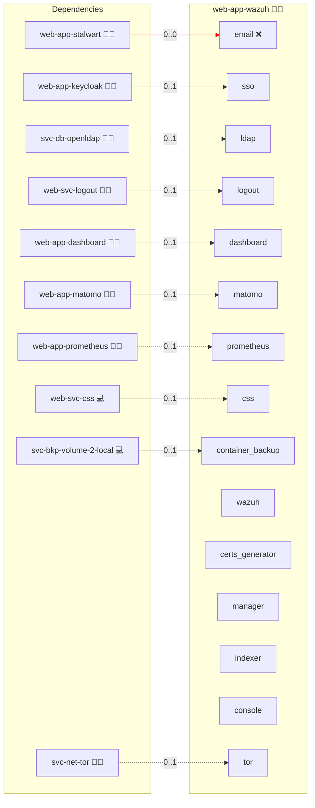
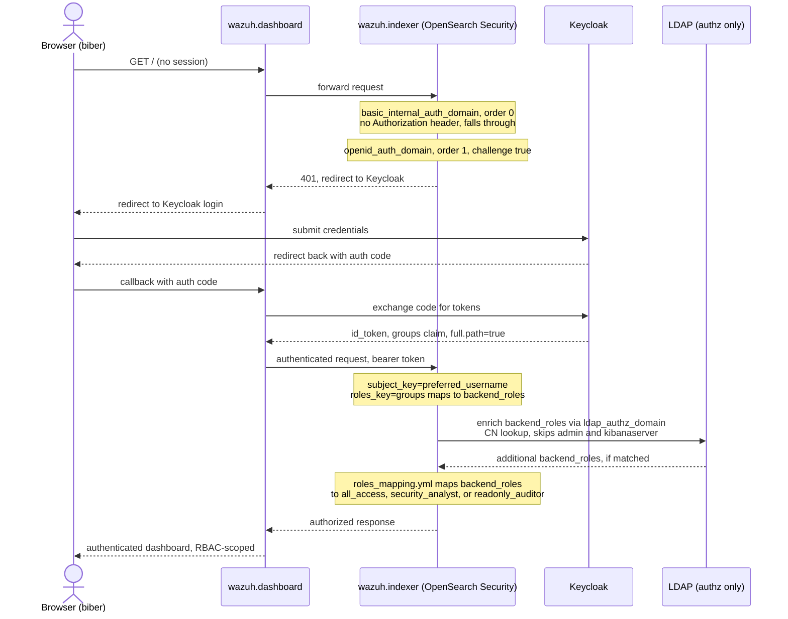

# Wazuh

## Description

[Wazuh](https://wazuh.com/) is an open-source SIEM and XDR platform providing security monitoring, log analysis, intrusion and vulnerability detection, and compliance support.

## Overview

This role deploys the single-node Wazuh stack (`wazuh.manager`, `wazuh.indexer`, `wazuh.dashboard`) with Docker Compose or Docker Swarm.
A one-shot `wazuh-certs-generator` job creates the internal TLS material before the manager and the indexer start.
The indexer is the stack's own datastore and holds the OpenSearch security configuration, so the role needs no shared database.
The manager's agent event port is published on `DOCKER_BIND_HOST` only. The enrollment service (`1515`) is on, because the manager API registers agents through it, but it requires the vault password `authd_password` and is reachable only inside the stack; agents are pre-registered through the manager API.
Each deploy registers the host's agent (id `001`) with its vault key `agent_key` and replaces the registration when the name or key differs, so rotating `agent_key` and redeploying revokes the old key.
The manager writes raw events to `archives.json` (`logall_json`) in development and CI only; archive indexing into `wazuh-archives-*` stays at the Wazuh default (off) everywhere.
The manager's vulnerability detection data (`/var/ossec/queue/vd`, volume `wazuh_manager_vd`) is deliberately not backed up.
The manager downloads it again after a restore, which can take a long time.
This matters once agents are enrolled.

## Host agent verification

This role includes [sys-svc-wazuh-agent](../sys-svc-wazuh-agent/README.md) for its own host after it has pre-registered the agents. An opted-in role deployed earlier in the run may already have installed the agent, which then keeps reconnecting until the manager exists.
At the end of its deploy this role waits until every pre-registered agent is `Active` (`agent_control`), for up to three of the agent's reconnect intervals, and then sends a canary line with the self-test tag through journald (`logger`).
The deploy fails unless the canary arrives as rule `100110` in `wazuh-alerts-*`: journald, agent, manager, indexer, end to end.
Each deploy therefore leaves one canary alert (level 3) in the index.

### Per-app canary

After all roles have deployed, the final deploy stage checks every opted-in app's own log path, in every runtime including production ([05_app_canary.yml](tasks/05_app_canary.yml), included from `tasks/stages/03_destructor.yml`). It sends one HTTP request to the app's published local port on its host, with the app's domain as `Host` header, so a host that cannot reach its own public domain still passes: `GET /INFINITO_WAZUH_CANARY%20<entity>-deploy-<timestamp>`. The app's access log writes the decoded path to the container's stdout, journald tags it with the app's tag, and the agent forwards it. The deploy fails unless rule `100111` (`GET /INFINITO_WAZUH_CANARY ` anywhere in the line, under any `infinito` parent) arrives in `wazuh-alerts-*` with the app's parent decoder and this run's marker. Self-test rule `100110` stays anchored at the start of the line.

Anyone who can reach the app can send such a request and raise a level 3 canary alert. That is harmless: the deploy accepts only its own run's unique marker, so a forged request cannot make a broken log path look healthy.

The canary needs an app whose main service (`services.<entity>`) publishes `ports.local.http` and logs every request to stdout. An app behind the SSO proxy or without HTTP needs another method, which comes with its onboarding.

### Dev and CI checks

In dev and CI only (`RUNTIME` `dev`, `act` or `github`), `test-e2e-cli` runs [files/test/test.sh](files/test/test.sh) after the per-app canary. It starts throwaway `journald` containers labelled for this run and removes them on exit, also on failure, and reads the manager's alerts and archives from its log volume and the indexer API, without `docker exec`. Before it looks for something that must be absent, it waits for a barrier canary through the same path, so absence means not forwarded rather than not yet arrived.

| Criterion | Check |
|---|---|
| B | The self-test tag and the first opted-in app's tag print the same canary text; two alerts arrive, one per parent decoder |
| J | The opted-in tag and the tag of a role that is not opted in (picked from the inventory's roles and asserted not opted in) each print a line, are recreated and print again; only the opted-in tag arrives, twice. No archived journald event carries a Wazuh container's ID as its tag |
| I | Synthetic credentials go to the app as login password, bearer token, `access_token` query parameter, password-reset and e-mail-confirm path token and Referer; none of them may appear in `archives.json`, `alerts.json` or any `wazuh-*` index |

Known limits of I: it covers these credential types, not every possible secret. Rule `101003` keeps Laravel's SQL errors including their bound values, by decision, so a value in a failing query reaches Wazuh; the test causes no database error. The front proxy's own access log still holds query strings and token routes (issue #1192); Wazuh does not collect it.

## Custom ruleset

Every role in the inventory that enables the `wazuh` service may ship `files/wazuh/decoders.xml` and `files/wazuh/rules.xml`; both are optional.
The deploy copies them as `<entity>_decoders.xml` and `<entity>_rules.xml` into `ruleset/decoders` and `ruleset/rules` under the instance directory, deletes files of roles that no longer opt in, and mounts that directory read-only at `/var/ossec/infinito`, which `ossec.conf` loads through its own `<decoder_dir>` and `<rule_dir>`.
The mount sits outside every path the image seeds or overwrites at start, so the deploy alone decides which files are active; the default ruleset and `etc/rules/local_rules.xml` stay untouched.
Before the manager restarts, the deploy checks that the `wazuh` user can read every file and runs `wazuh-analysisd -t`. If either fails, the previous files are restored, the manager keeps running on its loaded ruleset, and the deploy fails with the test output.
If a step fails after the manager has already restarted onto the new files, the previous files are restored, the manager is restarted again onto them, and the deploy fails.
The previous files are a snapshot taken at the start of each ruleset run and removed at its end. It lives in `/var/lib/infinito/web-app-wazuh/ruleset.previous` (`DIR_VAR_LIB`, root-only, `0700`), outside the compose tree, so the agent's file integrity monitoring of `DIR_COMPOSITIONS` does not report it on every deploy and the compose tree needs no FIM exclusion that could hide other files.

### Base decoders, base rules and canary

The deploy renders the base files into `ruleset/base/decoders` and `ruleset/base/rules`, which `ossec.conf` lists before the app directories, so every parent exists before an app file refers to it.
For each opted-in tag (the role's entity name, set as the journald `tag` by `sys-svc-container`) the base holds a parent decoder `infinito-<entity>` that matches `program_name` exactly, and a level 0 parent rule with the first ID of the role's rule block.
A role's `decoders.xml` holds only children with `<parent>infinito-<entity></parent>`; its `rules.xml` holds only rules chained by `<if_sid>` or `<if_matched_sid>` to IDs inside its own block.

After every deploy, `wazuh-logtest -U` sends one canary line per tag, `<tag>[1]: INFINITO_WAZUH_CANARY deploy`, through the running manager and requires canary rule `100110` at level 3 (the alert threshold) with the tag's parent decoder.
The reserved tags `infinito-selftest`, `infinito-deploy` (deploy markers) and `infinito-fim` (FIM who-data state) always take part, so the check also runs while no role opts in. A canary that does not fire fails the deploy and rolls the ruleset back.

### Rule IDs

Custom rules use the Wazuh range 100000-120000:

| Range | Use |
|---|---|
| 100000-100099 | Reserved: Wazuh examples, `etc/rules/local_rules.xml` uses 100001 |
| 100100-100999 | Base: parents `100100` self-test, `100101` deploy markers, `100102` FIM who-data state; `100110` canary; `100120`/`100121` deploy start/end; `100130`/`100131` who-data unavailable/unknown; `100160` GitHub settings check parent, `100161` settings drift, `100162` unexpected `pull_request_target` workflow, `100163` settings check failed |
| 101000-118999 | App blocks of 100 IDs; the first ID is the central parent rule, the last four are the central Docker attribution rules (see below) |
| 119000-119999 | Tests and drills, never shipped |

A role that opts in declares its block start in `meta/services.yml`, next to the flag:

```yaml
wazuh:
  enabled: true
  rule_block: 101000
```

The lint `tests/lint/ansible/services/test_wazuh_rule_block.py` fails on a missing block, a block outside 101000-118999, overlapping blocks, a rule ID outside its own block, on its parent ID or on one of the four reserved Docker IDs, a rule without a chain into its own block, and a decoder with a foreign parent.

The lint `tests/lint/ansible/services/test_wazuh_tags.py` checks the tag of every opted-in role, which is its entity name and also its compose project. The tag must not be empty, must not be one of the tags the agent or the ruleset reserves (`RESERVED_TAGS` in `utils/roles/applications/services/wazuh.py`: the self-test, deploy-marker and FIM tags, `systemd-journald`, `sshd`, `sshd-session`, `sudo` and `dockerd`), must not contain `systemd`, which Wazuh's default decoder claims, and must not be the entity of any other role, opted in or not. The agent reads its system tags and the container `_COMM` from the same helper through the `wazuh_ruleset` lookup. A tag that one of Wazuh's other default decoders claims cannot be linted, because the default ruleset is not in this repository; the per-tag logtest canary then fails the deploy, since it requires the tag's own parent decoder.

### Docker attribution

The agent's Docker listener reports container events (start, stop, die, OOM, exec) as JSON. For every opted-in app the base rules add four rules at the top of its block, so its container events carry the app's name and alert at level 5 (`WAZUH_DOCKER_APP_LEVEL`) under the `infinito_docker` group and the app's own group:

| ID | Matches |
|---|---|
| block + 99 | A container event of Wazuh's `docker` group whose compose project label (`docker.Actor.Attributes.com.docker.compose.project`) is the app's entity name |
| block + 98 | The same for the swarm stack label (`docker.Actor.Attributes.com.docker.stack.namespace`) |
| block + 97 | Level 0: a health-check exec of the app, child of the two above |
| block + 96 | Level 7 (`WAZUH_DOCKER_OOM_LEVEL`): an OOM kill in one of the app's containers, child of the two above |

The OOM rule (block + 96) is proven by the logtest samples only: in the Docker-in-Docker dev stack the kernel kills the process but Docker emits no `oom` event, so the live event is re-checked on a real host in step 2.8.

The app is identified by its label, never by its container name. Apart from the OOM kill, the attribution rule replaces Wazuh's per-action level (for example 7 for kill and die) with one level for all of the app's container events.

A health-check exec is `exec_create` or `exec_start` with exactly one of the commands the app's health checks run, and `exec_die`, which names no command and ends every health check, so it stays below the alert level; a real `docker exec` is already reported by its `exec_create` and `exec_start`. The deploy reads the commands from the app's rendered `compose.yml` on its host, the way Docker reports them (`CMD` arguments joined, `CMD-SHELL` through `/bin/sh -c`). Any other `docker exec` in the app's containers alerts, including the execs the app's own deploy runs. An app whose compose file does not exist yet, because it deploys after this role, gets no health-check exception until the next deploy of this role; the deploy reports such apps.

Residual risk: an attacker who can run `docker exec` with exactly the health-check command line is not reported, and neither is the `exec_die` of any exec. A health check defined only in the image (`HEALTHCHECK` in the Dockerfile) is not in the compose file, so its execs alert.

For every opted-in app the deploy also sends generated Docker events through `wazuh-logtest`: start, die, a shell exec and `exec_die` with the compose label, an OOM kill with each label, a start with the swarm label, the app's first health-check command exactly and with a suffix, and a start of a foreign project that must stay on Wazuh's own rule `87903`.

### Samples

Each opted-in role ships `files/wazuh/samples.yml`, a list of events with the rule and level they must hit:

```yaml
- log: "user alice failed to log in"
  rule: 101001
  level: 5
- log: "unrelated message"
  rule: 101000
  level: 0
- log:
    - "user alice failed to log in"
    - "user alice failed to log in"
  rule: 101002
  level: 10
```

`log` is the message after the syslog header: the deploy prefixes every line with a header carrying the role's tag, so the role's own parent decoder is implied.
A negative or injection sample expects the role's parent rule (the block start) at level 0.
After the canary, it sends each sample through `wazuh-logtest -U <rule>:<level>:<decoder>` in its own session and fails the deploy, with the role, the sample and the logtest output, when one does not match; the rollback then restores the previous ruleset.
A sample whose `log` is a list is sent as one session and only its last line is checked, which is how `-U` reports.
Each sample costs about 2 s of deploy time: about 1.3 s for the logtest session itself, the rest for the Ansible loop item.
This role's own `files/wazuh/samples.yml` holds the samples of the reserved tags, the only ones that may use the base range; a sample there may name its tag in `program` (`infinito-deploy`, `infinito-fim`) and defaults to `infinito-selftest`.

The same lint checks that every sample's rule lies in the role's own block (the base range for this role), that `level` is an integer and `log` a single line, that a list has at least two lines and is used only for a correlation rule (`frequency`, `if_matched_sid`, `if_matched_group`), and that every rule ID in `rules.xml` has at least one sample.

## Cosmos

The diagram places Wazuh in the Infinito.Nexus cosmos: the components it deploys (capabilities), the central services it consumes (dependencies), and its outward reach (federation and bridged external networks).



Solid `1:1` edges are fixed relationships; dashed `0..1` edges are conditional (enabled only in matching deployments); red `0..0` edges are turned off in this role. Node markers show the role's deploy modes (💻 host, 🐳 compose, 🐝 swarm); ❌ marks a service that is explicitly turned off, and ⚙️ an Ansible role dependency declared in `meta/main.yml`.

## Features

- **Single-node Wazuh stack:** Manager, indexer, and dashboard at the versions pinned in [services.yml](./meta/services.yml).
- **Native OIDC login:** The dashboard signs users in against Keycloak's discovery endpoint, without an oauth2-proxy sidecar.
- **LDAP authorization:** LDAP group membership adds `backend_roles` to an already authenticated user and is never used to verify a password.
- **Three-tier RBAC:** Administrator, Security Analyst, and Read-only Auditor, declared in [rbac.yml](./meta/rbac.yml) and mapped onto OpenSearch security roles.
- **Generated credentials:** Every service account password and the manager cluster key come from [secrets.yml](./meta/secrets.yml).

## Quick Setup

### Development

Clone, set up the workstation, and deploy Wazuh onto the local stack:

```bash
git clone https://github.com/infinito-nexus/core.git
cd core
make onboard
make compose-deploy mode=reinstall apps=web-app-wazuh full_cycle=false
```

### Production

Run the published image to provision the inventory and deploy Wazuh to a managed server (the mounted volume persists the inventory):

```bash
APP=web-app-wazuh
HOST=<your-server>
DOMAIN=<your-domain>
TLS_MODE=self_signed
SSH_PUBLIC_KEY="<your-ssh-public-key>"

docker run --rm -it \
  -v "$PWD/inventories:/etc/infinito.nexus/inventories" \
  -e APP="$APP" -e HOST="$HOST" -e DOMAIN="$DOMAIN" -e TLS_MODE="$TLS_MODE" -e SSH_PUBLIC_KEY="$SSH_PUBLIC_KEY" \
  ghcr.io/infinito-nexus/core/debian bash -c '
    INVENTORY=/etc/infinito.nexus/inventories/production
    infinito administration inventory provision "$INVENTORY" \
      --inventory-file "$INVENTORY/devices.yml" \
      --host "$HOST" \
      --include "$APP" \
      --vars "{\"TLS_MODE\": \"$TLS_MODE\", \"DOMAIN_PRIMARY\": \"$DOMAIN\", \"users\": {\"administrator\": {\"authorized_keys\": [\"$SSH_PUBLIC_KEY\"]}}}" &&
    infinito administration deploy dedicated "$INVENTORY/devices.yml" \
      --password-file "$INVENTORY/.password" \
      --diff -vv'
```

## Auth flow



The internal `admin` and `kibanaserver` service accounts authenticate with HTTP basic auth against `internal_users.yml` and bypass OIDC and LDAP.
With `sso` disabled, these two accounts are the only way to sign in.
Besides `kibana_server`, the dashboard service account maps to `wazuh_dashboard_jobs`, which lets the dashboard's monitoring and statistics jobs check, create and write only `wazuh-monitoring-*` and `wazuh-statistics-*`.

## RBAC

| Role | OpenSearch role | `backend_roles` (OIDC) | `backend_roles` (LDAP) |
|---|---|---|---|
| Administrator | `all_access` | `/roles/web-app-wazuh/administrator` | `web-app-wazuh-administrator` |
| Security Analyst | `security_analyst` | `/roles/web-app-wazuh/security-analyst` | `web-app-wazuh-security-analyst` |
| Read-only Auditor | `readonly_auditor`, `kibana_read_only` | `/roles/web-app-wazuh/readonly-auditor` | `web-app-wazuh-readonly-auditor` |

- Grant a role by adding the user to the matching Keycloak group or LDAP group.
- A group change applies on the user's next request, because the indexer's auth cache is disabled.
- Only Administrators reach the OpenSearch Dashboards Security app.
- Every role lands on `/app/home` after login.

## Disaster recovery

[svc-bkp-volume-2-local](../svc-bkp-volume-2-local/) backs up 13 of the 15 Wazuh volumes.
`wazuh_manager_vd` and `wazuh_manager_var_multigroups` are `backup: false` in [volumes.yml](./meta/volumes.yml).

### Restore order

`recover volume` writes into an existing volume, so the stack is deployed before the restore, not after.
This is the order the recovery drill on 2026-10-25 tested:

1. Deploy `web-app-wazuh` as in [Quick Setup](#quick-setup). This creates the volumes, the certificates and a fresh, empty stack.
2. Stop the three Wazuh containers:

   ```bash
   docker stop wazuh.dashboard wazuh.manager wazuh.indexer
   ```

3. Restore each backed-up volume from the newest generation. `--no-safety-backup` is correct here because the targets were just created and hold nothing; without it every restore first runs a full volume backup of the host.

   ```bash
   GEN=/var/lib/infinito/backup/<machine-hash>/backup-docker-to-local/<generation>
   HOST=<your-server>
   infinito administration recover volume "$GEN/wazuh_dashboard_config/files" "$HOST" --no-safety-backup
   infinito administration recover volume "$GEN/wazuh_dashboard_custom/files" "$HOST" --no-safety-backup
   infinito administration recover volume "$GEN/wazuh_indexer_data/files" "$HOST" --no-safety-backup
   infinito administration recover volume "$GEN/wazuh_manager_active_response/files" "$HOST" --no-safety-backup
   infinito administration recover volume "$GEN/wazuh_manager_agentless/files" "$HOST" --no-safety-backup
   infinito administration recover volume "$GEN/wazuh_manager_api_configuration/files" "$HOST" --no-safety-backup
   infinito administration recover volume "$GEN/wazuh_manager_etc/files" "$HOST" --no-safety-backup
   infinito administration recover volume "$GEN/wazuh_manager_filebeat_etc/files" "$HOST" --no-safety-backup
   infinito administration recover volume "$GEN/wazuh_manager_filebeat_var/files" "$HOST" --no-safety-backup
   infinito administration recover volume "$GEN/wazuh_manager_integrations/files" "$HOST" --no-safety-backup
   infinito administration recover volume "$GEN/wazuh_manager_logs/files" "$HOST" --no-safety-backup
   infinito administration recover volume "$GEN/wazuh_manager_queue/files" "$HOST" --no-safety-backup
   infinito administration recover volume "$GEN/wazuh_manager_wodles/files" "$HOST" --no-safety-backup
   ```

   Run each line with `--preview` first to print the restore without running it.
   Restore volume by volume rather than with `recover full`, which also restores every other application's volumes in the generation.
4. Deploy `web-app-wazuh` again. It starts the stack on the restored volumes.

On the local stack, run the commands through `make compose-exec cmd="..."` and deploy with `make compose-deploy mode=update apps=web-app-wazuh`.

What the restore keeps:

- **Agents** reconnect with their existing keys, because `client.keys` comes back with `wazuh_manager_etc`; nothing re-enrols.
- **Security config** is not applied again: the digest marker in `wazuh_indexer_data` matches the security files, so `securityadmin.sh` is skipped.
- **Certificates** are regenerated once by the first deploy when the instance directory is gone; the restore deploy keeps them.

### Dashboard during recovery

> [!WARNING]
> Between the first deploy and the end of the restore deploy, the dashboard shows zero or only some vulnerability findings.
> The first deploy starts an empty indexer, and its scanner rescans the agents on its own, so the count climbs from zero to a partial number.
> Do not read that as a clean host.
> Recovery is done when the restore deploy has finished; in the drill that was 13 to 14 minutes after the restore started, and every finding was back the moment the restored indexer answered.

### Vulnerability scanner state

`wazuh_manager_vd` holds the CVE feed (about 11 GB, downloaded again on demand) and the scanner's own state in `queue/vd`.
It is not backed up on purpose: after a restore the manager unpacks the feed again (about two minutes) and rebuilds `queue/vd`.

The scanner only reports packages that changed since its last scan.
If its state in `queue/vd` and the `wazuh-states-vulnerabilities-*` index ever drift apart, findings stay missing although the index exists and the scanner runs without errors.
Reset the scanner state to make it rescan every agent:

```bash
container exec wazuh.manager /var/ossec/bin/wazuh-control stop
container exec wazuh.manager rm -rf /var/ossec/queue/vd/inventory /var/ossec/queue/vd/state_track
container exec wazuh.manager /var/ossec/bin/wazuh-control start
```

This leaves the feed, the indexer mirror in `queue/indexer` and every volume in place.
The manager unpacks the feed again, then indexes the findings again within a few minutes.

The manager does not scan itself: `vulnerability-detection.disable_scan_manager=1` is Wazuh's default, so agent `000` never has findings.

## Developer Notes

Variant matrix: [variants.yml](./meta/variants.yml). Service flags and image pins: [services.yml](./meta/services.yml). Credentials: [secrets.yml](./meta/secrets.yml). RBAC roles: [rbac.yml](./meta/rbac.yml).

## Further Resources

- [Wazuh Official Website](https://wazuh.com/)
- [Wazuh Documentation](https://documentation.wazuh.com/current/)
- [wazuh-docker GitHub](https://github.com/wazuh/wazuh-docker)

## Credits

Implemented by **[Prageeth Panicker](https://github.com/pragepani)**.
Part of the [Infinito.Nexus Project](https://s.infinito.nexus/code) and maintained by [Kevin Veen-Birkenbach](https://www.veen.world).
Licensed under the [Infinito.Nexus Community License (Non-Commercial)](https://s.infinito.nexus/license).
