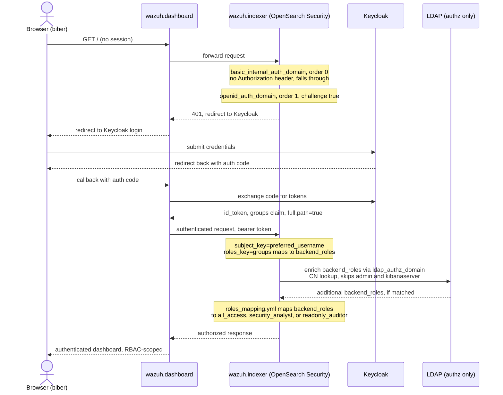

# Wazuh

## Description

[Wazuh](https://wazuh.com/) is an open-source SIEM and XDR platform providing security monitoring, log analysis, intrusion and vulnerability detection, and compliance support.

## Overview

This role deploys the single-node Wazuh stack (`wazuh.manager`, `wazuh.indexer`, `wazuh.dashboard`) with Docker Compose or Docker Swarm.
A one-shot `wazuh-certs-generator` job creates the internal TLS material before the manager and the indexer start.
The indexer is the stack's own datastore and holds the OpenSearch security configuration, so the role needs no shared database.
Agent enrollment is not part of this role: the agent ports are declared in [services.yml](./meta/services.yml) but not published.
The manager's vulnerability detection data (`/var/ossec/queue/vd`, volume `wazuh_manager_vd`) is deliberately not backed up.
The manager downloads it again after a restore, which can take a long time.
This matters once agents are enrolled.

## Features

- **Single-node Wazuh stack:** Manager, indexer, and dashboard at the versions pinned in [services.yml](./meta/services.yml).
- **Native OIDC login:** The dashboard signs users in against Keycloak's discovery endpoint, without an oauth2-proxy sidecar.
- **LDAP authorization:** LDAP group membership adds `backend_roles` to an already authenticated user and is never used to verify a password.
- **Three-tier RBAC:** Administrator, Security Analyst, and Read-only Auditor, declared in [rbac.yml](./meta/rbac.yml) and mapped onto OpenSearch security roles.
- **Generated credentials:** Every service account password and the manager cluster key come from [secrets.yml](./meta/secrets.yml).

## Auth flow

The internal `admin` and `kibanaserver` service accounts authenticate with HTTP basic auth against `internal_users.yml` and bypass OIDC and LDAP.
With `sso` disabled, these two accounts are the only way to sign in.

## RBAC

| Role | OpenSearch role | `backend_roles` (OIDC) | `backend_roles` (LDAP) |
|---|---|---|---|
| Administrator | `all_access` | `/roles/web-app-wazuh/administrator` | `web-app-wazuh-administrator` |
| Security Analyst | `security_analyst` | `/roles/web-app-wazuh/security-analyst` | `web-app-wazuh-security-analyst` |
| Read-only Auditor | `readonly_auditor`, `kibana_read_only` | `/roles/web-app-wazuh/readonly-auditor` | `web-app-wazuh-readonly-auditor` |

- Grant a role by adding the user to the matching Keycloak group or LDAP group.
- A group change applies on the user's next request, because the indexer's auth cache is disabled.
- Only Administrators reach the OpenSearch Dashboards Security app.
- Every role lands on `/app/home` after login.

## Developer Notes

Variant matrix: [variants.yml](./meta/variants.yml). Service flags and image pins: [services.yml](./meta/services.yml). Credentials: [secrets.yml](./meta/secrets.yml). RBAC roles: [rbac.yml](./meta/rbac.yml).

## Further Resources

- [Wazuh Official Website](https://wazuh.com/)
- [Wazuh Documentation](https://documentation.wazuh.com/current/)
- [wazuh-docker GitHub](https://github.com/wazuh/wazuh-docker)
- [Corporate design review: screenshots in light, dark, desktop and mobile](https://claude.ai/artifact/3LsSm8JzVMq6n9iHGwMLUc)
