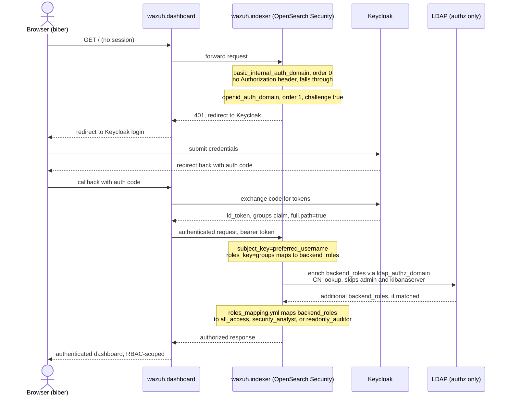

# Wazuh

## Description

[Wazuh](https://wazuh.com/) is an open-source SIEM and XDR platform providing security monitoring, log analysis, intrusion and vulnerability detection, and compliance support.

## Overview

This role deploys the single-node Wazuh stack (`wazuh.manager`, `wazuh.indexer`, `wazuh.dashboard`) with Docker Compose or Docker Swarm.
A one-shot `wazuh-certs-generator` job creates the internal TLS material before the manager and the indexer start.
The indexer is the stack's own datastore and holds the OpenSearch security configuration, so the role needs no shared database.
Agent enrollment is not part of this role: the agent ports are declared in [services.yml](./meta/services.yml) but not published.
The manager's vulnerability detection data (`/var/ossec/queue/vd`, volume `wazuh_manager_vd`) is deliberately not backed up.
The manager downloads it again after a restore, which can take a long time.
This matters once agents are enrolled.

## Features

- **Single-node Wazuh stack:** Manager, indexer, and dashboard at the versions pinned in [services.yml](./meta/services.yml).
- **Native OIDC login:** The dashboard signs users in against Keycloak's discovery endpoint, without an oauth2-proxy sidecar.
- **LDAP authorization:** LDAP group membership adds `backend_roles` to an already authenticated user and is never used to verify a password.
- **Three-tier RBAC:** Administrator, Security Analyst, and Read-only Auditor, declared in [rbac.yml](./meta/rbac.yml) and mapped onto OpenSearch security roles.
- **Wazuh API roles:** Security rules map the Administrator groups onto the Wazuh API `administrator` role and the Security Analyst and Read-only Auditor groups onto the API `readonly` role, so the dashboard's run_as requests carry the matching API permissions.
- **Generated credentials:** Every service account password and the manager cluster key come from [secrets.yml](./meta/secrets.yml).

## Auth flow

The internal `admin` and `kibanaserver` service accounts authenticate with HTTP basic auth against `internal_users.yml` and bypass OIDC and LDAP.
With `sso` disabled, these two accounts and the platform administrator (`internal_users.yml.j2` adds it only then) sign in at the dashboard's basic-auth form.

## Login methods

Each mode offers exactly one sign-in entry, so [services.yml](./meta/services.yml) marks the `sso` key with `# nocheck: login-methods` (see [Login Methods](../../docs/contributing/design/iam/login.md)) instead of declaring `services.wazuh.login.method`:

- With `sso` on, `opensearch_security.auth.type: "openid"` in [opensearch_dashboards.yml.j2](./templates/opensearch_dashboards.yml.j2) sends every visitor to Keycloak; the dashboard renders no form.
- With `sso` off, the dashboard keeps its default basic-auth form for the internal accounts.
- The `ldap` service only adds `backend_roles` (`ldap_authz_domain`) and never verifies a password, so the stack has no LDAP sign-in.

Break-glass access while `sso` is on runs over HTTP basic auth against the indexer's `basic_internal_auth_domain` (order 0, `challenge: false`) with the internal `admin` account, for example `curl -k -u admin:<indexer_admin_password> https://<host>:<services.indexer.ports.local.http>/_plugins/_security/authinfo`; the indexer port is published on `DOCKER_BIND_HOST` only, so this path runs from the host, not from a browser.

## RBAC

| Role | OpenSearch role | `backend_roles` (OIDC) | `backend_roles` (LDAP) |
|---|---|---|---|
| Administrator | `all_access` | `/roles/web-app-wazuh/administrator` | `web-app-wazuh-administrator` |
| Security Analyst | `security_analyst` | `/roles/web-app-wazuh/security-analyst` | `web-app-wazuh-security-analyst` |
| Read-only Auditor | `readonly_auditor`, `kibana_read_only` | `/roles/web-app-wazuh/readonly-auditor` | `web-app-wazuh-readonly-auditor` |

- Grant a role by adding the user to the matching Keycloak group or LDAP group.
- A group change applies on the user's next request, because the indexer's auth cache is disabled.
- Only Administrators reach the OpenSearch Dashboards Security app.
- Every role lands on `/app/home` after login.

## LDAP coverage

No Playwright scenario gates on `ldap`, and [services.yml](./meta/services.yml) exempts the flag from the Playwright service-flag check. The indexer configures LDAP only as `ldap_authz_domain`, which adds `backend_roles` to a user Keycloak or `internal_users.yml` already authenticated, so the stack has no LDAP-bind login to drive: with `sso` on every directory account signs in through Keycloak, which [files/playwright/test-rbac-roles.js](./files/playwright/test-rbac-roles.js) covers, and with `sso` off only the internal `admin` and `kibanaserver` accounts can sign in.

## Developer Notes

Variant matrix: [variants.yml](./meta/variants.yml). Service flags and image pins: [services.yml](./meta/services.yml). Credentials: [secrets.yml](./meta/secrets.yml). RBAC roles: [rbac.yml](./meta/rbac.yml).

## Biber coverage

No `biber:` assertion pins the application role that [`meta/rbac.yml`](./meta/rbac.yml) offers biber: none checks a role-scoped element or the absence of an admin-scoped one, so the scenarios prove the non-admin sign-in but not the role it maps to. A follow-up tightens them.

## Further Resources

- [Wazuh Official Website](https://wazuh.com/)
- [Wazuh Documentation](https://documentation.wazuh.com/current/)
- [wazuh-docker GitHub](https://github.com/wazuh/wazuh-docker)
- [Corporate design review: screenshots in light, dark, desktop and mobile](https://claude.ai/artifact/3LsSm8JzVMq6n9iHGwMLUc)
