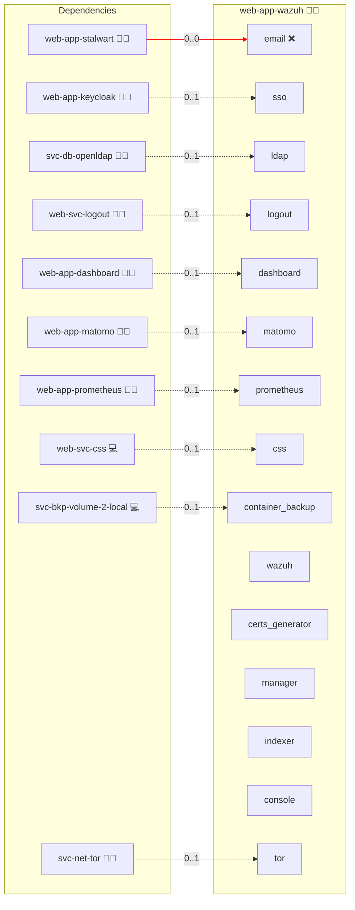
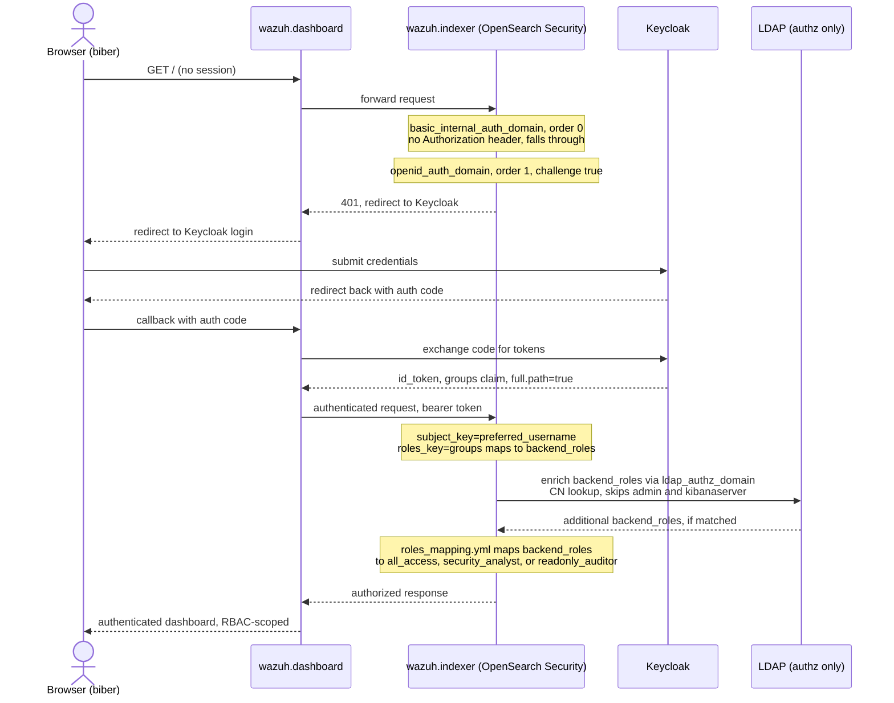

# Wazuh

## Description

[Wazuh](https://wazuh.com/) is an open-source SIEM and XDR platform providing security monitoring, log analysis, intrusion and vulnerability detection, and compliance support.

## Overview

This role deploys the single-node Wazuh stack (`wazuh.manager`, `wazuh.indexer`, `wazuh.dashboard`) with Docker Compose or Docker Swarm.
A one-shot `wazuh-certs-generator` job creates the internal TLS material before the manager and the indexer start.
The indexer is the stack's own datastore and holds the OpenSearch security configuration, so the role needs no shared database.
The manager's agent event port is published on `DOCKER_BIND_HOST` only. The enrollment service (`1515`) is on, because the manager API registers agents through it, but it requires the vault password `authd_password` and is reachable only inside the stack; agents are pre-registered through the manager API.
Each deploy registers the host's agent (id `001`) with its vault key `agent_key` and replaces the registration when the name or key differs, so rotating `agent_key` and redeploying revokes the old key.
The manager writes raw events to `archives.json` (`logall_json`) in development and CI only; archive indexing into `wazuh-archives-*` stays at the Wazuh default (off) everywhere.
The manager's vulnerability detection data (`/var/ossec/queue/vd`, volume `wazuh_manager_vd`) is deliberately not backed up.
The manager downloads it again after a restore, which can take a long time.
This matters once agents are enrolled.

## Custom ruleset

Every role in the inventory that enables the `wazuh` service may ship `files/wazuh/decoders.xml` and `files/wazuh/rules.xml`; both are optional.
The deploy copies them as `<entity>_decoders.xml` and `<entity>_rules.xml` into `ruleset/decoders` and `ruleset/rules` under the instance directory, deletes files of roles that no longer opt in, and mounts that directory read-only at `/var/ossec/infinito`, which `ossec.conf` loads through its own `<decoder_dir>` and `<rule_dir>`.
The mount sits outside every path the image seeds or overwrites at start, so the deploy alone decides which files are active; the default ruleset and `etc/rules/local_rules.xml` stay untouched.
Before the manager restarts, the deploy checks that the `wazuh` user can read every file and runs `wazuh-analysisd -t`. If either fails, the previous files are restored, the manager keeps running on its loaded ruleset, and the deploy fails with the test output.
If a step fails after the manager has already restarted onto the new files, the previous files are restored, the manager is restarted again onto them, and the deploy fails.

### Base decoders, base rules and canary

The deploy renders the base files into `ruleset/base/decoders` and `ruleset/base/rules`, which `ossec.conf` lists before the app directories, so every parent exists before an app file refers to it.
For each opted-in tag (the role's entity name, set as the journald `tag` by `sys-svc-container`) the base holds a parent decoder `infinito-<entity>` that matches `program_name` exactly, and a level 0 parent rule with the first ID of the role's rule block.
A role's `decoders.xml` holds only children with `<parent>infinito-<entity></parent>`; its `rules.xml` holds only rules chained by `<if_sid>` or `<if_matched_sid>` to IDs inside its own block.

After every deploy, `wazuh-logtest -U` sends one canary line per tag, `<tag>[1]: INFINITO_WAZUH_CANARY deploy`, through the running manager and requires canary rule `100110` at level 3 (the alert threshold) with the tag's parent decoder.
The reserved tag `infinito-selftest` always takes part, so the check also runs while no role opts in. A canary that does not fire fails the deploy and rolls the ruleset back.

### Rule IDs

Custom rules use the Wazuh range 100000-120000:

| Range | Use |
|---|---|
| 100000-100099 | Reserved: Wazuh examples, `etc/rules/local_rules.xml` uses 100001 |
| 100100-100999 | Base: `100100` self-test parent, `100110` canary |
| 101000-118999 | App blocks of 100 IDs; the first ID is the central parent rule |
| 119000-119999 | Tests and drills, never shipped |

A role that opts in declares its block start in `meta/services.yml`, next to the flag:

```yaml
wazuh:
  enabled: true
  rule_block: 101000
```

The lint `tests/lint/ansible/services/test_wazuh_rule_block.py` fails on a missing block, a block outside 101000-118999, overlapping blocks, a rule ID outside its own block or on its parent ID, a rule without a chain into its own block, a decoder with a foreign parent, and the reserved entity name `infinito-selftest`.

### Samples

Each opted-in role ships `files/wazuh/samples.yml`, a list of events with the rule and level they must hit:

```yaml
- log: "user alice failed to log in"
  rule: 101001
  level: 5
- log: "unrelated message"
  rule: 101000
  level: 0
- log:
    - "user alice failed to log in"
    - "user alice failed to log in"
  rule: 101002
  level: 10
```

`log` is the message after the syslog header: the deploy prefixes every line with a header carrying the role's tag, so the role's own parent decoder is implied.
A negative or injection sample expects the role's parent rule (the block start) at level 0.
After the canary, it sends each sample through `wazuh-logtest -U <rule>:<level>:<decoder>` in its own session and fails the deploy, with the role, the sample and the logtest output, when one does not match; the rollback then restores the previous ruleset.
A sample whose `log` is a list is sent as one session and only its last line is checked, which is how `-U` reports.
Each sample costs about 2 s of deploy time: about 1.3 s for the logtest session itself, the rest for the Ansible loop item.
This role's own `files/wazuh/samples.yml` holds the self-test samples, the only ones that may use the base range.

The same lint checks that every sample's rule lies in the role's own block (the base range for this role), that `level` is an integer and `log` a single line, that a list has at least two lines and is used only for a correlation rule (`frequency`, `if_matched_sid`, `if_matched_group`), and that every rule ID in `rules.xml` has at least one sample.

## Cosmos

The diagram places Wazuh in the Infinito.Nexus cosmos: the components it deploys (capabilities), the central services it consumes (dependencies), and its outward reach (federation and bridged external networks).



Solid `1:1` edges are fixed relationships; dashed `0..1` edges are conditional (enabled only in matching deployments); red `0..0` edges are turned off in this role. Node markers show the role's deploy modes (💻 host, 🐳 compose, 🐝 swarm); ❌ marks a service that is explicitly turned off, and ⚙️ an Ansible role dependency declared in `meta/main.yml`.

## Features

- **Single-node Wazuh stack:** Manager, indexer, and dashboard at the versions pinned in [services.yml](./meta/services.yml).
- **Native OIDC login:** The dashboard signs users in against Keycloak's discovery endpoint, without an oauth2-proxy sidecar.
- **LDAP authorization:** LDAP group membership adds `backend_roles` to an already authenticated user and is never used to verify a password.
- **Three-tier RBAC:** Administrator, Security Analyst, and Read-only Auditor, declared in [rbac.yml](./meta/rbac.yml) and mapped onto OpenSearch security roles.
- **Generated credentials:** Every service account password and the manager cluster key come from [secrets.yml](./meta/secrets.yml).

## Quick Setup

### Development

Clone, set up the workstation, and deploy Wazuh onto the local stack:

```bash
git clone https://github.com/infinito-nexus/core.git
cd core
make onboard
make compose-deploy mode=reinstall apps=web-app-wazuh full_cycle=false
```

### Production

Run the published image to provision the inventory and deploy Wazuh to a managed server (the mounted volume persists the inventory):

```bash
APP=web-app-wazuh
HOST=<your-server>
DOMAIN=<your-domain>
TLS_MODE=self_signed
SSH_PUBLIC_KEY="<your-ssh-public-key>"

docker run --rm -it \
  -v "$PWD/inventories:/etc/infinito.nexus/inventories" \
  -e APP="$APP" -e HOST="$HOST" -e DOMAIN="$DOMAIN" -e TLS_MODE="$TLS_MODE" -e SSH_PUBLIC_KEY="$SSH_PUBLIC_KEY" \
  ghcr.io/infinito-nexus/core/debian bash -c '
    INVENTORY=/etc/infinito.nexus/inventories/production
    infinito administration inventory provision "$INVENTORY" \
      --inventory-file "$INVENTORY/devices.yml" \
      --host "$HOST" \
      --include "$APP" \
      --vars "{\"TLS_MODE\": \"$TLS_MODE\", \"DOMAIN_PRIMARY\": \"$DOMAIN\", \"users\": {\"administrator\": {\"authorized_keys\": [\"$SSH_PUBLIC_KEY\"]}}}" &&
    infinito administration deploy dedicated "$INVENTORY/devices.yml" \
      --password-file "$INVENTORY/.password" \
      --diff -vv'
```

## Auth flow



The internal `admin` and `kibanaserver` service accounts authenticate with HTTP basic auth against `internal_users.yml` and bypass OIDC and LDAP.
With `sso` disabled, these two accounts are the only way to sign in.

## RBAC

| Role | OpenSearch role | `backend_roles` (OIDC) | `backend_roles` (LDAP) |
|---|---|---|---|
| Administrator | `all_access` | `/roles/web-app-wazuh/administrator` | `web-app-wazuh-administrator` |
| Security Analyst | `security_analyst` | `/roles/web-app-wazuh/security-analyst` | `web-app-wazuh-security-analyst` |
| Read-only Auditor | `readonly_auditor`, `kibana_read_only` | `/roles/web-app-wazuh/readonly-auditor` | `web-app-wazuh-readonly-auditor` |

- Grant a role by adding the user to the matching Keycloak group or LDAP group.
- A group change applies on the user's next request, because the indexer's auth cache is disabled.
- Only Administrators reach the OpenSearch Dashboards Security app.
- Every role lands on `/app/home` after login.

## Developer Notes

Variant matrix: [variants.yml](./meta/variants.yml). Service flags and image pins: [services.yml](./meta/services.yml). Credentials: [secrets.yml](./meta/secrets.yml). RBAC roles: [rbac.yml](./meta/rbac.yml).

## Further Resources

- [Wazuh Official Website](https://wazuh.com/)
- [Wazuh Documentation](https://documentation.wazuh.com/current/)
- [wazuh-docker GitHub](https://github.com/wazuh/wazuh-docker)

## Credits

Implemented by **[Prageeth Panicker](https://github.com/pragepani)**.
Part of the [Infinito.Nexus Project](https://s.infinito.nexus/code) and maintained by [Kevin Veen-Birkenbach](https://www.veen.world).
Licensed under the [Infinito.Nexus Community License (Non-Commercial)](https://s.infinito.nexus/license).
