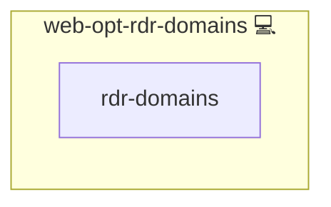

# Redirector

## Description

This Ansible role configures NGINX to perform 301 redirects from one domain to another. It handles SSL certificate retrieval for the source domains and sets up the NGINX configuration to redirect to the specified target domains.

## Overview

This role configures Nginx to perform 301 redirects based on a list of source→target domain mappings. Each source is served on every network sibling, and each sibling redirects to the target's sibling in the same network.

Extra mappings go into the inventory as `services.rdr-domains.redirects` of this role. A source may be a whole zone through `*.<zone>`, and `keep_path: false` sends every request to the bare target instead of appending its path:

```yaml
applications:
  web-opt-rdr-domains:
    services:
      rdr-domains:
        redirects:
          - source: legacy.example
            target: example.org
            keep_path: false
          - source: "*.legacy.example"
            target: example.org
            keep_path: false
```

A caller that includes the role with its own `web_opt_rdr_domains_mappings` renders only that list; without it the role renders `CURRENT_PLAY_REDIRECT_DOMAINS`, which holds these redirects, the primary domain's redirect to the homepage and every application alias.

## Cosmos

The diagram places Redirector in the Infinito.Nexus cosmos: the components it deploys (capabilities), the central services it consumes (dependencies), and its outward reach (federation and bridged external networks).



Solid `1:1` edges are fixed relationships; dashed `0..1` edges are conditional (enabled only in matching deployments); red `0..0` edges are turned off in this role. Node markers show the role's deploy modes (💻 host, 🐳 compose, 🐝 swarm); ❌ marks a service that is explicitly turned off, and ⚙️ an Ansible role dependency declared in `meta/main.yml`.

## Features

- **Automated provisioning:** Configured by Ansible without manual steps.
- **Well-known passthrough:** every source domain serves the files of its own subdirectory `<domain>/` of the shared well-known directory (`lookup('nginx', 'directories.data.well_known')`) under `/.well-known/`; any other request, a missing well-known file included, gets the 301.
