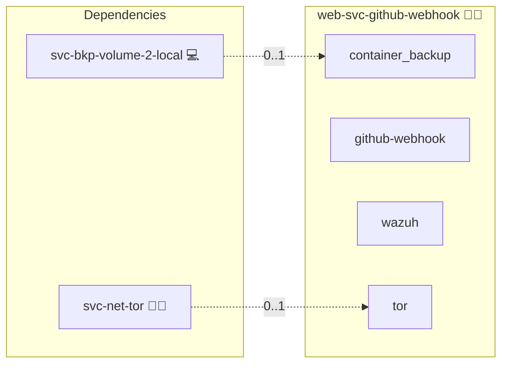

# GitHub Webhook Receiver

## Description

GitHub webhooks notify an HTTP endpoint about events in a repository or organization: pushes, branch protection and ruleset changes, new collaborators and deploy keys, and secret-scanning and Dependabot alerts.
Each delivery is signed with a shared secret (`X-Hub-Signature-256`), so the endpoint can prove it came from GitHub.

## Overview

This role runs a small receiver that accepts GitHub's signed deliveries and turns the security-relevant ones into Wazuh alerts.
It verifies the signature in constant time, refuses replayed, oversized, unsigned and malformed requests, and prints one JSON line per request and per event to stdout.
Journald tags that output with the role's entity name, and the host's Wazuh agent forwards it like every other opted-in app, so the rules in [rules.xml](./files/wazuh/rules.xml) (block 101100) raise the alerts.
It is the webhook alternative to Wazuh's GitHub module, which needs a GitHub Enterprise Cloud audit log.

## Cosmos

The diagram places GitHub Webhook Receiver in the Infinito.Nexus cosmos: the components it deploys (capabilities), the central services it consumes (dependencies), and its outward reach (federation and bridged external networks).



Solid `1:1` edges are fixed relationships; dashed `0..1` edges are conditional (enabled only in matching deployments); red `0..0` edges are turned off in this role. Node markers show the role's deploy modes (💻 host, 🐳 compose, 🐝 swarm); ❌ marks a service that is explicitly turned off, and ⚙️ an Ansible role dependency declared in `meta/main.yml`.

## Features

- **Signature check:** HMAC-SHA256 over the raw body with the vault-generated secret, compared with `hmac.compare_digest`; a missing header, a SHA-1 header or a wrong digest is refused with 401.
- **Replay guard:** every accepted `X-GitHub-Delivery` ID is kept for 7 days in a SQLite file on the `github_webhook_state` volume; a second delivery with the same ID is refused with 409.
- **Size limit:** bodies above 5 MiB are read and discarded, then refused with 413, so the client and the proxy get a clean status; the proxy allows 6 MiB, so the receiver still sees and alerts on the refusal.
- **Allowlisted fields only:** each event is reduced to `gh_`-prefixed fields (event, action, delivery, repository, sender, ref, flags, member, key title, alert number, severity, package, URL); no raw payload and no secret value reaches the log.
- **Organization-wide:** one organization webhook covers every repository; every event line (`delivery` and `direct_push`) carries `gh_repo`. Refused and access lines carry no repository, because a refused payload is not trusted and an access line has none.
- **Default branch per repository:** the branch rules apply to each repository's own default branch, read from `repository.default_branch` in the `push` and `delete` payload and logged as `gh_default_branch`; a payload without a repository never counts as a push to a default branch.
- **Direct push check:** for every push to a default branch, the receiver asks GitHub which pull requests contain each pushed commit and alerts when one has no merged pull request into that branch.
- **Hardened container:** read-only root filesystem, all capabilities dropped, `no-new-privileges`, Python standard library only.

### Rules

| Rule | Level | Event |
|---|---|---|
| 101101 | 3 | Any accepted delivery (context) |
| 101110 | 12 | Force push to a repository's default branch |
| 101111 | 12 | A repository's default branch was deleted |
| 101112 | 8 | Workflow files changed on a default branch |
| 101113 | 12 | Commits on a default branch without a merged pull request |
| 101114 | 7 | The direct push check could not run (no token, expired or revoked token, lookup failed, more than 50 commits) |
| 101120 | 10 | Branch protection rule created, edited or deleted |
| 101121 | 10 | Ruleset created, edited or deleted |
| 101130 | 10 | Collaborator added or their permission changed |
| 101131 | 10 | Organization member added or invited |
| 101132 / 101133 | 10 / 12 | Deploy key added, read-only / with write access |
| 101140 | 12 | Secret-scanning alert created or reopened |
| 101141 / 101142 | 10 / 7 | Dependabot alert created or reopened, critical or high / medium or low |
| 101160 | 10 | Delivery refused: unsigned or wrong signature |
| 101161 | 8 | Delivery refused: replayed delivery ID |
| 101162 | 6 | Delivery refused: oversized |
| 101163 | 5 | Request refused: malformed |

### Direct push detection

A push to a repository's default branch is checked commit by commit through `GET /repos/{repo}/commits/{sha}/pulls`.
A commit counts as reviewed when a pull request with `merged_at` set and that default branch as its base lists it.
GitHub links the commits of merge, squash and rebase merges to their pull request, so all three merge methods pass.
GitHub can take a few seconds to link a fresh merge, so a commit is asked about four times, ten seconds apart, before it counts as a direct push.

Limits:

- A commit that already belongs to a merged pull request into the default branch passes, even if someone pushes it again directly later.
- A merge that bypassed required reviews still has a pull request and passes here; review enforcement is checked by the settings check.
- A push of more than 50 new commits is not checked commit by commit; it raises rule 101114 instead.
- Without a working token, every push to a default branch raises rule 101114, so a missing, expired or revoked token is never silent.

## Quick Setup

### Development

Clone, set up the workstation, and deploy GitHub Webhook Receiver onto the local stack:

```bash
git clone https://github.com/infinito-nexus/core.git
cd core
make onboard
make compose-deploy mode=reinstall apps=web-svc-github-webhook full_cycle=false
```

### Production

Run the published image to provision the inventory and deploy GitHub Webhook Receiver to a managed server (the mounted volume persists the inventory):

```bash
APP=web-svc-github-webhook
HOST=<your-server>
DOMAIN=<your-domain>
TLS_MODE=self_signed
SSH_PUBLIC_KEY="<your-ssh-public-key>"

docker run --rm -it \
  -v "$PWD/inventories:/etc/infinito.nexus/inventories" \
  -e APP="$APP" -e HOST="$HOST" -e DOMAIN="$DOMAIN" -e TLS_MODE="$TLS_MODE" -e SSH_PUBLIC_KEY="$SSH_PUBLIC_KEY" \
  ghcr.io/infinito-nexus/core/debian bash -c '
    INVENTORY=/etc/infinito.nexus/inventories/production
    infinito administration inventory provision "$INVENTORY" \
      --inventory-file "$INVENTORY/devices.yml" \
      --host "$HOST" \
      --include "$APP" \
      --vars "{\"TLS_MODE\": \"$TLS_MODE\", \"DOMAIN_PRIMARY\": \"$DOMAIN\", \"users\": {\"administrator\": {\"authorized_keys\": [\"$SSH_PUBLIC_KEY\"]}}}" &&
    infinito administration deploy dedicated "$INVENTORY/devices.yml" \
      --password-file "$INVENTORY/.password" \
      --diff -vv'
```

## GitHub setup

An owner of the `infinito-nexus` organization sets this up:

1. Add an organization webhook (organization settings, Webhooks), so every repository and the membership events are covered:
   - Payload URL: `https://github-webhook.<your-domain>/github`
   - Content type: `application/json`
   - Secret: the role's `webhook_secret` credential from the inventory vault
   - SSL verification: enabled
   - Events: Branch protection rules, Deploy keys, Dependabot alerts, Branch or tag deletion, Collaborator add, remove, or changed, Organization, Pushes, Repository rulesets, Secret scanning alerts
2. Create a fine-grained personal access token on a dedicated bot account that is a member of the organization, never on a personal account:
   - Resource owner `infinito-nexus`, access to all repositories the webhook covers
   - Read-only permissions: Contents, Metadata, Pull requests
   - An expiry date; renew the token before it expires, because an expired token makes every push to a default branch raise rule 101114
   - Put it into the inventory vault as the role's `github_webhook_token` credential. The settings check gets its own token with Administration read, under a separate credential.
3. Use GitHub's "Recent Deliveries" page to check that a ping reaches the receiver with HTTP 202.

## Developer Notes

[test.sh](./files/test/test.sh) runs after each deploy: it signs every watched event the way GitHub does, sends it to the deployed receiver and waits for its alert, checks every refusal the same way, and proves the direct push rule with a throwaway second receiver that asks a local GitHub API stub instead of `api.github.com`.
The receiver's logic is unit-tested in `tests/unit/python/roles/web-svc-github-webhook/files/test_receiver.py`.

## Credits

Implemented by **[Prageeth Panicker](https://github.com/pragepani)**.
Part of the [Infinito.Nexus Project](https://s.infinito.nexus/code) and maintained by [Kevin Veen-Birkenbach](https://www.veen.world).
Licensed under the [Infinito.Nexus Community License (Non-Commercial)](https://s.infinito.nexus/license).
