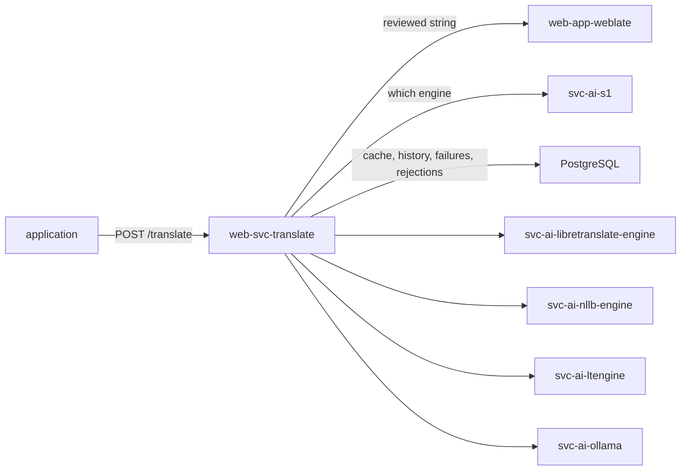

# Translation Gateway

## Description

One translation endpoint for every application in the deployment. It speaks the [LibreTranslate](https://libretranslate.com) API, chooses which engine answers, remembers which engine won earlier comparisons, caches what it has already paid for, and returns a reviewed human translation ahead of any machine output.

## Overview

The gateway is published at `api.translate.{{ DOMAIN_PRIMARY }}`. An application points at that one URL; anything that already speaks to LibreTranslate works unchanged.

Four backends are declared as consumer entries in `meta/services.yml`, each switched on by deploying the role that provides it:

| Backend | Provider | Reached over |
| --- | --- | --- |
| `libretranslate-engine` | [`svc-ai-libretranslate-engine`](../svc-ai-libretranslate-engine/) | the LibreTranslate API |
| `nllb` | [`svc-ai-nllb-engine`](../svc-ai-nllb-engine/) | FLORES-200 codes, mapped from ISO 639-1 by `translate_gateway/flores.py` |
| `ltengine` | [`svc-ai-ltengine`](../svc-ai-ltengine/) | the LibreTranslate API |
| `ollama` | [`svc-ai-ollama`](../svc-ai-ollama/) | the chat API of [`svc-ai-litellm`](../svc-ai-litellm/), as a prompt |

`nllb` serves 136 of the 184 languages of `meta/languages.yml` and refuses the other 48, which NLLB-200 has no language code for; `flores.py` names them. It also refuses a request without a source language, because NLLB carries no detector.

## Reading the memory

The gateway authenticates to Weblate with the API token [`web-app-weblate`](../web-app-weblate/) writes to the token store after its own deploy. A web service is deployed before the web applications, so on the very first run of a fresh deployment that token does not exist yet: the gateway starts without a memory and answers from the engines. The next deploy renders the stored token and the reviewed strings take precedence from then on.

## Features

- **One API:** `POST /translate`, `POST /detect` and `GET /languages` in LibreTranslate's request and response shapes.
- **Reviewed strings win:** a string approved in [`web-app-weblate`](../web-app-weblate/) is returned verbatim and no engine is called.
- **Engine choice that learns:** with [`svc-ai-s1`](../svc-ai-s1/) deployed the router asks the decider which engine should answer, states each engine's record in the criteria, and after a configured number of comparisons routes straight to the leader. A settled request is still compared again now and then, so a verdict the engines have outgrown does not hold for good: `resample_interval` is read under the same `sample_trigger` as `sample_interval`, so it means every Nth settled request (`requests`, counted across all settled signatures together, not per signature), a one in N chance per settled request (`probability`), or at most one comparison every N seconds (`seconds`).
- **Three separate counts:** an engine that fails, an engine whose answer is rejected for a mangled protected span, and an engine that loses a comparison are counted apart, and the criteria line of the next decision names each. A failure is counted per engine, a rejection per engine and language pair, so a pair an engine keeps mangling steers the choice away from it without costing it the pairs it serves well. A store that cannot be read is logged and the decision goes on without it.
- **Blind verdict:** while sampling, several engines answer the same request and the decider picks between the translations alone, labelled `option-0`, `option-1`, …, never by engine name.
- **Glossary protection:** a term the glossary protects must survive the translation; an answer that drops it is rejected rather than cached.
- **Loud failure:** with no engine able to answer, the gateway returns an error. It never hands the untranslated source text back as a translation.

## Schema



## Boundary

The gateway answers every translation request at request time: the content users put into the applications, and the batches `make i18n-translate` sends. Two neighbouring mechanisms keep their own ground:

- The catalogue run in `cli/build/i18n` extracts strings into gettext catalogues and fills them through `make i18n-translate`, which always goes through this gateway, because whether an engine keeps a masked span intact is a property of the engine and the language pair, which only a comparison across engines can learn. What the run writes into a catalogue, and which answer it discards, stays with the run; see [Catalogue runs](#catalogue-runs).
- The core surfaces, [`web-app-docs`](../web-app-docs/), [`web-app-dashboard`](../web-app-dashboard/) and the logout panel of [`web-app-keycloak`](../web-app-keycloak/), read those catalogues when they are built or rendered and never call this gateway.

None of the three is used to fix a defect that belongs to another.

## Catalogue runs

Every repository translates its gettext catalogues through this gateway with core's `make i18n-translate`:

```bash
make i18n-translate root=<repo> domain=<domain> gateway=<url>
```

- **`root`:** the directory whose `locale/` holds the catalogues; empty means core itself.
- **`domain`:** the catalogue name. The English source is `<root>/locale/<domain>.yml`, the catalogue of each language `<root>/locale/<code>/LC_MESSAGES/<domain>.po`, and every message sits under the `msgctxt` `<domain>:<key>`. Core's own domains are `core` and `docs`.
- **`gateway`:** the base URL of the shared gateway, used as it is and never deployed from the run; a gateway that names no language stops the run. `make infra-status` prints it as `http://127.0.0.1:<INFINITO_TOOLS_TRANSLATE_PORT>`, the only tools port the infra runner publishes. Without `gateway`, the run deploys the bundle into the infra runner when no gateway answers.

On a development machine the gateway and its engines run once per machine inside the infra runner, see [cache.md](../../docs/contributing/environment/cache.md). `make i18n-translate`, `make i18n-tune` and `make test-oracle` start them on demand, and every run of these targets is stamped in `INFINITO_TOOLS_STAMP_DIR` (default `<DIR_CACHE>/tools`). A systemd timer inside the infra runner stops the tools once `INFINITO_TOOLS_IDLE_GRACE` (default `2h`) has passed since the last run ended and no run is live; the caches beside them keep running. `make i18n-pause` and `make i18n-resume` pause and resume the tools alone.

## Further resources

- [LibreTranslate API](https://libretranslate.com/docs/)
